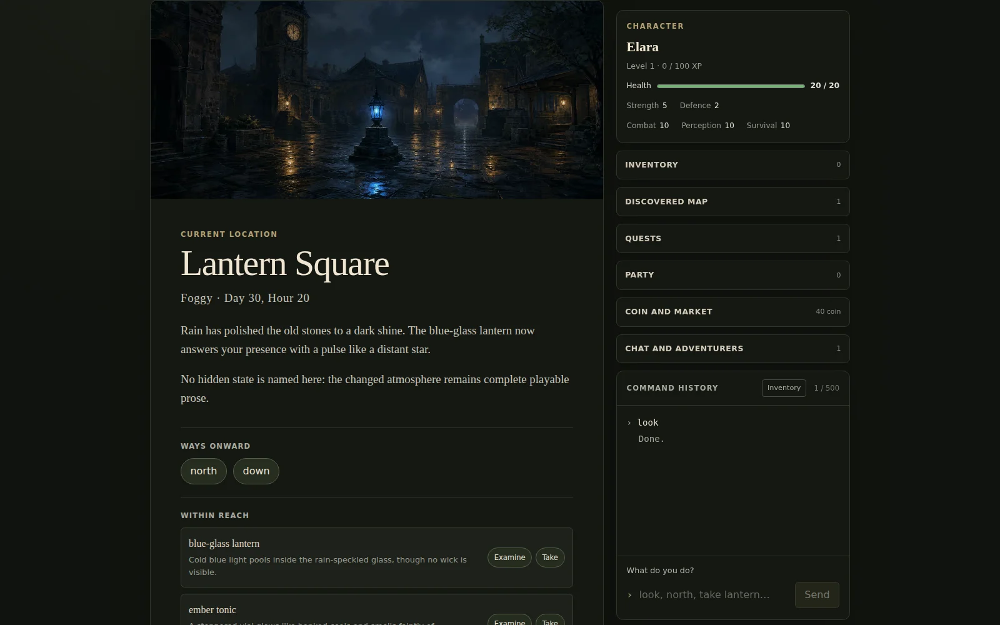
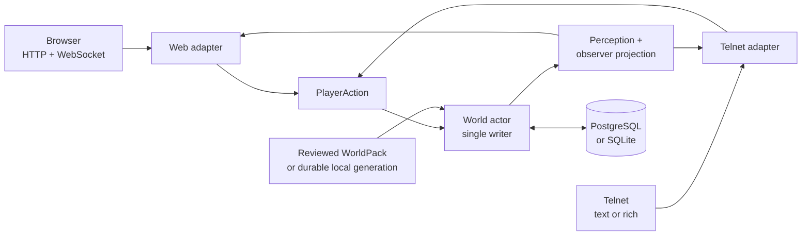
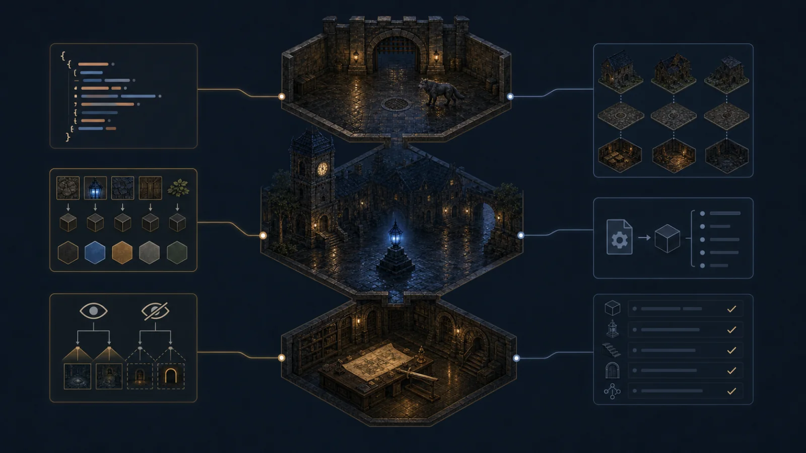

<h1 align="center">
  
</h1>

<p align="center">
  <a href="https://github.com/hyukudan/tiamud/actions/workflows/ci.yml"></a>
  <a href="#license"></a>
  <a href="https://www.rust-lang.org/"></a>
</p>


**A browser-first multiplayer narrative engine that is fully playable as text.**

Tiamud is a pre-release Rust engine for building persistent multiplayer worlds.
It is inspired by EnvyMUD, Merc and the classic MUD tradition, but it is a new
implementation. The official web client adds atmospheric artwork, audio and
accessible controls; every fact and every playable action stays available
through prose and structured state. A plain Telnet client remains a
first-class way to play.

The project is designed for a **single machine** first. One process serves the
world, the browser and Telnet on an ordinary host. PostgreSQL is the
recommended profile for a fresh public install; SQLite is the implemented,
zero-configuration path for development, local play and compatibility. Each
server opens exactly one persistence system and never writes to both. The
baseline needs no Kubernetes, Redis, object storage or AI.

> Tiamud is under active development. Automated coverage is broad, but there is
> still no public production deployment and no stable protocol version. The
> [completion matrix](docs/project/COMPLETION_MATRIX.md) distinguishes
> implementation, retained evidence and pending acceptance.

## Contents

- [What works today](#what-works-today)
- [Architecture](#architecture)
- [Quick start](#quick-start)
- [Single-machine deployment](#single-machine-deployment)
- [Characters, classes and progression](#characters-classes-and-progression)
- [Social, staff and inventory systems](#social-staff-and-inventory-systems)
- [Scenes and media](#scenes-and-media)
- [Authoring: WorldPack and AreaPack](#authoring-worldpack-and-areapack)
- [Accessibility and security](#accessibility-and-security)
- [Optional AI](#optional-ai)
- [Verification](#verification)
- [Status and roadmap](#status-and-roadmap)
- [Repository map](#repository-map)
- [Documentation](#documentation)
- [Contributing](#contributing)
- [License](#license)

## What works today

- **Persistent world:** accounts, characters, rooms, objects, NPCs, equipment,
  combat, quests, parties, economy, logical time and weather. Objects separate
  reusable prototypes from durable instances, with slot/weight capacity, derived
  fungible stacks, bounded containers, fixed and repeatable loot, `give`,
  transfer policies and confirmed bilateral trade.
- **Data-defined characters:** the v3 model captures lineages, optional
  background, base and advanced classes, a global XP curve, ranked talents and
  atomic promotions. Attributes, resources, resistances, cooldowns and states
  are all bounded.
- **Groups and conversation:** local `say`, online `tell`/`reply`, authored
  direct telepathy as an ability, world-defined room emotes, bounded group chat
  and lifecycle, `general`/`newbie`/`staff` channels, private offline mail and
  public `general`/`newbie` boards. Spatial voice `yell`/`shout` (phase 5E) uses
  a directed, bounded radius without revealing world topology.
- **Capability-based staff:** five operational profiles, twelve closed
  capabilities, a report queue/resolution flow, diagnostic/repair actions and an
  append-only audit. Neither narrative title, XP, class, WorldPack nor the legacy
  role authorizes commands.
- **One authoritative path:** browser and Telnet produce the same
  `PlayerAction`, pass through the same rules and mutate a single world actor.
- **Web and terminal clients:** Svelte 5 installable as a PWA; plain/ANSI
  Telnet; optional GMCP, MSSP, MCCP2, MXP/MSLP; TinTin++ and Mudlet integrations.
- **Safe media:** optional scene image and audio, immutable content-addressed
  assets, alternative text and preferences for media, motion, contrast and
  screen readers.
- **Modular authoring:** AreaPack v9 splits a world into areas; the offline
  composition of WorldProject v2 produces a canonical WorldPack v10, which also
  declares quests, commodities and shops as data. Phases 6A–6C
  add verifiable catalogs/bundles, catalog boot with additive on-demand loading,
  and quiescent replacement of a whole generation. Phase 6D, **partial**, adds
  reversible retirement of same-generation SCC units with a durable checkpoint;
  an RSS budget, LRU and an operator surface are still missing.
- **Single-host operation:** PostgreSQL/SQLite adapters, Argon2id credentials,
  revocable sessions, bounded queues, health, Prometheus metrics, graceful
  shutdown and an explicit move to PostgreSQL.

Per-phase status and exact figures live in the
[completion matrix](docs/project/COMPLETION_MATRIX.md).



## Architecture



Four boundaries keep the engine flexible:

1. **Transports parse; the domain decides.** A structured browser action is not
   a shortcut around the rules.
2. **One writer owns the world.** Bounded queues and durable checkpoints order
   state; if persistence fails, the previous in-memory state is restored
   exactly.
3. **Perception precedes protocol.** Hidden variants and stable IDs never leave
   the server. Each session receives opaque IDs and only authorized facts.
4. **Presentation is replaceable.** Text, terminal color, images, audio and
   visual composition all represent the same semantic state.

The experimental browser contract is documented in
[`tiamud.v1`](docs/protocol/tiamud-v1.md). On a sequence gap the client requests
an authoritative snapshot; it never invents state or blindly replays actions.

## Quick start

You need Git, `rustup`, a C/C++ compiler/linker, CMake, Node.js 20.19+ (or
22.12+) and pnpm 10+. The load and soak tooling requires Node.js 24. Node and
pnpm are used only to build the client, not as services of the compiled server.

```sh
git clone https://github.com/hyukudan/tiamud.git
cd tiamud
pnpm --dir apps/web install --frozen-lockfile
pnpm --dir apps/web build
TIAMUD_TELNET_MODE=plaintext cargo run --locked -p tiamud-server
```

Open <http://127.0.0.1:8080> or connect Telnet to `127.0.0.1:4000`. The Rust
server bundles the web build and the reviewed Lantern Square WorldPack.

Single-player StoryPack sessions (phase S2, with persisted save slots and an
autosave from phase S3) are off by default. To try the sample gamebook and menu adventure locally, add
`TIAMUD_STORY_DIR=crates/story-core/fixtures` to the command above, then type
`historias` and `historia cripta-del-nigromante` (or `story lluvia-de-neon`,
which shows the reviewed sample backgrounds and portraits in the browser;
`historia lluvia-de-neon en` plays it in English) in the browser or Telnet. See
[ADR 0029](docs/decisions/0029-story-session-instances-and-story-protocol.md)
and [single-host operation](docs/operations/single-host.md#story-sessions).

> Unencrypted Telnet is a local-development exception. It must not be exposed to
> the internet: registration and login would travel in the clear. Telnet TLS is
> the default mode and fails closed without a valid certificate and key.

Representative commands:

```text
look / examine <target>     north / east / south / west
inventory                   take / drop / put / get [quantity] <item>
equip / unequip <target>    give [quantity] <item> to <character>
loot / loot pass            trade request / offer / confirm <...>
attack <target>             ability / cast <id> [target]
promote <class-id>          talent learn <graph-id> <node-id>
quest ...                   party create / invite / accept / say
say / tell / reply          who / help / ignore / block
telepathy <ability-id> <character> <message>
emote <command> [character] channel say <channel> <text>
yell / shout <message>      balance / shop / buy ...
staff ...                   mail send <character> | <subject> | <body>
board post <board> | <subject> | <body>
```

The full surface of staff, mail and board commands is in the
[operations guide](docs/operations/single-host.md) and the
[authoring guide](docs/authoring/README.md).

## Single-machine deployment

| Layer | Local/private | Fresh public profile on one host |
| --- | --- | --- |
| Browser | HTTP on loopback | HTTPS/WSS behind Caddy |
| Terminal | explicit `plaintext` on localhost/trusted LAN | direct Telnet TLS |
| Persistence | zero-config SQLite | PostgreSQL on the same machine |
| World | embedded WorldPack or local 6B/6C catalog | reviewed external WorldPack or durable local catalog |

The [operations guide](docs/operations/single-host.md) covers Caddy, systemd,
Telnet TLS, environment variables, the SQL schema, backups, monitoring,
upgrade and rollback, including the 6B→6C migration with recovery/characters.
Reviewed examples live in [`deploy/`](deploy/).

If an install loses all administrative authority, the documented offline
recovery is not limited to the legacy role: `tiamud-admin recover-admin`
installs an `implementor` with exactly the twelve capabilities and both audits
in one transaction, refusing if an `administrator`/`implementor` already exists.
The SQLite procedure and its PostgreSQL equivalent are in the
[emergency recovery](docs/operations/single-host.md#emergency-implementor-recovery)
section.

`/health/live` and `/health/ready` expose health. `/metrics` serves Prometheus
on the same listener, bound to loopback by default; the reference Caddy
configuration does not publish metrics.

## Characters, classes and progression

WorldPack v10 keeps the v3 character model: it composes a character from a
lineage, optional background and a base class. Accumulated XP governs the global
level, class grants and separate point reserves. There is one active class and
an ordered history, not free multiclassing.

Advanced promotions may require level, attributes, abilities, quests, flags,
lineage, current or historical class, learned abilities and prior talents. A
promotion preserves XP/level, updates the active class exactly once and applies
only validated grants. Talents consume their reserve and respect prerequisites
and exclusions. Browser and Telnet expose the same catalog; Telnet also receives
the sheet through the `Tiamud.Character` GMCP package.

There is no general use-based training: permanent growth comes from creation,
level, talent and promotion grants. Earlier WorldPack/AreaPack versions and
Envy/Merc enter only through explicit normalization boundaries; `archetype` is
not a second identity, and published IDs are the content migration boundary.

See the [v3 progression design](docs/design/character-progression-v3.md) and the
[authoring guide](docs/authoring/README.md).

## Social, staff and inventory systems

Classic terms can hide distinct systems. What is implemented today:

- **Conversation:** local `say`; `yell`/`shout` with a directed, deterministic
  BFS that excludes secret exits and is bounded to 259 rooms; online
  `tell`/`reply`; authored direct telepathy with resource/cooldowns; authored
  room emotes with no free text; `who`, `help`, ignore, block and report; group
  chat; subscribed channels; separate paginated offline mail with quotas and
  report evidence; bounded public `general`/`newbie` boards.
- **Groups:** up to six members; create, invite, accept, revoke, kick,
  transfer, disband, leave and `party say`. Membership persists offline; targeted
  operations resolve a connected name. A frozen cohort takes part in round-robin
  loot distribution.
- **Staff:** `helper`/`builder`/`moderator`/`administrator`/`implementor`
  profiles, an optional narrative title, twelve closed capabilities, a report
  queue/resolution flow, inspect/where/goto/transfer/restore/announce/audit and
  explicit assignment with a reason and an append-only audit. The legacy
  `Player`/`Moderator`/`Admin` roles never authorize commands on their own.
- **Inventory:** prototypes and durable instances; derived stacks; containers
  with slots, recursive weight and depth four;
  `transferable`/`character_bound`/`non_transferable` policies; unilateral `give`
  and confirmed bilateral `trade` with revision, double confirmation and a
  simultaneous commit; a durable per-instance affix. Web, Telnet and GMCP project
  policy and opaque IDs, never owners or durable identities.
- **Loot:** fixed sources, repeatable integer tables, sealed rewards and
  deterministic affix pools. A defeat confirms provenance and rights for at most
  64 roots; `party_round_robin`, `loot pass` and the 20/120 deadlines are
  authoritative. `reward odds`/`open` query and open a seal with a single commit.
  Need/greed and master-loot are partially implemented for fixed loot
  (ADR 0023); paid boxes and pity stay out of the baseline.

Details and contracts:
[ADR 0016 room emotes](docs/decisions/0016-authored-room-emotes.md),
[ADR 0017 offline mail](docs/decisions/0017-bounded-offline-mail.md),
[ADR 0018 community boards](docs/decisions/0018-bounded-moderable-community-boards.md),
[ADR 0019 spatial voice](docs/decisions/0019-bounded-spatial-voice.md) and the
[social, staff and loot roadmap](docs/design/social-staff-and-loot-roadmap.md).
Administrative authority stays separate from progression: XP improves the
playable character, while a separate designation assigns profile and
capabilities with a durable audit.

## Scenes and media

Artwork sets the mood; text carries the game. Opaque AVIF/WebP/JPEG backgrounds
and transparent WebP/PNG sprites use bounded manifests with dimensions, hashes,
license, provenance, human review and localized alternative text. Save-Data,
disabled media and screen-reader mode avoid image requests; audio starts off and
requires a user gesture. Plain Telnet keeps everything; GMCP, MXP/MSLP, ANSI and
native graphics are optional and consented.

The pipeline and browser can compose sprites of already-visible NPCs/objects
deterministically and within bounds. There is not yet a reviewed demonstration
sprite set, separate player composition or a visual tombstone. The
[compositor design](docs/design/scene-compositor-v1.md) keeps these limits
explicit.

## Authoring: WorldPack and AreaPack



The runtime consumes **one canonical WorldPack v10**. To work with less coupling,
authors split a **WorldProject v2** into **AreaPack v9** with declared
dependencies and ownership, then compose them offline:

```sh
mkdir -p build/worlds
cargo run --locked -p world-pack --bin tiamud-world -- compose \
  worlds/lantern-square.project.json \
  --output build/worlds/lantern-square.composed.world.json
```

The local 6A path catalogs verifiable area revisions and bundles in a local
registry. `area-publish` publishes the catalog, bundles and a fallback WorldPack
under a per-world advisory lock and prints the exact content-addressed path;
`area-verify` is a read-only check of the published catalog:

```sh
cargo run --locked -p world-pack --bin tiamud-world -- area-publish \
  worlds/lantern-square.project.json \
  --release worlds/lantern-square.area-release.json \
  --registry build/area-registry

cargo run --locked -p world-pack --bin tiamud-world -- area-verify \
  --catalog build/area-registry/area-catalogs/<world-key>/<catalog-digest>.catalog.json \
  --registry build/area-registry
```

The bounded catalog (≤1 MiB, 256 entries) and its immutable canonical-JSON
bundles (≤16 MiB) separate `contentLicense=CC-BY-4.0` from
`scriptLicense=MIT OR Apache-2.0`, pin ownership, dependencies, portals and
digests, and use the explicit `unsigned_local` trust mode for a local registry
on a trusted host. Catalog mode 6B boots from an exact catalog and adds verified
areas on demand; 6C replaces a whole generation in a quiescent cutover; 6D
reversibly retires same-generation SCC units. Details, invariants and the CLI
are in [docs/world-authoring.md](docs/world-authoring.md), the
[authoring guide](docs/authoring/README.md) and ADRs
[0005](docs/decisions/0005-hot-area-lifecycle.md),
[0020](docs/decisions/0020-additive-local-area-loading.md),
[0021](docs/decisions/0021-quiescent-area-generation-cutover.md) and
[0022](docs/decisions/0022-reversible-area-unit-retirement.md).

| Tool | Purpose |
| --- | --- |
| `tiamud-world` | Compose, validate, build, diff, preview, test, publish and roll back |
| `tiamud-assets` | Build reviewed, content-addressed media |
| `envy-import` | Conservatively audit/convert supported Envy/Merc areas |
| `tiamud-admin` | Integrity, migration and SQLite backup/restore |
| `tiamud-migrate-postgres` | Move a current SQLite snapshot into an empty PostgreSQL |

Imported programs are never executed. Lua hooks use declared capabilities and
quotas on code, memory, instructions, time and events.

## Accessibility and security

The entire game works over a plain-text stream. The browser adds semantic
regions, a narrative log, selective announcements, native keyboard controls,
forced colors and persistent preferences for size, contrast, motion and screen
reader.

Automated axe, keyboard, mobile and screen-reader-mode tests are retained. A
manual validation with a real screen reader and a current WebKit run on a
compatible host are still pending.

For a public host:

- use HTTPS/WSS and direct Telnet TLS;
- keep metrics, databases, keys, staging and backups private;
- run under an unprivileged account and test external restores;
- review the license of every imported area and asset; and
- report vulnerabilities per [SECURITY.md](SECURITY.md).

Untrusted messages, scripts, media and outputs are bounded. A slow client drops
lower-value presentation first and is disconnected if it cannot flush critical
output. `SIGTERM`/`SIGINT` close listeners, wait for accepted actions and drain
persistence.

## Optional AI

No AI is needed to build, run or play. The
[`editorial-ai`](crates/editorial-ai/README.md) crate can draft or review
authoring material outside the game loop. The default provider is `none`; local
endpoints are restricted to loopback and supported remote ones require explicit
HTTPS. Every draft passes normal validation and human review.

Development also declares AI assistance when it is material. A model may propose
code, tests, text or images, but it is not an authority: changes are reviewed and
pass the same gates.

## Verification

Representative local gates:

```sh
pnpm --dir apps/web check
pnpm --dir apps/web test
pnpm --dir apps/web build
pnpm --dir apps/web e2e

cargo fmt --all -- --check
cargo test --workspace --locked
cargo clippy --workspace --all-targets --locked -- -D warnings

bash scripts/verify-project-licenses.sh
node scripts/generate-third-party-notices.mjs --check
node --test scripts/bot.test.mjs scripts/verify-soak-report.test.mjs scripts/telnet-bot.test.mjs
node scripts/smoke.mjs
```

`cargo test --workspace --locked` also fails if
`apps/web/src/lib/generated/protocol.ts` is stale against the typed protocol in
`crates/protocol`; regenerate it with
`TIAMUD_UPDATE_GENERATED_PROTOCOL=1 cargo test --locked -p tiamud-protocol` and
review the diff.

The baseline is verified locally per phase with formatting, strict clippy,
workspace tests, the web client and license checks. Exact per-phase figures,
retained evidence and unrun limits live in
[PROJECT_MEMORY.md](docs/project/PROJECT_MEMORY.md) and in the dated logs under
[docs/project/log/](docs/project/log/README.md).

This evidence is a local diagnostic, not CI, release or production evidence. A
short load test does not replace a 24-hour soak; WebKit does not start on the
current local host because of missing GTK/GStreamer/media libraries, and no
WebKit pass or production PostgreSQL acceptance is claimed without evidence.

## Status and roadmap

Tiamud is prepared under open-source licenses and stays in the `0.1.0`
pre-release; the canonical repository remains private until an explicit
visibility decision. The WebSocket protocol is still experimental. The
[completion matrix](docs/project/COMPLETION_MATRIX.md) is the authority on
acceptance.

Pending external gates:

- restore hosted GitHub Actions (currently blocked by billing/spend limit) and
  obtain a green CI on the exact candidate;
- a public-install exercise for PostgreSQL TLS, backup/restore, monitoring and
  operational recovery;
- a retained, verified 24-hour soak for the exact candidate;
- a current WebKit run on a compatible host and a manual screen-reader test;
- a tagged release with independently verified OIDC provenance.

Next technical lines: close the retire/restart E2E, the PostgreSQL smoke and the
6D vertical metrics before designing an automatic policy, a memory budget or LRU;
consolidate capability-based staff; extend need/greed and master-loot beyond
fixed loot (rolled loot and a structured web surface remain); keep paid loot
boxes out of the baseline; publish a reviewed demonstration sprite set; and ship
the first explicit `tiamud.v1` compatibility milestone. The full roadmap is in
the matrix and in [PROJECT_MEMORY.md](docs/project/PROJECT_MEMORY.md).

## Repository map

```text
apps/web/                    official Svelte 5 client
clients/                     TinTin++ and Mudlet integrations
crates/mud-core/             transport-independent domain and perception
crates/mud-server/           actor, transports, persistence and embedded web
crates/protocol/             typed tiamud.v1 wire types; generates web TypeScript
crates/telnet-codec/         shared, fuzzed Telnet parser
crates/cell-frame/           bounded, consented cell graphics
crates/persistence-*/        SQLite/PostgreSQL schemas and migration
crates/world-pack/           authoring model, composition and CLI
crates/scripting/            quota-bounded Lua capabilities
crates/story-core/           pure narrative ruleset prototype (StoryPack, S0)
crates/story-tools/          offline StoryPack authoring CLI (tiamud-story, S1)
crates/story-parser/         standalone ES/EN interactive-fiction parser library (not integrated)
crates/asset-pipeline/       deterministic, reviewed media pipeline
crates/editorial-ai/         optional authoring-only AI
crates/tiamud-admin/         operator integrity and recovery
tools/envy-import/           offline historical importer
worlds/                      reviewed WorldPacks and area modules
scripts/                     smoke, load, soak and licenses
docs/                        protocol, decisions, operation and status
deploy/                      Caddy, systemd and environment examples
```

## Documentation

The full documentation index is [docs/README.md](docs/README.md), which links
the protocol, operation, authoring, decisions (ADRs), clients and status. Key
entry points:

- **Protocol:** [`tiamud.v1`](docs/protocol/tiamud-v1.md) (experimental).
- **Operation:** [single host](docs/operations/single-host.md).
- **Authoring:** [WorldPack v10](docs/authoring/README.md) ·
  [areas and catalogs](docs/world-authoring.md).
- **Status:** [completion matrix](docs/project/COMPLETION_MATRIX.md) ·
  [project memory](docs/project/PROJECT_MEMORY.md).
- **Specification:** [v0.3](docs/spec-v0.3.md) (current baseline).
- **Historical:** [v0.2 specification, in Spanish](docs/archive/spec-v0.2.md).

Internal governance documents (`AGENTS.md`, `CLAUDE.md`, the project memory,
matrix, ADRs and dated logs) are maintained in Spanish; the public-facing docs
listed above are in English.

## Contributing

Issues and pull requests are welcome. Domain behavior must be
transport-neutral; all untrusted input must be bounded, and changes need focused
tests and honest documentation.

Do not submit historical code, areas, help or media without clear redistribution
rights. Compatibility does not imply a license.

## License

The software is offered under your choice of MIT or Apache-2.0; see
[LICENSE](LICENSE), [LICENSE-MIT](LICENSE-MIT) and
[LICENSE-APACHE](LICENSE-APACHE). Documentation, original worlds and media use
[CC BY 4.0](LICENSE-CONTENT.md). Manifests keep per-asset license and provenance.
Dependency notices are in [THIRD_PARTY_NOTICES.md](THIRD_PARTY_NOTICES.md).
