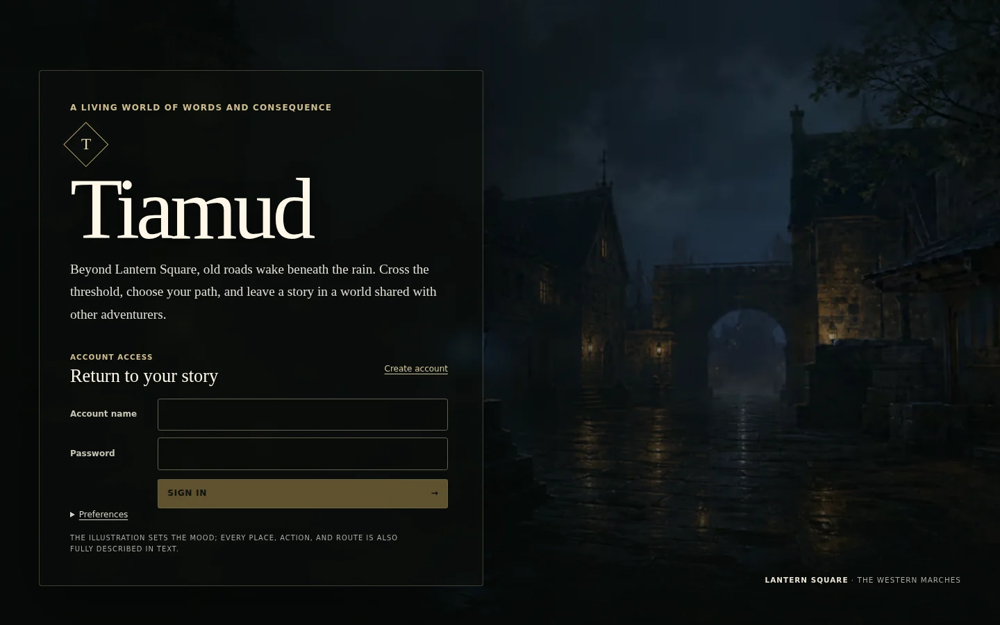
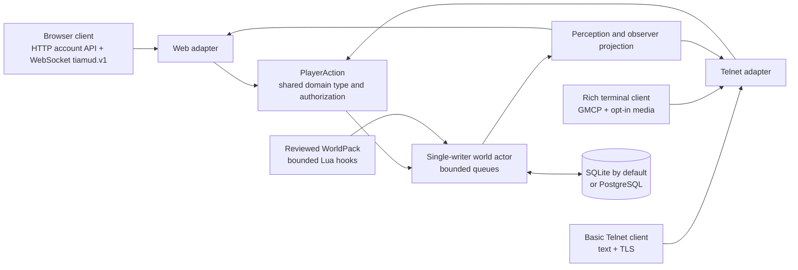
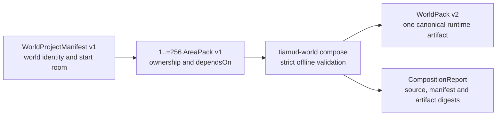

# Tiamud

[](https://github.com/hyukudan/tiamud/actions/workflows/ci.yml)
[](#licensing)
[](https://www.rust-lang.org/)



**A new multiplayer narrative engine for worlds that read beautifully, run
locally and remain playable everywhere.**

Tiamud is a Rust engine inspired by EnvyMUD, Merc and other classic text MUDs.
It is **browser-first, not browser-only**, and **text-complete, not text-only**:
the official web client adds atmosphere and accessible controls, while every
playable fact remains available as text and a basic Telnet client remains a
first-class way to play.

The server, reviewed Lantern Square world, browser client and SQLite storage
fit in one process on one ordinary host. PostgreSQL, richer terminal clients,
media processing and editorial AI are optional additions rather than runtime
requirements.

## What is included

- **A persistent shared world.** Accounts, characters, rooms, objects, NPCs,
  equipment, combat, progression, quests, parties, economy, chat, moderation,
  logical time and weather survive clean restarts.
- **One game, multiple clients.** Browser and Telnet gameplay inputs become the
  same transport-neutral actions. Observer-specific perception is applied
  before either protocol receives a scene or event.
- **A modern browser experience.** Responsive Svelte UI, typed reconnect and
  snapshot recovery, typed access rejection, a 500-entry anchored scrollback,
  command history, map, accessible panels, persistent media/motion/contrast
  preferences and a bounded Service Worker.
- **A capable terminal experience.** Fragment-safe Telnet negotiation, ANSI,
  GMCP, MSSP, MCCP2, optional safe links, direct TLS, and opt-in graphical
  capabilities; official TinTin++ and Mudlet integrations are included. The
  production byte parser is shared with its bounded fuzz target, and live
  world/chat updates use bounded session-addressed mailboxes instead of a
  global broadcast fan-out.
- **Authored worlds with guardrails.** Versioned WorldPacks, deterministic
  build/diff/preview/test/publish/rollback tools, compile-validated and
  aggregate-bounded Lua hooks, immutable assets and explicit provenance.
  Editorial AI is optional, authoring-only and never part of the game loop;
  explicitly configured remote compatible providers may use HTTPS.
- **Operator-facing safety.** Argon2id credentials, revocable sessions,
  a bounded password-work service, authorization and rate limits, bounded
  queues, health and Prometheus endpoints, graceful shutdown, schema-v8 event
  watermarks/compaction, verified SQLite backup/restore, an explicit PostgreSQL
  mover and reproducible release tooling.

### One authoritative action path



Stable world identifiers and hidden variants stay behind the projection
boundary. Clients receive session-opaque view IDs and only the facts their
character is allowed to perceive. When a browser sequence gap occurs, the
client requests a fresh authoritative snapshot instead of guessing or blindly
replaying events.

## Choose a surface and store

| Layer | Local/default | Public/alternative | Important property |
| --- | --- | --- | --- |
| Play | Browser over HTTP locally | HTTPS/WSS behind Caddy | Illustrated, responsive and keyboard accessible |
| Terminal | Telnet with direct TLS | Explicit plaintext on a trusted local network | Complete clean-text fallback; rich features require consent |
| Persistence | Embedded SQLite | PostgreSQL via an explicit offline transfer | Exactly one backend; Tiamud never dual-writes |
| World | Embedded Lantern Square WorldPack | Reviewed external WorldPack | Deterministic validation and digest-based rollback |

## Quick start

You need Git, Rust 1.88 or newer, a C/C++ compiler and linker, CMake,
Node.js 20.19+ (or 22.12+) and pnpm 10+. Node and pnpm build and test the web
client and run repository tooling; neither is a runtime service for the built
server. CI, release and soak reproducibility workflows pin Rust 1.93.1,
Node.js 24 and pnpm 11.11.0.

```sh
git clone https://github.com/hyukudan/tiamud.git
cd tiamud
pnpm --dir apps/web install --frozen-lockfile
pnpm --dir apps/web build
TIAMUD_TELNET_MODE=plaintext cargo run -p tiamud-server
```

Then open <http://127.0.0.1:8080> or connect a Telnet client to
`127.0.0.1:4000`.

> `TIAMUD_TELNET_MODE=plaintext` is a deliberate local-development exception.
> It logs a warning because Telnet registration and login are unencrypted.
> Never expose that listener to the public Internet. The default mode is TLS
> and startup fails closed without a valid certificate and private key.

The default database is `data/tiamud.db`; the Lantern Square WorldPack and
browser distribution are embedded in the server. Try:

```text
look                       north / east / south / west
inventory                  take / drop / examine / use <target>
equip / unequip <target>   attack <target>
weather                    time
quest ...                  party ...
balance / shop / buy ...   say / tell / who / help ...
```

See the [single-host runbook](docs/operations/single-host.md) for HTTPS/WSS,
direct Telnet TLS, Caddy, systemd, backups, monitoring, updates and rollback.

## Runtime configuration

The most useful settings are:

| Variable | Default | Purpose |
| --- | --- | --- |
| `TIAMUD_HTTP_ADDR` | `127.0.0.1:8080` | HTTP, WebSocket, health and metrics listener |
| `TIAMUD_TELNET_ADDR` | `127.0.0.1:4000` | Direct Telnet listener |
| `TIAMUD_TELNET_MODE` | `tls` | Exactly `tls` or explicit `plaintext` |
| `TIAMUD_TELNET_TLS_CERT` / `TIAMUD_TELNET_TLS_KEY` | — | PEM identity required by Telnet TLS |
| `TIAMUD_DB_PATH` | `data/tiamud.db` | Default SQLite database; must not be set with `TIAMUD_DATABASE_URL` |
| `TIAMUD_DATABASE_URL` | — | Alternative `sqlite://`, `postgresql://` or `postgres://` URL; mutually exclusive with `TIAMUD_DB_PATH` |
| `TIAMUD_WORLD_PACK` | embedded pack | Path to a reviewed external WorldPack |
| `TIAMUD_TICK_MILLIS` | `1000` | Logical world tick interval |
| `RUST_LOG` | `tiamud_server=info,tower_http=info` | Structured application log filter |

Authentication, command, session and TLS-handshake limits are configurable as
well. [`deploy/tiamud.env.example`](deploy/tiamud.env.example) is the reviewed
production example; the [single-host runbook](docs/operations/single-host.md)
explains the operational choices and additional storage settings.

Health and metrics:

- `/health/live` checks that the HTTP process responds.
- `/health/ready` reports readiness/availability by probing the world actor and
  selected storage worker.
- `/metrics` exposes Prometheus data on the same HTTP listener, which binds to
  loopback by default. The provided Caddy configuration deliberately does not
  publish it.

## Security and operating model

Tiamud is designed to fail closed at trust boundaries, but a secure public
installation still depends on correct host operation.

- Use HTTPS/WSS for the browser and direct TLS for public Telnet. Keep
  plaintext Telnet on an explicitly trusted network only.
- Keep `/metrics`, database files, private keys, WorldPack staging areas and
  backups off the public surface.
- Run the service as a dedicated unprivileged account and put ordinary
  firewall, proxy limits, log retention and off-host backups around it.
- Treat `/health/ready` as a readiness/availability signal, not as proof of
  data integrity. Exercise `tiamud-admin check`, verified backups and restore
  tests.
- Review every imported area and asset license. The importer never converts
  unknown provenance into permission to redistribute material.
- Follow [SECURITY.md](SECURITY.md) for private reporting. Use GitHub's private
  vulnerability reporting form when it is enabled; otherwise use the fallback
  described there. Never publish exploitable details in an issue.

The reference deployment is intentionally one process on one host. It has
bounded actor, persistence and transport queues; slow clients lose lower-value
updates first and are disconnected if critical output cannot drain. `SIGTERM`
and `SIGINT` stop new listeners, place a barrier behind accepted world actions,
then drain and close persistence.

## Author and operator tools

The workspace includes focused CLIs rather than putting maintenance powers in
the live player protocol.

| Tool | Purpose |
| --- | --- |
| `tiamud-admin` | Integrity checks, safe migration and SQLite backup/verify/restore |
| `tiamud-world` | Compose, validate, build, diff, preview, test, publish and roll back WorldPacks |
| `tiamud-assets` | Compile responsive content-addressed media with provenance and review metadata |
| `tiamud-migrate-postgres` | Move one offline current SQLite snapshot into an empty PostgreSQL schema |
| `envy-import` | Audit or conservatively convert historical EnvyMUD/Merc-family areas without executing programs |

Examples:

```sh
# Check the default local database and reviewed world.
cargo run -p tiamud-admin -- check \
  --database data/tiamud.db \
  --world-pack worlds/lantern-square.world.json

# Validate and preview a WorldPack without publishing it.
cargo run -p world-pack --bin tiamud-world -- validate \
  worlds/lantern-square.world.json
cargo run -p world-pack --bin tiamud-world -- preview \
  worlds/lantern-square.world.json \
  --room demo:lantern-square --format ansi

# Audit a historical area; unsupported records remain inert diagnostics.
cargo run -p envy-import -- audit path/to/area.are
```

The importer preserves ROM-style alphabetic flag bitvectors verbatim rather
than guessing their numeric meaning. Directed-unreachable rooms are retained
with review diagnostics because one-way travel, portals and scripts cannot be
inferred safely from static exits alone.

Detailed workflows:

- [World authoring and runtime decisions](docs/decisions/0002-runtime-world-and-durable-identity.md)
- [Asset pipeline](crates/asset-pipeline/README.md)
- [Quota-limited scripting](crates/scripting/README.md)
- [Optional editorial AI](crates/editorial-ai/README.md)
- [Release and provenance runbook](docs/operations/releases.md)

## Modular world authoring


Editors can split a world into bounded, independently owned areas without
changing the runtime contract. A project manifest names between 1 and 256
strict `AreaPack` modules; `tiamud-world compose` resolves their declared
dependencies and emits the one canonical `WorldPack` document consumed by the
server.



The reviewed Lantern Square project composes three areas—`square`, `archive`
and `north-gate`—with the real command below:

```sh
mkdir -p build/worlds
cargo run --locked -p world-pack --bin tiamud-world -- compose \
  worlds/lantern-square.project.json \
  --output build/worlds/lantern-square.composed.world.json
```

Composition is deterministic, atomic and implemented today. Its report records
the ownership of every structured record, declared dependencies, cross-area
references, exact source SHA-256 values, and canonical manifest and artifact
digests. Each area file, all area sources together and the composed artifact
are independently capped at 16 MiB. Validation compiles every Lua module,
checks each declared hook and rejects room/hook batches above eight modules.
NPC loot is allocated exactly once and staged outside room projection until its
initial NPC spawn takes ownership.

The current server still loads exactly one complete WorldPack at startup; it
does not compose, hot-load or evict areas while running. A resident catalog,
immutable area bundles, hot activation and LRU lifecycle are future
architecture—not implemented runtime behavior—documented in
[ADR 0005](docs/decisions/0005-hot-area-lifecycle.md). See the complete
[world-authoring guide](docs/world-authoring.md) for schemas, dependency rules,
validation, content tests, publication and rollback.

## Verification

Representative local gates are shown below. The workflows pin their toolchains
and run the documented profiles with their own exact parameters.

```sh
pnpm --dir apps/web check
pnpm --dir apps/web test
pnpm --dir apps/web build
pnpm --dir apps/web exec playwright install --with-deps chromium firefox webkit
pnpm --dir apps/web e2e
bash scripts/verify-project-licenses.sh
node scripts/generate-third-party-notices.mjs --check
node --test scripts/verify-soak-report.test.mjs

cargo fmt --all -- --check
cargo test --workspace --locked
cargo clippy --workspace --all-targets --locked -- -D warnings
cargo test -p tiamud-telnet-codec --locked

node scripts/smoke.mjs
node scripts/load.mjs --users 2 --telnet-users 1 --rounds 2 --concurrency 2 --pace-ms 100
```

The Playwright install step fetches Chromium, Firefox and WebKit plus the native
dependencies required before `e2e`. PostgreSQL integration tests are
intentionally opt-in and require a disposable external database. See the
[completion matrix](docs/project/COMPLETION_MATRIX.md) for requirement-by-
requirement evidence and [soak-testing.md](docs/operations/soak-testing.md)
before interpreting short load tests as long-duration acceptance. The
weekly/manual Telnet fuzz workflow is configured to run a bounded campaign
against the same parser used by the server; the existence of that workflow is
not evidence that a particular campaign completed.

## Project status and limits

Tiamud is the definitive product name. The current packages are versioned
`0.1.0`; implementation and acceptance are tracked against the repository's
historical [v0.2 specification](docs/spec-v0.2.md).

The engine, default world, browser and Telnet paths, SQLite and PostgreSQL
adapters, tooling and automated browser harnesses are implemented with focused
coverage. Acceptance criterion 19 remains open until a successful 24-hour
candidate report is retained and passes the deterministic verifier. A running
soak, a shorter profile or an unverified JSON file is not acceptance.

Remaining qualifications are kept visible rather than folded into broad
“production-ready” language:

- a manual pass with real screen-reader software is still required; automated
  axe, keyboard, responsive and reader-mode coverage is retained separately;
- the browser WebSocket protocol is explicitly experimental before its first
  public compatibility milestone;
- release workflows exist and local archives have reproduced byte-for-byte,
  but a tagged release with independently verified OIDC provenance is still
  required;
- the canonical GitHub repository is still private; making it publicly visible
  remains a release acceptance item;
- the single-host material is a reviewed reference configuration, not evidence
  that a live public Tiamud service has been installed;
- the dated [name/domain pre-check](docs/project/NAME_DOMAIN_PRECHECK.md) is not
  trademark clearance or a domain reservation.

The [completion matrix](docs/project/COMPLETION_MATRIX.md) is authoritative when
this summary and retained evidence differ.

## Repository map

```text
apps/web/                    official Svelte browser client
clients/                     TinTin++ and Mudlet integrations
crates/mud-core/             transport-independent domain and perception
crates/mud-server/           actor, transports, storage adapters, embedded web
crates/persistence-*/        shared SQLite schema and PostgreSQL transfer
crates/world-pack/           world model and authoring CLI
crates/scripting/            quota-limited Lua capabilities
crates/asset-pipeline/       deterministic reviewed media pipeline
crates/editorial-ai/         optional authoring-only AI adapters
crates/tiamud-admin/         operator integrity and recovery CLI
tools/envy-import/           isolated historical compatibility tool
worlds/                      reviewed source WorldPacks
docs/operations/             deployment, soak and release runbooks
deploy/                      Caddy, systemd and environment examples
```

## Contributing

Issues and pull requests are welcome. Keep domain behavior transport-neutral,
preserve text completeness, maintain strict bounds at untrusted inputs, and add
focused coverage for parser, state, persistence and authorization changes.
Run the relevant [verification gates](#verification) before opening a pull
request.

Contributions intentionally submitted for inclusion are accepted under the
same software or content terms that apply to the files being changed. No
historical MUD source code, area, help text or media is bundled with Tiamud;
compatibility does not grant redistribution rights.

## Licensing

The [software licensing notice](LICENSE) covers source, tests, binaries,
configuration, build and deployment material, and scripts under your choice of
the [MIT License](LICENSE-MIT) or the
[Apache License 2.0](LICENSE-APACHE), expressed as `MIT OR Apache-2.0` in
package metadata.

Original narrative and world data, documentation prose, artwork, audio and
derived image/audio renditions are available under [Creative Commons
Attribution 4.0 International](LICENSE-CONTENT.md); the complete legal text is
retained in [LICENSE-CC-BY-4.0](LICENSE-CC-BY-4.0). Asset manifests keep
per-asset provenance and license metadata. The README illustrations have their
generation and processing record in
[docs/images/README.md](docs/images/README.md).

A source tree, browser distribution, executable or release archive may contain
both software and content. Inclusion in that mixed artifact does not apply CC
BY 4.0 to the software or the software licenses to the content. Third-party
and imported material keeps its own terms and is never relicensed merely by
passing through a Tiamud tool. Locked release dependencies and their retained
license texts are recorded in
[THIRD_PARTY_NOTICES.md](THIRD_PARTY_NOTICES.md).
