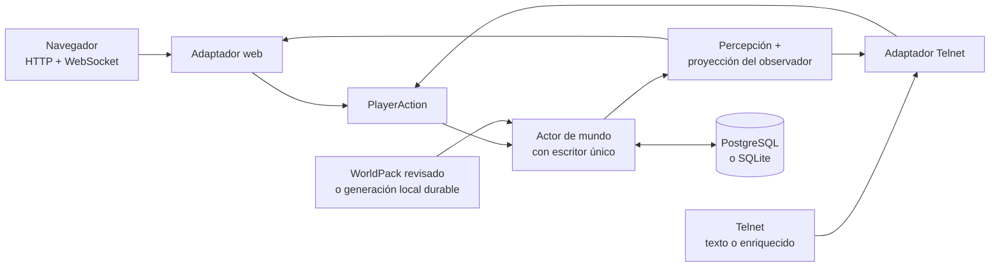

<h1 align="center">
  
</h1>

<p align="center">
  <a href="https://github.com/hyukudan/tiamud/actions/workflows/ci.yml"></a>
  <a href="#licencia"></a>
  <a href="https://www.rust-lang.org/"></a>
</p>


**Motor narrativo multijugador orientado al navegador y completamente jugable
como texto.**

Tiamud es un motor en Rust, aún en prelanzamiento, para crear mundos
multijugador persistentes. Está inspirado en EnvyMUD, Merc y la tradición de
los MUD clásicos, pero es una implementación nueva. El cliente web oficial
añade ilustración atmosférica, audio y controles accesibles; cada hecho y cada
acción jugable siguen disponibles mediante prosa y estado estructurado. Un
cliente Telnet básico continúa siendo una forma de juego de primera clase.

El proyecto está diseñado primero para **un único equipo**. Un proceso sirve el
mundo, el navegador y Telnet en un host corriente. PostgreSQL es el perfil
recomendado para una instalación pública nueva; SQLite es la ruta implementada
sin configuración para desarrollo, juego local y compatibilidad. Cada servidor
abre exactamente un sistema de persistencia y nunca escribe en ambos. El
baseline no requiere Kubernetes, Redis, almacenamiento de objetos ni IA.

> Tiamud está en desarrollo activo. Existe cobertura automatizada amplia, pero
> todavía no hay un despliegue público de producción ni una versión estable del
> protocolo. La [matriz de completitud](docs/project/COMPLETION_MATRIX.md)
> distingue implementación, evidencia retenida y aceptación pendiente.

## Contenido

- [Qué funciona hoy](#qué-funciona-hoy)
- [Arquitectura](#arquitectura)
- [Inicio rápido](#inicio-rápido)
- [Despliegue en un único equipo](#despliegue-en-un-único-equipo)
- [Personajes, clases y progresión](#personajes-clases-y-progresión)
- [Sistemas sociales, staff e inventario](#sistemas-sociales-staff-e-inventario)
- [Escenas y multimedia](#escenas-y-multimedia)
- [Autoría: WorldPack y AreaPack](#autoría-worldpack-y-areapack)
- [Accesibilidad y seguridad](#accesibilidad-y-seguridad)
- [IA opcional](#ia-opcional)
- [Verificación](#verificación)
- [Estado y hoja de ruta](#estado-y-hoja-de-ruta)
- [Mapa del repositorio](#mapa-del-repositorio)
- [Documentación](#documentación)
- [Contribuir](#contribuir)
- [Licencia](#licencia)

## Qué funciona hoy

- **Mundo persistente:** cuentas, personajes, salas, objetos, NPC, equipo,
  combate, misiones, grupos, economía, tiempo lógico y clima. Los objetos
  separan prototipos reutilizables e instancias durables, con capacidad por
  slots/peso, pilas fungibles derivadas, contenedores acotados, botín fijo y
  repetible, `give`, políticas de transferencia y trade bilateral confirmado.
- **Personajes definidos por datos:** el modelo v3 modela linajes, trasfondo
  opcional, clases base y avanzadas, curva global de XP, talentos con rango y
  promociones atómicas. Atributos, recursos, resistencias, cooldowns y estados
  están acotados.
- **Grupos y conversación:** `say` local, `tell`/`reply` online, telepatía
  directa como habilidad authored, emotes de sala definidos por el mundo, chat
  y ciclo de grupo acotado, canales `general`/`newbie`/`staff`, correo offline
  privado y tablones públicos `general`/`newbie`. La voz espacial `yell`/`shout`
  (fase 5E) usa alcance dirigido y acotado sin revelar la topología del mundo.
- **Staff por capacidades:** cinco perfiles operativos, doce capacidades
  cerradas, cola/resolución de reportes, acciones de diagnóstico/reparación y
  auditoría append-only. Ni título narrativo, XP, clase, WorldPack ni el rol
  legado autorizan comandos.
- **Una ruta autoritativa:** navegador y Telnet producen las mismas
  `PlayerAction`, pasan por las mismas reglas y mutan un único actor de mundo.
- **Clientes web y terminal:** Svelte 5 instalable como PWA; Telnet plano/ANSI;
  GMCP, MSSP, MCCP2, MXP/MSLP opcional; integraciones TinTin++ y Mudlet.
- **Multimedia segura:** imagen de escena y audio opcionales, recursos
  inmutables direccionados por contenido, texto alternativo y preferencias de
  medios, movimiento, contraste y lector de pantalla.
- **Autoría modular:** AreaPack v8 divide un mundo en áreas; la composición sin
  conexión de WorldProject v2 produce un WorldPack v9 canónico. Las fases 6A–6C
  añaden catálogos/bundles verificables, arranque desde catálogo con carga
  aditiva bajo demanda y sustitución quiescente de una generación completa. La
  fase 6D, **parcial**, añade retirada reversible de unidades SCC de una misma
  generación con checkpoint durable; aún falta presupuesto RSS, LRU y superficie
  operativa.
- **Operación en un host:** adaptadores PostgreSQL/SQLite, credenciales
  Argon2id, sesiones revocables, colas acotadas, salud, métricas Prometheus,
  apagado ordenado y traslado explícito a PostgreSQL.

El estado por fase y las cifras exactas viven en la
[matriz de completitud](docs/project/COMPLETION_MATRIX.md).


## Arquitectura



Cuatro límites mantienen el motor flexible:

1. **Los transportes analizan; el dominio decide.** Una acción estructurada del
   navegador no es un atajo para evitar reglas.
2. **Un escritor posee el mundo.** Las colas acotadas y los checkpoints
   durables ordenan el estado; si falla la persistencia se restaura exactamente
   el estado anterior en memoria.
3. **La percepción precede al protocolo.** Variantes ocultas e IDs estables no
   salen del servidor. Cada sesión recibe IDs opacos y solo hechos autorizados.
4. **La presentación es sustituible.** Texto, color terminal, imágenes, audio y
   composición visual representan el mismo estado semántico.

El contrato experimental del navegador está documentado en
[`tiamud.v1`](docs/protocol/tiamud-v1.md). Ante un hueco de secuencia, el
cliente pide una instantánea autoritativa; no inventa estado ni reproduce
acciones a ciegas.

## Inicio rápido

Se necesita Git, `rustup`, compilador/enlazador C/C++, CMake, Node.js 20.19+
(o 22.12+) y pnpm 10+. Las herramientas de carga y soak requieren Node.js 24.
Node y pnpm solo se usan para construir el cliente, no como servicios del
servidor compilado.

```sh
git clone https://github.com/hyukudan/tiamud.git
cd tiamud
pnpm --dir apps/web install --frozen-lockfile
pnpm --dir apps/web build
TIAMUD_TELNET_MODE=plaintext cargo run --locked -p tiamud-server
```

Abre <http://127.0.0.1:8080> o conecta Telnet a `127.0.0.1:4000`. El servidor
Rust incluye la compilación web y el WorldPack revisado de Lantern Square.

> Telnet sin cifrar es una excepción para desarrollo local. No debe exponerse
> a Internet: registro y acceso viajarían sin cifrar. Telnet TLS es el modo
> predeterminado y falla de forma cerrada sin certificado y clave válidos.

Comandos representativos:

```text
look / examine <objetivo>   north / east / south / west
inventory                   take / drop / put / get [cantidad] <objeto>
equip / unequip <objetivo>  give [cantidad] <objeto> to <personaje>
loot / loot pass            trade request / offer / confirm <...>
attack <objetivo>           ability / cast <id> [objetivo]
promote <class-id>          talent learn <graph-id> <node-id>
quest ...                   party create / invite / accept / say
say / tell / reply          who / help / ignore / block
telepathy <ability-id> <personaje> <mensaje>
emote <comando> [personaje] channel say <canal> <texto>
yell / shout <mensaje>      balance / shop / buy ...
staff ...                   mail send <personaje> | <asunto> | <cuerpo>
board post <tablón> | <asunto> | <cuerpo>
```

La superficie completa de comandos staff, mail y board está en la
[guía de operación](docs/operations/single-host.md) y la
[autoría](docs/authoring/README.md).

## Despliegue en un único equipo

| Capa | Local/privado | Perfil público nuevo en un host |
| --- | --- | --- |
| Navegador | HTTP en bucle local | HTTPS/WSS detrás de Caddy |
| Terminal | `plaintext` explícito en localhost/LAN confiable | Telnet TLS directo |
| Persistencia | SQLite sin configuración | PostgreSQL en el mismo equipo |
| Mundo | WorldPack embebido o catálogo local 6B/6C | WorldPack externo revisado o catálogo local durable |

La [guía de operación](docs/operations/single-host.md) cubre Caddy, systemd,
Telnet TLS, variables de entorno, esquema SQL, copias, monitorización,
actualización y reversión, incluida la migración 6B→6C con recovery/personajes.
Los ejemplos revisados están en [`deploy/`](deploy/).

Si una instalación pierde toda autoridad administrativa, la recuperación
offline documentada no se limita al rol legado: `tiamud-admin recover-admin`
instala un `implementor` con exactamente las doce capacidades y ambas
auditorías en una transacción, negándose si ya existe un
`administrator`/`implementor`. El procedimiento SQLite y su equivalente
PostgreSQL están en la
[recuperación de emergencia](docs/operations/single-host.md#emergency-implementor-recovery).

`/health/live` y `/health/ready` exponen salud. `/metrics` ofrece Prometheus en
el mismo punto de escucha, ligado por defecto a bucle local; la configuración
de referencia de Caddy no publica métricas.

## Personajes, clases y progresión

WorldPack v9 conserva el modelo de personaje v3: compone un personaje con
linaje, trasfondo opcional y clase base. Una XP acumulada gobierna el nivel
global, las concesiones de clase y reservas de puntos separadas. Hay una clase
activa y un historial ordenado, no multiclase libre.

Las promociones avanzadas pueden exigir nivel, atributos, habilidades,
misiones, señales, linaje, clase actual o histórica, habilidades aprendidas y
talentos previos. La promoción conserva XP/nivel, actualiza una sola vez la
clase activa y aplica únicamente concesiones validadas. Los talentos consumen su
reserva y respetan prerrequisitos y exclusiones. Navegador y Telnet exponen el
mismo catálogo; Telnet recibe además la ficha mediante `Tiamud.Character` GMCP.

No existe entrenamiento general por uso: el crecimiento permanente procede de
concesiones de creación, nivel, talento y promoción. WorldPack/AreaPack de
versiones previas y Envy/Merc solo entran por límites explícitos de
normalización; `archetype` no es una segunda identidad y los IDs publicados son
la frontera de migración de contenido.

Consulta el [diseño de progresión v3](docs/design/character-progression-v3.md)
y la [guía de autoría](docs/authoring/README.md).

## Sistemas sociales, staff e inventario

Los términos clásicos pueden ocultar sistemas distintos. Lo implementado hoy:

- **Conversación:** `say` local; `yell`/`shout` con BFS dirigido, determinista,
  sin salidas secretas y acotado a 259 salas; `tell`/`reply` online; telepatía
  directa authored con recurso/cooldowns; emotes de sala authored sin texto
  libre; `who`, `help`, ignore, block y report; chat de grupo; canales
  suscritos; correo offline separado y paginado con cuotas y evidencia de
  denuncia; tablones públicos `general`/`newbie` acotados.
- **Grupos:** hasta seis miembros; crear, invitar, aceptar, revocar, expulsar,
  transferir, disolver, salir y `party say`. La membresía persiste offline; las
  operaciones dirigidas resuelven un nombre conectado. Una cohorte congelada
  participa en el reparto round-robin del botín.
- **Staff:** perfiles `helper`/`builder`/`moderator`/`administrator`/
  `implementor`, título narrativo opcional, doce capacidades cerradas,
  cola/resolución de reportes, inspect/where/goto/transfer/restore/announce/audit
  y asignación explícita con motivo y auditoría append-only. Los roles legados
  `Player`/`Moderator`/`Admin` nunca autorizan comandos por sí solos.
- **Inventario:** prototipos e instancias durables; pilas derivadas;
  contenedores con slots, peso recursivo y profundidad cuatro; políticas
  `transferable`/`character_bound`/`non_transferable`; `give` unilateral y
  `trade` bilateral confirmado con revisión, doble confirmación y commit
  simultáneo; afijo durable por instancia. Web, Telnet y GMCP proyectan política
  e IDs opacos, nunca dueños ni identidades durables.
- **Botín:** fuentes fijas, tablas enteras repetibles, recompensas selladas y
  pools de afijos deterministas. La derrota confirma procedencia y derechos para
  un máximo de 64 raíces; `party_round_robin`, `loot pass` y los plazos 20/120
  son autoritativos. `reward odds`/`open` consultan y abren un sello con commit
  único. Quedan fuera need/greed, master-loot, cajas pagadas y pity.

Detalles y contratos: [ADR 0016 emotes de sala](docs/decisions/0016-authored-room-emotes.md),
[ADR 0017 correo offline](docs/decisions/0017-bounded-offline-mail.md),
[ADR 0018 tablones comunitarios](docs/decisions/0018-bounded-moderable-community-boards.md),
[ADR 0019 voz espacial](docs/decisions/0019-bounded-spatial-voice.md) y la
[hoja de ruta social, staff y botín](docs/design/social-staff-and-loot-roadmap.md).
La autoridad administrativa permanece separada de la progresión: XP mejora al
personaje jugable, mientras una designación separada asigna perfil y capacidades
con auditoría durable.

## Escenas y multimedia

La ilustración aporta ambiente; el texto contiene el juego. Fondos opacos
AVIF/WebP/JPEG y sprites transparentes WebP/PNG usan manifiestos acotados con
dimensiones, hashes, licencia, procedencia, revisión humana y texto alternativo
localizado. Save-Data, multimedia desactivada y modo lector de pantalla evitan
peticiones de imagen; el audio empieza apagado y necesita gesto del usuario.
Telnet plano conserva todo; GMCP, MXP/MSLP, ANSI y gráficos nativos son
opcionales y consentidos.

El pipeline y el navegador pueden componer sprites de NPC/objetos ya visibles de
forma determinista y acotada. No hay aún sprites de demostración revisados,
composición separada de jugadores ni lápida visual. El
[diseño del compositor](docs/design/scene-compositor-v1.md) mantiene estos
límites explícitos.

## Autoría: WorldPack y AreaPack


El entorno de ejecución consume **un WorldPack v9 canónico**. Para trabajar con
menos acoplamiento, los autores dividen un **WorldProject v2** en **AreaPack v8**
con dependencias y propiedad declaradas, y los componen sin conexión:

```sh
mkdir -p build/worlds
cargo run --locked -p world-pack --bin tiamud-world -- compose \
  worlds/lantern-square.project.json \
  --output build/worlds/lantern-square.composed.world.json
```

La ruta local 6A cataloga revisiones y bundles de área verificables en un
registro local. `area-publish` publica catálogo, bundles y WorldPack de respaldo
bajo un lock advisory por mundo e imprime la ruta content-addressed exacta;
`area-verify` es una comprobación read-only del catálogo publicado:

```sh
cargo run --locked -p world-pack --bin tiamud-world -- area-publish \
  worlds/lantern-square.project.json \
  --release worlds/lantern-square.area-release.json \
  --registry build/area-registry

cargo run --locked -p world-pack --bin tiamud-world -- area-verify \
  --catalog build/area-registry/area-catalogs/<world-key>/<catalog-digest>.catalog.json \
  --registry build/area-registry
```

El catálogo acotado (≤1 MiB, 256 entradas) y sus bundles JSON canónicos
inmutables (≤16 MiB) separan `contentLicense=CC-BY-4.0` de
`scriptLicense=MIT OR Apache-2.0`, fijan propiedad, dependencias, portales y
digests, y usan el modo de confianza explícito `unsigned_local` para un registro
local en un host confiable. El modo catálogo 6B arranca desde un catálogo exacto
y añade áreas verificadas bajo demanda; 6C sustituye una generación completa en
un corte quiescente; 6D retira de forma reversible unidades SCC de la misma
generación. Los detalles, invariantes y CLI están en
[docs/world-authoring.md](docs/world-authoring.md), la
[guía de autoría](docs/authoring/README.md) y los ADR
[0005](docs/decisions/0005-hot-area-lifecycle.md),
[0020](docs/decisions/0020-additive-local-area-loading.md),
[0021](docs/decisions/0021-quiescent-area-generation-cutover.md) y
[0022](docs/decisions/0022-reversible-area-unit-retirement.md).

| Herramienta | Finalidad |
| --- | --- |
| `tiamud-world` | Componer, validar, construir, comparar, previsualizar, probar, publicar y revertir |
| `tiamud-assets` | Compilar medios revisados y direccionados por contenido |
| `envy-import` | Auditar/convertir de forma conservadora áreas Envy/Merc admitidas |
| `tiamud-admin` | Integridad, migración y copia/restauración SQLite |
| `tiamud-migrate-postgres` | Trasladar una instantánea SQLite actual a PostgreSQL vacío |

Los programas importados nunca se ejecutan. Los hooks Lua usan capacidades
declaradas y cuotas de código, memoria, instrucciones, tiempo y eventos.

## Accesibilidad y seguridad

Todo el juego funciona con un flujo de texto plano. El navegador añade regiones
semánticas, registro narrativo, anuncios selectivos, controles nativos de
teclado, colores forzados y preferencias persistentes de tamaño, contraste,
movimiento y lector de pantalla.

Se conservan pruebas automatizadas axe, teclado, móvil y modo lector. Sigue
pendiente una validación manual con lector de pantalla real y una ejecución
WebKit actual en un host compatible.

Para un host público:

- usar HTTPS/WSS y Telnet TLS directo;
- mantener privadas métricas, bases, claves, staging y copias;
- ejecutar con una cuenta sin privilegios y probar restauraciones externas;
- revisar licencia de cada área y recurso importado; y
- informar vulnerabilidades según [SECURITY.md](SECURITY.md).

Mensajes, guiones, medios y salidas no confiables están acotados. Un cliente
lento pierde primero presentación de menor valor y se desconecta si no puede
vaciar salida crítica. `SIGTERM`/`SIGINT` cierran listeners, esperan las acciones
aceptadas y drenan persistencia.

## IA opcional

No se necesita IA para compilar, ejecutar o jugar. El crate
[`editorial-ai`](crates/editorial-ai/README.md) puede redactar o revisar
material de autoría fuera del bucle de juego. El proveedor predeterminado es
`none`; los endpoints locales se limitan a bucle local y los remotos compatibles
requieren HTTPS explícito. Todo borrador pasa la validación normal y revisión
humana.

El desarrollo también declara asistencia de IA cuando es material. Un modelo
puede proponer código, pruebas, texto o imágenes, pero no es autoridad: los
cambios se revisan y se someten a las mismas puertas.

## Verificación

Puertas locales representativas:

```sh
pnpm --dir apps/web check
pnpm --dir apps/web test
pnpm --dir apps/web build
pnpm --dir apps/web e2e

cargo fmt --all -- --check
cargo test --workspace --locked
cargo clippy --workspace --all-targets --locked -- -D warnings

bash scripts/verify-project-licenses.sh
node scripts/generate-third-party-notices.mjs --check
node --test scripts/bot.test.mjs scripts/verify-soak-report.test.mjs scripts/telnet-bot.test.mjs
node scripts/smoke.mjs
```

El baseline se verifica localmente por fase con formato, clippy estricto,
pruebas de workspace, cliente web y comprobación de licencias. Las cifras
exactas por fase, la evidencia retenida y los límites no ejecutados viven en
[PROJECT_MEMORY.md](docs/project/PROJECT_MEMORY.md) y en los registros fechados
de [docs/project/log/](docs/project/log/README.md).

Esta evidencia es diagnóstico local, no evidencia de CI, release ni producción.
Una prueba corta de carga no sustituye a un soak de 24 horas; WebKit no arranca
en el host local actual por bibliotecas GTK/GStreamer/medios ausentes, y no se
reclama un pase WebKit ni una aceptación PostgreSQL de producción sin evidencia.

## Estado y hoja de ruta

Tiamud está preparado bajo licencias de código abierto y permanece en
prelanzamiento `0.1.0`; el repositorio canónico sigue privado hasta una decisión
explícita de visibilidad. El protocolo WebSocket continúa experimental. La
[matriz de completitud](docs/project/COMPLETION_MATRIX.md) es la autoridad sobre
aceptación.

Puertas externas pendientes:

- restablecer la ejecución alojada de GitHub Actions (actualmente bloqueada por
  facturación/límite de gasto) y obtener un CI verde del candidato exacto;
- ejercicio de instalación pública para TLS PostgreSQL, backup/restore,
  monitorización y recuperación operativa;
- soak retenido y verificado de 24 horas para el candidato exacto;
- WebKit actual en un host compatible y prueba manual con lector de pantalla;
- release etiquetada con procedencia OIDC verificada de forma independiente.

Siguientes líneas técnicas: cerrar el E2E retiro/restart, el humo PostgreSQL y
las métricas del vertical 6D antes de diseñar política automática, presupuesto
de memoria o LRU; consolidar staff por capacidades; modelar need/greed o
master-loot antes de presentarlos; mantener fuera del baseline las cajas de
botín pagadas; publicar sprites de demostración revisados; y publicar el primer
hito explícito de compatibilidad `tiamud.v1`. La hoja completa está en la matriz
y en [PROJECT_MEMORY.md](docs/project/PROJECT_MEMORY.md).

## Mapa del repositorio

```text
apps/web/                    cliente oficial Svelte 5
clients/                     integraciones TinTin++ y Mudlet
crates/mud-core/             dominio y percepción independientes del transporte
crates/mud-server/           actor, transportes, persistencia y web embebida
crates/telnet-codec/         analizador Telnet compartido con fuzzing
crates/cell-frame/           gráficos de celdas acotados y consentidos
crates/persistence-*/        esquemas SQLite/PostgreSQL y traslado
crates/world-pack/           modelo, composición y CLI de autoría
crates/scripting/            capacidades Lua con cuotas
crates/asset-pipeline/       pipeline de medios determinista y revisado
crates/editorial-ai/         IA opcional solo para autoría
crates/tiamud-admin/         integridad y recuperación del operador
tools/envy-import/           importador histórico sin conexión
worlds/                      WorldPacks y módulos de área revisados
scripts/                     humo, carga, soak y licencias
docs/                        protocolo, decisiones, operación y estado
deploy/                      ejemplos Caddy, systemd y entorno
```

## Documentación

El índice completo de documentación es [docs/README.md](docs/README.md), que
enlaza protocolo, operación, autoría, decisiones (ADR), clientes y estado.
Puntos de entrada clave:

- **Protocolo:** [`tiamud.v1`](docs/protocol/tiamud-v1.md) (experimental).
- **Operación:** [host único](docs/operations/single-host.md).
- **Autoría:** [WorldPack v9](docs/authoring/README.md) ·
  [áreas y catálogos](docs/world-authoring.md).
- **Estado:** [matriz de completitud](docs/project/COMPLETION_MATRIX.md) ·
  [memoria del proyecto](docs/project/PROJECT_MEMORY.md).
- **Especificación:** [v0.3](docs/spec-v0.3.md) (baseline vigente).
- **Histórico:** [especificación v0.2 en castellano](docs/archive/spec-v0.2.md).

## Contribuir

Las issues y pull requests son bienvenidas.
El comportamiento de dominio debe ser neutral al transporte; todo input no
confiable debe estar acotado y los cambios necesitan pruebas enfocadas y
documentación honesta.

No envíes código, áreas, ayudas o medios históricos sin derechos claros de
redistribución. Compatibilidad no significa licencia.

## Licencia

El software se ofrece a elección bajo MIT o Apache-2.0; consulta
[LICENSE](LICENSE), [LICENSE-MIT](LICENSE-MIT) y
[LICENSE-APACHE](LICENSE-APACHE). La documentación, mundos y medios originales
usan [CC BY 4.0](LICENSE-CONTENT.md). Los manifiestos conservan licencia y
procedencia por recurso. Los avisos de dependencias están en
[THIRD_PARTY_NOTICES.md](THIRD_PARTY_NOTICES.md).
