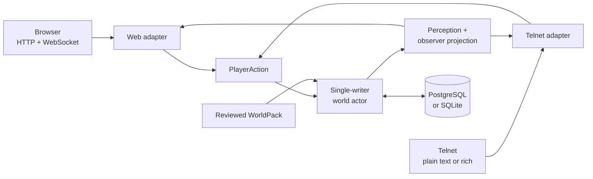

<h1 align="center">
  
</h1>

<p align="center">
  <a href="https://github.com/hyukudan/tiamud/actions/workflows/ci.yml"></a>
  <a href="#licensing"></a>
  <a href="https://www.rust-lang.org/"></a>
</p>


**A browser-first multiplayer narrative engine that remains fully playable as
text.**

Tiamud is a pre-release Rust engine for persistent multiplayer worlds,
inspired by EnvyMUD, Merc and the wider classic MUD family. The official web
client adds atmospheric illustration, audio and accessible controls, while
every playable fact remains available through prose and structured state. A
basic Telnet client is still a first-class way to play.

The project is deliberately **single-machine first**. One server process can
serve the world, browser client and Telnet listener on an ordinary host.
PostgreSQL is recommended for a new public installation; SQLite is the
implemented zero-configuration path for development, local play and
compatibility use. A running server selects exactly one backend and never
dual-writes. Kubernetes, Redis, object storage and mandatory AI services are
not part of the baseline.

> Tiamud is under active development. The engine already has substantial
> automated coverage, but there is no public production deployment or stable
> protocol release yet. See [Project status](#project-status) for the exact
> boundary between current code and the next design phase.

## What works today

- **Persistent multiplayer world:** accounts, characters, rooms, objects,
  NPCs, equipment, combat, quests, parties, economy, chat, moderation, logical
  time and weather.
- **Data-driven characters:** WorldPack v3 defines lineages, optional
  backgrounds, base and advanced classes, one global XP curve, ranked talent
  graphs and atomic promotions. Attributes, skills, resources, resistances,
  cooldowns, statuses and martial, spell or utility abilities remain bounded
  authored data.
- **One authoritative game path:** browser and Telnet input become the same
  transport-neutral actions, pass the same authorization and mutate one
  single-writer world actor.
- **Browser and terminal clients:** a responsive Svelte 5 client, plain and
  ANSI Telnet, GMCP, MSSP, MCCP2, opt-in MXP/MSLP media links, and official
  TinTin++ and Mudlet integrations.
- **Safe multimedia:** one optional atmospheric scene image, optional audio,
  immutable content-addressed assets, mandatory alternative text and explicit
  media, motion, contrast and screen-reader preferences.
- **World authoring:** modular area composition, versioned WorldPacks,
  deterministic validation/build/diff/preview/test/publish/rollback tools,
  quota-bounded Lua and a conservative EnvyMUD/Merc area importer.
- **Single-host operations:** PostgreSQL and SQLite adapters, Argon2id
  credentials, revocable sessions, bounded queues, health and Prometheus
  endpoints, graceful shutdown, SQLite backup/restore and an explicit offline
  SQLite-to-PostgreSQL mover.


## Architecture



Four boundaries keep the engine flexible:

1. **Transports parse; the domain decides.** Structured browser actions are
   not trusted shortcuts around gameplay rules.
2. **One writer owns the world.** Bounded queues and durable checkpoints keep
   state ordering explicit; failed persistence restores the in-memory
   checkpoint.
3. **Perception comes before protocol.** Hidden variants and stable world IDs
   remain server-side. Clients receive session-opaque view IDs and only what
   their character can perceive.
4. **Presentation is replaceable.** Text is authoritative; browser imagery,
   terminal colour and future scene composition are optional renderers over
   the same semantic state.

The browser contract is documented as experimental in
[`tiamud.v1`](docs/protocol/tiamud-v1.md). A sequence gap triggers a fresh
authoritative snapshot instead of client-side guessing or blind replay.

## Quick start

You need Git, `rustup`, a C/C++ compiler and linker, CMake, Node.js 20.19+
(or 22.12+) and pnpm 10+. The load and soak harnesses require Node.js 24.
Node and pnpm are build tools, not runtime services for the compiled server.

```sh
git clone https://github.com/hyukudan/tiamud.git
cd tiamud
pnpm --dir apps/web install --frozen-lockfile
pnpm --dir apps/web build
TIAMUD_TELNET_MODE=plaintext cargo run --locked -p tiamud-server
```

Open <http://127.0.0.1:8080>, or connect a Telnet client to
`127.0.0.1:4000`. The browser build is bundled by the Rust server; without it,
the server still compiles but serves a minimal fallback page. The reviewed
Lantern Square WorldPack is embedded for a self-contained first run.

> Plaintext Telnet is a local-development exception. Never expose it to the
> public Internet: registration and login are unencrypted. The default Telnet
> mode is TLS and fails closed without a valid certificate and private key.

Try:

```text
look                       north / east / south / west
inventory                  take / drop / examine / use <target>
equip / unequip <target>   attack <target>
ability <id> [target]      cast <id> [target]
promote <class-id>         talent learn <graph-id> <node-id>
weather                    time
quest ...                  party ...
balance / shop / buy ...   say / tell / who / help ...
```

## One-machine deployment

| Layer | Local/private | New public single-host profile |
| --- | --- | --- |
| Browser | HTTP on loopback | HTTPS/WSS behind Caddy |
| Terminal | Explicit plaintext on trusted localhost/LAN | Direct Telnet TLS |
| Persistence | Zero-config SQLite | PostgreSQL on the same host |
| World | Embedded sample WorldPack | Reviewed external WorldPack |

The [single-host runbook](docs/operations/single-host.md) covers Caddy,
systemd, direct Telnet TLS, backups, monitoring, updates and rollback. Reviewed
examples live in [`deploy/`](deploy/).

| Variable | Default | Purpose |
| --- | --- | --- |
| `TIAMUD_HTTP_ADDR` | `127.0.0.1:8080` | HTTP, WebSocket, health and metrics |
| `TIAMUD_TELNET_ADDR` | `127.0.0.1:4000` | Direct Telnet listener |
| `TIAMUD_TELNET_MODE` | `tls` | Exactly `tls` or explicit `plaintext` |
| `TIAMUD_TELNET_TLS_CERT` / `TIAMUD_TELNET_TLS_KEY` | — | PEM identity for Telnet TLS |
| `TIAMUD_DB_PATH` | `data/tiamud.db` | SQLite path when no database URL is set |
| `TIAMUD_DATABASE_URL` | — | PostgreSQL profile, or explicit `sqlite://` URL |
| `TIAMUD_WORLD_PACK` | embedded pack | Reviewed external WorldPack |
| `RUST_LOG` | `tiamud_server=info,tower_http=info` | Structured log filter |

`TIAMUD_DB_PATH` and `TIAMUD_DATABASE_URL` are mutually exclusive. The server
opens one persistence backend; moving a SQLite installation to PostgreSQL is
an explicit offline operation, not replication. PostgreSQL keeps relational
account, ownership and social data relational. Bounded application snapshots
remain opaque JSON text because the server does not query their fields ad hoc.

Health is exposed as `/health/live` and `/health/ready`; `/metrics` provides
Prometheus output on the same loopback-bound listener. The reference Caddy
configuration does not publish metrics.

## Characters, classes and progression

WorldPack v3 composes a character from a lineage, an optional background and a
base class. The lineage and background remain identity; the active class owns
trainable role progression. One cumulative XP total drives the global level,
class grants and separate bounded point pools for class and lineage talent
graphs. A character has one active class and an ordered class history rather
than unrestricted multiclass state.

Advanced classes are explicit, atomic promotions. Each can require an authored
combination of level, permanent attributes, skills, quests, signals, flags,
lineage, current or historical class, learned abilities and prior talent
ranks. Promotion keeps global XP and level, updates the active class once and
applies only validated bounded grants. Ranked talents independently consume
their graph's point pool and enforce prerequisites and exclusions.

Browser and Telnet creation both expose the reviewed lineage/background/base-
class catalog. Omitted choices use the WorldPack defaults; an explicit empty
background differs from the default background. The browser presents class
history, available points, safe requirement explanations, talents and
promotions through native controls. Text players use
`promote <class-id>` and `talent learn <graph-id> <node-id>`, while supporting
terminal clients receive the same projection through `Tiamud.Character` GMCP.

The authoritative actor validates ownership, targets, resources, cooldowns,
recovery, progression requirements and grant caps before changing state. XP,
level, lineage/background identity, class history, point balances, talent
ranks, the derived sheet, resources, unlocks, cooldowns, resistances and active
statuses persist through restart. Increasing capacity does not heal or refill
the character; a newly granted resource begins empty.

The bundled Lantern Square catalog demonstrates the model without prescribing
final balance:

| Dimension | Reviewed examples |
| --- | --- |
| Lineages | Mortal, Stonekin, Embermarked |
| Backgrounds | Caravan Scout, Archive Apprentice, City Guard |
| Base classes | Wanderer, Vanguard, Arcanist |
| Advanced classes | Pathfinder, Bastion, Stormcaller, Spellblade |

This avoids a hard-coded lineage × class matrix and keeps published content
reviewable. WorldPack v2 and Envy/Merc inputs normalize at explicit offline
boundaries; `archetype` is not a second runtime character identity. Stable
published IDs remain the content-migration boundary for future releases.

The detailed curve, requirements, grants and invariants live in
[character progression v3](docs/design/character-progression-v3.md). The
[WorldPack v3 authoring hub](docs/authoring/README.md) covers the current
content workflow; the Spanish v2 guide is retained only for migration history.

## Scenes and media

Illustration provides atmosphere; text carries the game. The current client
renders one background image per scene and never depends on it for a playable
fact.

- Opaque reviewed sources produce content-addressed AVIF-first renditions with
  WebP and JPEG fallbacks at 640 and 1280 pixels.
- Transparent or explicitly lossless sources currently produce PNG-only
  renditions at those sizes; transparency is preserved rather than flattened.
- Every manifest includes bounded dimensions, hashes, mandatory alternative
  text, focal point, license, provenance, classification and human-review
  metadata.
- Save-Data and screen-reader modes stop image requests. Audio remains off
  until a user gesture. Motion respects both system and manual preferences.
- Plain Telnet receives complete text. GMCP media, MXP/MSLP links and ANSI or
  native terminal graphics are opt-in and bounded; terminal type is never
  treated as consent.

The pipeline, WorldPack authoring model, perception projection and browser can
optionally compose transparent NPC and item sprites over the atmospheric
background. Placement is deterministic and bounded; dense scenes fall back to
their semantic roster rather than overlap or hide prose. After observer
projection, the server derives a closed set of NPC `attack`, `hit` and
`defeat` cues from authoritative combat events and decorates the existing
narrative message with the same opaque entity ID; it never infers animation
from prose. Reduced motion selects the static authored pose without movement,
and resync, view change or entity removal clears the cue. Player characters are
not separately composited and defeated NPCs do not linger after semantic
removal in v1. Hidden entities and their assets never cross the perception
boundary.

These layers are optional browser presentation. Text, structured state and
Telnet remain complete, and missing media can never alter combat or block the
game loop. The bridge is covered with fixtures, but the bundled world does not
yet ship a reviewed demonstration sprite set. See the
[scene compositor design](docs/design/scene-compositor-v1.md) for the layout,
cue and accessibility contract, and the
[asset pipeline](crates/asset-pipeline/README.md) for the implemented compiler.

## World authoring


The runtime consumes one canonical versioned WorldPack. Authors may split a
project into bounded `AreaPack` modules and compose them offline with declared
dependencies, ownership and deterministic source/artifact digests.

```sh
mkdir -p build/worlds
cargo run --locked -p world-pack --bin tiamud-world -- compose \
  worlds/lantern-square.project.json \
  --output build/worlds/lantern-square.composed.world.json
```

The server currently loads one complete pack at startup; runtime hot-loading
and eviction are future architecture described in
[ADR 0005](docs/decisions/0005-hot-area-lifecycle.md) (Spanish).

| Tool | Purpose |
| --- | --- |
| `tiamud-world` | Compose, validate, build, diff, preview, test, publish and roll back WorldPacks |
| `tiamud-assets` | Compile reviewed, responsive, content-addressed media |
| `envy-import` | Audit or conservatively convert supported EnvyMUD/Merc area records |
| `tiamud-admin` | Integrity checks, safe migration and SQLite backup/verify/restore |
| `tiamud-migrate-postgres` | Move one current offline SQLite snapshot into an empty PostgreSQL schema |

Historical area files are importer input, never the runtime model. The tested
safe subset targets stock EnvyMUD 2.2 area structure. Unsupported records
remain inert diagnostics for human review; imported programs are not executed
and unknown licensing is not treated as permission to redistribute.

Lua hooks run behind declared capabilities and instruction, memory,
wall-clock and event quotas. Details live in the
[current WorldPack v3 authoring hub](docs/authoring/README.md),
[scripting runtime](crates/scripting/README.md) and
[historical importer](tools/envy-import/README.md).

## Accessibility and security

Text completeness is the foundation: the entire game remains usable from a
plain text stream. The browser adds semantic landmarks, a narrative log,
selective live announcements, native keyboard controls, forced-colours support
and persistent text-size, contrast, motion and screen-reader preferences.
Automated axe, keyboard, responsive and reader-mode checks are retained, while
a manual pass with real screen-reader software remains an open acceptance
gate.

For a public host:

- use HTTPS/WSS for the browser and direct TLS for Telnet;
- keep metrics, databases, private keys, staging areas and backups private;
- run as a dedicated unprivileged account and test off-host restores;
- review every imported area and asset license; and
- report vulnerabilities privately as described in [SECURITY.md](SECURITY.md).

Untrusted protocol messages, scripts, media and output are bounded. Slow
clients lose lower-value presentation updates first and disconnect if critical
output cannot drain. `SIGTERM` and `SIGINT` stop listeners, place a barrier
behind accepted world actions, and drain persistence before shutdown.

## Optional AI

AI is not required to build, run or play Tiamud. The optional
[`editorial-ai`](crates/editorial-ai/README.md) crate can draft or review
authoring material outside the game loop. Its default provider is `none` and
fails closed; local Ollama/llama.cpp endpoints must use loopback, and a remote
OpenAI-compatible endpoint must be configured explicitly over HTTPS. Every
draft still passes ordinary validation and human review.

Development and editorial work in this repository is also transparently
AI-assisted. Models may propose code, tests, prose or visual drafts; they are
not authority. Contributors review changes, normal automated gates apply, and
material deliveries retain evidence in the project log.

## Verification

Representative local gates:

```sh
pnpm --dir apps/web check
pnpm --dir apps/web test
pnpm --dir apps/web build
pnpm --dir apps/web e2e

cargo fmt --all -- --check
cargo test --workspace --locked
cargo clippy --workspace --all-targets --locked -- -D warnings

bash scripts/verify-project-licenses.sh
node scripts/smoke.mjs
node scripts/load.mjs --users 2 --telnet-users 1 --rounds 2 --concurrency 2 --pace-ms 100
```

CI also checks advisories, dependency sources, browser accessibility and
bounded Telnet parser fuzzing. PostgreSQL integration tests require an explicit
disposable database. Short load tests are not substitutes for the documented
long soak profile; see [soak testing](docs/operations/soak-testing.md).

## Project status

Tiamud is a private, pre-release `0.1.0` project. The codebase implements the
engine, sample world, browser and Telnet paths, persistence adapters,
WorldPack v3 character/progression/ability system, and authoring/operator
tooling described above. The browser WebSocket protocol remains experimental.

The [completion matrix](docs/project/COMPLETION_MATRIX.md) is authoritative
for acceptance evidence. Remaining external gates include:

- a retained, verified 24-hour soak for the exact release candidate;
- a manual pass with real screen-reader software;
- a tagged release with independently verified OIDC provenance; and
- trademark and domain review.

The canonical GitHub repository is intentionally private during pre-release;
making it public is a later product decision, not a current implementation
failure.

The historical [v0.2 specification](docs/spec-v0.2.md) records the original
requirements (Spanish). Current design decisions live in
[`docs/decisions/`](docs/decisions/) and material implementation sessions in
[`docs/project/log/`](docs/project/log/).

### Direction after the current baseline

- Tune and expand the bundled lineage, class, talent and promotion catalog
  through playtests and stronger balance previews.
- Publish a reviewed demonstration sprite set; consider player-avatar
  composition, a defeat tombstone or further cosmetic cues only when measured
  content justifies them.
- Add content-ID aliases/migrations, pre-creation character previews and
  stronger progression/balance preview tooling.
- Continue the designed hot-area lifecycle, ally targeting and party XP work
  only after the simpler compatibility paths are stable.
- Publish the first explicit `tiamud.v1` compatibility milestone.

## Repository map

```text
apps/web/                    official Svelte 5 browser client
clients/                     TinTin++ and Mudlet integrations
crates/mud-core/             transport-independent domain and perception
crates/mud-server/           actor, transports, storage and embedded web
crates/telnet-codec/         Telnet byte parser shared by server and fuzzing
crates/cell-frame/           bounded, consent-gated terminal cell art
crates/persistence-*/        SQLite schema and PostgreSQL adapter/transfer
crates/world-pack/           world model, composition and authoring CLI
crates/scripting/            quota-limited Lua capabilities
crates/asset-pipeline/       deterministic reviewed media pipeline
crates/editorial-ai/         optional authoring-only AI adapters
crates/tiamud-admin/         operator integrity and recovery CLI
tools/envy-import/           offline historical area importer
worlds/                      reviewed WorldPacks and area modules
scripts/                     smoke, load, soak and license tooling
docs/                        protocol, decisions, operations and status
deploy/                      Caddy, systemd and environment examples
```

## Documentation

- **Protocol:** [`tiamud.v1`](docs/protocol/tiamud-v1.md) (experimental)
- **Operations:** [single-host](docs/operations/single-host.md) ·
  [releases](docs/operations/releases.md) ·
  [load and soak](docs/operations/soak-testing.md) ·
  [operator CLI](crates/tiamud-admin/README.md)
- **Authoring:** [WorldPack v3 hub](docs/authoring/README.md) ·
  [character progression v3](docs/design/character-progression-v3.md) ·
  [scene compositor](docs/design/scene-compositor-v1.md) ·
  [assets](crates/asset-pipeline/README.md) ·
  [Lua](crates/scripting/README.md) ·
  [editorial AI](crates/editorial-ai/README.md) ·
  [Envy importer](tools/envy-import/README.md)
- **Clients:** [web](apps/web/README.md) ·
  [TinTin++](clients/tintin/README.md) · [Mudlet](clients/mudlet/README.md)
- **Decisions:** [project foundation](docs/decisions/0001-project-foundation.md) ·
  [runtime identity](docs/decisions/0002-runtime-world-and-durable-identity.md) ·
  [product name](docs/decisions/0003-tiamud-product-identity.md) ·
  [licensing](docs/decisions/0004-open-source-licensing.md) ·
  [hot areas](docs/decisions/0005-hot-area-lifecycle.md) (Spanish) ·
  [progression and PostgreSQL](docs/decisions/0006-character-progression-and-postgresql-first.md) ·
  [WorldPack v3 characters](docs/decisions/0007-worldpack-v3-character-model.md) ·
  [optional scene compositor](docs/decisions/0008-optional-scene-compositor.md)
- **Status:** [completion matrix](docs/project/COMPLETION_MATRIX.md) ·
  [technical specification v0.3](docs/spec-v0.3.md) ·
  [project memory](docs/project/PROJECT_MEMORY.md) ·
  [image provenance](docs/images/README.md)

## Contributing

Issues and pull requests are welcome once the repository is public. Keep
domain behavior transport-neutral, preserve text completeness, bound every
untrusted input and add focused tests for state, persistence, parser and
authorization changes. Documentation claims are treated like code and must
remain consistent with retained evidence.

Do not submit historical MUD source, areas, help text or media without clear
redistribution rights. Compatibility does not grant a license.

## Licensing

Software is available under your choice of MIT or Apache-2.0; see
[LICENSE](LICENSE), [LICENSE-MIT](LICENSE-MIT) and
[LICENSE-APACHE](LICENSE-APACHE). Original documentation, world content and
media use [CC BY 4.0](LICENSE-CONTENT.md). Asset manifests preserve per-asset
provenance and licensing, and third-party material retains its own terms.
Release dependency notices are in
[THIRD_PARTY_NOTICES.md](THIRD_PARTY_NOTICES.md).
