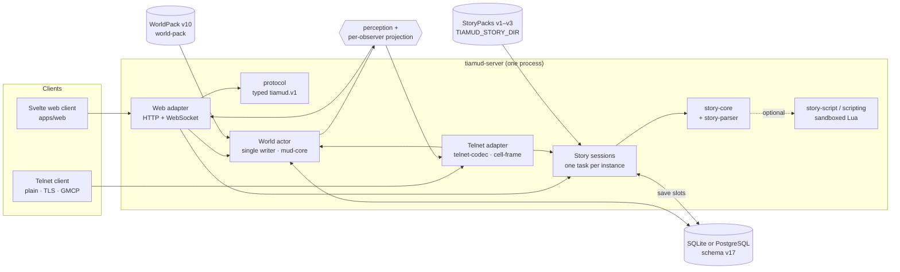

<h1 align="center">
  
</h1>

<p align="center">
  <strong>One Rust engine for persistent MUDs and narrative games — fully playable as text, in the browser and over Telnet.</strong>
</p>

<p align="center">
  <a href="#license"></a>
  <a href="LICENSE-CONTENT.md"></a>
  <a href="Cargo.toml"></a>
  <a href="#status-and-roadmap"></a>
</p>

<p align="center">
  <a href="#quick-start"><strong>Run it locally</strong></a> ·
  <a href="docs/authoring/story-packs.md">Write a story</a> ·
  <a href="docs/operations/single-host.md">Deploy it</a> ·
  <a href="#status-and-roadmap">Status</a>
</p>


Tiamud is a single-process Rust server that runs two kinds of game on the same
accounts, transports and persistence:

- **A persistent multiplayer MUD** in the EnvyMUD/Merc tradition — a new
  implementation, not a fork — with rooms, NPCs, combat, v3 characters,
  durable item instances, trade, group loot, quests, shops and social systems.
- **Narrative games** authored as StoryPacks:
  - **choose-your-own-adventure gamebooks** with stats, dice and items;
  - **menu-driven adventures** in the style of *Snatcher* and the Spanish
    adventures of the 1980s — verb menus, hotspots, character portraits and
    dialogue trees;
  - **parser interactive fiction** (*aventuras conversacionales*) with a
    Spanish and English command parser, rooms, objects, doors and light;
  - optional **multiplayer** for any story: shared instances with seats,
    spectators, majority votes or turns;
  - music and sound-effect cues and background/portrait images published through
    the reviewed media pipeline, which
    are always optional: losing media never changes play.

Every fact and every action is available as text. The Svelte web client adds
artwork, audio and accessible controls; a plain Telnet client is a first-class
way to play, with TLS by default and optional ANSI colour, GMCP and terminal graphics.

> [!IMPORTANT]
> Tiamud is **pre-release** (`0.1.0`) and the `tiamud.v1` protocol is still
> experimental. Many narrative and content features are deliberately
> **Partial**. See [Status and roadmap](#status-and-roadmap) for what is
> complete, partial and pending.

## Contents

- [Highlights](#highlights)
- [Architecture](#architecture)
- [The MUD engine](#the-mud-engine)
- [The narrative runtime](#the-narrative-runtime)
- [Clients](#clients)
- [Protocol](#protocol)
- [Persistence and performance](#persistence-and-performance)
- [Quick start](#quick-start)
- [Authoring a story](#authoring-a-story)
- [Authoring a world](#authoring-a-world)
- [Deployment](#deployment)
- [Verification and evidence](#verification-and-evidence)
- [Status and roadmap](#status-and-roadmap)
- [Repository map](#repository-map)
- [Documentation](#documentation)
- [Contributing](#contributing)
- [License](#license)

## Highlights

| | |
| --- | --- |
| **One authoritative path** | Browser and Telnet both parse to the same `PlayerAction` and mutate one single-writer world actor. No transport has a shortcut around the rules. |
| **Text first, media optional** | Images, music and sound are presentation only. Reader mode, Save-Data and "media off" download nothing and lose no information. |
| **Two game models, one server** | MUD worlds (WorldPack v10) and narrative StoryPacks (formats v1–v3) share accounts, transports and the storage backend, but never game state. |
| **Bounded everything** | Queues, frames (16 KiB), scripts, parser input, save slots, votes and media maps all have explicit limits and fail closed. |
| **Single host, one backend** | One process serves web, WebSocket and Telnet. SQLite for zero-config local play, PostgreSQL for a public install — exactly one per server. No Kubernetes, Redis or AI required. |
| **Honest status** | Phases are marked `Complete` or `Partial` with their evidence; local evidence is never presented as CI, release or production evidence. |


## Architecture



Four rules hold the design together:

1. **Transports parse; the domain decides.** A structured browser action is not
   a shortcut around the rules.
2. **One writer owns the world.** Bounded queues and durable checkpoints order
   state; if persistence fails, the previous in-memory state is restored
   exactly.
3. **Perception precedes protocol.** Hidden variants and durable IDs never leave
   the server; each session sees opaque, per-session IDs and only authorized
   facts. Story choices use random per-view tokens.
4. **Presentation is replaceable.** Text, terminal colour, images, audio and
   visual composition all render the same semantic state.

## The MUD engine

| Area | What exists | Status |
| --- | --- | --- |
| World actor | Single-writer actor, bounded input/output/persistence queues, prioritized output and a slow-client policy, observer-specific projection | Complete |
| Characters v3 | Lineages, optional background, base and advanced classes, one global XP curve, ranked talents and atomic promotions ([design](docs/design/character-progression-v3.md)) | Complete |
| Inventory 3A–3D | Item prototypes and durable instances, slot/weight capacity, derived stacks, containers (depth 4), transfer policies, `give` and confirmed bilateral `trade` | Complete |
| Loot and rewards 4A–4B | Fixed and repeatable loot with rights and provenance, party round-robin and `loot pass`, earned sealed rewards and deterministic affixes | Complete |
| Group loot 4C | Need/greed and master-loot for fixed loot ([ADR 0023](docs/decisions/0023-need-greed-and-master-loot-distribution.md)) | Partial |
| Social 1–5E | `say`, `tell`/`reply`, authored telepathy and room emotes, channels, parties of six, offline mail, moderated boards, spatial `yell`/`shout` | Complete |
| Staff | Five profiles, twelve closed capabilities, report queue, inspect/where/goto/transfer/restore/announce and an append-only audit | Complete |
| Areas 6A–6D | Verifiable area catalogs and bundles (6A), additive on-demand loading (6B), quiescent whole-generation cutover (6C); reversible unit retirement (6D) is **partial** — no memory budget, LRU or operator surface yet | 6A–6C Complete, 6D Partial |
| Quests and shops as data | WorldPack v10/AreaPack v9 `commodities`, staged `quests` and `shops` with restock ([ADR 0032](docs/decisions/0032-worldpack-v10-quests-and-shops.md)); `talk <npc>` in Web and Telnet | Partial |
| Lua hooks | Fresh sandboxed VM per call with quotas on code, memory, instructions, time and events; no filesystem, network or process access | Complete |
| Time and RNG | Logical ticks, weather, respawns, timers and seeded deterministic RNG | Complete |

Representative commands (Web and Telnet share them):

```text
look / examine <target>       north / east / south / west
inventory                     take / drop / put / get [quantity] <item>
equip / unequip <target>      give [quantity] <item> to <character>
loot / loot pass              trade request / offer / confirm <...>
attack <target>               ability / cast <id> [target]
promote <class-id>            talent learn <graph-id> <node-id>
quest ...   talk <npc>        balance / shop / buy ...
say / tell / reply            yell / shout <message>
party create / invite / accept / say
mail send <character> | <subject> | <body>
board post <board> | <subject> | <body>
historias / stories           historia <id> [locale] / story <id> [locale]
```

The full command surface is in the [operations guide](docs/operations/single-host.md)
and the [authoring guide](docs/authoring/README.md).

## The narrative runtime

The narrative ruleset ([ADR 0025](docs/decisions/0025-narrative-ruleset-story-core.md))
is separate from the MUD: a story never reads or writes world state. All of it
is **Partial** — implemented as working slices with local
evidence, not yet accepted end to end.

### StoryPack formats

| Format | Adds | ADR |
| --- | --- | --- |
| **v1** — gamebook | Nodes and choices, bounded int/bool variables, items, a closed condition and effect language (`set`, `add`, `give`, `take`, `goto`, `roll`, `if`, `cue`, `score`, `end`), seeded dice, endings | [0025](docs/decisions/0025-narrative-ruleset-story-core.md) |
| **v2** — menu adventure | Verbs with targets, hotspots, characters with expression portraits, per-node backgrounds, menu responses, flat dialogue trees | [0028](docs/decisions/0028-story-menus-portraits-and-dialogue-trees.md) |
| **v3** — parser IF | A `world` with rooms and exits, doors, darkness, up to 128 objects, `before`/`instead`/`after` rules, a default action library, 1–4 lexicons, `compatible_revisions`, optional Lua `scripts` | [0031](docs/decisions/0031-parser-interactive-fiction-storypack-v3.md), [0034](docs/decisions/0034-lua-scripts-in-storypacks.md) |

Each format is a strict superset of the previous one, and `tiamud-story fmt
--upgrade` lifts a pack to v3. JSON Schemas are published for
[v1](crates/story-tools/schema/story-pack.v1.schema.json),
[v2](crates/story-tools/schema/story-pack.v2.schema.json) and
[v3](crates/story-tools/schema/story-pack.v3.schema.json).

### Building blocks

| Crate | Role |
| --- | --- |
| [`story-core`](crates/story-core) | Pure, I/O-free ruleset: load, validate, `step`/`view`, undo ring, paginated views |
| [`story-parser`](crates/story-parser) | Regex-free Spanish/English command parser: enclitics (`cógela`), contractions, `todo`/`excepto`, ambiguity questions, up to 4 commands per line ([guide](docs/authoring/story-parser.md)) |
| [`story-script`](crates/story-script) | Optional Lua host: scripts declare grants, emit checked intents and run under memory/instruction/time budgets |
| [`story-tools`](crates/story-tools) | `tiamud-story` CLI: `validate`, `preview`, `test`, `play`, `fmt`, `schema` |

### On the server

- **Sessions** ([ADR 0029](docs/decisions/0029-story-session-instances-and-story-protocol.md)):
  enabled with `TIAMUD_STORY_DIR`; one single-writer task per instance, idle
  eviction and global caps. Enter with `historia <id>` / `story <id>`.
- **Save slots and autosave** ([ADR 0030](docs/decisions/0030-story-save-slots-and-schema-v16.md)):
  slots 1–9 plus autosave slot 0 (on leave, idle eviction and graceful
  shutdown), verified against the exact pack SHA-256 or a declared compatible
  revision.
- **Locale per session**: `historia <id> en` or the browser's **Stories**
  picker chooses among the pack's languages; the server's own story text
  follows it (Spanish or English).
- **Shared instances** ([ADR 0033](docs/decisions/0033-shared-story-instances-and-voting.md)):
  share or host a story, join with an 8-character code or invitation, up to 8
  seats and 32 spectators, host / majority-vote / round-robin-turn modes.
  Free-text parser commands are never put to a vote.
- **Lua** only with `TIAMUD_STORY_SCRIPTS=1`; a failing script leaves the game
  unchanged and shows players a generic error.

### Sample stories

All four are original and reviewed, written in English (their default
language) with a full Spanish translation; pick a language on entry
(`historia <id> es`) or in the browser's story picker.

| Story | Format | Pitch |
| --- | --- | --- |
| [Crypt of the Necromancer](crates/story-core/fixtures/crypt-of-the-necromancer.story.json) | v1 gamebook | Roll your skill, fight a skeleton with dice and find the key to the necromancer's treasure — or escape without it. |
| [Neon Rain](crates/story-core/fixtures/neon-rain.story.json) | v2 menu adventure | Rain-soaked noir: a memory dealer turned up dead, and Lola and Dámaso — with portraits and dialogue trees — know more than they say. Ships with sample art. |
| [The Lighthouse at Grey Point](crates/story-core/fixtures/parser/grey-point-lighthouse.story.json) | v3 parser IF | Washed ashore in a storm, you must relight the dark lighthouse before the boats out at sea need it. |
| [Duel at the Pass](crates/story-script/fixtures/duel-at-the-pass.story.json) | v3 + Lua | A bandit blocks the mountain pass; a Lua-scripted combat round decides the duel. |

## Clients

### Web (Svelte 5, [`apps/web`](apps/web))

- Installable PWA with a bounded Service Worker that never caches API,
  WebSocket or media.
- Accessibility: semantic regions, narrative log, selective announcements,
  keyboard operation, explicit screen-reader mode, forced colours and
  persistent preferences for font size, contrast, motion and media.
- Resilience: reconnection with jittered backoff, wake-up on `online` and
  visibility, sequence-gap detection and atomic snapshot recovery.
- Audio: off by default, unlocked by a user gesture, three volumes, 600 ms
  crossfade for music and ambience (instant with reduced motion).
- Mobile: command form kept above the on-screen keyboard and touch targets of
  at least 44×44 CSS px.
- Lazy-loaded player dashboard, fetched after first paint or on world entry.
- Stories: `StoryPanel` (choices, verbs, dialogue, parser command field with
  history), `StoryPicker` (language choice) and `StoryLobby` (seats, votes,
  invitations).

### Telnet

- Direct TLS (Rustls, default) or explicit local `plaintext` mode.
- Plain text always works; ANSI 16/256/truecolour, MCCP2, MSSP, opt-in MXP/MSLP
  links.
- Consent-gated cell-frame graphics: ANSI, Kitty, iTerm2 and Sixel
  (terminal type alone never enables them).
- GMCP: Core, Room, Char.Vitals/Items, `Char.Trade`, `Char.Reward`,
  `Tiamud.Character`, `Tiamud.Mail`, `Tiamud.Board`, Comm, Group, Client.Media,
  Tiamud.Scene/Assets/CellFrame/Client and `Tiamud.Story` (with Lobby, Tally and
  Invitation).
- [TinTin++ and Mudlet](clients/) integrations.

## Protocol

The browser speaks [`tiamud.v1`](docs/protocol/tiamud-v1.md) over WebSocket
(experimental). Since ADR [0026](docs/decisions/0026-typed-protocol-source-and-typescript-codegen.md),
[`crates/protocol`](crates/protocol) types the envelope and the payloads, and
the server builds every WebSocket message from those types. TypeScript is
generated into `apps/web/src/lib/generated/` and `cargo test --workspace`
fails if it is stale. Golden tests pin the wire bytes. The HTTP account API is
still hand-written JSON, so this item is **Partial**.

## Persistence and performance

- **Exactly one backend per server**: SQLite (zero configuration, local play)
  or PostgreSQL (recommended for a public install), both at **schema v17**,
  with an explicit offline mover from SQLite to an empty PostgreSQL.
- **Sectioned runtime storage** ([ADR 0035](docs/decisions/0035-sectioned-runtime-snapshot-storage-schema-v17.md)):
  the runtime snapshot is stored as a header, a manifest and ten SHA-256-checked
  sections; a commit rewrites only dirty sections and recovery fails closed on
  any mismatch.
- **Dirty-tracked commits** ([ADR 0027](docs/decisions/0027-durable-dirty-tracking-for-tick-commits.md)):
  copy-on-write checkpoints and an item-location index; a tick with no durable
  change writes nothing.

Measured on a shared local host with an in-memory store that serializes exactly
what SQL would write (diagnostic figures, **no SQL I/O timed**, ±30 % run to
run; not CI or production evidence):

| Scenario | Before | After | Change |
| --- | --- | --- | --- |
| Mean tick, 50 characters / 5,524 objects | 696–1,033 ms | 7.3–8.7 ms | dirty tracking ([ADR 0027](docs/decisions/0027-durable-dirty-tracking-for-tick-commits.md)) |
| Mean `move`, 50 characters | 432–437 ms | 7.8–11.1 ms | same |
| Mean tick, 200 characters / 7,024 objects | 3,477–3,539 ms | 28.8–43.7 ms | same |
| Bytes per `move` commit, 200 characters | 1,229,540 | 2,344 | sectioned snapshot ([ADR 0035](docs/decisions/0035-sectioned-runtime-snapshot-storage-schema-v17.md)) |
| Bytes per tick, 200 characters | 245,731 | 314 | same |

Limits of those numbers: a commit that moves an item still rewrites the item
section (about a third saved, not more); latency with the in-memory store did
not change with sectioning, because actor work — not persistence — dominates;
and splitting the item section further was measured with real SQL I/O and
rejected. PostgreSQL v16/v17 tests passed locally on a disposable PostgreSQL
18.6, not in CI.

## Quick start

**Prerequisites:** Git, `rustup` (the toolchain is pinned by the repository), a
C/C++ compiler and linker, CMake, Node.js 20.19+ or 22.12+ and pnpm 10+. The
load and soak tools need Node.js 24. Node and pnpm only build the web client;
the compiled server does not need them.

```sh
git clone https://github.com/hyukudan/tiamud.git
cd tiamud
pnpm --dir apps/web install --frozen-lockfile
pnpm --dir apps/web build

# Local development: SQLite, plaintext Telnet and three sample stories
TIAMUD_TELNET_MODE=plaintext \
TIAMUD_STORY_DIR=crates/story-core/fixtures \
cargo run --locked -p tiamud-server
```

- **Browser:** open <http://127.0.0.1:8080>, register, create a character.
- **Telnet:** `telnet 127.0.0.1 4000`.
- **Stories:** type `historias` (or `stories`), then for example
  `story crypt-of-the-necromancer`, `story neon-rain es` (Spanish) or
  `historia grey-point-lighthouse`; in the browser use the **Stories** button.

Without `TIAMUD_STORY_DIR` story sessions are off. The bundled
`crates/story-core/fixtures` directory holds three packs (its `parser/`
subdirectory is scanned too) plus the reviewed media map. The Lua sample
lives in `crates/story-script/fixtures`; to try it, point `TIAMUD_STORY_DIR`
at a directory that also contains `duel-at-the-pass.story.json` and add
`TIAMUD_STORY_SCRIPTS=1` — without that switch a scripted pack stops the
server at startup. See [story sessions](docs/operations/single-host.md#story-sessions)
for every limit.

> [!WARNING]
> Plaintext Telnet is a local-development exception: credentials would travel
> in the clear. TLS is the default Telnet mode and fails closed without a valid
> certificate and key. Never expose `plaintext` to the internet.

## Authoring a story

A minimal StoryPack (format v1; it validates against the published
[v1 JSON Schema](crates/story-tools/schema/story-pack.v1.schema.json)):

```json
{
  "format_version": 1,
  "id": "puente-de-cuerda",
  "title": { "es": "El puente de cuerda", "en": "The Rope Bridge" },
  "start": "orilla",
  "items": [{ "id": "cuerda", "name": { "es": "Cuerda", "en": "Rope" } }],
  "nodes": [
    {
      "id": "orilla",
      "text": { "es": "Un puente roto cruza el barranco.", "en": "A broken bridge spans the gorge." },
      "choices": [
        { "id": "coger", "label": { "es": "Coger la cuerda", "en": "Take the rope" },
          "effects": [{ "give": "cuerda" }] },
        { "id": "cruzar", "label": { "es": "Cruzar", "en": "Cross" },
          "when": { "has_item": "cuerda" }, "effects": [{ "score": 10 }], "target": "otro-lado" }
      ]
    },
    { "id": "otro-lado", "text": { "es": "Llegas al otro lado.", "en": "You reach the far side." },
      "ending": { "id": "cruce", "kind": "victory" } }
  ]
}
```

Work with packs offline using `tiamud-story`:

```sh
alias tiamud-story='cargo run --locked -q -p tiamud-story-tools --bin tiamud-story --'

# Validate and lint (unreachable nodes, impossible choices, soft-locks, ...)
tiamud-story validate crates/story-core/fixtures/crypt-of-the-necromancer.story.json --deny-warnings

# Render a node or a dialogue as a player would see it
tiamud-story preview crates/story-core/fixtures/neon-rain.story.json --locale es

# Replay a scripted playthrough with a fixed seed and check expectations
tiamud-story test crates/story-core/fixtures/parser/grey-point-lighthouse.story.json \
  --script crates/story-tools/tests/fixtures/lighthouse-victory.script.json

# Play interactively in the terminal (Lua host included)
tiamud-story play crates/story-script/fixtures/duel-at-the-pass.story.json --seed 7

# Canonical formatting, upgrade to v3, and the v3 JSON Schema
tiamud-story fmt my.story.json --upgrade --output my.v3.story.json
tiamud-story schema
```

Linter silence is not a proof that every ending is winnable. Read the
[StoryPack guide](docs/authoring/story-packs.md) and the
[parser guide](docs/authoring/story-parser.md) for the full format, limits and
the server's meta commands.

## Authoring a world


The runtime consumes one canonical **WorldPack v10**. Authors split a
**WorldProject v2** into **AreaPack v9** modules and compose them offline:

```sh
mkdir -p build/worlds
cargo run --locked -p world-pack --bin tiamud-world -- compose \
  worlds/lantern-square.project.json \
  --output build/worlds/lantern-square.composed.world.json
```

| Tool | Purpose |
| --- | --- |
| `tiamud-world` | Compose, validate, build, diff, preview, test, publish and roll back worlds; `area-publish`/`area-verify` for local area catalogs |
| `tiamud-story` | Validate, preview, test, play and format StoryPacks |
| `tiamud-assets` | Build reviewed, content-addressed media (AVIF/WebP/JPEG/PNG) |
| `envy-import` | Conservatively audit and convert supported Envy/Merc areas; imported programs are never executed |
| `tiamud-admin` | SQLite integrity, migration, backup/restore and emergency `implementor` recovery |
| `tiamud-migrate-postgres` | Move a current SQLite snapshot into an empty PostgreSQL |

Guides: [authoring](docs/authoring/README.md) ·
[areas and catalogs](docs/world-authoring.md) ·
[media](docs/authoring/media.md) ·
[progression and combat](docs/authoring/progression-and-combat.md) ·
[validation and publishing](docs/authoring/validation-and-publishing.md).
The optional [`editorial-ai`](crates/editorial-ai/README.md) crate can draft or
review authoring material outside the game loop; its default provider is
`none` and every draft goes through normal validation and human review.

## Deployment

| Layer | Local / private | Public single host |
| --- | --- | --- |
| Browser | HTTP on loopback | HTTPS/WSS behind a reverse proxy |
| Terminal | explicit `plaintext` on localhost or a trusted LAN | direct Telnet TLS |
| Persistence | zero-config SQLite | PostgreSQL on the same machine |
| World | embedded WorldPack or local area catalog | reviewed external WorldPack or durable local catalog |

- **[Single-host operation](docs/operations/single-host.md)** — Caddy, hardened
  systemd, Telnet TLS, environment variables, story sessions, metrics, backup,
  migration, update/rollback and emergency administrator recovery. Reference
  files: [`deploy/`](deploy/).
- `/health/live` and `/health/ready` report health; `/metrics` serves
  Prometheus on loopback only.
- [Releases](docs/operations/releases.md) and [soak testing](docs/operations/soak-testing.md)
  describe the release and load tooling.

## Verification and evidence

```sh
cargo fmt --all -- --check
cargo test --workspace --locked
cargo clippy --workspace --all-targets --locked -- -D warnings

pnpm --dir apps/web check
pnpm --dir apps/web test
pnpm --dir apps/web build
pnpm --dir apps/web e2e

bash scripts/verify-project-licenses.sh
node scripts/generate-third-party-notices.mjs --check
node --test scripts/bot.test.mjs scripts/verify-soak-report.test.mjs scripts/telnet-bot.test.mjs
```

PostgreSQL tests need an explicit, disposable `TIAMUD_TEST_POSTGRES_URL`; never
point them at real data. When `crates/protocol` or the projected views change,
regenerate the TypeScript with
`TIAMUD_UPDATE_GENERATED_PROTOCOL=1 cargo test --locked -p tiamud-protocol -p tiamud-core -p tiamud-server typescript`
and review the diff.

What the evidence does and does not show:

- The latest recorded local gate (story language picker, 2026-10-16): 1,194 Rust workspace tests passed
  (1 ignored), strict clippy and fmt, 306 Vitest tests, svelte-check 0/0 and
  76/76 Playwright runs on Chromium and Firefox. This is **local** evidence.
- **Hosted CI is currently blocked** before job steps by GitHub billing or
  spending limits; there is no green CI run for the current tree.
- **WebKit** cannot start on the current host (missing native libraries); no
  current WebKit pass is claimed. A manual screen-reader audit is pending.
- **No 24-hour soak** has been retained; short load and soak runs are
  diagnostics only.
- No tagged release with verified provenance exists yet.

## Status and roadmap

| Area | Status |
| --- | --- |
| Core engine, single-host server, SQLite persistence, Telnet and GMCP | Complete |
| Characters v3, inventory 3A–3D, loot 4A–4B, social 1–5E, staff | Complete |
| Areas 6A–6C | Complete |
| Areas 6D, group loot 4C, quests/shops as data (S8 MUD side) | Partial |
| PostgreSQL public profile (local v16/v17 tests; public-install exercise pending) | Partial |
| Typed protocol and generated TypeScript | Partial |
| Narrative runtime S0–S7 (formats, tools, sessions, slots, parser, Lua, multiplayer) | Partial |
| WCAG 2.2 AA browser matrix, 24-hour soak, reproducible release | Partial |

Next steps:

- close 6D acceptance (PostgreSQL smoke, end-to-end restart, bounded operator
  surface, memory measurements) before any memory budget or LRU;
- measure the world actor's own CPU time at 200 characters, now larger than
  the storage cost;
- extend shops to item-prototype stock and quest rewards to sealed rewards and
  progression grants through the existing atomic paths;
- publish a reviewed demonstration sprite set for the optional scene
  compositor;
- consider further group-loot modes only while preserving existing atomicity
  (paid loot boxes stay out of the baseline);
- externally: restore hosted CI, retain a 24-hour soak, run a manual
  screen-reader pass, and produce a tagged, independently verified release.

## Repository map

```text
apps/web/                  Svelte 5 web client (PWA)
clients/                   TinTin++ and Mudlet integrations
crates/mud-core/           transport-independent MUD domain and perception
crates/mud-server/         tiamud-server: actor, transports, story sessions, persistence, embedded web
crates/protocol/           typed tiamud.v1 wire types; generates the web TypeScript
crates/telnet-codec/       shared, fuzzed Telnet parser
crates/cell-frame/         bounded, consent-gated terminal graphics
crates/persistence-sqlite/ SQLite schema, migrations and shared row contracts
crates/persistence-postgres/ PostgreSQL adapter and SQLite→PostgreSQL mover
crates/world-pack/         WorldPack/AreaPack model, composition and tiamud-world CLI
crates/scripting/          quota-bounded Lua sandbox
crates/story-core/         narrative ruleset (StoryPack v1–v3) and sample stories
crates/story-parser/       Spanish/English interactive-fiction parser
crates/story-script/       Lua host for StoryPack scripts
crates/story-tools/        tiamud-story authoring CLI and JSON Schemas
crates/asset-pipeline/     deterministic, reviewed media pipeline (tiamud-assets)
crates/editorial-ai/       optional, authoring-only AI
crates/tiamud-admin/       operator integrity and recovery
tools/envy-import/         offline historical area importer
worlds/                    reviewed Lantern Square WorldPack and area modules
scripts/                   smoke, load, soak, bots and license checks
deploy/                    Caddy, systemd and env examples
docs/                      protocol, decisions, authoring, design and operations
```

## Documentation

The full index is [docs/README.md](docs/README.md).

| Topic | Entry points |
| --- | --- |
| Status | [Status and roadmap](#status-and-roadmap) |
| Decisions | [ADR index](docs/decisions/README.md) (0001–0035) |
| Stories | [StoryPack guide](docs/authoring/story-packs.md) · [parser guide](docs/authoring/story-parser.md) |
| Worlds | [Authoring guide](docs/authoring/README.md) · [areas and catalogs](docs/world-authoring.md) · [workflow](docs/authoring/workflow.md) |
| Protocol | [`tiamud.v1`](docs/protocol/tiamud-v1.md) (experimental) |
| Operations | [Single host](docs/operations/single-host.md) · [releases](docs/operations/releases.md) · [soak](docs/operations/soak-testing.md) |
| Design | [Character progression v3](docs/design/character-progression-v3.md) · [scene compositor](docs/design/scene-compositor-v1.md) · [social, staff and loot roadmap](docs/design/social-staff-and-loot-roadmap.md) |
| Specification | [v0.3](docs/spec-v0.3.md) (current baseline) · [v0.2, Spanish, historical](docs/archive/spec-v0.2.md) |
| Security | [SECURITY.md](SECURITY.md) |

Internal governance documents (`AGENTS.md`, `CLAUDE.md` and the ADRs) are
maintained in Spanish; public-facing guides
are in English.

## Contributing

Issues and pull requests are welcome. Before changing anything, read
[AGENTS.md](AGENTS.md): it is the contract for every contributor, human or AI,
and defines the invariants (single writer, one backend, browser/Telnet parity,
bounded input, honest status) and the required checks.

- Domain behaviour must be transport-neutral and fixed at the authoritative
  boundary, with focused tests.
- Persistence changes normally need SQLite/PostgreSQL parity and a migration;
  protocol changes need Rust, strict TypeScript, Playwright and Telnet/GMCP
  parity.
- Changes to accepted architecture need an [ADR](docs/decisions/README.md)
  first; material changes keep tests and public documentation factual.
- Do not submit historical code, areas, help or media without clear
  redistribution rights. Compatibility does not imply a license.

Material AI assistance in development is declared in the project's records;
model output is reviewed and passes the same gates. No AI is needed to build, run or
play Tiamud.

## License

The software is offered under your choice of MIT or Apache-2.0; see
[LICENSE](LICENSE), [LICENSE-MIT](LICENSE-MIT) and
[LICENSE-APACHE](LICENSE-APACHE). Documentation, original worlds and media use
[CC BY 4.0](LICENSE-CONTENT.md). Manifests keep per-asset license and provenance.
Dependency notices are in [THIRD_PARTY_NOTICES.md](THIRD_PARTY_NOTICES.md).
