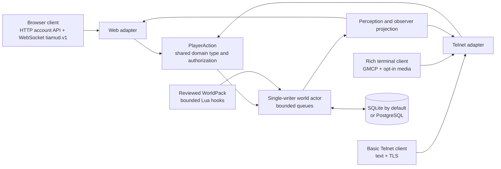
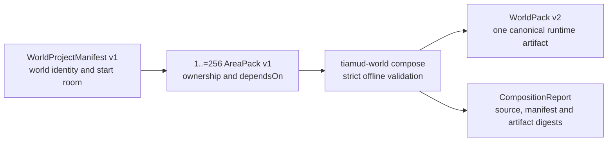

<h1 align="center">
  
</h1>

<p align="center">
  <a href="https://github.com/hyukudan/tiamud/actions/workflows/ci.yml"></a>
  <a href="#licensing"></a>
  <a href="https://www.rust-lang.org/"></a>
</p>


**A multiplayer narrative engine for worlds that read beautifully, run
locally and remain playable everywhere.**

Tiamud is a Rust engine for persistent multiplayer text worlds, inspired by
EnvyMUD, Merc and other classic MUDs. It is **browser-first, not
browser-only**, and **text-complete, not text-only**: the official web client
adds atmosphere and accessible controls, while every playable fact remains
available as text and a basic Telnet client remains a first-class way to
play.

It exists to pair a modern, illustrated, accessible browser experience with
the operational simplicity of a classic single-process server. The server,
the reviewed Lantern Square world, the browser client and SQLite storage fit
in one process on one ordinary host; Kubernetes, Redis, object storage and
microservices are deliberately not dependencies
([ADR 0001](docs/decisions/0001-project-foundation.md)). PostgreSQL, richer
terminal clients, media processing and editorial AI are optional additions
rather than runtime requirements.

**Contents:** [What is included](#what-is-included) ·
[Choose a surface and store](#choose-a-surface-and-store) ·
[Quick start](#quick-start) · [Runtime configuration](#runtime-configuration) ·
[Storage](#storage-one-backend-chosen-at-startup) ·
[Media](#media-that-degrades-safely) · [Accessibility](#accessibility) ·
[Security](#security-and-operating-model) ·
[Author and operator tools](#author-and-operator-tools) ·
[Verification](#verification) · [Status](#project-status-and-limits) ·
[Repository map](#repository-map) ·
[Documentation index](#documentation-index) ·
[Contributing](#contributing) · [Licensing](#licensing)

## What is included

- **A persistent shared world.** Accounts, characters, rooms, objects, NPCs,
  equipment, combat, progression, quests, parties, economy, chat, moderation,
  logical time and weather survive clean restarts. The bundled Lantern Square
  world is deliberately small — three reviewed rooms — because it is
  reference content for the engine, not a finished game.
- **One game, multiple clients.** Browser and Telnet gameplay inputs parse
  into the same transport-neutral `PlayerAction` values with shared
  authorization. Observer-specific perception is applied before either
  protocol receives a scene or event.
- **A modern browser experience.** Responsive Svelte 5 UI, typed reconnect
  and snapshot recovery, typed access rejection, a 500-entry anchored
  scrollback, persistent command history, map, accessible panels, persistent
  media/motion/contrast preferences and a bounded Service Worker.
- **A capable terminal experience.** Fragment-safe Telnet negotiation, ANSI,
  GMCP, MSSP, MCCP2, opt-in MXP/MSLP links, direct TLS and opt-in cell-art
  graphics; official TinTin++ and Mudlet integrations are included. The
  production byte parser is shared with its bounded fuzz target, and live
  world/chat updates use bounded session-addressed mailboxes instead of a
  global broadcast fan-out.
- **Authored worlds with guardrails.** Versioned WorldPacks, deterministic
  build/diff/preview/test/publish/rollback tools, compile-validated and
  quota-bounded Lua hooks, immutable content-addressed assets and explicit
  provenance. Editorial AI is optional, authoring-only and never part of the
  game loop.
- **Operator-facing safety.** Argon2id credentials, revocable sessions,
  a bounded password-work service, authorization and rate limits, bounded
  queues, health and Prometheus endpoints, graceful shutdown, schema-v8 event
  watermarks/compaction, verified SQLite backup/restore, an explicit
  PostgreSQL mover and reproducible release tooling.


### One authoritative action path



Stable world identifiers and hidden variants stay behind the projection
boundary. Clients receive session-opaque view IDs and only the facts their
character is allowed to perceive. When a browser sequence gap occurs, the
client requests a fresh authoritative snapshot instead of guessing or blindly
replaying events. The browser wire contract is documented in
[`tiamud.v1`](docs/protocol/tiamud-v1.md) and is explicitly experimental
before its first public compatibility milestone.

## Choose a surface and store

| Layer | Local/default | Public/alternative | Important property |
| --- | --- | --- | --- |
| Play | Browser over HTTP locally | HTTPS/WSS behind Caddy | Illustrated, responsive and keyboard accessible |
| Terminal | Explicit plaintext on trusted localhost/LAN | Direct Telnet TLS | Complete clean-text fallback; rich features require consent |
| Persistence | Embedded SQLite | PostgreSQL via an explicit offline transfer | Exactly one backend; Tiamud never dual-writes |
| World | Embedded Lantern Square WorldPack | Reviewed external WorldPack | Deterministic validation and digest-based rollback |

## Quick start

You need Git, `rustup`, a C/C++ compiler and linker, CMake,
Node.js 20.19+ (or 22.12+) and pnpm 10+ to build and test the web client;
the load and soak harnesses require Node.js 24, which is also used by the
documented full verification profile. Node and pnpm are build and test tooling,
not runtime services for the built server. The workspace declares Rust 1.88 as
its minimum supported version, while this checkout and the CI, release and soak
workflows select Rust 1.93.1; those workflows also pin Node.js 24 and pnpm
11.11.0.

```sh
git clone https://github.com/hyukudan/tiamud.git
cd tiamud
pnpm --dir apps/web install --frozen-lockfile
pnpm --dir apps/web build
TIAMUD_TELNET_MODE=plaintext cargo run --locked -p tiamud-server
```

Build the web client before the server: the Rust build embeds
`apps/web/dist` at compile time, so the resulting binary carries both the
browser client and the Lantern Square WorldPack with no separate services.
Then open <http://127.0.0.1:8080> or connect a Telnet client to
`127.0.0.1:4000`.

> `TIAMUD_TELNET_MODE=plaintext` is a deliberate local-development exception.
> It logs a warning because Telnet registration and login are unencrypted.
> Never expose that listener to the public Internet. The default mode is TLS
> and startup fails closed without a valid certificate and private key.

The default SQLite database is created at `data/tiamud.db` on first run.
Try:

```text
look                       north / east / south / west
inventory                  take / drop / examine / use <target>
equip / unequip <target>   attack <target>
weather                    time
quest ...                  party ...
balance / shop / buy ...   say / tell / who / help ...
```

See the [single-host runbook](docs/operations/single-host.md) for HTTPS/WSS,
direct Telnet TLS, Caddy, hardened systemd, backups, monitoring, updates and
rollback on one Linux host.

## Runtime configuration

The most useful settings are:

| Variable | Default | Purpose |
| --- | --- | --- |
| `TIAMUD_HTTP_ADDR` | `127.0.0.1:8080` | HTTP, WebSocket, health and metrics listener |
| `TIAMUD_TELNET_ADDR` | `127.0.0.1:4000` | Direct Telnet listener |
| `TIAMUD_TELNET_MODE` | `tls` | Exactly `tls` or explicit `plaintext` |
| `TIAMUD_TELNET_TLS_CERT` / `TIAMUD_TELNET_TLS_KEY` | — | PEM identity required by Telnet TLS |
| `TIAMUD_DB_PATH` | `data/tiamud.db` | Default SQLite database; must not be set with `TIAMUD_DATABASE_URL` |
| `TIAMUD_DATABASE_URL` | — | Alternative `sqlite://`, `postgresql://` or `postgres://` URL; mutually exclusive with `TIAMUD_DB_PATH` |
| `TIAMUD_WORLD_PACK` | embedded pack | Path to a reviewed external WorldPack |
| `TIAMUD_TICK_MILLIS` | `1000` | Logical world tick interval |
| `RUST_LOG` | `tiamud_server=info,tower_http=info` | Structured application log filter |

Authentication, command, session and TLS-handshake limits are configurable as
well. [`deploy/tiamud.env.example`](deploy/tiamud.env.example) is the reviewed
production example; the [single-host runbook](docs/operations/single-host.md)
explains the operational choices and additional storage settings.

Health and metrics:

- `/health/live` checks that the HTTP process responds.
- `/health/ready` reports readiness/availability by probing the world actor
  and the selected storage worker.
- `/metrics` exposes Prometheus data on the same HTTP listener, which binds
  to loopback by default. The provided Caddy configuration deliberately does
  not publish it.

## Storage: one backend, chosen at startup

Tiamud opens exactly one persistence backend per process and never
dual-writes; startup rejects a configuration that names both.

- **SQLite is the default.** With nothing configured, the server uses
  `data/tiamud.db`. The `tiamud-admin` CLI provides integrity checks, safe
  schema migration and verified backup create/verify/restore for this
  profile.
- **PostgreSQL is an explicit alternative, not a replica.** It is selected
  only by `TIAMUD_DATABASE_URL=postgres://…`. The offline
  `tiamud-migrate-postgres` tool copies one current SQLite snapshot into an
  empty PostgreSQL schema and requires `--confirm-offline`.
- Both backends share schema version 8, including event watermarks and
  transactional event compaction. `tiamud-admin backup` subcommands are
  SQLite tools; PostgreSQL installations use native PostgreSQL backup
  procedures, as the [single-host runbook](docs/operations/single-host.md)
  spells out.

PostgreSQL integration tests are opt-in (`TIAMUD_TEST_POSTGRES_URL`) against
a disposable database. A complete local acceptance run against PostgreSQL
18.4 — opt-in suites, verified SQLite backup/restore digest, the offline mover
and a mixed WebSocket/Telnet runtime — is recorded in the
[completion matrix](docs/project/COMPLETION_MATRIX.md) and project log.

## Media that degrades safely

Illustration and audio set the mood; text carries the game. That boundary is
structural rather than stylistic:

- Scene media is classified as atmosphere and never carries an exclusive
  gameplay fact. Alternative text is mandatory, and losing an image removes
  only the image ([protocol contract](docs/protocol/tiamud-v1.md)).
- The [asset pipeline](crates/asset-pipeline/README.md) compiles reviewed
  source illustrations into immutable, content-addressed **AVIF-first**
  renditions with WebP and JPEG fallbacks at 640 and 1280 pixel widths, each
  carrying license, provenance and review metadata.
- The browser requests media only when preferences allow it: Save-Data and
  screen-reader modes stop scene-image requests entirely, audio stays off
  until an explicit user gesture, and motion combines the system setting
  with a manual override.
- Terminal players get complete plain text by default. GMCP-negotiated media
  URLs, MXP/MSLP links and bounded cell-art graphics (ANSI, or Kitty, Sixel
  and iTerm2 rasters) each require explicit opt-in; announcing a
  graphics-capable terminal type is never treated as consent.

## Accessibility

Text completeness is the foundation: everything the game can do is playable
from a plain text stream. On top of that, the browser client uses semantic
landmarks, a `role="log"` narrative history, selective live announcements,
keyboard-operable native controls, forced-colors support and persistent
text-size, contrast, reduced-motion and screen-reader preferences.

The Playwright suite is configured to run axe WCAG 2.2 A/AA, keyboard,
mobile-overflow and reader-mode checks across Chromium, Firefox and WebKit in
CI. The current combined tree passed 22/22 Chromium and Firefox scenarios;
WebKit discovered its eleven scenarios but could not load on the latest
validation host because its GTK/GStreamer runtime libraries were absent. That
automation is deliberately not oversold: a current WebKit pass and a manual
pass with real screen-reader software remain open acceptance items, tracked in
the [completion matrix](docs/project/COMPLETION_MATRIX.md).

## Security and operating model

Tiamud is designed to fail closed at trust boundaries, but a secure public
installation still depends on correct host operation.

- Use HTTPS/WSS for the browser and direct TLS for public Telnet. Keep
  plaintext Telnet on an explicitly trusted network only.
- Keep `/metrics`, database files, private keys, WorldPack staging areas and
  backups off the public surface.
- Run the service as a dedicated unprivileged account and put ordinary
  firewall, proxy limits, log retention and off-host backups around it. The
  reviewed [systemd unit](deploy/tiamud.service) and
  [Caddyfile](deploy/Caddyfile) are the reference examples.
- Treat `/health/ready` as a readiness/availability signal, not as proof of
  data integrity. Exercise `tiamud-admin check`, verified backups and restore
  tests.
- Review every imported area and asset license. The importer never converts
  unknown provenance into permission to redistribute material.
- Follow [SECURITY.md](SECURITY.md) for private reporting. Use GitHub's
  private vulnerability reporting form when it is enabled; otherwise use the
  fallback described there. Never publish exploitable details in an issue.

The reference deployment is intentionally one process on one host. It has
bounded actor, persistence and transport queues; slow clients lose
lower-value updates first and are disconnected if critical output cannot
drain. `SIGTERM` and `SIGINT` stop new listeners, place a barrier behind
accepted world actions, then drain and close persistence.

## Author and operator tools

The workspace ships focused CLIs rather than putting maintenance powers in
the live player protocol.

| Tool | Purpose |
| --- | --- |
| `tiamud-admin` | Integrity checks, safe migration and SQLite backup/verify/restore |
| `tiamud-world` | Compose, validate, build, diff, preview, test, publish and roll back WorldPacks |
| `tiamud-assets` | Compile responsive content-addressed media with provenance and review metadata |
| `tiamud-migrate-postgres` | Move one offline current SQLite snapshot into an empty PostgreSQL schema |
| `envy-import` | Audit or conservatively convert historical EnvyMUD/Merc-family areas without executing programs |

Examples:

```sh
# Check the default local database and reviewed world.
cargo run -p tiamud-admin -- check \
  --database data/tiamud.db \
  --world-pack worlds/lantern-square.world.json

# Validate and preview a WorldPack without publishing it.
cargo run -p world-pack --bin tiamud-world -- validate \
  worlds/lantern-square.world.json
cargo run -p world-pack --bin tiamud-world -- preview \
  worlds/lantern-square.world.json \
  --room demo:lantern-square --format ansi

# Audit a historical area; unsupported records remain inert diagnostics.
cargo run -p envy-import -- audit path/to/area.are
```

### Modular world authoring


Editors can split a world into bounded, independently owned areas without
changing the runtime contract. A project manifest names between 1 and 256
strict `AreaPack` modules; `tiamud-world compose` resolves their declared
dependencies and emits the one canonical `WorldPack` document consumed by the
server.



The reviewed Lantern Square project composes three areas—`square`, `archive`
and `north-gate`—with the real command below:

```sh
mkdir -p build/worlds
cargo run --locked -p world-pack --bin tiamud-world -- compose \
  worlds/lantern-square.project.json \
  --output build/worlds/lantern-square.composed.world.json
```

Composition is deterministic, atomic and implemented today. Its report
records the ownership of every structured record, declared dependencies,
cross-area references, exact source SHA-256 values, and canonical manifest
and artifact digests. Each area file, all area sources together and the
composed artifact are independently capped at 16 MiB. Validation compiles
every Lua module, checks each declared hook and rejects room/hook batches
above eight modules. NPC loot is allocated exactly once and staged outside
room projection until its initial NPC spawn takes ownership. Hook execution
at runtime is quota-bounded — instruction, memory, wall-clock and event caps
per script — as documented in the
[scripting runtime](crates/scripting/README.md).

The current server still loads exactly one complete WorldPack at startup; it
does not compose, hot-load or evict areas while running. A resident catalog,
immutable area bundles, hot activation and LRU lifecycle are future
architecture—not implemented runtime behavior—documented in
[ADR 0005](docs/decisions/0005-hot-area-lifecycle.md) (Spanish). See the
complete [world-authoring guide](docs/world-authoring.md) (Spanish) for
schemas, dependency rules, validation, content tests, publication and
rollback.

### Historical import

Historical EnvyMUD/Merc-family area files are importer input, never the
runtime model: the server consumes only versioned WorldPacks.
[`envy-import`](tools/envy-import/README.md) is an offline, deliberately
conservative bridge — its currently tested subset targets stock EnvyMUD 2.2
area structure — and imported data is never executed. It preserves ROM-style
alphabetic flag bitvectors verbatim rather than guessing their numeric
meaning, and it retains directed-unreachable rooms with review diagnostics
because one-way travel, portals and scripts cannot be inferred safely from
static exits alone. Everything outside the safe conversion subset stays
inert, structured and flagged for human review.

### Optional editorial AI

Editorial AI is a WorldPack authoring aid, never a runtime feature; the game
server does not depend on the [editorial-ai
crate](crates/editorial-ai/README.md) at all. The default provider is `none`
and fails closed. Local Ollama and llama.cpp adapters must point at
loopback; a remote OpenAI-compatible provider is used only when explicitly
configured and must use HTTPS. The feature-gated `tiamud-world ai-draft` and
`ai-review` commands only produce drafts and review notes that flow through
the same validation and human review as any other authored change.

## Verification

Representative local gates are shown below. The workflows pin their
toolchains and run the documented profiles with their own exact parameters.

```sh
pnpm --dir apps/web check
pnpm --dir apps/web test
pnpm --dir apps/web build
pnpm --dir apps/web exec playwright install --with-deps chromium firefox webkit
pnpm --dir apps/web e2e
bash scripts/verify-project-licenses.sh
node scripts/generate-third-party-notices.mjs --check
node --test scripts/verify-soak-report.test.mjs

cargo fmt --all -- --check
cargo test --workspace --locked
cargo clippy --workspace --all-targets --locked -- -D warnings
cargo test -p tiamud-telnet-codec --locked

node scripts/smoke.mjs
node scripts/load.mjs --users 2 --telnet-users 1 --rounds 2 --concurrency 2 --pace-ms 100
```

The Playwright install step fetches Chromium, Firefox and WebKit plus the
native dependencies required before `e2e`. The load and soak harnesses enforce
Node.js 24; CI and the documented full verification profile also use it. CI
additionally checks Rust advisories and dependency sources with `cargo-deny`
against [`deny.toml`](deny.toml). PostgreSQL integration
tests are intentionally opt-in and require a disposable external database. See the
[completion matrix](docs/project/COMPLETION_MATRIX.md) for
requirement-by-requirement evidence and
[soak-testing.md](docs/operations/soak-testing.md) before interpreting short
load tests as long-duration acceptance.

The weekly/manual fuzz workflow runs a bounded campaign against the same
production Telnet parser the server uses; see
[fuzz/README.md](fuzz/README.md) for the local harnesses. One completed
pinned-toolchain campaign — 3,081,428 executions in 121 seconds with no
crash, timeout or memory failure — is recorded in the completion matrix. A
configured workflow is still never counted as a successful run by itself.

## Project status and limits

Tiamud is the definitive product name. The workspace packages are versioned
`0.1.0`; implementation and acceptance are tracked requirement by requirement
against the repository's historical [v0.2 specification](docs/spec-v0.2.md)
(Spanish). The [completion matrix](docs/project/COMPLETION_MATRIX.md) is
authoritative whenever this summary and retained evidence differ.

**Implemented with focused automated coverage:** the engine, the default
world, the browser and Telnet paths, the SQLite and PostgreSQL adapters, the
authoring and operator tooling, and the automated browser harnesses.

**Locally validated evidence:** release archives have reproduced
byte-for-byte across isolated local builds; a complete opt-in PostgreSQL 18.4
acceptance run is recorded; the official 30-second soak profile passes with
zero errors; and a bounded pinned-toolchain Telnet fuzz campaign completed
without a failure artifact.

**Remaining external acceptance gates**, kept visible rather than folded into
broad “production-ready” language:

- run and archive a successful 24-hour soak report for the exact release
  candidate — acceptance criterion 19 stays open until a retained report
  passes the deterministic verifier; a running soak, a shorter profile or an
  unverified JSON file is not acceptance;
- perform and retain a manual pass with real screen-reader software;
  automated axe, keyboard, responsive and reader-mode coverage is retained
  separately;
- make the canonical GitHub repository publicly visible; it is still private;
- produce a tagged release with independently verified OIDC provenance;
  local archives reproducing byte-for-byte is necessary but not sufficient;
- complete the trademark and domain review — the dated
  [name/domain pre-check](docs/project/NAME_DOMAIN_PRECHECK.md) is not
  clearance or a reservation.

Two standing qualifications: the browser WebSocket protocol is explicitly
experimental before its first public compatibility milestone, and the
single-host material is a reviewed reference configuration, not evidence
that a live public Tiamud service has been installed.

## Repository map

```text
apps/web/                    official Svelte 5 browser client
clients/                     TinTin++ and Mudlet integrations
crates/mud-core/             transport-independent domain and perception
crates/mud-server/           actor, transports, storage adapters, embedded web
crates/telnet-codec/         Telnet byte parser shared by server and fuzzing
crates/cell-frame/           bounded, consent-gated terminal cell art
crates/persistence-*/        shared SQLite schema and PostgreSQL transfer
crates/world-pack/           world model and authoring CLI
crates/scripting/            quota-limited Lua capabilities
crates/asset-pipeline/       deterministic reviewed media pipeline
crates/editorial-ai/         optional authoring-only AI adapters
crates/tiamud-admin/         operator integrity and recovery CLI
tools/envy-import/           offline historical area importer
worlds/                      reviewed source WorldPacks and area modules
fuzz/                        bounded cargo-fuzz harnesses
scripts/                     smoke, load, soak and license tooling
docs/                        spec, ADRs, protocol, operations and status
deploy/                      Caddy, systemd and environment examples
.github/workflows/           CI, release, soak and fuzz pipelines
```

## Documentation index

English is the repository's primary documentation language; the remaining
Spanish documents are marked.

- **Protocol:** [`tiamud.v1` browser wire contract](docs/protocol/tiamud-v1.md)
  (experimental)
- **Operations:** [single-host runbook](docs/operations/single-host.md) ·
  [release construction and verification](docs/operations/releases.md) ·
  [load and soak evidence](docs/operations/soak-testing.md) ·
  [operator CLI](crates/tiamud-admin/README.md)
- **Authoring:** [world-authoring guide](docs/world-authoring.md) (Spanish) ·
  [asset pipeline](crates/asset-pipeline/README.md) ·
  [scripting runtime](crates/scripting/README.md) ·
  [editorial AI](crates/editorial-ai/README.md) ·
  [historical importer](tools/envy-import/README.md)
- **Clients:** [web client](apps/web/README.md) ·
  [TinTin++](clients/tintin/README.md) · [Mudlet](clients/mudlet/README.md)
- **Decisions:** [ADR 0001 project foundation](docs/decisions/0001-project-foundation.md) ·
  [ADR 0002 runtime world and durable identity](docs/decisions/0002-runtime-world-and-durable-identity.md) ·
  [ADR 0003 Tiamud product identity](docs/decisions/0003-tiamud-product-identity.md) ·
  [ADR 0004 open-source licensing](docs/decisions/0004-open-source-licensing.md) ·
  [ADR 0005 hot area lifecycle](docs/decisions/0005-hot-area-lifecycle.md)
  (Spanish; future architecture)
- **Status:** [completion matrix](docs/project/COMPLETION_MATRIX.md)
  (authoritative) · [historical v0.2 specification](docs/spec-v0.2.md)
  (Spanish) · [name/domain pre-check](docs/project/NAME_DOMAIN_PRECHECK.md)
- **Testing:** [fuzz harnesses](fuzz/README.md)
- **Image provenance:** [docs/images/README.md](docs/images/README.md)

## Contributing

Issues and pull requests are welcome. Keep domain behavior transport-neutral,
preserve text completeness, maintain strict bounds at untrusted inputs, and
add focused coverage for parser, state, persistence and authorization
changes. Run the relevant [verification gates](#verification) before opening
a pull request. Documentation claims are treated like code: keep them
consistent with retained evidence and the completion matrix.

Contributions intentionally submitted for inclusion are accepted under the
same software or content terms that apply to the files being changed. No
historical MUD source code, area, help text or media is bundled with Tiamud;
compatibility does not grant redistribution rights.

## Licensing

The [software licensing notice](LICENSE) covers source, tests, binaries,
configuration, build and deployment material, and scripts under your choice
of the [MIT License](LICENSE-MIT) or the
[Apache License 2.0](LICENSE-APACHE), expressed as `MIT OR Apache-2.0` in
package metadata.

Original narrative and world data, documentation prose, artwork, audio and
derived image/audio renditions are available under [Creative Commons
Attribution 4.0 International](LICENSE-CONTENT.md); the complete legal text
is retained in [LICENSE-CC-BY-4.0](LICENSE-CC-BY-4.0). Asset manifests keep
per-asset provenance and license metadata. The README illustrations have
their generation and processing record in
[docs/images/README.md](docs/images/README.md).

A source tree, browser distribution, executable or release archive may
contain both software and content. Inclusion in that mixed artifact does not
apply CC BY 4.0 to the software or the software licenses to the content.
Third-party and imported material keeps its own terms and is never relicensed
merely by passing through a Tiamud tool. Locked release dependencies and
their retained license texts are recorded in
[THIRD_PARTY_NOTICES.md](THIRD_PARTY_NOTICES.md).
