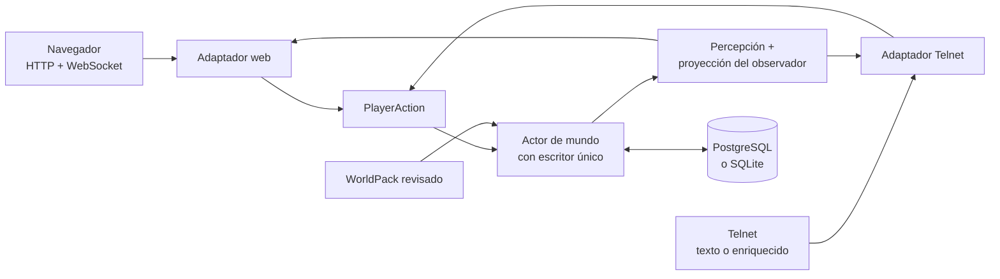
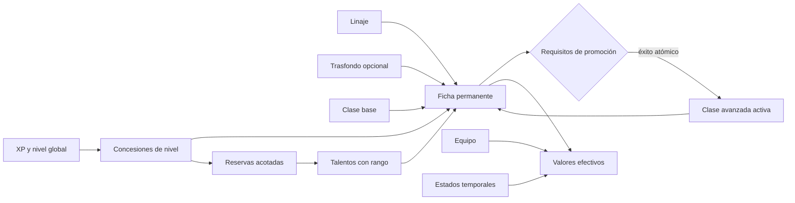
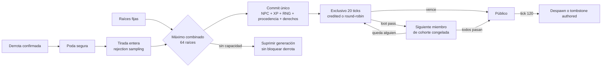
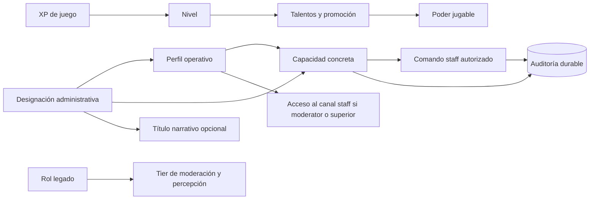

<h1 align="center">
  
</h1>

<p align="center">
  <a href="https://github.com/hyukudan/tiamud/actions/workflows/ci.yml"></a>
  <a href="#licencia"></a>
  <a href="https://www.rust-lang.org/"></a>
</p>


**Motor narrativo multijugador orientado al navegador y completamente jugable
como texto.**

Tiamud es un motor en Rust, aún en prelanzamiento, para crear mundos
multijugador persistentes. Está inspirado en EnvyMUD, Merc y la tradición de
los MUD clásicos, pero es una implementación nueva. El cliente web oficial
añade ilustración atmosférica, audio y controles accesibles; cada hecho y cada
acción jugable siguen disponibles mediante prosa y estado estructurado. Un
cliente Telnet básico continúa siendo una forma de juego de primera clase.

El proyecto está diseñado primero para **un único equipo**. Un proceso sirve el
mundo, el navegador y Telnet en un host corriente. PostgreSQL es el perfil
recomendado para una instalación pública nueva; SQLite es la ruta implementada
sin configuración para desarrollo, juego local y compatibilidad. Cada servidor
abre exactamente un sistema de persistencia y nunca escribe en ambos. El
baseline no requiere Kubernetes, Redis, almacenamiento de objetos ni IA.

> Tiamud está en desarrollo activo. Existe cobertura automatizada amplia, pero
> todavía no hay un despliegue público de producción ni una versión estable del
> protocolo. La [matriz de completitud](docs/project/COMPLETION_MATRIX.md)
> distingue implementación, evidencia retenida y aceptación pendiente.

## Qué funciona hoy

- **Mundo persistente:** cuentas, personajes, salas, objetos, NPC, equipo,
  combate, misiones, grupos, economía, tiempo lógico y clima. Los objetos
  separan prototipos reutilizables e instancias durables, con capacidad por
  slots/peso, pilas fungibles derivadas, contenedores acotados y botín fijo y
  repetible;
  `give`, políticas de transferencia e intercambio bilateral confirmado con
  objetos y moneda ya funcionan. Las tablas ponderadas enteras, la procedencia,
  los derechos exclusivos y el reparto de grupo round-robin también funcionan.
- **Personajes definidos por datos:** el modelo de personaje v3 modela linajes, trasfondo
  opcional, clases base y avanzadas, una curva global de XP, talentos con rango
  y promociones atómicas. Atributos, habilidades, recursos, resistencias,
  tiempos de reutilización y estados están acotados.
- **Grupos y conversación:** `say` local, `tell` y `reply` en línea, chat de
  grupo, liderazgo completo y canales suscritos `general`, `newbie` y `staff`.
  `staff` exige perfil `moderator`, `administrator` o `implementor`. Navegador,
  Telnet y GMCP comparten la misma política social.
- **Staff por capacidades:** cinco perfiles operativos, doce capacidades
  cerradas, cola y resolución de reportes, acciones de diagnóstico/reparación
  del mundo y auditoría append-only. El perfil puede añadir un título narrativo,
  pero ni ese título ni XP, clase, WorldPack o el rol legado autorizan comandos.
- **Una ruta autoritativa:** navegador y Telnet producen las mismas
  `PlayerAction`, pasan por las mismas reglas y mutan un único actor de mundo.
- **Clientes web y terminal:** Svelte 5 adaptable; Telnet plano/ANSI; GMCP,
  MSSP, MCCP2, MXP/MSLP opcional; integraciones TinTin++ y Mudlet.
- **Multimedia segura:** imagen de escena y audio opcionales, recursos
  inmutables direccionados por contenido, texto alternativo y preferencias de
  medios, movimiento, contraste y lector de pantalla.
- **Autoría modular:** AreaPack v5 permite dividir un mundo en áreas; la
  composición sin conexión de WorldProject v2 produce un WorldPack v6
  canónico, determinista y revisable. El servidor aún carga un único paquete
  completo al arrancar.
- **Operación en un host:** adaptadores PostgreSQL/SQLite, credenciales
  Argon2id, sesiones revocables, colas acotadas, salud, métricas Prometheus,
  apagado ordenado, copia/restauración SQLite y traslado explícito a PostgreSQL.


## Arquitectura



Cuatro límites mantienen el motor flexible:

1. **Los transportes analizan; el dominio decide.** Una acción estructurada del
   navegador no es un atajo para evitar reglas.
2. **Un escritor posee el mundo.** Las colas acotadas y los checkpoints
   durables ordenan el estado; si falla la persistencia se restaura exactamente
   el estado anterior en memoria.
3. **La percepción precede al protocolo.** Variantes ocultas e IDs estables no
   salen del servidor. Cada sesión recibe IDs opacos y solo hechos autorizados.
4. **La presentación es sustituible.** Texto, color terminal, imágenes, audio y
   composición visual representan el mismo estado semántico.

El contrato experimental del navegador está documentado en
[`tiamud.v1`](docs/protocol/tiamud-v1.md). Ante un hueco de secuencia, el
cliente pide una instantánea autoritativa; no inventa estado ni reproduce
acciones a ciegas.

## Inicio rápido

Se necesita Git, `rustup`, compilador/enlazador C/C++, CMake, Node.js 20.19+
(o 22.12+) y pnpm 10+. Las herramientas de carga y soak requieren Node.js 24.
Node y pnpm solo se usan para construir el cliente, no como servicios del
servidor compilado.

```sh
git clone https://github.com/hyukudan/tiamud.git
cd tiamud
pnpm --dir apps/web install --frozen-lockfile
pnpm --dir apps/web build
TIAMUD_TELNET_MODE=plaintext cargo run --locked -p tiamud-server
```

Abre <http://127.0.0.1:8080> o conecta Telnet a `127.0.0.1:4000`. El servidor
Rust incluye la compilación web y el WorldPack revisado de Lantern Square.

> Telnet sin cifrar es una excepción para desarrollo local. No debe exponerse
> a Internet: registro y acceso viajarían sin cifrar. Telnet TLS es el modo
> predeterminado y falla de forma cerrada sin certificado y clave válidos.

Comandos representativos:

```text
look                       north / east / south / west
inventory                  take / drop [cantidad] <objeto>
loot / loot status         loot pass <objeto-reservado>
give [cantidad] <objeto> to <personaje>
trade request <personaje>  trade accept / decline / status / cancel
trade offer item [cantidad] <objeto>   trade remove item <objeto>
trade offer coins <cantidad>  trade contents <contenedor-ofrecido> [página]
trade confirm <revisión>
contents <contenedor> [página]
put [cantidad] <objeto> in <contenedor>
get [cantidad] <objeto> from <contenedor>
examine / use <objetivo>   equip / unequip <objetivo>
attack <objetivo>
ability <id> [objetivo]    cast <id> [objetivo]
promote <class-id>         talent learn <graph-id> <node-id>
weather                    time
quest ...                  party create / invite / accept / status
party revoke / kick / transfer / disband / leave
party say <texto>          gsay / gtell <texto>
say / tell / reply         who / help / ignore / block
channels                   channel join / leave <canal>
channel say <canal> <texto>  gossip / newbie / wiznet <texto>
balance / shop / buy ...
staff
staff status                staff reports <motivo>
staff resolve <id> <dismissed|action_taken|no_action> <motivo>
staff inspect <nombre> | <motivo>   staff where <nombre> | <motivo>
staff goto <nombre> | <motivo>      staff transfer <nombre> | <motivo>
staff restore <nombre> | <motivo>   staff announce <texto> | <motivo>
staff audit <motivo>
staff profile <nombre> <helper|builder|moderator|administrator|implementor|none> <título|none> | <motivo>
staff capability <grant|revoke> <nombre> <capacidad> | <motivo>
```

## Despliegue en un único equipo

| Capa | Local/privado | Perfil público nuevo en un host |
| --- | --- | --- |
| Navegador | HTTP en bucle local | HTTPS/WSS detrás de Caddy |
| Terminal | `plaintext` explícito en localhost/LAN confiable | Telnet TLS directo |
| Persistencia | SQLite sin configuración | PostgreSQL en el mismo equipo |
| Mundo | WorldPack de ejemplo embebido | WorldPack externo revisado |

La [guía de operación](docs/operations/single-host.md) cubre Caddy, systemd,
Telnet TLS, copias, monitorización, actualización y reversión. Los ejemplos
revisados están en [`deploy/`](deploy/).

| Variable | Valor predeterminado | Finalidad |
| --- | --- | --- |
| `TIAMUD_HTTP_ADDR` | `127.0.0.1:8080` | HTTP, WebSocket, salud y métricas |
| `TIAMUD_TELNET_ADDR` | `127.0.0.1:4000` | Punto de escucha Telnet |
| `TIAMUD_TELNET_MODE` | `tls` | Solo `tls` o `plaintext` explícito |
| `TIAMUD_TELNET_TLS_CERT` / `TIAMUD_TELNET_TLS_KEY` | — | Identidad PEM de Telnet TLS |
| `TIAMUD_DB_PATH` | `data/tiamud.db` | Ruta SQLite sin URL de base de datos |
| `TIAMUD_DATABASE_URL` | — | Perfil PostgreSQL o URL `sqlite://` explícita |
| `TIAMUD_WORLD_PACK` | paquete embebido | WorldPack externo revisado |
| `TIAMUD_TICK_MILLIS` | `1000` | Cadencia del ciclo lógico |
| `RUST_LOG` | `tiamud_server=info,tower_http=info` | Filtro de registro estructurado |

`TIAMUD_DB_PATH` y `TIAMUD_DATABASE_URL` son excluyentes. El traslado de
SQLite a PostgreSQL es una operación sin conexión, no replicación. Los datos
consultables siguen siendo relacionales; las instantáneas JSON acotadas se
guardan como texto opaco porque el servidor no consulta su interior.

Ambos adaptadores implementan actualmente el **esquema v11**. La migración
v10→v11 reconstruye de forma transaccional la custodia opaca del runtime para
admitir el snapshot v6 de hasta 2 MiB; los snapshots legacy v1–v5 siguen
limitados a 1 MiB al decodificarse. Se conservan las relaciones sociales y de
staff de v9/v10, y el traslado SQLite→PostgreSQL las copia junto con el estado
actual. La evidencia real PostgreSQL retenida acredita v8: todavía no existe
una aceptación PostgreSQL v11 contra un servidor real.

Si una instalación pierde toda autoridad administrativa, la recuperación
offline documentada no se limita al rol legado: `tiamud-admin recover-admin`
instala un `implementor` con exactamente las doce capacidades y ambas
auditorías en una transacción. Se niega si ya existe un perfil
`administrator`/`implementor`; el procedimiento SQLite y su equivalente
PostgreSQL están en la [guía de operación](docs/operations/single-host.md#emergency-implementor-recovery).

`/health/live` y `/health/ready` exponen salud. `/metrics` ofrece Prometheus en
el mismo punto de escucha, ligado por defecto a bucle local; la configuración
de referencia de Caddy no publica métricas.

## Personajes, clases y progresión

WorldPack v6 conserva el modelo de personaje v3: compone un personaje con
linaje, trasfondo opcional y clase base.
Una XP acumulada gobierna el nivel global, las concesiones de clase y reservas
de puntos separadas. Hay una clase activa y un historial ordenado, no
multiclase libre.



Las promociones avanzadas pueden exigir nivel, atributos, habilidades,
misiones, señales, linaje, clase actual o histórica, habilidades aprendidas y
talentos previos. La promoción conserva XP/nivel, actualiza una sola vez la
clase activa y aplica únicamente concesiones validadas. Los talentos consumen
su reserva y respetan prerrequisitos y exclusiones.

Navegador y Telnet exponen el mismo catálogo. Una selección omitida usa el
valor predeterminado del mundo; un trasfondo explícitamente vacío es diferente
del trasfondo predeterminado. Telnet recibe además la ficha mediante
`Tiamud.Character` GMCP.

| Dimensión | Ejemplos revisados |
| --- | --- |
| Linajes | Mortal, Stonekin, Embermarked |
| Trasfondos | Caravan Scout, Archive Apprentice, City Guard |
| Clases base | Wanderer, Vanguard, Arcanist |
| Clases avanzadas | Pathfinder, Bastion, Stormcaller, Spellblade |

WorldPack v5/v4/v3/v2, AreaPack v4/v3/v2/v1 y Envy/Merc solo entran por límites
explícitos de normalización/importación; `archetype` no es una segunda
identidad del personaje. Los IDs publicados son la frontera de migración de
contenido.

No existe entrenamiento general por uso. El crecimiento permanente procede de
concesiones de creación, nivel, talento y promoción. El incremento heredado de
`combat` al derrotar un NPC es deuda de política del mundo de ejemplo, no un
sistema general de entrenamiento.

Consulta el [diseño de progresión v3](docs/design/character-progression-v3.md)
y la [guía de autoría](docs/authoring/README.md).

## Sistemas sociales, staff e inventario

Los términos clásicos pueden ocultar sistemas distintos. Esta tabla separa lo
implementado de la hoja de ruta.

| Sistema | Implementado | Pendiente |
| --- | --- | --- |
| Conversación | `say` local; `tell` online; `reply` al último remitente válido mientras siga conectado; `who`, `help`, ignore, block y report; chat de grupo; canales suscritos `general`, `newbie`, `staff`. | Correo e historial durable, shout/yell espacial, emotes, tablones y telepatía definida por el mundo. `tell` no es telepatía. |
| Grupos | Hasta seis miembros; crear, invitar, aceptar, revocar, expulsar, transferir, disolver, salir, consultar y `party say`. La membresía persiste offline; accept/revoke/kick/transfer resuelven por nombre conectado. Una cohorte congelada de miembros próximos y vivos participa en el reparto round-robin del botín. | Gestión dirigida de miembros desconectados, follow, assist/rescue, selección general de aliados, XP/crédito de misión compartidos y reparto need/greed, master-loot o por contribución. |
| Canales | Suscripción persistente en SQLite/PostgreSQL v11; `staff` exige perfil `moderator`, `administrator` o `implementor` al unirse, enviar y recibir; `helper` y `builder` no acceden. `announcement` es entrega de servidor, no un canal al que el jugador se suscribe o escribe. Web, texto Telnet y `Comm.Channel.Text` GMCP son equivalentes. | Historial, retención, búsqueda, moderación de archivo y canales definidos por WorldPack. |
| Staff | Perfiles `helper`, `builder`, `moderator`, `administrator`, `implementor`; título narrativo opcional; 12 capacidades cerradas; cola/resolución de reportes; inspect/where/goto/transfer/restore/announce/audit y asignación explícita, con motivo y auditoría append-only. El primer registro es `implementor`; admins migrados quedan `administrator`. Cambiar perfil reinicia el bundle y solo se actúa sobre un rango estrictamente inferior. Las acciones de mundo resuelven un personaje conectado. | OLC seguro, spawn/purge y operaciones de host. Roles `Player`/`Moderator`/`Admin` quedan como tier legado de moderación/percepción: por sí solos nunca autorizan comandos ni acceso a `staff`. |
| Inventario | WorldPack v6 separa prototipos e instancias durables. Las pilas se derivan por ubicación, prototipo, vínculo y acceso al botín; los contenedores aplican slots, peso recursivo, profundidad cuatro y validación atómica. `take`/`drop`/`put`/`get`/`give` aceptan 1..=256 unidades. `transferable` puede cambiar de dueño; `character_bound` se liga al primer adquirente; `non_transferable` puede adquirirse pero no abandonar al dueño actual. `give` es unilateral; `trade` negocia hasta 128 raíces transferibles y moneda mediante reservas durables, revisión exacta y dos confirmaciones, y liquida ambos lados en un solo commit. Web, Telnet y GMCP proyectan política, cantidades, acceso e IDs opacos, nunca dueños, cohortes ni identidades durables. | Desgaste/durabilidad de objetos, afijos y recompensas selladas ganadas jugando; trade remoto/offline, subastas y mercado offline. |
| Botín | WorldPack v6/AreaPack v5 definen fuentes `npc_spawn` y tablas enteras con drops garantizados y pools ponderados repetibles. La tirada usa rejection sampling, queda confirmada con procedencia y derechos, y suma como máximo 64 raíces fijas+generadas por derrota. `credited_character` y `party_round_robin` reservan cada raíz 20 ticks; `loot pass` la cede dentro de la cohorte y al tick 120 se retira lo no reclamado. La capacidad puede suprimir generación sin bloquear derrota/XP ni permitir reroll. | Afijos y recompensas selladas de fase 4B. Need/greed, master-loot, reparto por contribución y cajas o llaves pagadas quedan fuera del baseline. |

```mermaid
stateDiagram-v2
    accTitle: Ciclo de un intercambio confirmado
    accDescr: Los activos permanecen reservados con sus dueños. Cambiar la base borra confirmaciones; solo dos confirmaciones de la misma revisión permiten una liquidación simultánea.

    [*] --> Solicitado: trade request
    Solicitado --> Negociando: aceptar
    Solicitado --> [*]: rechazar o expirar
    Negociando --> Negociando: cambiar oferta\nborra confirmaciones
    Negociando --> UnaConfirmacion: confirmar revisión
    UnaConfirmacion --> Negociando: cambia inventario o saldo\nborra confirmaciones
    UnaConfirmacion --> [*]: cambia la política\ncancelación
    UnaConfirmacion --> [*]: confirma la contraparte\ncommit simultáneo
    Negociando --> [*]: cancelar, separarse,\ncombatir o desconectar
```





`reply` no persiste el destinatario: conserva en memoria el ID interno del
último remitente cuyo `tell` se entregó. Al desconectar o reiniciar no se
convierte en correo implícito. Las suscripciones de canal sí son durables.

La telepatía futura deberá ser una habilidad o efecto de autoría con coste,
alcance, percepción y estados; seguirá respetando ignore, block, mute y
límites. Las cajas de botín de pago, llaves pagadas o tiradas con moneda prémium
quedan fuera del baseline. Véase la
[hoja de ruta social, staff y botín](docs/design/social-staff-and-loot-roadmap.md).

La autoridad administrativa permanece separada de la progresión:



## Escenas y multimedia

La ilustración aporta ambiente; el texto contiene el juego.

- Fondos opacos: AVIF preferente, WebP/JPEG alternativos, 640/1280 píxeles.
- Sprites transparentes: WebP con alfa y PNG, 320/640 píxeles.
- Manifiestos acotados con dimensiones, hashes, licencia, procedencia,
  clasificación, revisión humana y texto alternativo localizado.
- Save-Data, multimedia desactivada y modo lector de pantalla evitan peticiones
  de imagen; el audio empieza apagado y necesita gesto del usuario.
- Telnet plano conserva todo; GMCP, MXP/MSLP, ANSI y gráficos nativos son
  opcionales y requieren consentimiento.

El pipeline, WorldPack, la proyección y el navegador pueden componer sprites de
NPC/objetos ya visibles. La colocación es determinista y acotada; una escena
densa conserva su lista semántica. Las pistas `attack`, `hit` y `defeat` salen
de eventos autoritativos con IDs opacos, nunca de analizar la prosa.

No hay aún un conjunto revisado de sprites de demostración. Tampoco se
componen por separado los jugadores ni permanece una lápida visual tras retirar
un NPC derrotado. El [diseño del compositor](docs/design/scene-compositor-v1.md)
mantiene estos límites explícitos.

## Autoría: WorldPack y AreaPack


El entorno de ejecución consume **un WorldPack v6 canónico**. Para trabajar con
menos acoplamiento, los autores dividen un **WorldProject v2** en **AreaPack
v5** con dependencias y propiedad declaradas, y los componen sin conexión:

```sh
mkdir -p build/worlds
cargo run --locked -p world-pack --bin tiamud-world -- compose \
  worlds/lantern-square.project.json \
  --output build/worlds/lantern-square.composed.world.json
```

Esto es más eficiente para autoría, revisión, caché y compilación incremental
que mantener un único archivo fuente. No implica carga caliente. El servidor
actual valida y carga un paquete completo antes de abrir los puntos de escucha.
La carga/reemplazo de áreas en caliente y la descarga/LRU cuando no hay
jugadores son arquitectura futura de
[ADR 0005](docs/decisions/0005-hot-area-lifecycle.md), no funcionalidad
publicada.

El vocabulario v6 separa la definición reusable en `itemPrototypes` de cada
unidad inicial en `initialItemInstances`. Una instancia empieza en una sala,
un `npc_spawn`, `staged` o dentro de otra instancia contenedor; los IDs durables
y de prototipo permanecen en el servidor y cada sesión recibe solo IDs opacos.
Añade `lootTables` y `lootSources` enteras y acotadas, con como máximo 64
raíces fijas y generables por derrota. Los títulos de sala —incluidas sus
variantes— ocupan como máximo 128 bytes y las descripciones 8.192 bytes; ambos
se validan como texto seguro.
WorldPack v5/v4/v3/v2 y AreaPack v4/v3/v2/v1 se aceptan únicamente para
normalización determinista. Las entradas antiguas no pueden introducir campos
de fases posteriores: los formatos previos a v6/v5 rechazan `lootTables` o
`lootSources` aunque estén vacíos. WorldPack v4 y AreaPack v3 exigen
`transferable`; para publicar `character_bound` o `non_transferable` se
requiere al menos WorldPack v5/AreaPack v4.

Las instancias fungibles comparten `stackPolicy: fungible` y
`maxStackUnits: 2..=1000`; el runtime deriva grupos ordenados sin persistir una
segunda autoridad de cantidad. Un prototipo contenedor declara `maxSlots` y
`maxWeightGrams`, debe ser `unique` y puede anidarse hasta cuatro aristas. Sus
hijos directos consumen slots agrupados; todos los descendientes consumen peso.
La clave de pila incluye el vínculo de la instancia. La primera adquisición de
un subárbol liga recursivamente sus objetos `character_bound`; una bolsa
transferible no permite sacar un descendiente ligado o no transferible de su
propietario efectivo.

Los sprites `entityMedia` de objeto pertenecen al **prototipo**, de modo que
pueden decorar todas sus unidades visibles. La percepción `hiddenItems`
pertenece a una **instancia** concreta: ocultar una unidad no oculta las demás
del mismo prototipo.

Al arrancar con un snapshot anterior, Tiamud conserva las nuevas instancias
iniciales del WorldPack y superpone las ubicaciones durables, sin resucitar
instancias runtime ausentes. Antes de abrir listeners valida también
propietarios desconectados, equipo, capacidad y todos los IDs ligados, incluso
si el objeto ya fue consumido, mediante lecturas acotadas que descarta después;
no convierte esas fichas en personajes activos. El snapshot vigente es v6:
además de instancias, vínculo y trade, conserva RNG, procedencia, encuentros,
derechos de suelo y cursores round-robin. El decoder separa explícitamente las
formas v1–v6; una forma v1–v5 está limitada a 1 MiB, migra con procedencia
`legacy_snapshot` y rechaza campos de v6, mientras la forma actual admite hasta
2 MiB. Al reiniciar se validan por lotes todas las identidades de los derechos,
se cancelan los encuentros aún abiertos y su combate antes de readiness, y se
conservan intactos los derechos ya creados. SQLite y PostgreSQL usan esquema
v11, sin tabla de loot/escrow espejo ni doble escritura.

El mundo revisado compone tres áreas en 9 prototipos, 9 instancias iniciales,
una tabla y una fuente de botín: 50.498 bytes con SHA-256
`3d6c7f40e7a5e56d509b46aeb89439aeea8f5a3168d249dd46609df1fe54c816`.
El gate-stalker conserva su `stormglass-talon` fijo, garantiza un `road-token`
y resuelve una tirada ponderada repetible de `wolf-clasp` o `nothing` con
derechos round-robin. Los IDs publicados anteriores conservan su política para
que un snapshot legítimo siga restaurando sin reinterpretación.

| Herramienta | Finalidad |
| --- | --- |
| `tiamud-world` | Componer, validar, construir, comparar, previsualizar, probar, publicar y revertir |
| `tiamud-assets` | Compilar medios revisados y direccionados por contenido |
| `envy-import` | Auditar/convertir de forma conservadora áreas Envy/Merc admitidas |
| `tiamud-admin` | Integridad, migración y copia/restauración SQLite |
| `tiamud-migrate-postgres` | Trasladar una instantánea SQLite actual a PostgreSQL vacío |

Los programas importados nunca se ejecutan. Los hooks Lua usan capacidades
declaradas y cuotas de código, memoria, instrucciones, tiempo y eventos.

## Accesibilidad y seguridad

Todo el juego funciona con un flujo de texto plano. El navegador añade regiones
semánticas, registro narrativo, anuncios selectivos, controles nativos de
teclado, colores forzados y preferencias persistentes de tamaño, contraste,
movimiento y lector de pantalla.

Se conservan pruebas automatizadas axe, teclado, móvil y modo lector. Sigue
pendiente una validación manual con lector de pantalla real y una ejecución
WebKit actual en un host compatible.

Para un host público:

- usar HTTPS/WSS y Telnet TLS directo;
- mantener privadas métricas, bases, claves, staging y copias;
- ejecutar con una cuenta sin privilegios y probar restauraciones externas;
- revisar licencia de cada área y recurso importado; y
- informar vulnerabilidades según [SECURITY.md](SECURITY.md).

Mensajes, guiones, medios y salidas no confiables están acotados. Un cliente
lento pierde primero presentación de menor valor y se desconecta si no puede
vaciar salida crítica. `SIGTERM`/`SIGINT` cierran listeners, esperan las acciones
aceptadas y drenan persistencia.

## IA opcional

No se necesita IA para compilar, ejecutar o jugar. El crate
[`editorial-ai`](crates/editorial-ai/README.md) puede redactar o revisar
material de autoría fuera del bucle de juego. El proveedor predeterminado es
`none`; los endpoints locales se limitan a bucle local y los remotos compatibles
requieren HTTPS explícito. Todo borrador pasa la validación normal y revisión
humana.

El desarrollo también declara asistencia de IA cuando es material. Un modelo
puede proponer código, pruebas, texto o imágenes, pero no es autoridad: los
cambios se revisan y se someten a las mismas puertas.

## Verificación

Puertas locales representativas:

```sh
pnpm --dir apps/web check
pnpm --dir apps/web test
pnpm --dir apps/web build
pnpm --dir apps/web e2e

cargo fmt --all -- --check
cargo test --workspace --locked
cargo clippy --workspace --all-targets --locked -- -D warnings

bash scripts/verify-project-licenses.sh
node scripts/generate-third-party-notices.mjs --check
node --test scripts/bot.test.mjs scripts/verify-soak-report.test.mjs scripts/telnet-bot.test.mjs
node scripts/smoke.mjs
```

La evidencia retenida del árbol anterior de 2026-07-16 incluye 409 pruebas
Rust bloqueadas, 96 pruebas web y 28 escenarios Chromium/Firefox, además de una
campaña de 3.081.428 ejecuciones del analizador Telnet sin fallo y un perfil
mixto corto limpio. La aceptación
[PostgreSQL 18.4 de esquema v8](docs/project/log/2026-07-16-postgresql-v8-acceptance.md)
también pertenece a ese árbol y conserva su etiqueta v8.

La fase social v9 pasó 419 pruebas Rust del workspace, clippy estricto, 166/166
pruebas de servidor, 98/98 pruebas web, build, 15/15 escenarios Chromium y
15/15 Firefox ejecutados por proyecto, licencias y avisos de dependencias. Una
ejecución combinada tuvo un flake Firefox que pasó al repetir; no se oculta.
No se ejecutó PostgreSQL real v9. El detalle está en el
[registro de fase social 1](docs/project/log/2026-07-16-social-phase-1-and-schema-v9.md).

La fase staff 2 y el esquema v10 superan las pruebas bloqueadas de todo el
workspace, clippy estricto, formato, 183 pruebas de servidor, 100 pruebas web,
check/build y 30/30 escenarios Playwright soportados (15 Chromium y 15
Firefox). WebKit sigue sin arrancar en este host por dependencias del sistema y
no se ejecutó una aceptación PostgreSQL real v10. El contrato, los comandos y
la evidencia exacta están en el
[registro de fase staff 2](docs/project/log/2026-07-16-staff-capabilities-phase-2.md).

La fase de inventario 3A supera sobre el árbol integrado `cargo fmt`, las
pruebas bloqueadas de todo el workspace y clippy estricto. Las suites enfocadas
suman 77 pruebas de core, 80 de WorldPack, 28 del importador y 195 del servidor;
la web supera `svelte-check` sin errores ni avisos, 100/100 pruebas unitarias, el
build de producción y 30/30 escenarios Playwright soportados (15 Chromium y 15
Firefox). También pasan la política de licencias y los avisos generados de 307
dependencias Rust y 76 web. La suite Node de bots/transporte/verificador de soak
pasa; el humo cubre creación v3 por Telnet y Web/SQLite/assets; la
carga CI exacta completa 16 bootstraps y 32 rondas con 16 usuarios (15 WebSocket
y uno Telnet) sin errores; y el perfil soak corto de 30 s completa 64 rondas,
8/8 readiness y todos sus veredictos con dos usuarios, sin errores. La
recomposición canónica de seis prototipos y seis instancias es byte a byte
idéntica. El detalle está en el
[registro de fase 3A](docs/project/log/2026-07-16-item-instances-phase-3a.md).
No se ejecutaron PostgreSQL real v10, WebKit local ni soak de 24 horas; estas
puertas operacionales se ejecutaron sobre un árbol dirty precommit y son
diagnóstico local, no evidencia publicable ni de ejecución de CI.

La fase 3B implementa pilas derivadas, contenedores acotados, cantidades y
paginación en autoría, dominio, snapshot, navegador y Telnet/GMCP. Sobre el
árbol integrado pasan formato, check y clippy estricto, 499/499 pruebas Rust
(88 core, 93 WorldPack, 28 importador, 202 servidor y 88 restantes),
`svelte-check` 0/0, 103/103 unitarias web, build, 30/30 Playwright soportados,
80/80 del harness Node, humo, licencias, `cargo-deny` y avisos para 307
dependencias Rust/76 web. La carga exacta de CI completa 16 bootstraps/32
rondas con 15 WebSocket + un Telnet y cero errores; el soak corto completa 66
rondas, 10/10 readiness y 146 acciones sin errores ni crecimiento continuo
sospechoso. Consulta el
[registro de fase 3B](docs/project/log/2026-07-16-derived-stacks-and-containers-phase-3b.md).

La fase 3C añade entrega atómica y políticas ejecutables sin crear otra
autoridad SQL: WorldPack v5/AreaPack v4, `WorldRuntimeSnapshot` v4 y los
esquemas SQLite/PostgreSQL v10 permanecen alineados. Sobre el árbol integrado
pasan formato/check/clippy y 513/513 pruebas Rust (93 core, 95 WorldPack, 28
importador, 207 servidor y 90 restantes), `svelte-check` 0/0, 103/103 pruebas
web, build, 32/32 Playwright soportados (16 Chromium + 16 Firefox) y 81/81
pruebas Node. También pasan humo, licencias, avisos de 307 dependencias Rust/76
web y `cargo deny check advisories sources`. La carga exacta de CI completa 16
bootstraps/32 rondas sin errores; el soak corto completa 60 rondas, 8/8
readiness y 131 acciones, sin errores ni crecimiento continuo sospechoso. No
se ejecutaron PostgreSQL real v10, WebKit local ni soak de 24 horas. Consulta el
[registro de fase 3C](docs/project/log/2026-07-16-atomic-give-and-transfer-policies-phase-3c.md).

La fase 3D añade trade bilateral confirmado sin custodiar objetos ni monedas en
otra autoridad. Las ofertas permanecen reservadas en sus propietarios, cada
cambio material invalida confirmaciones mediante una revisión y un digest
canónico, y la segunda confirmación liquida ambos inventarios y saldos de forma
simultánea. `WorldRuntimeSnapshot` v5 sobre los mismos esquemas SQL v10 permite
validar y cancelar de forma cerrada las reservas tras reinicio. Web, texto
Telnet, `Char.Trade 1` GMCP y el bot estricto comparten acciones, proyecciones y
límites. El árbol integrado pasa formato, clippy, 550 pruebas Rust, check/build,
107 Vitest, 83 Node/bot, licencias, avisos, humo, carga de 16 usuarios y soak
corto. El pase Playwright final completa 36/36 escenarios, 18 Chromium y 18
Firefox. No se ejecutaron
PostgreSQL real v10, WebKit local ni soak de 24 horas. Consulta el
[registro de fase 3D](docs/project/log/2026-07-16-confirmed-trade-reservations-phase-3d.md).

La fase 4A añade botín fijo+repetible, procedencia durable, reparto inicial
round-robin y `loot pass`, junto con WorldPack v6, AreaPack v5, snapshot v6 y
los esquemas SQL v11. El árbol integrado supera formato y clippy estricto,
587 pruebas Rust (113 core, 240 servidor, 112 WorldPack y 122 restantes), 109
Vitest, 84 Node/bot y 19 escenarios Chromium. También pasan licencias y avisos
de 307 dependencias Rust/76 web, `cargo-deny` para advisories/sources, humo, la
carga exacta de 16 usuarios (16 bootstraps, 32 rondas, cero errores y
57.774.080 bytes de crecimiento RSS, por debajo de 96 MiB) y el soak corto de
30 s (58 rondas, 127 acciones, readiness 8/8, cero errores y sin crecimiento
continuo). No se ejecutaron PostgreSQL real v11, Firefox, WebKit, lector de
pantalla real ni soak de 24 horas; las puertas locales no demuestran una
release pública o producción.

Una prueba corta de carga no sustituye al soak de 24 horas. WebKit no arranca
en el host local actual por bibliotecas GTK/GStreamer/medios ausentes; eso no
es un pase ni un fallo de aplicación.

## Estado y hoja de ruta

Tiamud es un proyecto privado de prelanzamiento `0.1.0`. El protocolo
WebSocket sigue siendo experimental. La matriz de completitud es la autoridad
sobre aceptación.

Puertas externas pendientes:

- soak retenido y verificado de 24 horas para el candidato exacto;
- WebKit actual en un host compatible y prueba manual con lector de pantalla;
- release etiquetada con procedencia OIDC verificada independientemente;
- revisión de marca/dominios y derechos de futuro contenido externo.

Siguientes líneas técnicas y de producto:

- diseñar telepatía como habilidad de autoría, no renombrar `tell`;
- añadir correo/historial/emotes solo con retención y moderación explícitas;
- consolidar la superficie de staff por capacidades ya implementada, sin
  convertir roles, títulos narrativos, XP o WorldPack en autoridad;
- diseñar los afijos y recompensas selladas ganadas jugando de fase 4B;
- considerar need/greed, master-loot o contribución solo tras modelar sus
  requisitos; no presentarlos como parte del reparto round-robin actual;
- mantener fuera del baseline las cajas de botín pagadas;
- publicar sprites de demostración revisados;
- añadir alias/migraciones de IDs y mejores vistas previas de balance;
- optimizar con seguimiento de personajes modificados y deltas acotados antes
  de considerar distribución;
- implementar carga caliente/LRU de áreas solo tras medir la necesidad y
  conservar checkpoint, rollback y una única autoridad;
- publicar el primer hito explícito de compatibilidad `tiamud.v1`.

## Mapa del repositorio

```text
apps/web/                    cliente oficial Svelte 5
clients/                     integraciones TinTin++ y Mudlet
crates/mud-core/             dominio y percepción independientes del transporte
crates/mud-server/           actor, transportes, persistencia y web embebida
crates/telnet-codec/         analizador Telnet compartido con fuzzing
crates/cell-frame/           gráficos de celdas acotados y consentidos
crates/persistence-*/        esquemas SQLite/PostgreSQL y traslado
crates/world-pack/           modelo, composición y CLI de autoría
crates/scripting/            capacidades Lua con cuotas
crates/asset-pipeline/       pipeline de medios determinista y revisado
crates/editorial-ai/         IA opcional solo para autoría
crates/tiamud-admin/         integridad y recuperación del operador
tools/envy-import/           importador histórico sin conexión
worlds/                      WorldPacks y módulos de área revisados
scripts/                     humo, carga, soak y licencias
docs/                        protocolo, decisiones, operación y estado
deploy/                      ejemplos Caddy, systemd y entorno
```

## Documentación

- **Protocolo:** [`tiamud.v1`](docs/protocol/tiamud-v1.md) (experimental).
- **Operación:** [host único](docs/operations/single-host.md) ·
  [releases](docs/operations/releases.md) ·
  [carga y soak](docs/operations/soak-testing.md).
- **Autoría:** [WorldPack v6](docs/authoring/README.md) ·
  [progresión v3](docs/design/character-progression-v3.md) ·
  [compositor de escena](docs/design/scene-compositor-v1.md) ·
  [hoja social/staff/botín](docs/design/social-staff-and-loot-roadmap.md) ·
  [recursos](crates/asset-pipeline/README.md) ·
  [Lua](crates/scripting/README.md) ·
  [importador Envy](tools/envy-import/README.md).
- **Clientes:** [web](apps/web/README.md) ·
  [TinTin++](clients/tintin/README.md) · [Mudlet](clients/mudlet/README.md).
- **Decisiones:** [fundación](docs/decisions/0001-project-foundation.md) ·
  [identidad](docs/decisions/0002-runtime-world-and-durable-identity.md) ·
  [nombre](docs/decisions/0003-tiamud-product-identity.md) ·
  [licencias](docs/decisions/0004-open-source-licensing.md) ·
  [áreas calientes](docs/decisions/0005-hot-area-lifecycle.md) ·
  [PostgreSQL/progresión](docs/decisions/0006-character-progression-and-postgresql-first.md) ·
  [personajes v3](docs/decisions/0007-worldpack-v3-character-model.md) ·
  [compositor](docs/decisions/0008-optional-scene-compositor.md) ·
  [prototipos, instancias y capacidad](docs/decisions/0009-item-prototypes-instances-and-capacity.md) ·
  [pilas derivadas y contenedores](docs/decisions/0010-derived-stacks-and-bounded-containers.md) ·
  [entrega atómica y políticas](docs/decisions/0011-atomic-give-and-item-transfer-policies.md) ·
  [trade confirmado](docs/decisions/0012-confirmed-trade-reservations.md).
- **Estado:** [matriz](docs/project/COMPLETION_MATRIX.md) ·
  [especificación v0.3](docs/spec-v0.3.md) ·
  [memoria](docs/project/PROJECT_MEMORY.md) ·
  [procedencia de imágenes](docs/images/README.md).
- **Histórico:** [especificación v0.2 en castellano](docs/spec-v0.2.md).

## Contribuir

Las issues y pull requests serán bienvenidas cuando el repositorio sea público.
El comportamiento de dominio debe ser neutral al transporte; todo input no
confiable debe estar acotado y los cambios necesitan pruebas enfocadas y
documentación honesta.

No envíes código, áreas, ayudas o medios históricos sin derechos claros de
redistribución. Compatibilidad no significa licencia.

## Licencia

El software se ofrece a elección bajo MIT o Apache-2.0; consulta
[LICENSE](LICENSE), [LICENSE-MIT](LICENSE-MIT) y
[LICENSE-APACHE](LICENSE-APACHE). La documentación, mundos y medios originales
usan [CC BY 4.0](LICENSE-CONTENT.md). Los manifiestos conservan licencia y
procedencia por recurso. Los avisos de dependencias están en
[THIRD_PARTY_NOTICES.md](THIRD_PARTY_NOTICES.md).
