# ADR 0005: ciclo de vida de áreas cargables en caliente

- Estado: arquitectura objetivo aceptada; fases 6A, 6B y 6C implementadas y
  aceptadas; retirada reversible 6D implementada parcialmente; sustitución de revisión por área,
  descarga automática y LRU pendientes.
- Fecha: 2026-07-15.
- Alcance: catálogo, activación, sustitución y descarga de áreas del mundo.

## Contexto

Cuando se aceptó esta decisión, Tiamud dividía la autoría en un
`WorldProjectManifest` v1 y módulos `AreaPack` v1 que componían un
`WorldPackDocument` v2. La frontera vigente ha evolucionado a manifiesto v2,
AreaPack v8 y WorldPack v9, pero conserva el mismo comportamiento relevante:
`tiamud-world compose` valida el grafo completo sin conexión y el servidor
consume un solo artefacto plano al arrancar.

Esa composición resolvió el problema editorial inmediato: varias personas
pueden poseer áreas distintas, revisar dependencias y obtener digests
reproducibles sin mantener un JSON monolítico. Las fases 6B y 6C añaden la
carga local aditiva bajo demanda y el corte quiescente de una generación
completa. En la implementación actual:

- el servidor elige de forma excluyente el WorldPack monolítico o un catálogo
  local exacto mediante `TIAMUD_AREA_REGISTRY` y `TIAMUD_AREA_CATALOG`;
- en modo catálogo fija el SHA-256 canónico de la generación, conserva ownership
  y residencia y carga el área inicial más su cierre duro o toda la generación
  antes de recuperar autoridad durable;
- los portales hacia áreas no residentes quedan como `DeferredExit` y una
  entrada real coordina staging acotado fuera del actor e instalación atómica;
- SQL v15 conserva la liga durable de generación introducida en v14; SIGHUP reconcilia el
  puntero editorial local, prepara fuera del actor una candidata completa y la
  activa solo con cero sesiones y cero leases mediante CAS de snapshot y
  generación;
- una activación normal y un rollback explícito usan el mismo corte 6C, y el
  arranque recupera por digest la autoridad durable aunque `area-active` haya
  cambiado; y
- dentro de una generación, la ruta interna 6D puede retirar y rehidratar la
  misma revisión de una unidad vacía; todavía no existe presupuesto LRU
  ejecutable ni superficie operativa.

6C permite publicar o revertir una generación compatible sin reiniciar, pero no
sustituye una revisión individual. La
arquitectura 6D aceptada en [ADR 0022](0022-reversible-area-unit-retirement.md)
trabaja en retirar y rehidratar la misma revisión de una unidad vacía y sin
pins. Solo después de demostrar esa transición, reinicio y ahorro real podrá
habilitarse LRU. En un mundo pequeño como Lantern Square, catálogo, checkpoints
y coordinación pueden consumir más recursos que mantenerlo completo en
memoria. Cada optimización se activa por medición, no por el número de ficheros.

## Decisión

Se adopta como arquitectura objetivo un modelo híbrido:

1. La autoría seguirá dividida en `AreaPack` y conservará la composición global
   sin conexión como ruta estable, simple y reproducible.
2. La fase 6A publica sin conexión bundles de área inmutables y direccionados
   por contenido, acompañados por un catálogo local pequeño. La fase 6B
   implementa su consumo local aditivo y residencia hasta apagar, sin ampliar
   el alcance editorial de 6A.
3. 6C prepara y valida una generación completa fuera del actor y solo la activa
   mediante la transición explícita, quiescente y durable de
   [ADR 0021](0021-quiescent-area-generation-cutover.md).
4. Las áreas con actividad permanecen fijadas. 6D modela unidades por
   componentes fuertemente conexas de dependencias duras y solo podrá retirar
   una unidad vacía tras cero pins y un checkpoint durable; esta implementación
   está implementada parcialmente y aún no habilita LRU.
5. Una actualización nunca muta una revisión activa en el sitio. 6C instala una
   generación nueva completa, drena admisiones, confirma el CAS SQL v14 y
   conserva rollback explícito a una generación inmutable retenida.
6. Los clientes cargarán multimedia por digest y bajo demanda. La prosa y toda
   información jugable seguirán siendo completas sin esos recursos.

WorldPack v9/AreaPack v8 siguen siendo la frontera de contenido; catálogo y
bundle usan su propio sobre versionado y no convierten AreaPack en un protocolo
de activación. 6C conserva `WorldRuntimeSnapshot` v7 y añade la identidad
durable de generación en SQL v15. 6D implementa snapshot v8 y SQL v15 para
manifiesto de residencia y checkpoints de unidad; la fase completa continúa
parcial hasta cerrar la evidencia de ADR 0022.

La fase 6A mantiene además un WorldPack v9 monolítico, content-addressed y
verificado como respaldo. Su puntero local de publicación se llama `area-active`
por analogía editorial; no significa que un área esté activa o residente en el
actor de mundo.

## Catálogo residente objetivo y sobre local 6A

El catálogo contiene metadatos, no salas ni scripts ejecutables. Cada entrada
identifica como mínimo:

- `worldId`, `areaId`, `revision` monotónica y SHA-256 del bundle exacto;
- versión de esquema, tamaño comprimido y expandido y coste estimado en memoria;
- IDs que posee: salas, objetos, prototipos, apariciones, scripts y registros
  auxiliares;
- portales de entrada y salida con área, revisión mínima e ID destino;
- dependencias estructuradas obligatorias y dependencias blandas de precarga;
- digests del manifiesto de recursos y módulos Lua;
- requisitos de compatibilidad del motor y de la migración persistente; y
- estado de revisión, procedencia, licencia y, cuando exista distribución
  remota, identidad de firma.

El sobre local v1 de 6A concreta ese objetivo de forma más estrecha:

- un manifiesto de release ocupa hasta 256 KiB, el catálogo hasta 1 MiB/256
  entradas, cada bundle hasta 16 MiB y su suma hasta 16 MiB;
- `worldId` vive en catálogo y bundle; la entrada identifica `areaId` y
  `revision` sin repetirlo;
- manifiesto, catálogo y bundle son JSON estricto de profundidad máxima 16 y
  rechazan claves duplicadas recursivamente;
- `storedBytes` es igual a `expandedBytes`: v1 no comprime;
- `AreaPack.dependsOn` conserva la declaración editorial exhaustiva, pero
  `hardDependencies` deriva solo de referencias cruzadas no-`RoomExit`; los
  `RoomExit` se representan como `portals`, conservan `sourceExit` y no fijan
  residencia;
- `softDependencies` permanece vacío en v1;
- el bundle liga un `CompiledArea` estricto mediante `compiledAreaSha256`;
- `contentLicense` separa la licencia de mundo/prosa/medios de
  `scriptLicense` para Lua/software; el fixture original de Tiamud usa
  respectivamente `CC-BY-4.0` y `MIT OR Apache-2.0`; y
- `trustMode=unsigned_local` es obligatorio y explícito. No equivale a firma
  remota ni autoriza redistribución.

Los blobs viven bajo `area-catalogs/`, `area-bundles/` y `area-worlds/`, en
rutas derivadas de SHA-256. Solo después de reabrir y verificar el conjunto se
sustituye atómicamente el puntero local `area-active/`. 6A no incluye red,
compresión, firma remota, carga, activación, reemplazo, descarga ni LRU en
runtime.

Los publicadores cooperantes se serializan mediante un lock advisory `fd-lock`
por mundo y revalidan la revisión activa dentro del lock. El verificador hace
preflight checked del conteo y presupuesto agregado antes de abrir bundles;
un blob idéntico existente se reabre y resincroniza durablemente. `area-verify`
es read-only y exige la ruta exacta que `area-publish` publica por stdout.

`unsigned_local` presupone un registro local en un host confiable. El lock no
es una frontera contra un proceso que lo ignore o pueda mutar el registro; un
escritor hostil y sus carreras TOCTOU quedan fuera de este modo.

El catálogo completo conserva límites de bytes y entradas. V1 se valida de
forma atómica antes de reemplazar su puntero local; una futura versión residente
deberá conservar la misma propiedad. Un área o entidad solo tendrá un
propietario por generación de mundo. Los IDs estables no se reutilizarán con un
significado distinto.

El digest identifica bytes; `revision` ordena la evolución editorial. Una
generación de mundo fija el conjunto compatible de revisiones visibles. Dos
generaciones pueden coexistir durante el drenaje, pero una sesión o acción
observa una sola generación coherente.

## Estados y transiciones

```mermaid
stateDiagram-v2
    accTitle: Ciclo de vida aditivo y retirada de una unidad de áreas
    accDescr: 6B implementa el crecimiento Unloaded a Loading a Active. 6D trabaja en Draining, checkpoint durable, Retired y rehidratación de la misma revisión; LRU permanece posterior.

    [*] --> Unloaded
    Unloaded --> Loading: demanda 6B o precarga futura
    Loading --> Active: digest, esquema, grafo, assets y scripts válidos
    Loading --> Unloaded: fallo; no cambia el mundo
    Active --> Draining: petición local de retirada 6D
    Draining --> Active: aparece actividad o falla el checkpoint
    Draining --> Retired: cero pins + checkpoint y snapshot confirmados
    Retired --> Loading: portal, login o precarga
    Loading --> Retired: bundle o checkpoint inválido
    Loading --> Rehydrating: staging completo
    Rehydrating --> Retired: falla o conflicto durable
    Rehydrating --> Active: checkpoint consumido + snapshot confirmado
    Active --> Active: acciones en la revisión fijada
```

- `Unloaded`, `Loading` y `Active` forman la transición aditiva implementada en
  6B. Un área `Active` no vuelve a descargarse durante ese proceso.
- La sustitución 6C opera sobre estados de router de **generación completa**,
  no mediante este ciclo por unidad; está implementada en ADR 0021.
- `Draining` y `Retired` describen la vertical interna parcial 6D de ADR 0022.
  No implican una superficie operativa ni política automática; LRU sigue siendo
  posterior.

Solo el actor propietario del mundo publica transiciones. E/S, descompresión,
hashing, validación y compilación Lua suceden fuera del actor y entregan un
resultado acotado. El actor vuelve a comprobar generación y digest antes de
instalarlo para evitar resultados obsoletos.

## Preparación y activación

La fase 6B implementa esta secuencia solo para añadir una revisión ausente de
la generación fijada. No sustituye una revisión activa, no mezcla generaciones
y no sigue de nuevo el puntero editorial durante la ejecución. El contrato
exacto, incluidos `DeferredExit`, coalescing, límites y rollback, está en
[ADR 0020](0020-additive-local-area-loading.md).

La fase 6C implementa una ruta distinta: SIGHUP prepara una generación completa,
revalida `area-active` bajo el lock cooperativo, cierra admisiones, exige cero
sesiones y cero leases y confirma snapshot v7 más identidad SQL v14 antes del
swap. Activación y rollback explícito recorren el mismo protocolo; un resultado
ambiguo se reconcilia contra SQL y falla cerrado si no existe una autoridad
única. El contrato y su aceptación están en
[ADR 0021](0021-quiescent-area-generation-cutover.md).

La instalación de una revisión sigue estas fases:

1. Resolver por ID y digest desde un registro aprobado; reservar cuotas de
   bytes, memoria, tiempo y concurrencia.
2. Leer sin seguir escapes de ruta; verificar tamaño, digest, esquema,
   procedencia y firma exigida.
3. Deserializar con formato estricto, validar IDs poseídos, referencias,
   portales y compatibilidad con la generación objetivo.
4. Verificar recursos direccionados por contenido y compilar Lua con las mismas
   capacidades y cuotas del arranque normal.
5. Ejecutar pruebas de contenido y migraciones puras contra una copia o staging
   desechable; no modificar estado vivo.
6. Entregar al actor una revisión preparada e inmutable.
7. Activarla solo si su precondición —catálogo, generación, revisión previa y
   dependencias— sigue siendo cierta.

Para un área nueva sin referencias vivas, 6B puede instalarla de inmediato. 6C
no pone una sola revisión en `Draining`: sustituye la generación completa cuando
el mundo está vacío. 6D tampoco sustituye revisiones; trabaja en retirar y
rehidratar la **misma** revisión de una unidad vacía. La sustitución individual
y cualquier migración en vivo permanecen fuera de estas fases y solo serán
válidas con funciones directas e inversas totales, versionadas, deterministas y
probadas para cada estado afectado.

No se parchean estructuras compartidas campo a campo. Un lote activa todas sus
áreas o ninguna. Si cambia un portal, el extremo origen y destino se publican en
la misma generación. Si falla cualquier precondición, se descarta staging y la
generación activa no cambia.

## Pins: cuándo una unidad no puede retirarse

Esta sección describe el contrato 6D aceptado y parcialmente implementado, no
una política operativa terminada. La unidad mínima es una componente fuertemente conexa
del grafo de dependencias duras e incluye el cierre inverso residente necesario;
el área propietaria de `startRoomId` nunca es candidata.

Una unidad permanece fijada mientras exista cualquiera de estos pins:

- un jugador, conexión en reconexión o transferencia de entrada/salida;
- combate, derrota pendiente, efecto, intercambio o transacción económica;
- NPC activo, aparición o botín cuya autoridad viva resida en el área;
- temporizador, evento programado o callback Lua no convertido a dato durable;
- misión, grupo o acción administrativa con una mutación en curso;
- escritura de persistencia aceptada pero aún no confirmada;
- snapshot, copia de seguridad, migración o activación que incluya la revisión;
- dependencia dura de otra área activa; o
- inspección operativa que haya solicitado un lease temporal acotado.

Los pins tienen propietario, motivo y tiempo de creación observables. Un pin no
puede desaparecer por timeout silencioso: debe completarse, cancelarse mediante
un protocolo seguro o elevar una alerta. Las referencias de cliente no cuentan
como autoridad y nunca mantienen un área cargada por sí solas.

Un portal compatible o una dependencia declarativa no son por sí solos una
dependencia dura ni un pin de residencia. Solo fija el área una relación viva
que no pueda representarse de forma durable y reanudable. Del mismo modo, las
definiciones y entidades pasivas de NPC u objetos podrán descargarse después de
su checkpoint; actividad, autoridad o callbacks todavía vivos sí mantienen el
pin. Esta distinción evita que un ciclo de portales o dependencias editoriales
termine conservando todo el mundo en memoria.

## Checkpoint y descarga

La retirada segura diseñada por 6D es una transición, no una liberación de
memoria oportunista:

1. Marcar `Draining` y cerrar nuevas entradas salvo rollback o cancelación.
2. Esperar a cero jugadores y cero pins. No se expulsa ni teletransporta a un
   jugador solo para satisfacer el presupuesto.
3. Convertir trabajo diferible —por ejemplo, respawns— en registros durables con
   tick lógico objetivo, no en temporizadores de proceso.
4. Construir un checkpoint acotado de la unidad con NPC, respawns en ticks
   absolutos, raíces de objetos y subárboles, procedencia, afijos, derechos de
   botín, salidas diferidas y jobs serializables.
5. Confirmar mediante CAS el checkpoint, el snapshot v8 y el manifiesto
   `Retired` en SQL v15.
6. Registrar digest y epoch para impedir que un resultado tardío recupere
   autoridad.
7. Retirar la unidad de los índices del actor y liberar sus estructuras.

RNG, revisión y contadores globales permanecen en la autoridad global y nunca
retroceden al rehidratar. Si el checkpoint, la barrera o el backend fallan, la
unidad vuelve a `Active` con la misma revisión; nunca se libera memoria sobre
estado no confirmado. Al cargar se verifican catálogo, bundle y checkpoint, se
aplican jobs vencidos contra el tick global, se consume el checkpoint en el CAS
que publica `Resident` y se reintenta una vez la entrada original. La
recuperación debe ser idempotente. Esta transición sigue en implementación
según [ADR 0022](0022-reversible-area-unit-retirement.md).

### Estado que cruza áreas

- Un objeto tiene un único propietario durable. Si viaja con un jugador, queda
  en el inventario del personaje, no fijado a su área de origen.
- Un NPC que cruza un portal requiere transferencia atómica de autoridad entre
  áreas; hasta implementarla, los NPC no cruzarán y su área seguirá fijada.
- Combate y transacciones no abarcarán dos áreas. Una salida no se confirma hasta
  que la entrada destino esté activa y pueda aceptar la transferencia.
- Misiones globales guardan datos por ID estable y revisión compatible, nunca un
  puntero a memoria de un área.
- Los eventos futuros persisten área, revisión y tick objetivo. Una revisión
  incompatible debe aportar migración o bloquear la activación.
- El estado interno Lua serializable debe estar declarado y acotado; corutinas,
  handles y closures vivos impiden descargar.

## Política de carga, precarga y LRU

En 6B, una entrada a un portal de área aún no residente inicia carga y reintenta
una vez; nunca mueve al jugador a un destino inexistente. En la arquitectura
6D, portal o login hacia una unidad `Retired` deben rehidratarla antes de entrar.
La precarga por presupuesto será cancelable y tendrá menor prioridad que una
entrada real, pero todavía no se afirma implementada.

La primera entrega 6D no habilita LRU automáticamente. Antes debe demostrar
retiro, reinicio, rehidratación y descenso real de índices, contenido y RSS.
Lo siguiente describe la política posterior, no comportamiento implementado.

La selección automática futura usará LRU ponderado, no solo antigüedad, y
considerará:

- memoria residente medida, coste de recarga y bytes de bundle;
- recencia y frecuencia de jugadores/portales;
- número y fuerza de dependencias con áreas activas;
- latencia del almacenamiento y del backend persistente; y
- margen de seguridad del proceso.

Solo son candidatas las áreas `Active` vacías y sin pins. Se mantienen un mínimo
de área inicial y vecindad disponible, una reserva de memoria para picos y
histeresis para impedir ciclos de carga/descarga. Si no existe candidato seguro,
se rechaza o difiere una carga nueva con un error controlado; no se viola la
integridad para recuperar memoria.

Los límites iniciales serán configuración explícita y acotada: catálogo,
bundles simultáneos en staging, bytes expandidos, memoria residente, tiempo de
carga, profundidad de precarga y frecuencia de activaciones. Los valores se
escogerán después de medir mundos mayores; no se inventan en este ADR.

## Multimedia de cliente

El catálogo de juego solo anuncia manifiestos y digests autorizados. El navegador
y los clientes enriquecidos descargan variantes bajo demanda, con caché por
contenido y límites de bytes/concurrencia. Descargar un área del servidor no
invalida recursos inmutables ya almacenados por el cliente.

Los recursos no bloquean la activación de reglas salvo que falte el manifiesto
revisado requerido por la publicación. Un error de red o caché degrada a texto.
Alt text, descripción, salidas, objetos perceptibles y avisos siguen viajando por
la proyección autorizada y completa.

## Fallos y rollback

- Bundle ausente, digest/firma incorrectos, JSON inválido, Lua roto o exceso de
  cuota: `Loading` falla y la revisión activa no cambia.
- Dependencia o portal incompatible: se rechaza todo el lote antes de activar.
- Timeout de carga: se cancela staging; las entradas esperan o fallan de forma
  explícita sin movimiento parcial.
- Fallo al drenar o persistir: se cancela la descarga y vuelve a `Active`.
- Caída durante activación: el registro durable conserva un puntero de generación
  confirmado; el arranque elige la última generación completamente comprometida.
- Regresión después de activar: rollback instala una generación previa inmutable.
  Si el estado ya migró, se necesita migración inversa probada o restauración de
  checkpoint; cambiar solo el puntero no promete reversibilidad de datos.

Se retendrá un número acotado de generaciones y checkpoints verificados. El
recolector nunca borra una revisión referenciada por una generación activa,
sesión drenando, checkpoint retenido o rollback permitido.

## Seguridad y confianza

Los AreaPack son entrada no confiable aunque provengan del repositorio oficial.
La implementación mantendrá:

- tamaños, cantidades, profundidad, tiempo, memoria y concurrencia acotados;
- rutas relativas canónicas sin escapes ni enlaces que salgan de raíces
  aprobadas;
- digest de cada byte activado y allowlist de esquemas/capacidades;
- Lua sin E/S arbitraria y con capacidades explícitas;
- autorización separada para subir, preparar, activar, revertir y recolectar;
- registro auditable de actor, revisión, digest, generación y resultado;
- staging no ejecutable y sin acceso a secretos de runtime; y
- firma/verificación obligatoria para registros remotos o multioperador cuando
  se defina la raíz de confianza. Un digest solo da integridad, no autoría.

La activación no se expondrá al protocolo de jugador. Las APIs operativas usarán
autenticación fuerte, protección contra repetición y control de velocidad.

## Observabilidad y salud

Las métricas mínimas incluirán por resultado, sin etiquetas de alta cardinalidad:

- áreas por estado y memoria residente/preparada;
- cargas, activaciones, drenajes, descargas y rollbacks;
- latencia y bytes de carga/checkpoint;
- hits, misses, precargas útiles y ciclos evitados por histéresis;
- pins por clase y edad máxima;
- fallos de digest, firma, esquema, dependencia, script, cuota y persistencia;
- generación activa y presión sobre presupuestos; y
- entradas bloqueadas o rechazadas por destino no disponible.

Los IDs concretos y digests se registran en logs acotados/auditoría, no como
labels Prometheus. Readiness falla si la generación activa no puede servir la
sala inicial o si el catálogo confirmado contradice el estado del actor. Un área
opcional descargada no vuelve por sí sola no-ready al proceso.

## Plan de implementación

1. **Base ya entregada:** autoría AreaPack, manifiesto de proyecto, composición
   determinista, digests, ownership y aristas cruzadas; runtime monolítico.
2. **Catálogo y bundles, fase 6A implementada:** esquema versionado local,
   procedencia, licencias separadas, trust `unsigned_local`, publicación
   inmutable, puntero atómico y verificador sin activación caliente. Firma y
   registro remotos no pertenecen a esta fase.
3. **Carga aditiva bajo demanda sin descarga, fase 6B implementada:** generación
   fijada, bundles verificados, portales diferidos, staging acotado, instalación
   atómica, compatibilidad y recuperación; todas las áreas usadas permanecen
   residentes. Véase [ADR 0020](0020-additive-local-area-loading.md).
4. **Sustitución quiescente, fase 6C implementada y aceptada:** generación
   completa, SIGHUP local, staging privado, cero sesiones/leases, identidad
   durable SQL v14, CAS con snapshot v7, recuperación y rollback explícito.
   Véase [ADR 0021](0021-quiescent-area-generation-cutover.md).
5. **Retirada reversible, fase 6D parcial:** unidades SCC con cierre inverso,
   pins y epochs, snapshot v8, checkpoints SQL v15, retiro y rehidratación de la
   misma revisión. [ADR 0022](0022-reversible-area-unit-retirement.md) está
   implementado como primera vertical interna, pero 6D no se considera completa
   hasta cerrar todas sus pruebas de aceptación. LRU e histéresis se habilitan solo después
   de demostrar ahorro real y estabilidad.
6. **Casos avanzados:** transferencias NPC, migraciones de estado y registro
   remoto firmado solo si existe demanda medida.

Cada fase requiere pruebas deterministas, fuzz/property tests de manifiestos y
transiciones, inyección de fallos, reinicio en cada punto de commit, carga
concurrente, límites adversariales y un soak del candidato exacto. No se marcará
como implementada por tener solamente tipos o documentación.

## Consecuencias

La composición offline ofrece ya la flexibilidad editorial de múltiples áreas.
6B añade carga local bajo demanda y 6C permite activar o revertir generaciones
completas compatibles sin reiniciar, con autoridad durable. La arquitectura 6D
en curso busca añadir retirada y rehidratación reversible sin atar la identidad
durable a objetos en memoria. El precio es significativo: catálogo,
generaciones, checkpoints por unidad, coordinación de portales y muchos estados
de fallo.

Por ello, el modo monolítico seguirá siendo válido y preferente para mundos que
caben con margen en memoria. La descarga LRU será opcional y justificada por
métricas. Nunca se presentará como optimización segura hasta completar las fases
y criterios anteriores.
