# ADR 0005: ciclo de vida de áreas cargables en caliente

- Estado: arquitectura objetivo aceptada; implementación pendiente.
- Fecha: 2026-07-15.
- Alcance: catálogo, activación, sustitución y descarga de áreas del mundo.

## Contexto

Cuando se aceptó esta decisión, Tiamud dividía la autoría en un
`WorldProjectManifest` v1 y módulos `AreaPack` v1 que componían un
`WorldPackDocument` v2. La frontera vigente ha evolucionado a manifiesto v2,
AreaPack v4 y WorldPack v5, pero conserva el mismo comportamiento relevante:
`tiamud-world compose` valida el grafo completo sin conexión y el servidor
consume un solo artefacto plano al arrancar.

Esa composición resuelve el problema editorial inmediato: varias personas
pueden poseer áreas distintas, revisar dependencias y obtener digests
reproducibles sin mantener un JSON monolítico. No resuelve todavía la carga
durante la partida. En la implementación actual:

- el servidor valida y carga un WorldPack completo antes de abrir la red;
- las salas y entidades no conservan propiedad de área en el runtime;
- no existe catálogo de bundles, estado de residencia ni presupuesto LRU;
- publicar o revertir selecciona el artefacto para un arranque posterior; y
- cambiar el mundo exige reiniciar el proceso.

La carga caliente puede reducir memoria y permitir añadir o corregir regiones
sin reiniciar, pero solo en mundos suficientemente grandes. En un mundo pequeño
como Lantern Square, un catálogo, checkpoints y coordinación de revisiones
consumirían más recursos y complejidad que mantenerlo completo en memoria. La
optimización se activará por medición, no por el simple número de ficheros.

## Decisión

Se adopta como arquitectura objetivo un modelo híbrido:

1. La autoría seguirá dividida en `AreaPack` y conservará la composición global
   sin conexión como ruta estable, simple y reproducible.
2. Una futura ruta de runtime publicará bundles de área inmutables y
   direccionados por contenido, acompañados por un catálogo pequeño siempre
   residente.
3. Una revisión se preparará y validará fuera del actor del mundo. Solo una
   transición explícita del actor podrá activarla.
4. Las áreas con actividad se fijarán en memoria. Las vacías podrán descargarse
   mediante LRU ponderado únicamente tras persistir un checkpoint completo y
   demostrar que ningún trabajo vivo las referencia.
5. Una actualización nunca mutará una revisión activa en el sitio. Se instalará
   una generación nueva, se drenará la anterior y se conservará una vía de
   rollback.
6. Los clientes cargarán multimedia por digest y bajo demanda. La prosa y toda
   información jugable seguirán siendo completas sin esos recursos.

Esta decisión no exige otro cambio de formato ni altera el runtime actual.
WorldPack v5/AreaPack v4 siguen siendo la frontera hasta que una implementación
futura de áreas calientes acepte un ADR y migración propios.

## Catálogo residente

El catálogo contiene metadatos, no salas ni scripts ejecutables. Cada entrada
identifica como mínimo:

- `worldId`, `areaId`, `revision` monotónica y SHA-256 del bundle exacto;
- versión de esquema, tamaño comprimido y expandido y coste estimado en memoria;
- IDs que posee: salas, objetos, prototipos, apariciones, scripts y registros
  auxiliares;
- portales de entrada y salida con área, revisión mínima e ID destino;
- dependencias estructuradas obligatorias y dependencias blandas de precarga;
- digests del manifiesto de recursos y módulos Lua;
- requisitos de compatibilidad del motor y de la migración persistente; y
- estado de revisión, procedencia, licencia y, cuando exista distribución
  remota, identidad de firma.

El catálogo completo tendrá límites de bytes y entradas. Se validará de forma
atómica antes de reemplazar su versión activa. Un área o entidad solo tendrá un
propietario por generación de mundo. Los IDs estables no se reutilizarán con un
significado distinto.

El digest identifica bytes; `revision` ordena la evolución editorial. Una
generación de mundo fija el conjunto compatible de revisiones visibles. Dos
generaciones pueden coexistir durante el drenaje, pero una sesión o acción
observa una sola generación coherente.

## Estados y transiciones

```mermaid
stateDiagram-v2
    accTitle: Ciclo de vida objetivo de un área de Tiamud
    accDescr: Un área descargada se prepara y valida antes de activarse. Una revisión activa solo puede descargarse después de drenar actividad y confirmar un checkpoint persistente; un fallo vuelve al estado seguro anterior.

    [*] --> Unloaded
    Unloaded --> Loading: demanda o precarga
    Loading --> Active: digest, esquema, grafo, assets y scripts válidos
    Loading --> Unloaded: fallo; no cambia el mundo
    Active --> Draining: sustitución o presión LRU
    Draining --> Active: aparece actividad o falla el checkpoint
    Draining --> Unloaded: sin pins + checkpoint confirmado
    Active --> Active: acciones en la revisión fijada
```

- `Unloaded`: solo reside la entrada de catálogo y el último checkpoint.
- `Loading`: un trabajador acotado lee, verifica y prepara una revisión en una
  arena privada. Aún no puede recibir acciones.
- `Active`: la revisión es visible para nuevas entradas y está fijada mientras
  tenga actividad.
- `Draining`: no admite nuevas entradas ordinarias; termina o transfiere el
  trabajo permitido y vuelve a `Active` si aparece un pin no cancelable.

Solo el actor propietario del mundo publica transiciones. E/S, descompresión,
hashing, validación y compilación Lua suceden fuera del actor y entregan un
resultado acotado. El actor vuelve a comprobar generación y digest antes de
instalarlo para evitar resultados obsoletos.

## Preparación y activación caliente

La instalación de una revisión sigue estas fases:

1. Resolver por ID y digest desde un registro aprobado; reservar cuotas de
   bytes, memoria, tiempo y concurrencia.
2. Leer sin seguir escapes de ruta; verificar tamaño, digest, esquema,
   procedencia y firma exigida.
3. Deserializar con formato estricto, validar IDs poseídos, referencias,
   portales y compatibilidad con la generación objetivo.
4. Verificar recursos direccionados por contenido y compilar Lua con las mismas
   capacidades y cuotas del arranque normal.
5. Ejecutar pruebas de contenido y migraciones puras contra una copia o staging
   desechable; no modificar estado vivo.
6. Entregar al actor una revisión preparada e inmutable.
7. Activarla solo si su precondición —catálogo, generación, revisión previa y
   dependencias— sigue siendo cierta.

Para un área nueva sin referencias vivas, la activación puede ser inmediata.
Para sustituir una activa, la revisión anterior pasa a `Draining`. Los jugadores
que ya están dentro permanecen fijados a una política explícita: normalmente se
esperará a que salgan; una migración en vivo solo será válida si existe una
función total, versionada, determinista y probada para cada estado afectado.

No se parchean estructuras compartidas campo a campo. Un lote activa todas sus
áreas o ninguna. Si cambia un portal, el extremo origen y destino se publican en
la misma generación. Si falla cualquier precondición, se descarta staging y la
generación activa no cambia.

## Pins: cuándo un área no puede descargarse

Un área permanece fijada mientras exista cualquiera de estos pins:

- un jugador, conexión en reconexión o transferencia de entrada/salida;
- combate, derrota pendiente, efecto, intercambio o transacción económica;
- NPC activo, aparición o botín cuya autoridad viva resida en el área;
- temporizador, evento programado o callback Lua no convertido a dato durable;
- misión, grupo o acción administrativa con una mutación en curso;
- escritura de persistencia aceptada pero aún no confirmada;
- snapshot, copia de seguridad, migración o activación que incluya la revisión;
- dependencia dura de otra área activa; o
- inspección operativa que haya solicitado un lease temporal acotado.

Los pins tienen propietario, motivo y tiempo de creación observables. Un pin no
puede desaparecer por timeout silencioso: debe completarse, cancelarse mediante
un protocolo seguro o elevar una alerta. Las referencias de cliente no cuentan
como autoridad y nunca mantienen un área cargada por sí solas.

Un portal compatible o una dependencia declarativa no son por sí solos una
dependencia dura ni un pin de residencia. Solo fija el área una relación viva
que no pueda representarse de forma durable y reanudable. Del mismo modo, las
definiciones y entidades pasivas de NPC u objetos podrán descargarse después de
su checkpoint; actividad, autoridad o callbacks todavía vivos sí mantienen el
pin. Esta distinción evita que un ciclo de portales o dependencias editoriales
termine conservando todo el mundo en memoria.

## Checkpoint y descarga

Una descarga segura es una transición, no una liberación de memoria oportunista:

1. Marcar `Draining` y cerrar nuevas entradas salvo rollback o cancelación.
2. Esperar a cero jugadores y cero pins. No se expulsa ni teletransporta a un
   jugador solo para satisfacer el presupuesto.
3. Convertir trabajo diferible —por ejemplo, respawns— en registros durables con
   tick lógico objetivo, no en temporizadores de proceso.
4. Construir un checkpoint que incluya revisión, generación, secuencia de
   eventos, RNG, entidades, apariciones, objetos, scripts y jobs.
5. Persistirlo en una transacción y esperar confirmación del backend.
6. Registrar el digest del checkpoint y una barrera que impida acciones tardías.
7. Retirar la revisión de los índices del actor y liberar su arena completa.

Si el checkpoint, la barrera o el backend fallan, el área vuelve a `Active` con
la misma revisión; nunca se libera memoria sobre estado no confirmado. Al cargar,
se verifica que catálogo, bundle y checkpoint sean compatibles y se reanudan los
jobs comparando ticks lógicos. La recuperación debe ser idempotente.

### Estado que cruza áreas

- Un objeto tiene un único propietario durable. Si viaja con un jugador, queda
  en el inventario del personaje, no fijado a su área de origen.
- Un NPC que cruza un portal requiere transferencia atómica de autoridad entre
  áreas; hasta implementarla, los NPC no cruzarán y su área seguirá fijada.
- Combate y transacciones no abarcarán dos áreas. Una salida no se confirma hasta
  que la entrada destino esté activa y pueda aceptar la transferencia.
- Misiones globales guardan datos por ID estable y revisión compatible, nunca un
  puntero a memoria de un área.
- Los eventos futuros persisten área, revisión y tick objetivo. Una revisión
  incompatible debe aportar migración o bloquear la activación.
- El estado interno Lua serializable debe estar declarado y acotado; corutinas,
  handles y closures vivos impiden descargar.

## Política de carga, precarga y LRU

Una entrada a un portal de área descargada inicia carga y devuelve un resultado
explícito de espera/reintento; nunca mueve al jugador a un destino inexistente.
Se precargan vecinos inmediatos cuando su coste cabe en el presupuesto y hay
demanda observada. La precarga es cancelable y tiene menor prioridad que una
entrada real.

La selección de descarga usa LRU ponderado, no solo antigüedad. Considera:

- memoria residente medida, coste de recarga y bytes de bundle;
- recencia y frecuencia de jugadores/portales;
- número y fuerza de dependencias con áreas activas;
- latencia del almacenamiento y del backend persistente; y
- margen de seguridad del proceso.

Solo son candidatas las áreas `Active` vacías y sin pins. Se mantienen un mínimo
de área inicial y vecindad disponible, una reserva de memoria para picos y
histeresis para impedir ciclos de carga/descarga. Si no existe candidato seguro,
se rechaza o difiere una carga nueva con un error controlado; no se viola la
integridad para recuperar memoria.

Los límites iniciales serán configuración explícita y acotada: catálogo,
bundles simultáneos en staging, bytes expandidos, memoria residente, tiempo de
carga, profundidad de precarga y frecuencia de activaciones. Los valores se
escogerán después de medir mundos mayores; no se inventan en este ADR.

## Multimedia de cliente

El catálogo de juego solo anuncia manifiestos y digests autorizados. El navegador
y los clientes enriquecidos descargan variantes bajo demanda, con caché por
contenido y límites de bytes/concurrencia. Descargar un área del servidor no
invalida recursos inmutables ya almacenados por el cliente.

Los recursos no bloquean la activación de reglas salvo que falte el manifiesto
revisado requerido por la publicación. Un error de red o caché degrada a texto.
Alt text, descripción, salidas, objetos perceptibles y avisos siguen viajando por
la proyección autorizada y completa.

## Fallos y rollback

- Bundle ausente, digest/firma incorrectos, JSON inválido, Lua roto o exceso de
  cuota: `Loading` falla y la revisión activa no cambia.
- Dependencia o portal incompatible: se rechaza todo el lote antes de activar.
- Timeout de carga: se cancela staging; las entradas esperan o fallan de forma
  explícita sin movimiento parcial.
- Fallo al drenar o persistir: se cancela la descarga y vuelve a `Active`.
- Caída durante activación: el registro durable conserva un puntero de generación
  confirmado; el arranque elige la última generación completamente comprometida.
- Regresión después de activar: rollback instala una generación previa inmutable.
  Si el estado ya migró, se necesita migración inversa probada o restauración de
  checkpoint; cambiar solo el puntero no promete reversibilidad de datos.

Se retendrá un número acotado de generaciones y checkpoints verificados. El
recolector nunca borra una revisión referenciada por una generación activa,
sesión drenando, checkpoint retenido o rollback permitido.

## Seguridad y confianza

Los AreaPack son entrada no confiable aunque provengan del repositorio oficial.
La implementación mantendrá:

- tamaños, cantidades, profundidad, tiempo, memoria y concurrencia acotados;
- rutas relativas canónicas sin escapes ni enlaces que salgan de raíces
  aprobadas;
- digest de cada byte activado y allowlist de esquemas/capacidades;
- Lua sin E/S arbitraria y con capacidades explícitas;
- autorización separada para subir, preparar, activar, revertir y recolectar;
- registro auditable de actor, revisión, digest, generación y resultado;
- staging no ejecutable y sin acceso a secretos de runtime; y
- firma/verificación obligatoria para registros remotos o multioperador cuando
  se defina la raíz de confianza. Un digest solo da integridad, no autoría.

La activación no se expondrá al protocolo de jugador. Las APIs operativas usarán
autenticación fuerte, protección contra repetición y control de velocidad.

## Observabilidad y salud

Las métricas mínimas incluirán por resultado, sin etiquetas de alta cardinalidad:

- áreas por estado y memoria residente/preparada;
- cargas, activaciones, drenajes, descargas y rollbacks;
- latencia y bytes de carga/checkpoint;
- hits, misses, precargas útiles y ciclos evitados por histéresis;
- pins por clase y edad máxima;
- fallos de digest, firma, esquema, dependencia, script, cuota y persistencia;
- generación activa y presión sobre presupuestos; y
- entradas bloqueadas o rechazadas por destino no disponible.

Los IDs concretos y digests se registran en logs acotados/auditoría, no como
labels Prometheus. Readiness falla si la generación activa no puede servir la
sala inicial o si el catálogo confirmado contradice el estado del actor. Un área
opcional descargada no vuelve por sí sola no-ready al proceso.

## Plan de implementación

1. **Base ya entregada:** autoría AreaPack, manifiesto de proyecto, composición
   determinista, digests, ownership y aristas cruzadas; runtime monolítico.
2. **Catálogo y bundles:** esquema versionado, firma/procedencia, herramienta de
   publicación y verificador sin activación caliente.
3. **Carga bajo demanda sin descarga:** arenas inmutables, portales, pins,
   compatibilidad y recuperación; mantener todas las áreas usadas residentes.
4. **Sustitución caliente:** staging, generaciones, drenaje y rollback por lote,
   primero para áreas vacías y sin migraciones.
5. **Checkpoint y descarga:** persistencia por área, jobs durables, LRU ponderado,
   histéresis y pruebas de caída en cada barrera.
6. **Casos avanzados:** transferencias NPC, migraciones de estado y registro
   remoto firmado solo si existe demanda medida.

Cada fase requiere pruebas deterministas, fuzz/property tests de manifiestos y
transiciones, inyección de fallos, reinicio en cada punto de commit, carga
concurrente, límites adversariales y un soak del candidato exacto. No se marcará
como implementada por tener solamente tipos o documentación.

## Consecuencias

La composición offline ofrece ya la flexibilidad editorial de múltiples áreas
con un runtime sencillo. La arquitectura objetivo permite crecer hacia adición,
reemplazo y descarga caliente sin atar la identidad durable a objetos en memoria.
El precio es significativo: catálogo, generaciones, persistencia por área,
coordinación de portales y muchos estados de fallo.

Por ello, el modo monolítico seguirá siendo válido y preferente para mundos que
caben con margen en memoria. La descarga LRU será opcional y justificada por
métricas. Nunca se presentará como optimización segura hasta completar las fases
y criterios anteriores.
