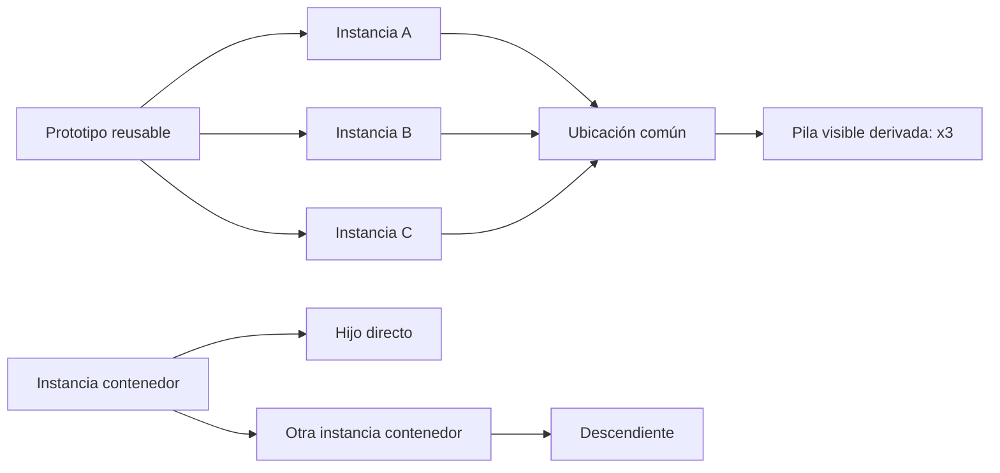
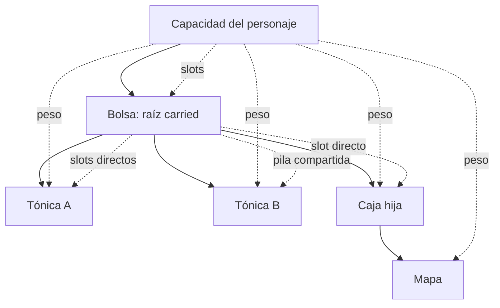

# ADR 0010: Pilas derivadas y contenedores acotados

- Estado: aceptada
- Fecha: 2026-07-16
- Alcance: inventario fase 3B
- Matiza: [ADR 0009](0009-item-prototypes-instances-and-capacity.md)

## Contexto

La fase 3A separó contenido reusable (`ItemPrototype`) de cada unidad durable
(`ItemInstance`), estableció una única ubicación autoritativa por instancia y
añadió capacidad de personaje por slots y peso. Esa base permite representar
varias unidades del mismo objeto, pero aún proyecta y mueve cada unidad por
separado y no permite que una instancia contenga otras.

Persistir una `quantity` mutable junto a las instancias introduciría dos
autoridades para la misma posesión. Persistir una entidad `Stack` separada
añadiría identidad, merge/split y recuperación sin aportar identidad de juego.
Los contenedores, por su parte, convierten la ubicación en un grafo: sin límites
explícitos permiten ciclos, recursión no acotada, peso ambiguo y snapshots que
no pueden restaurarse con seguridad.

## Decisión

La fase 3B conserva cada unidad como una instancia durable. Las pilas son una
vista determinista derivada; nunca se persisten una cantidad, un ID de pila ni
una lista duplicada de miembros. Los contenedores añaden una única variante de
ubicación que apunta a otra instancia, con grafo, profundidad y capacidades
validados antes de publicar cualquier mutación.

WorldPack pasa a versión 5 y AreaPack a versión 4. WorldProject continúa en
versión 2. `WorldRuntimeSnapshot` pasa a versión 3; SQLite y PostgreSQL
permanecen en esquema 10 y siguen guardando el JSON acotado como única autoridad
de mundo.



## Contrato de autoría

`ItemPrototype` añade:

```rust
enum ItemStackPolicy {
    Unique,
    Fungible,
}

struct ItemContainerDefinition {
    max_slots: u16,
    max_weight_grams: u32,
}

struct ItemPrototype {
    // campos de 3A
    stack_policy: ItemStackPolicy,
    max_stack_units: u16,
    container: Option<ItemContainerDefinition>,
}
```

Reglas cerradas:

- `unique` exige `maxStackUnits == 1`;
- `fungible` exige `2..=1000`;
- un contenedor exige `unique`, máximo uno y no consumible;
- `container.maxSlots` pertenece a `1..=1000`;
- `container.maxWeightGrams` pertenece a `0..=1_000_000`; y
- peso unitario, coste de slot, rareza, nivel y transferencia siguen siendo
  propiedades del prototipo.

`InitialItemLocation` añade:

```json
{
  "kind": "container",
  "containerInstanceId": "tiamud:instance:satchel"
}
```

El destino debe existir y su prototipo debe definir contenedor. Una instancia
no puede contenerse a sí misma, ningún ancestro puede entrar en su descendiente
y la cadena admite como máximo cuatro aristas de contención.

## Pilas derivadas

La clave de pila de 3B es el par formado por ubicación y prototipo. Las fases de
afijos podrán ampliarla únicamente con metadatos durables idénticos. Los
miembros se ordenan siempre por `ItemInstanceId` y se dividen en grupos de hasta
`maxStackUnits`.

Para una cantidad `n`:

```text
stackSlots = ceil(n / maxStackUnits) * slotCost
totalWeightGrams = n * weightGrams
```

La aritmética es comprobada. En la sala, la percepción se aplica antes de
agrupar: una instancia oculta no incrementa la cantidad visible ni puede ser el
selector del grupo. `entityMedia(kind=item)` continúa unido al prototipo y se
presenta una sola vez por grupo visible.

Una pila visible recibe un selector opaco efímero derivado de su primer miembro
visible ordenado. Las unidades únicas conservan su referencia opaca individual.
El selector nunca es durable, cambia con la sesión y no expone los IDs internos
de los demás miembros.

## Capacidad y peso

Los slots del personaje cuentan solo raíces `Carried`, agrupadas en pilas. Su
peso cuenta recursivamente todas las raíces `Carried` y `Equipped` con sus
descendientes.

Los slots de un contenedor cuentan sus hijos directos agrupados en pilas. Su
peso usado cuenta todos los descendientes y excluye el peso vacío del propio
contenedor. Un contenedor hijo consume en su padre los slots de su propia
carcasa y el peso de carcasa más descendientes. Los hijos no consumen slots del
personaje, pero sí su peso.



Antes de mutar se construye una ubicación prospectiva, se comprueban
referencias, ciclos, profundidad y todas las capacidades afectadas, y solo
entonces se aplican juntas las ubicaciones. Un error no mueve ninguna unidad ni
avanza revisión, RNG o contador.

## Acciones y selección

La cantidad predeterminada es uno y cada mutación admite como máximo 256
unidades. Los comandos son:

```text
take [cantidad] <objeto>
drop [cantidad] <objeto>
contents <contenedor> [página]
put [cantidad] <objeto> in <contenedor>
get [cantidad] <objeto> from <contenedor>
```

`get ... from ...` se analiza antes del alias histórico `get = take`. `put`
solo toma raíces portadas; `get` solo extrae hijos directos. Mover un contenedor
mueve su raíz y conserva las ubicaciones `Contained` de sus descendientes. Una
cantidad selecciona determinísticamente los primeros miembros ordenados que el
actor está autorizado a manipular.

`contents` pagina veinte grupos por página. No se incrustan árboles completos
en la escena o ficha: esto mantiene cada frame WebSocket por debajo de 16 KiB y
evita recorridos recursivos involuntarios.

## Snapshot y restauración

La ubicación runtime añade:

```rust
RuntimeItemLocation::Contained {
    container_id: ItemInstanceId,
}
```

`WorldRuntimeSnapshot` v3 usa DTO explícitos v1, v2 y v3. El decoder lee primero
`snapshotVersion` y ejecuta v1 -> v2 -> v3; no usa una enum `untagged` entre
formas casi idénticas. La versión de la columna SQL se compara con la versión
original del payload antes de normalizarlo.

La restauración valida todo el grafo, equipo, NPC, propietarios, profundidad y
capacidades. La barrera de arranque sigue padres `Contained` hasta raíces
`Carried` o `Equipped` para validar personajes desconectados sin retenerlos como
sesiones activas. SQLite, PostgreSQL, admin y el mover entre backends consumen
el mismo decoder.

## Protocolo y presentación

Las vistas conservan `weightGrams` como peso unitario y añaden:

```text
quantity
stackSlots
totalWeightGrams
containerCapacity? {
  usedSlots
  maxSlots
  usedWeightGrams
  maxWeightGrams
}
```

Web acepta acciones estructuradas `item.take`, `item.drop`, `item.put`,
`item.get` e `item.contents`, incorporando solo los campos necesarios
`target`, `container`, `quantity` o `page`. Esos campos forman parte de la firma
de deduplicación y los sobrantes se rechazan.

El resultado paginado de `contents` se proyecta como `container.contents` en
Web, texto equivalente en Telnet y `Char.Items.List` GMCP con ubicación
`container`, referencia, página y capacidad. Ningún transporte recibe IDs
durables ni una representación más autorizada que otro.

## Compatibilidad

- WorldPack v4 normaliza a v5 con `maxStackUnits: 1` y sin contenedor.
- AreaPack v3 normaliza a v4 del mismo modo.
- Las rutas v3/v2 y AreaPack v2/v1 pasan primero por su normalizador existente.
- Una entrada antigua que intenta declarar campos de 3B se rechaza como
  schema-smuggling; debe publicar la versión nueva.
- Envy emite conservadoramente objetos únicos, máximo uno y sin contenedor. No
  infiere fungibilidad y mantiene resets históricos `P` como diagnóstico
  inerte.
- El esquema relacional continúa en v10: no hay tabla espejo ni doble escritura.

## Fuera de alcance

3B no implementa `give`, vinculación al personaje, objetos no transferibles,
trade/escrow, durabilidad, afijos, derechos o reparto de botín, procedencia de
drops ni tablas aleatorias repetibles. Las cajas pagadas o tiradas monetizadas
continúan fuera del baseline.

## Consecuencias

La identidad durable permanece normalizada y auditable; split y merge de pilas
no son operaciones persistentes. El coste es recalcular grupos y el grafo en
proyecciones y mutaciones, pero los límites de 65.536 instancias, profundidad
cuatro, 256 unidades por acción y paginación hacen ese coste explícito y
predecible. Las pruebas deben cubrir fronteras de pila, peso recursivo, ciclos,
profundidad 4/5, rollback, snapshots v1/v2/v3, propietarios offline, opacidad y
paridad Web/Telnet/GMCP.
