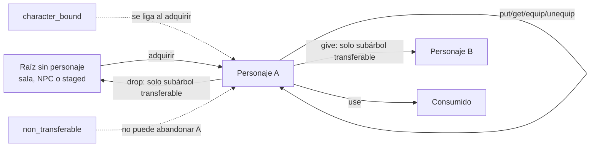

# ADR 0011: Entrega atómica y políticas de transferencia

- Estado: aceptada e implementada
- Fecha: 2026-07-16
- Alcance: inventario fase 3C
- Matiza: [ADR 0009](0009-item-prototypes-instances-and-capacity.md) y
  [ADR 0010](0010-derived-stacks-and-bounded-containers.md)

## Contexto

Las fases 3A y 3B separaron prototipos e instancias, hicieron durable una única
ubicación por unidad y añadieron pilas derivadas y contenedores acotados. Antes
de 3C no existía una transferencia directa entre personajes y las políticas
`character_bound` y `non_transferable` seguían reservadas: aceptarlas sin una
regla de propietario efectivo habría permitido eludirlas soltando el objeto o
entregando una bolsa transferible que lo contuviera.

La vinculación tampoco puede deducirse del prototipo. Dos instancias del mismo
prototipo pueden estar sin adquirir, ligadas a personajes distintos o
consumidas. Debe sobrevivir a reinicios, replay y rollback sin convertirse en
un ID o nombre visible para clientes.

## Decisión

La fase 3C activa las tres políticas ya reservadas en WorldPack v5 y AreaPack
v4, añade vinculación durable por instancia y ofrece una única entrega simple
de raíces portadas. WorldProject continúa en v2. `WorldRuntimeSnapshot` pasa a
v4; SQLite y PostgreSQL permanecen en esquema 10 y conservan el documento
versionado como única autoridad del mundo.



## Propietario efectivo y subárbol

El propietario efectivo de una instancia se obtiene siguiendo como máximo
cuatro aristas `Contained` hasta su raíz:

- `Carried(C)` o `Equipped(C, slot)` pertenece a `Character(C)`;
- `Room`, `HeldByNpc` y `Staged` no pertenecen a un personaje; y
- `Consumed` es un estado terminal.

Toda transición se evalúa para la raíz movida y cada descendiente. Las reglas
cerradas son:

| Cambio de propietario efectivo | Regla |
| --- | --- |
| ninguno -> `Character(C)` | Permitido; cada `character_bound` sin vínculo se liga atómicamente a C y uno ya ligado debe pertenecer a C. |
| `Character(C)` -> `Character(C)` | Permitido para put/get/equip/unequip y consumo autorizado. |
| `Character(A)` -> `Character(B)` | Solo si todas las instancias del subárbol son `transferable`. |
| `Character(A)` -> ninguno | Solo si todas las instancias del subárbol son `transferable`. |
| ninguno -> ninguno | No crea ni cambia vínculos. |

Una operación se valida contra una copia prospectiva completa del grafo y solo
después publica ubicación y vínculo juntos. También valida ciclos, profundidad,
slots y peso recursivo de todos los propietarios y contenedores afectados. Un
fallo no cambia revisión, contador, RNG, ubicación ni vinculación.

## Semántica de las políticas

- `transferable` no lleva vínculo y puede entregarse o soltarse si el subárbol
  completo cumple la misma condición.
- `character_bound` empieza sin vínculo fuera de un personaje. La primera
  adquisición lo liga al `CharacterId` del adquirente. No se desliga ni se
  reasigna en 3C y no puede salir de su grafo; consumirlo conserva el dato
  durable para una restauración y auditoría coherentes.
- `non_transferable` no guarda un propietario ligado. Puede adquirirse por
  primera vez, pero mientras pertenezca a un personaje no puede salir ni
  cambiar de dueño. Es una restricción de transición apropiada para objetos de
  misión o concesiones de contenido, no una identidad recuperable de dueño.

Un prototipo `transferable` o `non_transferable` con vínculo es inválido. Un
`character_bound` dentro del grafo de C debe estar ligado a C. Un
`character_bound` ligado fuera de ese grafo solo es válido en estado terminal
`Consumed`; sala, NPC y staging no sirven como almacén indirecto de objetos
ligados.

El botín fijo `HeldByNpc -> Room` no liga. El primer `take` válido sí liga el
objeto y todos los descendientes `character_bound`. La concesión autorizada de
script aplica exactamente las mismas reglas; no roba, reasigna, desliga ni
salta capacidad.

## Pilas y contenedores

La clave derivada de pila incorpora ubicación, prototipo y vínculo. Los
miembros siguen ordenados por ID durable, pero ningún vínculo ni ID durable se
proyecta al cliente. Una bolsa `transferable` con cualquier descendiente ligado
o no transferible puede moverse dentro del grafo de su dueño, pero no puede
entregarse ni soltarse.

Esta comprobación se hace sobre el índice de grafo construido una sola vez, no
mediante recorridos repetidos por cada unidad. Los límites de 65.536 instancias,
profundidad cuatro y 256 raíces por acción continúan vigentes.

## Acción `give`

La gramática común a Web y Telnet es:

```text
give [cantidad] <objeto> to <personaje>
```

La cantidad predeterminada es uno y pertenece a `1..=256`. Solo se seleccionan
raíces `Carried`; no se entrega directamente un objeto equipado o contenido.
El receptor debe ser distinto, estar conectado y permanecer en la misma sala
al ejecutar la acción. Se acepta su selector opaco de sesión o un nombre exacto
no ambiguo. El servidor nunca confía en el listado del cliente.

`give` conserva el subárbol de cada raíz, exige que todas sus instancias sean
`transferable`, calcula la fusión o división de pilas y valida la capacidad del
receptor y del emisor. Una única mutación y revisión mueve todas las raíces. Si
el receptor se desconecta después del commit, la posesión ya confirmada sigue
siendo durable.

Ignore del receptor y block bilateral impiden la entrega para evitar acoso. La
respuesta es genérica y no permite averiguar cuál de esas relaciones existe.
Mute y el rate limit de chat no se aplican a inventario.

El intercambio con oferta, escrow y doble aceptación no reutiliza `give`; se
implementará en 3D.

## Eventos, replay y rollback

Se añade un evento separado:

```rust
ItemsGiven {
    giver_id,
    giver_name,
    recipient_id,
    recipient_name,
    item_ids,
    item_name,
    room_id,
}
```

`item_ids` contiene como máximo las 256 raíces, no todos los descendientes. El
replay exige `Carried(giver) -> Carried(recipient)`, vuelve a comprobar el
subárbol y ambos agregados y no cambia ningún vínculo porque `give` solo admite
subárboles transferibles.

Los eventos de adquisición enlazan recursivamente de forma determinista. Al
revertir una adquisición se deshacen esos vínculos: el invariante prohíbe que
un subárbol sin propietario contenga vínculos anteriores, por lo que no hace
falta inflar el evento con hasta 65.536 IDs. El checkpoint exacto del actor
continúa siendo la reversión autoritativa ante un fallo de commit y restaura
también revisiones de observador.

El commit persiste juntos todos los personajes conectados afectados, snapshot
v4 y evento. No se entrega salida ni broadcast antes de confirmarlo.

## Snapshot y restauración

Cada instancia v4 lleva un campo obligatorio y cerrado:

```json
"binding": { "kind": "unbound" }
```

o:

```json
"binding": { "kind": "character", "characterId": 42 }
```

No se usa un `Option`: en serde un campo opcional ausente podría convertirse en
`None` y debilitar el rechazo de schema-smuggling. Existen DTO exactos para v1,
v2, v3 y v4; el decoder elige por `snapshotVersion`, compara primero la versión
original con la columna SQL y solo entonces normaliza. v1-v3 se convierten a
`unbound` y un payload v3 que inyecta `binding` se rechaza.

La barrera de arranque carga la unión de propietarios raíz y todos los
`CharacterId` ligados, incluidos los consumidos, y exige que existan sus fichas
durables. Restaurar rechaza un vínculo inválido, una política cambiada sin
migración explícita o un propietario raíz discordante. SQLite, PostgreSQL,
admin y el mover entre backends usan el mismo decoder.

## Autoría y compatibilidad

WorldPack v5 y AreaPack v4 aceptan las tres políticas. Los normalizadores de
WorldPack v4 y AreaPack v3 exigen exactamente `transferable`; sus versiones
anteriores y Envy/Merc continúan produciendo únicamente esa política. Así se
activa el vocabulario reservado sin reinterpretar formatos legacy ni inferir
vinculación desde flags históricos.

La demostración canónica conserva `tiamud:wolf-clasp` y
`tiamud:road-token` como `transferable`: son IDs publicados y cambiar su
semántica exigiría una migración explícita. 3C se demuestra con dos identidades
nuevas: `tiamud:rain-writ`, consumible con `healAmount: 1` y
`non_transferable` en `demo:north-gate`; y `tiamud:stormglass-talon`,
`character_bound` y botín fijo de `tiamud:gate-stalker-1`.

La composición revisada contiene nueve prototipos y diez instancias iniciales.
Su WorldPack canónico ocupa 49.603 bytes y tiene SHA-256
`f3ab27cb93a2b3c80fe0a9a6ecf8acdd856a45ec1edbda257dd33046a21772c8`;
los registros históricos conservan sus digests originales.

## Protocolo y presentación

Las vistas de objeto añaden `transferPolicy`, `boundToYou` y `canGive`, además
de acciones contextuales para ayudar a la interfaz. Esas proyecciones no
autorizan: la fuente de verdad es la validación del dominio al ejecutar la
acción, que vuelve a comprobar subárbol, propietario, vínculo, capacidad y
receptor. Nunca se proyecta el propietario durable. `social.online` distingue
objetivos cercanos para ayudar al formulario, pero el servidor vuelve a
comprobar proximidad.

Web acepta estrictamente:

```json
{
  "action": "item.give",
  "target": "selector-opaco-del-objeto",
  "recipient": "selector-opaco-del-personaje",
  "quantity": 2
}
```

`target`, `recipient` y `quantity` forman la firma de deduplicación. Repetir el
mismo `requestId` y firma no vuelve a donar; cambiar cualquiera de los tres con el
mismo ID se rechaza. El campo `recipient` se rechaza en el resto de acciones y
la caché continúa indexada por personaje y `requestId`; la firma conserva los
selectores opacos producidos por la sesión que originó la petición.

Telnet usa el parser común. GMCP regenera `Char.Items.List` por separado para
emisor y receptor con la sal de cada sesión. La proyección `ItemGiven` narra al
emisor, receptor y observadores de la sala; solo emisor y receptor reciben un
`itemId` opaco derivado de la primera raíz y un observador remoto no recibe el
evento. Para el emisor ya no es un selector de inventario accesible después del
movimiento; para el receptor identifica la instancia recién recibida.

## Fuera de alcance

3C no incluye intercambio confirmado, monedas en escrow, correo, subasta,
entrega offline o remota, derechos y reparto de botín, tablas aleatorias,
procedencia, afijos, durabilidad, account-bound, unbind/rebind, bypass de staff
ni cajas monetizadas.

## Consecuencias

La política deja de ser una etiqueta y pasa a ser un invariante único de cambio
de propietario. El coste es una versión nueva del snapshot y validación de
subárboles, pero no se añade otra autoridad SQL ni una lista de cambios sin
límite a los eventos. Las pruebas deben cubrir adquisición y vínculo recursivo,
contenedores-bypass, replay/rollback, reinicio, capacidad bilateral,
ignore/block, concurrencia, opacidad, deduplicación y paridad
Web/Telnet/GMCP/SQLite/PostgreSQL.
