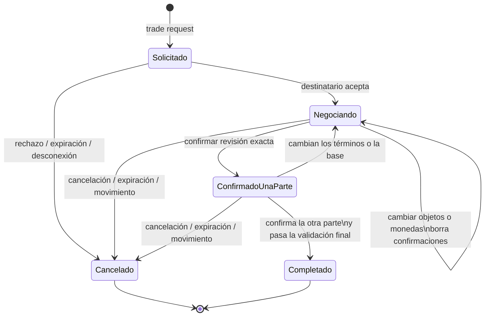

# ADR 0012: Intercambio confirmado mediante reservas durables

- Estado: propuesta; no aceptada ni implementada
- Fecha: 2026-07-16
- Alcance propuesto: inventario fase 3D
- Continúa: [ADR 0011](0011-atomic-give-and-item-transfer-policies.md)

## Contexto

ADR 0011 implementa `give` como una transferencia unilateral y atómica entre
dos personajes conectados. Activa las políticas `transferable`,
`character_bound` y `non_transferable`, define propietario efectivo, valida el
subárbol completo y conserva ubicaciones, vínculos, personajes y snapshot en
un único commit. No ofrece negociación, monedas en escrow ni doble
confirmación.

Un intercambio bilateral no puede encadenar dos `give`: el primer movimiento
quedaría confirmado aunque el segundo fallase por capacidad, desconexión,
política, saldo o persistencia. Tampoco debe añadir una tabla SQL autoritativa
paralela al actor ni trasladar temporalmente objetos a una ubicación que
obligue a devolver propiedad a personajes desconectados.

Esta propuesta describe el contrato de fase 3D para su revisión. No constituye
evidencia de implementación y no cambia todavía ninguna versión o formato.

## Decisión propuesta

El escrow será una **reserva durable**, no custodia en otra ubicación:

- los objetos ofrecidos permanecen en `Carried(propietario)`;
- las monedas ofrecidas permanecen en `CharacterGameplaySnapshot.coins`;
- un `TradeSnapshot` dentro del snapshot autoritativo bloquea las raíces, sus
  subárboles y el saldo ofrecido; y
- la segunda confirmación aplica los dos lotes y las dos variaciones de moneda
  en una única mutación prospectiva.

No se añadirá `RuntimeItemLocation::Escrow`. Cancelar, expirar, desconectar o
recuperar tras un reinicio elimina reservas sin ejecutar reembolsos sobre
agregados offline. La reserva forma parte del mismo estado de mundo que las
instancias; no es una segunda autoridad.



## Modelo durable propuesto

El modelo conceptual es:

```rust
struct TradeSnapshot {
    id: TradeId,
    requester: CharacterId,
    recipient: CharacterId,
    room_id: String,
    phase: TradePhase, // requested | negotiating
    created_tick: u64,
    opened_tick: Option<u64>,
    expires_at_tick: u64,
    state_revision: u64,
    offers: BTreeMap<CharacterId, TradeOffer>,
    confirmations: BTreeMap<CharacterId, TradeConfirmation>,
}

struct TradeOffer {
    lines: Vec<TradeOfferLine>,
    coins: u64,
}

struct TradeOfferLine {
    key: TradeOfferKey,
    item_ids: Vec<ItemInstanceId>,
}

struct TradeConfirmation {
    state_revision: u64,
    basis_sha256: [u8; 32],
}

enum TradePhase {
    Requested,
    Negotiating,
}

enum TradeOfferKey {
    Fungible { prototype_id: String },
    Unique { item_id: ItemInstanceId },
}

enum TradeCancellationReason {
    Declined,
    CancelledByParticipant,
    Expired,
    ParticipantsSeparated,
    CombatStarted,
    ParticipantDefeated,
    ParticipantDisconnected,
    SocialPolicyChanged,
    InvalidReservation,
    CounterExhausted,
    Restart,
}
```

`TradeOfferKey` identifica internamente una agrupación fungible por prototipo
o una instancia única. `item_ids` contiene solo raíces `Carried`, ordenadas y
sin duplicados; los descendientes se obtienen del índice de grafo existente.
Los nombres no son identidad durable del trade.

Todo `ItemInstanceId`, tanto authored como creado en runtime, ocupa
`1..=128` bytes. Un ID authored usa la gramática ASCII minúscula cerrada de los
identificadores gameplay; uno creado en runtime es exactamente
`runtime:<u64-no-cero-canónico>`. WorldPack v5, AreaPack v4, normalizadores,
composición, loader, creación runtime, DTO v1-v5, restore y replay deberán validar esa
misma cota antes de construir o aceptar un `ItemInstanceId`. Una referencia a
contenedor cumple la misma regla por referenciar una instancia validada. Así,
un snapshot o evento no puede introducir un ID largo que el WorldPack no
hubiera podido publicar.

Cada personaje participa como máximo en una solicitud o negociación viva. Las
confirmaciones se indexan por `CharacterId`: repetir la confirmación de un
mismo participante nunca cuenta como la segunda.

La forma durable por fase es única:

- `requested`: `opened_tick = None`, `offers = {}` y `confirmations = {}`;
- `negotiating`: `opened_tick = Some`, `offers` contiene exactamente dos
  entradas, una por cada participante, incluso si su oferta está vacía; y
  `confirmations` contiene de cero a dos entradas cuyas claves son un
  subconjunto de esos mismos participantes; y
- `completed` y `cancelled` no son fases persistidas: la transición elimina el
  trade del mapa.

En negociación, las líneas se ordenan estrictamente por `TradeOfferKey`, las
claves no se repiten y cada línea contiene `1..=128` raíces ordenadas y únicas.
Una clave `Fungible` coincide con el prototipo fungible de todos sus miembros;
una clave `Unique` contiene exactamente su única raíz. Entre ambas ofertas hay
como máximo 128 raíces y 16 líneas. Cada confirmación coincide con la
`state_revision` actual; si existen dos, sus digest son idénticos. Cualquier
otra cardinalidad, clave, orden o forma se rechaza en acción, restore y replay.

`TradeId`, `state_revision` y `nextTradeId` son positivos y monótonos. Sus
incrementos y el cálculo de los plazos usan aritmética `checked`; los ticks
pueden empezar en cero, pero deben cumplir `created <= opened < expires` cuando
exista `opened`. Ningún valor se envuelve ni reutiliza: si un contador o un
plazo no puede incrementarse, se rechaza la transición o se cancela el trade de
forma cerrada. La clave del mapa de trades debe coincidir con
`TradeSnapshot.id`, cada ID vivo es menor que `nextTradeId` y todos los
registros anidados usan formas cerradas sin campos desconocidos.

`TradePhase`, `TradeOfferKey` y `TradeCancellationReason` son enums cerrados,
sin variante `other`, string libre ni fallback. Cada salida actual usa un
motivo exhaustivo: rechazo, cancelación explícita, expiración, separación,
inicio de combate, derrota, desconexión o ban, política social, reserva
inválida, agotamiento de contador y reinicio se corresponden respectivamente
con las variantes declaradas. Añadir otra causa durable exige ampliar el enum,
decoder, replay, proyección y pruebas de versión.

`basis_sha256` se calcula sobre una representación canónica y acotada de:

- participantes, sala, trade y revisión de estado;
- ofertas exactas de objetos y monedas;
- ubicación, prototipo, política, vínculo y subárbol de cada raíz reservada;
- inventario, equipo y capacidad relevantes de ambos personajes; y
- saldos que intervienen en la liquidación.

El digest detecta cambios de estado relevantes; no sustituye las validaciones
autoritativas de la liquidación. Su codificación es binaria canónica,
versionada, separada por dominio y con longitudes explícitas; no depende de la
representación JSON, del orden de un `HashMap`, de la plataforma ni del
adaptador de persistencia.

`state_revision` es la revisión pública de esa base completa, no solo de las
ofertas. Toda mutación que cambie cualquier entrada del digest incrementa la
revisión y elimina ambas confirmaciones antes de aceptar otro `confirm`. Así,
una confirmación retrasada nunca puede autorizar una base nueva conservando la
revisión que el jugador había visto.

Para detectar ese cambio se compara la base material —sin
`state_revision`, confirmaciones ni el propio digest— del checkpoint con la
base material final. Después se incrementa la revisión una sola vez y el digest
de confirmación se calcula incluyendo ya la nueva revisión. No hay una
dependencia circular ni un hash persistido adicional como autoridad.

## Estados y transiciones

### Solicitud

`trade request <personaje>` crea `requested` con `state_revision = 1` si ambos
personajes son distintos, están conectados, comparten sala, superan la política
social bilateral y no participan ya en otro trade. Ninguno puede estar en
combate ni derrotado.
Todavía no reserva activos. La solicitud permanece activa mientras
`logical_tick < expires_at_tick`, con
`expires_at_tick = created_tick.checked_add(20)` y `opened_tick = None`.

El destinatario puede aceptar o rechazar. Aceptar crea una negociación con
ofertas vacías y ninguna confirmación. La aceptación vuelve a comprobar
conexión, sala, política social y disponibilidad, incrementa la revisión de
estado, fija una sola vez `opened_tick` y reemplaza el plazo por
`opened_tick.checked_add(120)`. Rechazar o cancelar elimina la solicitud.

### Negociación

Cada lado puede fijar la cantidad de una línea de objetos, eliminarla o fijar
su oferta total de monedas. Son operaciones de asignación, no incrementos:
repetir exactamente una operación conserva el mismo resultado.

Todo cambio efectivo:

1. conserva las raíces elegibles ya reservadas y añade o quita solo las
   necesarias en orden durable;
2. valida reservas, límites y políticas;
3. hace que la reconciliación incremente `state_revision` exactamente una vez
   para la transición completa; y
4. elimina las confirmaciones de ambos participantes.

Una asignación con la misma clave y cantidad es un no-op y conserva exactamente
los mismos `item_ids`, aunque haya aparecido después otra raíz anterior en el
orden durable. Al aumentar se añaden las primeras raíces disponibles; al
reducir se eliminan las últimas. Una raíz reservada que deja de cumplir un
invariante no se sustituye silenciosamente: la reconciliación cancela el trade.

El trade no puede completarse con ambas ofertas vacías. Se permite que uno de
los dos lados no aporte activos, como entrega confirmada bilateral.

### Confirmación y liquidación

La confirmación incluye la revisión de estado exacta vista por el jugador. Una
revisión obsoleta no confirma ofertas ni base nuevas. Antes de registrar cada
confirmación se reconcilia el estado actual; si la base cambió, primero se
incrementa `state_revision`, se eliminan ambas confirmaciones y se rechaza el
comando obsoleto. La primera confirmación válida guarda revisión y digest. La
segunda recalcula toda la base y, si difiere, repite esa invalidación y exige
revisar de nuevo.

Cuando las dos confirmaciones distintas coinciden:

1. se comprueban conexión, sala y política social inmediatamente antes de
   mutar;
2. se confirma que todas las raíces siguen reservadas y `Carried` por su
   oferente;
3. se vuelve a validar que cada subárbol completo es `transferable`;
4. se construye el grafo final con los dos movimientos simultáneos;
5. se valida el estado final completo de ambos participantes: ciclos,
   profundidad, slots, peso recursivo y capacidad de sus contenedores;
6. se calculan ambos saldos finales con aritmética checked; y
7. se publican juntos ubicaciones, monedas, eliminación del trade, revisión y
   evento.

No se mueve primero un lado, no se derraman objetos a la sala y no se completa
parcialmente un intercambio. La capacidad se calcula después de retirar las
salidas y añadir las entradas de ambos lados, por lo que un intercambio neto
válido puede completarse aunque ambos inventarios estuvieran llenos antes de
la operación.

## Reservas de objetos

Solo se pueden reservar raíces `Carried`; no objetos equipados ni contenidos
directamente. Cada raíz y todos sus descendientes deben tener política
`transferable`. Un contenedor exterior transferible con un descendiente
`character_bound` o `non_transferable` no es elegible.

Se construirá una vez por estado un índice de raíces y subárboles reservados.
Es una vista derivada de `trades`, nunca una tabla, columna o campo persistido,
y se reconstruye o invalida al cambiar la revisión del mundo. La restauración
rechaza raíces duplicadas, una raíz y su descendiente reservados a la vez,
líneas o claves repetidas, participantes ajenos y cualquier subárbol presente
en más de un trade. Mientras exista la reserva:

- `drop`, `give`, `put`, `get`, `equip`, `use` y otra reserva no pueden mover
  la raíz ni ningún descendiente;
- no se puede introducir un objeto nuevo dentro de un contenedor reservado;
- `contents` ordinario puede seguir siendo de lectura, pero no concede una
  mutación; y
- la contraparte puede inspeccionar de forma paginada el contenido ofrecido
  mediante una proyección específica de trade.

Las pilas siguen siendo vistas derivadas. La ficha del propietario debe
distinguir cantidad total, cantidad disponible y cantidad reservada para que
Web y Telnet no propongan cantidades que el dominio rechazará. Los grupos
disponible y reservado tienen selectores opacos coherentes con sus primeras
raíces respectivas; un selector de una raíz bloqueada nunca se presenta como
una cantidad disponible.

## Reservas de moneda

La oferta de monedas no descuenta inmediatamente `coins`. El saldo gastable es:

```text
spendableCoins = coins - reservedCoins
```

`reservedCoins` y `spendableCoins` son vistas derivadas de los trades vivos, no
autoridades persistidas. Las compras, scripts y cualquier otro gasto pasan por
un único cálculo checked de `spendableCoins`. Recompensas y ventas pueden
aumentar el saldo total, pero cualquier modificación relevante incrementa
`state_revision`, invalida las confirmaciones y obliga a revisar de nuevo. Si
una mutación futura consiguiese dejar `coins < reservedCoins`, la
reconciliación cancela el trade; nunca reduce silenciosamente la oferta.

La liquidación simultánea calcula:

```text
finalA = coinsA - offeredA + offeredB
finalB = coinsB - offeredB + offeredA
```

con comprobaciones de insuficiencia y overflow. Los `commodities` actuales
quedan fuera: son contadores del mercado, no instancias con identidad,
propiedad y política de transferencia.

## Política social y disponibilidad

Para solicitar, aceptar, modificar y confirmar se exige que sean verdaderas
las dos consultas:

```text
social_delivery_allowed(A, B)
social_delivery_allowed(B, A)
```

Así, ignore de cualquiera de las partes y block bilateral impiden la
negociación. La respuesta es genérica y no revela qué relación existe. Mute y
el rate limit de chat no se aplican a inventario.

Estas acciones también vuelven a exigir conexión, misma sala y que ninguno de
los participantes esté en combate o derrotado. No se puede abrir una
negociación durante un combate para eludir la cancelación por inicio de
combate.

El actor serializa estas comprobaciones con las acciones. Si un ignore o block
se establece durante una negociación, el trade se cancela o queda inutilizable
antes de cualquier liquidación; un fallo al persistir esa limpieza nunca
autoriza el intercambio.

La política no se cachea como autoridad dentro del snapshot. Antes de
reconciliar un trade vivo, incluidos el tick normal, su fallback sin scripts y
cualquier reintento después de restaurar un checkpoint, el actor consulta de
nuevo al `CharacterStore` ambas direcciones en orden de `TradeId`. Son como
máximo 128 consultas acotadas por tick con 64 trades vivos. Un error del store
aborta la transición y restaura el checkpoint; el reintento repite las
consultas, nunca reutiliza un permiso social anterior ni convierte un fallo en
autorización.

## Límites propuestos

| Recurso | Límite |
| --- | ---: |
| Solicitudes y trades vivos globales | 64 |
| Trades vivos por personaje | 1 |
| Líneas de objeto por participante | 8 |
| Raíces ofrecidas por trade, entre ambos lados | 128 |
| Raíces reservadas globalmente | 2.048 |
| Bytes por `ItemInstanceId` | 1..=128 |
| Cantidad de una línea | 1..=128 |
| Monedas ofrecidas por participante | 0..=1.000.000.000 |
| Caducidad de solicitud | 20 ticks |
| Vida máxima de negociación | 120 ticks |
| Nuevas solicitudes por personaje | ráfaga 1; una cada 5 ticks |
| Grupos por página de contenido ofrecido | 20 |
| Gameplay de owners en startup | 1.048.576 bytes |
| Gameplay de participantes extra en startup | 8.388.608 bytes |
| Gameplay combinado máximo en startup | 9.437.184 bytes |

La caducidad usa ticks lógicos, no tiempo de pared, y la negociación no se
renueva cambiando repetidamente la oferta. El control de nuevas solicitudes es
efímero, acotado a personajes conectados y puede reiniciarse con el proceso;
solo limita abuso y no autoriza ni reserva activos. Continúan los límites
existentes de profundidad cuatro, 65.536 instancias, frame WebSocket de 16 KiB,
evento de 64 KiB y snapshot de mundo de 1 MiB.

La cota de 128 bytes por `ItemInstanceId`, 128 raíces y 16 líneas totales hace
posible mantener bajo 65.536 bytes incluso el mayor evento de trade con estados
`previous/current` o un `previousTrade`. Cada forma se serializa y comprueba
contra el límite real antes de commit; una prueba worst-case con IDs de 128
bytes demuestra el presupuesto exacto en ambos adaptadores.

No existe un presupuesto de 1 MiB independiente para `trades`. Antes de aceptar
request, oferta, confirmación, invalidación o cancelación, el actor serializa el
`WorldRuntimeSnapshot` prospectivo **completo**, con instancias, NPC, aventura,
progresión y trades, y exige que ocupe como máximo 1.048.576 bytes. Si no cabe,
restaura el checkpoint y rechaza la transición sin revisión ni salida. El mismo
límite se aplica al documento completo antes de decodificar durante restore;
comprobar solo la colección de trades no satisface este contrato.

La reconciliación usa índices por participante y raíz y revisa solo los trades
afectados. Si necesita una barrera global de arranque o tick, construye el
índice del grafo una vez y no recorre el inventario completo una vez por trade.
Pruebas de serialización con IDs y ofertas de longitud máxima deben demostrar
que `previous/current`, un `previousTrade`, los 64 trades y el snapshot completo
permanecen dentro de los presupuestos existentes.

## Cancelación, desconexión, expiración y reinicio

Se cancela el trade ante:

- rechazo o cancelación explícita;
- expiración;
- movimiento o traslado staff que separa a los participantes;
- inicio de combate o derrota;
- desconexión de cualquiera de los dos; o
- política social incompatible.

En el tick donde `logical_tick >= expires_at_tick` se cancela al comienzo de
la transición, antes de hooks de timer, combate y scripts. Un fallo del commit
restaura con el checkpoint tanto el tick anterior como el trade y la siguiente
ejecución lo reintenta.

La ruta de salida intenta confirmar la cancelación antes de retirar la sesión.
Si ese commit falla, el checkpoint conserva la reserva durable y el siguiente
tick, una reconexión o la recuperación de arranque vuelve a cancelarla; nunca
se interpreta como una autorización para liquidar.

Una reconexión no reanuda un trade cuya cancelación por desconexión falló. El
actor restaura el agregado del personaje, cancela y confirma el trade antes de
`OnEnter`, de proyectar su ficha o de admitir una acción del jugador.

Tras un cierre inesperado, la barrera de arranque tiene dos fases. Primero
decodifica v5 y valida forma, IDs, límites, grafo y reservas sin necesitar
agregados offline. Los 64 trades pueden aportar como máximo 128 participantes
distintos. Después forma la unión ordenada y sin duplicados de propietarios de
objetos y propietarios ligados (`owners`). A continuación calcula
`tradeParticipants - owners`, también ordenado y sin duplicados; este segundo
conjunto contiene como máximo 128 identidades. Los documentos de `owners`
mantienen el presupuesto existente de 1.048.576 bytes. Los participantes
adicionales tienen un presupuesto separado y exacto de
`128 * 65.536 = 8.388.608` bytes. Tras deduplicar, el techo combinado es por
tanto 9.437.184 bytes, no un 1 MiB que pudiera convertir en irrecuperable un
estado válido ya confirmado.

La carga amplía el gate compartido, no crea una consulta por personaje. Primero
carga `owners` con el presupuesto existente y después
`tradeParticipants - owners` con el presupuesto adicional. El loader batch
común recibe el presupuesto cerrado de cada ámbito y conserva el orden
ascendente y los chunks ya acotados por adaptador: hasta 900 IDs en SQLite y 16
en PostgreSQL. Así, los 128 participantes realmente adicionales requieren como
máximo un chunk SQLite u ocho chunks PostgreSQL. IDs ausentes, duplicados
devueltos, exceso de cardinalidad o de cualquiera de los dos presupuestos
abortan el arranque. Los agregados temporales no se retienen como personajes
conectados y se liberan tras validar y cancelar.

Con el batch completo se validan existencia, ofertas, saldos y capacidad. Solo
entonces se cancelan todos los trades restaurados con motivo `restart` y se
confirman en una transacción el snapshot limpio y sus eventos, antes de declarar
readiness o abrir listeners. Un fallo de carga, validación o commit aborta el
arranque. Al ser reservas y no custodia, esta limpieza no modifica monedas ni
ubicaciones.

## Atomicidad, invalidación y concurrencia

El escritor único continúa serializando todas las acciones. Antes de cada
commit existe un checkpoint que incluye trades, contador de trades, objetos,
personajes, monedas, revisión y revisiones de observador.

Una reconciliación central se ejecuta dentro del checkpoint y antes de cada
commit que vaya a publicar un `WorldRuntimeSnapshot`. Cubre la acción normal y
sus hooks, las mutaciones staff y su auditoría, social ignore/block, tick con
scripts y su fallback sin scripts, `Leave`, ban y cualquier otra desconexión,
`Enter`/reconexión y la limpieza de arranque. Movimiento, economía, inventario,
equipo, scripts o cambios futuros no pueden conservar una confirmación obsoleta
ni una reserva inválida.

Para cada trade afectado compara la base del checkpoint con el estado final,
aunque todavía no exista ninguna confirmación. Si cambió, incrementa
`state_revision` una sola vez para el lote completo y limpia ambas
confirmaciones. Las operaciones propias de trade no hacen un segundo
incremento: producen el estado candidato y esta reconciliación publica su única
revisión visible.

Las rutas que mutan staff deben añadir cancelación o invalidación al mismo lote
de `commit_staff_action`, antes de su auditoría durable. Ignore y block se
guardan hoy fuera del snapshot del mundo: si la relación se confirma y falla el
commit posterior de limpieza, el trade conserva su reserva durable pero queda
inutilizable porque cada modificación y confirmación vuelve a consultar la
política; el tick, la reconexión o el arranque reintentan la cancelación. Esta
excepción fail-closed no convierte la relación social en autoridad del trade.

El commit de liquidación contiene juntos:

- ambos agregados de personaje;
- `WorldRuntimeSnapshot` con las ubicaciones finales y el trade eliminado; y
- el evento durable de finalización.

No se produce salida, frame GMCP, actualización Web ni broadcast antes de que
el commit tenga éxito. Un fallo restaura el checkpoint exacto.

## Eventos, replay y rollback

El vocabulario durable propuesto incluye:

- `TradeRequested { trade }`;
- `TradeOpened { previous, current }`;
- `TradeOfferSet { previous, current }`;
- `TradeConfirmed { participant, confirmation }`;
- `TradeInvalidated { previous, current }`;
- `TradeCancelled { previousTrade, reason: TradeCancellationReason }`; y
- `TradeCompleted { previousTrade }`.

Los eventos de cambio conservan el estado anterior mínimo necesario para una
validación y auditoría. Los límites de líneas y raíces mantienen incluso una
oferta anterior y otra actual dentro del máximo de evento. Ningún evento se
presenta como una segunda autoridad ni como un sustituto del snapshot.

Con snapshot presente, el arranque restaura v5 y no reproduce el sufijo de
eventos cubierto. El replay frío sin snapshot conserva la semántica actual:
reconstruye solo estado compartido del mundo. Valida IDs, participantes,
revisión, raíces y transición; `TradeCompleted` exige las dos confirmaciones,
mueve juntos los lotes compartidos y elimina el trade, pero **no vuelve a
aplicar monedas**. Los documentos de personaje confirmados en la misma
transacción son la autoridad de sus saldos y se validan después en la barrera
de agregados. La política social tampoco se consulta durante replay; se vuelve
a comprobar antes de cualquier acción viva y todo trade reconstruido se
cancela en la barrera de arranque.

`rollback_domain_events` no es una reversión exacta cross-aggregate: movimiento,
tick, combate, social y documentos de personaje tienen autoridades y ciclos de
vida distintos. No debe reinstalar por sí solo un trade expirado, separado o
con una confirmación obsoleta, ni usarse para deshacer una acción confirmada. El
checkpoint completo del actor —que incluye trades, objetos, monedas, tick,
revisiones y observadores— es la única reversión exacta ante fallo de commit.
Las pruebas de eventos verifican replay frío del estado compartido y rechazo de
transiciones forjadas; las pruebas de rollback exacto usan el checkpoint del
lote completo.

## Comandos y acciones estructuradas

### Telnet

El parser común incorporaría:

```text
trade request <personaje>
trade accept
trade decline
trade offer item [cantidad] <objeto>
trade remove item <objeto>
trade offer coins <cantidad>
trade status
trade contents <contenedor-ofrecido> [página]
trade confirm <state-revision>
trade cancel
```

`trade confirm` exige la revisión visible para que un cambio ocurrido entre
lectura y envío no confirme términos ni una base desconocidos. El texto
describe todos los hechos y acciones sin depender de GMCP.

### Web

Las formas cerradas propuestas son:

| Acción | Campos exactos adicionales |
| --- | --- |
| `trade.request` | `recipient` |
| `trade.accept` | `tradeId` |
| `trade.decline` | `tradeId` |
| `trade.item.set` | `tradeId`, `target`, `quantity` |
| `trade.item.remove` | `tradeId`, `target` |
| `trade.coins.set` | `tradeId`, `coins` |
| `trade.contents` | `tradeId`, `target`, `page` |
| `trade.confirm` | `tradeId`, `stateRevision` |
| `trade.status` | `tradeId` |
| `trade.cancel` | `tradeId` |

Todos los campos relevantes entran en la firma de deduplicación. Reutilizar un
`requestId` con otra firma se rechaza. Repetir una asignación idéntica o una
confirmación ya registrada para ese personaje es un no-op idempotente. Tras un
reinicio, un selector opaco de otra sesión falla y un trade ya completado no
puede liquidarse otra vez.

La caché Web acotada se indexa por `CharacterId + requestId`, no por
`SessionId`, igual que las acciones existentes: una reconexión del mismo
personaje no vuelve a ejecutar una acción ya cacheada, y otro personaje puede
usar el mismo `requestId` sin colisión. La firma conserva todos los campos,
incluidos los selectores opacos recibidos. Solo la proyección cacheada y su
handle llevan el `projection_session: SessionId`: si cambia la sesión, el
resultado autoritativo sigue deduplicado, pero se devuelve un resultado genérico
acotado y se regeneran escena/ficha para la sesión nueva, sin texto,
`trade.contents` ni IDs opacos de la conexión anterior. La caché no es durable
tras reinicio. Telnet obtiene idempotencia del estado cerrado y una segunda
confirmación de la misma identidad nunca sustituye a la contraparte.

## Percepción y presentación

`PlayerStateView` añadiría una vista privada opcional de un solo trade:

- fase, contraparte con ID opaco, expiración y revisión de estado;
- confirmación propia y de la contraparte;
- oferta propia y ajena, agrupadas y acotadas;
- `canConfirm` y acciones autorizadas; y
- monedas totales, reservadas y gastables.

`PlayerItemView` distinguiría `availableQuantity`, `reservedForTrade` y
`canTrade`. Los selectores de trade, personaje y objeto se derivan de la sal de
cada sesión. No se proyectan `TradeId`, `CharacterId`, `ItemInstanceId`,
prototipos ni vínculos durables.

Solicitudes, cambios, confirmaciones y cancelaciones solo se proyectan a los
dos participantes. Al completarse, ambos reciben su ficha autoritativa nueva;
los observadores de la sala reciben únicamente una narración genérica sin
objetos, monedas ni selectores. Un observador remoto no recibe el evento.

Web recibe la vista dentro de `player.snapshot`/`inventory.patch` y una página
separada `trade.contents`. Telnet recibe texto equivalente. GMCP añadiría
`Char.Trade 1` y regeneraría por separado cada payload con la sal de su sesión.
El bot estricto validaría las mismas formas y límites.

## Versiones y persistencia

Si se acepta e implementa esta propuesta:

- `WorldRuntimeSnapshot` pasaría a v5;
- se conservaría un DTO v4 exacto sin campos de trade;
- v4 -> v5 produciría `nextTradeId: 1` y `trades: {}`;
- SQLite y PostgreSQL permanecerían en esquema v10;
- WorldPack v5, AreaPack v4 y WorldProject v2 no cambiarían; y
- `tiamud.v1`, todavía experimental, podría mantenerse si servidor, cliente y
  parsers estrictos se actualizan juntos.

El DTO v5 exige `nextTradeId` y `trades`; no les aplica `default`. Sus mapas,
ofertas, líneas y confirmaciones rechazan campos desconocidos. El DTO v4 exacto
carece de esos campos y rechaza su inyección antes de convertir a v5. La
conversión v4 -> v5 es la única que crea los valores vacíos iniciales.

Los trades deben vivir en el nivel superior de `WorldRuntimeSnapshot`, no
dentro de `AdventureRuntimeSnapshot`. Así el espejo existente
`world_adventure` no recibe otra copia mutable. No se crean tablas de trade,
columnas de escrow ni doble escritura. La columna SQL continúa comparando su
versión con la versión original del payload antes de normalizar.

## Superficies de implementación previstas

Dominio y snapshot:

- `crates/mud-core/src/lib.rs`.

Autoría, composición y carga de IDs acotados:

- `crates/world-pack/src/lib.rs`;
- `crates/world-pack/src/authoring.rs`;
- `crates/world-pack/src/composition.rs`; y
- `crates/mud-server/src/world_loader.rs`.

Actor, recuperación y persistencia:

- `crates/mud-server/src/world_actor.rs`;
- `crates/mud-server/src/staff.rs`;
- `crates/mud-server/src/social.rs`;
- `crates/mud-server/src/persistence.rs`;
- `crates/mud-server/src/persistence_postgres.rs`;
- `crates/persistence-postgres/src/transfer.rs`; y
- `crates/tiamud-admin/src/lib.rs`.

No deberían cambiar los esquemas SQL definidos en
`crates/persistence-sqlite/src/lib.rs` y
`crates/persistence-postgres/src/lib.rs`, salvo pruebas que demuestren que
siguen en v10.

Transportes y clientes:

- `crates/mud-server/src/web.rs`;
- `crates/mud-server/src/telnet.rs`;
- `apps/web/src/lib/protocol.ts`;
- `apps/web/src/components/PlayerDashboard.svelte`;
- `apps/web/src/App.svelte`;
- sus pruebas unitarias y `apps/web/e2e/accessibility.spec.ts`; y
- `scripts/bot.mjs`, `scripts/bot.test.mjs` y el escenario de dos usuarios del
  harness de carga cuando corresponda.

## Evidencia necesaria para aceptar la implementación

Las pruebas deberán cubrir como mínimo:

1. parser común, campos Web sobrantes, cantidades, monedas y revisión de estado
   obsoleta;
2. forma y cardinalidad canónicas de `requested` y `negotiating`, claves y
   líneas ordenadas, y enum exhaustivo de cancelación;
3. reserva idempotente que conserva IDs y dos confirmaciones de identidades
   distintas con la misma revisión y digest;
4. incremento de revisión ante cambios de oferta, saldo, inventario, equipo o
   capacidad, incluso antes de la primera confirmación;
5. bloqueo de raíz y subárbol ante todos los bypass de contenedor y scripts;
6. rechazo recursivo de `character_bound` y `non_transferable`;
7. `ItemInstanceId` de 128 bytes en WorldPack/AreaPack, loader, creación,
   restore y replay, y rechazo de 129 bytes en cada frontera;
8. intercambio neto simultáneo, incluido un swap válido con ambos inventarios
   llenos, y rechazo por peso, slots, profundidad o contenedor;
9. saldo gastable insuficiente, invariantes de reserva y overflow de monedas,
   revisión, IDs y plazos;
10. ignore en ambos sentidos y block bilateral sin fuga de política, incluido
    fallo al persistir la limpieza, error del store y nueva consulta en tick,
    fallback y reintento;
11. movimiento normal, goto/transfer staff, combate ya activo y recién iniciado,
   derrota, Leave, ban, desconexión y expiración en ambas rutas del tick;
12. reconexión que cancela antes de `OnEnter` y reinicio en dos fases que no
    abre listeners si falla la limpieza;
13. gate de arranque con 128 participantes, deduplicación respecto de owners,
    chunks deterministas SQLite/PostgreSQL, agregados ausentes y presupuestos
    separados de 1.048.576 + 8.388.608 bytes;
14. replay frío del estado compartido sin reaplicar monedas, rechazo de eventos
    forjados y rollback exacto mediante checkpoint;
15. fallo de cada ruta de commit sin salida, broadcast ni revisión visible;
16. v4 -> v5, campos obligatorios, schema-smuggling, reservas duplicadas,
    participantes ausentes y formas anidadas estrictas;
17. opacidad distinta por sesión, separación disponible/reservado y percepción
    privada;
18. firmas `requestId`, clave `CharacterId + requestId`, proyección ligada a
    `SessionId`, reconexión y confirmaciones idempotentes;
19. paridad SQLite, PostgreSQL, mover y herramientas admin;
20. preflight del `WorldRuntimeSnapshot` completo a 1 MiB, eventos worst-case
    bajo 64 KiB, presupuestos Web/GMCP y texto Telnet completo; y
21. flujo Playwright de dos participantes con cambio de oferta y de base entre
    confirmaciones.

## Fuera de alcance

Esta propuesta no incluye:

- botín aleatorio o repetible;
- derechos o reparto de botín de grupo;
- procedencia, afijos, durabilidad o reparación;
- commodities, subastas, correo o mercado offline;
- trade remoto, offline o entre cuentas sin personajes conectados;
- objetos `account_bound`, unbind o rebind;
- bypass de staff;
- carga caliente de áreas; ni
- cajas, llaves o tiradas pagadas.

Botín aleatorio continúa bloqueado hasta definir por separado elegibilidad,
propiedad, procedencia, reparto y creación/asignación transaccional.

## Consecuencias previstas

La reserva mantiene propiedad y moneda en sus autoridades actuales y hace que
cancelación y recuperación sean operaciones pequeñas. A cambio, todas las
mutaciones de inventario y economía deben respetar el índice de reservas y una
reconciliación central debe invalidar confirmaciones obsoletas.

El snapshot v5 propuesto añade estado durable suficiente para recuperación,
validación de replay compartido y auditoría sin imponer schema v11 ni una tabla
paralela. No convierte el sufijo de eventos en event sourcing general ni
reemplaza los documentos de personaje. La propuesta debe aceptarse
explícitamente antes de implementar o documentar el trade como funcionalidad
disponible.
