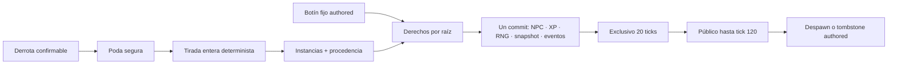

# ADR 0013: botín repetible con derechos y procedencia durable

- Estado: aceptada e implementada
- Fecha: 2026-07-17
- Alcance: inventario y botín, fase 4A
- Continúa: [ADR 0012](0012-confirmed-trade-reservations.md)

## Contexto

Al tomar esta decisión, Tiamud ya separaba prototipos de instancias, derivaba
pilas, validaba contenedores, aplicaba políticas de transferencia y confirmaba
intercambios bilaterales. El botín era solo fijo: una instancia inicial
pertenecía a una aparición de NPC y pasaba a la sala una única vez al
derrotarlo. Aún no existían procedencia durable, generación repetible, derecho
exclusivo ni reparto de grupo.

Generar objetos al azar sin definir antes identidad, propiedad y recuperación
permitiría repetir tiradas tras una caída, mezclar en una pila unidades con
derechos distintos, agotar el límite global de instancias o revelar la
identidad del beneficiario. Un reparto que dependa de la contribución tampoco
sería honesto: el combate vigente solo registra un personaje enfrentado a cada
NPC.

Esta decisión define la primera entrega cerrada de fase 4. Los afijos y las
recompensas selladas obtenidas jugando se reservan para 4B; need/greed,
master-loot, pity y cajas o llaves pagadas quedan fuera.

## Decisión

WorldPack v6 y AreaPack v5 incorporan tablas enteras y fuentes de botín. El
runtime resuelve cada fuente una sola vez por derrota, usando RNG persistido,
publica como máximo 64 raíces entre botín fijo y generado, registra procedencia
y reserva cada raíz para un personaje durante 20 ticks. El reparto inicial de
party es round-robin; no existe autoridad discrecional del líder.



No se añade una tabla SQL espejo. `WorldRuntimeSnapshot` v6 sigue siendo la
única autoridad de instancias, procedencia y derechos. SQLite y PostgreSQL
usan esquema v11 y guardan el JSON acotado como `TEXT` opaco dentro de su
transacción existente. La migración v10→v11 solo amplía de forma transaccional
la restricción física del singleton runtime: conserva versión, JSON, secuencia
cubierta y fecha, sin convertirlo a `jsonb` ni crear otra autoridad.

## Autoría: WorldPack v6 y AreaPack v5

`GameplayDefinition` añade `lootTables` y `lootSources`. AreaPack los declara
en su nivel superior y la composición conserva ownership, dependencias y orden
canónico.

```json
{
  "lootTables": [{
    "id": "tiamud:gate-stalker-drops",
    "guaranteed": [{
      "id": "tiamud:drop:road-token",
      "itemPrototypeId": "tiamud:road-token",
      "quantity": 1
    }],
    "pools": [{
      "id": "tiamud:drop:trophy",
      "rolls": 1,
      "entries": [
        {
          "kind": "item",
          "id": "tiamud:drop:wolf-clasp",
          "weight": 6000,
          "itemPrototypeId": "tiamud:wolf-clasp",
          "minQuantity": 1,
          "maxQuantity": 1
        },
        {
          "kind": "nothing",
          "id": "tiamud:drop:nothing",
          "weight": 4000
        }
      ]
    }]
  }],
  "lootSources": [{
    "kind": "npc_spawn",
    "id": "tiamud:gate-stalker-loot",
    "npcSpawnId": "tiamud:gate-stalker-1",
    "lootTableId": "tiamud:gate-stalker-drops",
    "rights": "party_round_robin"
  }]
}
```

Una tabla procesa primero `guaranteed`, ordenado por ID, y después `pools`,
también ordenados por ID. Cada pool ejecuta `rolls` selecciones con reemplazo.
Las entradas se ordenan por ID y se seleccionan por suma acumulada. `nothing`
consume su tirada sin crear una instancia. La cantidad de una entrada de
objeto se elige uniformemente en el intervalo inclusivo declarado.

Los vocabularios son cerrados. En 4A una fuente solo puede ser `npc_spawn` y
su política solo `credited_character` o `party_round_robin`. No hay tablas
anidadas, condiciones, scripts de recompensa, afijos, `maxSelections`, pity ni
una política elegida por el líder.

Límites de publicación:

- 256 tablas y 1.024 fuentes por WorldPack;
- una fuente como máximo por aparición de NPC y toda tabla debe usarse;
- 8 entradas garantizadas y 8 pools por tabla;
- 8 rolls y 64 entradas por pool, 4.096 entradas globales;
- pesos `1..=1.000.000`, sumados con aritmética comprobada;
- cantidades `1..=32`; y
- peor caso máximo de 64 raíces por derrota, sumando las instancias fijas de la
  aparición y las unidades generables por su tabla.

Las salas y sus variantes conservan texto completo acotado: `title` admite
1..=128 bytes UTF-8 seguros sin controles y `description` 1..=8.192 bytes
seguros. Los límites
cuentan bytes, no caracteres Unicode, y se validan igual en WorldPack y
AreaPack.

IDs de tabla, fuente, pool y entrada cumplen la gramática canónica y el límite
de 128 bytes. Prototipos, apariciones y tablas referenciados deben existir. Un
SHA-256 de la forma canónica exacta de cada tabla llega al dominio para la
procedencia.

WorldPack v5/v4/v3/v2 y AreaPack v4/v3/v2/v1 se normalizan a colecciones vacías.
Introducir `lootTables` o `lootSources`, incluso vacíos, en una versión anterior
se rechaza como schema-smuggling. WorldProject continúa en v2. El importador
histórico no inventa probabilidades a partir de resets ambiguos.

## RNG y resolución exactly-once

Las tiradas usan enteros y rejection sampling para evitar sesgo de módulo. No
se cambia la secuencia usada por el combate existente: el dominio añade una
operación uniforme específica y probada para botín.

Al derrotar un NPC, `resolve_npc_defeat` es la única frontera de resolución.
Botín fijo y generado se ordenan de forma estable: primero raíces authored por
ID, después guaranteed y pools por IDs canónicos, índice de roll, cantidad e ID
de instancia. Respawn nunca restaura el botín fijo y cada derrota resuelve la
tabla una sola vez.

La poda, tiradas, incremento de `nextLootDropId`, creación, procedencia,
derechos, cursor, NPC, XP, eventos y snapshot forman una única mutación
checkpointed. El commit durable confirma todo o el checkpoint restaura todo,
incluido RNG y contadores.

## Cohorte y reparto

Al empezar el encuentro se congela `LootEncounter`:

- el iniciador siempre forma parte; una vez creado un derecho, lo conserva
  aunque se desconecte;
- si pertenece a una party, se añaden hasta cinco miembros conectados, vivos y
  en la misma sala, ordenados por `CharacterId`;
- altas posteriores no entran; y
- al morir el NPC, los compañeros se intersectan con quienes siguen conectados,
  vivos, en esa sala y en la misma party. El iniciador no se elimina por una
  desconexión posterior.

Esta es elegibilidad por membresía y proximidad, no contribución de combate.
Un encuentro sin derrota se elimina al separarse, derrotarse o desconectarse el
iniciador, al terminar el combate por otra causa o al desaparecer el NPC. La
desconexión posterior a una derrota ya resuelta no borra el derecho resultante;
4A no cambia la regla vigente que cancela combate y efectos ofensivos pendientes
cuando el iniciador desconecta.

`credited_character` reserva siempre todas las raíces para el iniciador. En
`party_round_robin`, una cohorte de una sola persona produce el mismo resultado;
con dos o más, usa un cursor monotónico durable por `PartyId` y lo incrementa
por cada raíz. Un cursor solo existe para una party viva y se limpia al
disolverla; los derechos ya creados conservan su cohorte y beneficiario aunque
cambie el grupo.

`loot pass <referencia>` cede una raíz al siguiente miembro de la cohorte
congelada que no haya renunciado. No renueva el plazo. Repetir un pass propio
ya aplicado es idempotente; pasar todos vuelve la raíz pública. No se revela a
terceros quién era el beneficiario.

## Snapshot v6 y procedencia

Para que los DTO v1-v5 no acepten semántica futura, v6 añade solo campos al
nivel superior:

```text
nextLootDropId
itemProvenance: ItemInstanceId -> ItemProvenance
lootEncounters: NpcSpawnId -> LootEncounter
groundLoot: RootItemInstanceId -> GroundLootReservation
partyLootCursors: PartyId -> u64
```

`nextLootDropId` es positivo y monotónico. Las claves de `itemProvenance`
coinciden exactamente con `itemInstances`. Versiones v1-v5 se convierten con
`legacy_snapshot { sourceVersion }`; un mundo nuevo asigna `authored_initial`
a cada instancia inicial.

Las variantes cerradas de procedencia son:

```text
authored_initial
legacy_snapshot { sourceVersion }
runtime_created { createdTick }
npc_loot {
  dropId, npcSpawnId, lootTableId, tableDigestSha256,
  entryId, poolId?, rollIndex, quantityIndex, generatedTick
}
```

`runtime_created` conserva la procedencia honesta de la API general existente
que crea una instancia staged fuera de una tabla; no se etiqueta falsamente
como snapshot legado ni como drop de NPC.

`GroundLootReservation` conserva `dropId`, raíz, sala, cohorte ordenada,
beneficiario opcional, renuncias, tick de creación, `claimUntilTick` y
`despawnAtTick`. Máximo 2.048 reservas y seis miembros por cohorte. Raíces,
descendientes, referencias, plazos y contadores se validan de forma estricta.
Las reservas activas no pueden solaparse con trade.

`WorldCheckpoint` incorpora los cinco campos v6. Replay no pretende sustituir
al snapshot: si una recuperación fría sin snapshot v6 encuentra un evento de
generación runtime, falla cerrada en vez de ignorarlo y perder objetos.

## Acceso, pilas y privacidad

Una reserva es exclusiva mientras `logicalTick < claimUntilTick`. Al llegar a
20 ticks pasa a pública; al llegar a 120 se despawnea. `take` vuelve a validar
derecho, sala, capacidad, binding, grafo y reservas en la misma mutación. La
reclamación elimina la reserva al mover la raíz. Los descendientes heredan el
derecho de la raíz, de modo que `get` no lo evita.

Las pilas visibles se particionan por acceso relativo al observador:
`yours`, `reserved` o `public`, además de prototipo, ubicación y vínculo. Un
selector nunca representa a la vez unidades propias, ajenas y públicas.

Web, Telnet y GMCP muestran texto completo y referencias opacas. El beneficiario
ve `yours` y ticks restantes; terceros solo `reserved`; el estado público omite
metadata de claim. La desconexión no publica el objeto. Ningún cliente recibe
`CharacterId`, `PartyId`, drop ID, tabla, procedencia o cohorte.

Acciones de fase 4A:

```text
loot
loot status
loot pass <referencia-opaca|nombre-exacto>
take [cantidad] <referencia-opaca|nombre-exacto>
```

Web añade `loot.status` sin campos y `loot.pass` con un único `target`. Las
firmas de deduplicación incluyen la referencia. GMCP reutiliza escena e
inventario; no crea una segunda autoridad.

## Poda, capacidad y despawn

Antes de cada resolución se ejecuta poda determinista. Una instancia runtime
solo se borra físicamente si está `Consumed` o su drop ha alcanzado despawn, no
está reservada por trade ni ground loot, no es raíz o descendiente activo y no
aparece en `initial_item_prototypes`. Su procedencia se elimina en la misma
mutación.

Una instancia authored nunca se borra: al despawnear queda como tombstone
inerte en `Staged`, con sus descendientes, para impedir que reaparezca al
superponer un WorldPack sobre el snapshot. Los consumidos authored conservan
su tombstone.

Si después de podar no cabe el peor caso de una resolución bajo el límite
global de 65.536 instancias o el presupuesto de 2.048 reservas, el dominio
consume y persiste la tirada y el `dropId`, no crea unidades aleatorias,
confirma derrota y XP, y emite `LootGenerationSuppressed(capacity)`. Las raíces
fijas tienen prioridad; si ni ellas caben en el presupuesto de derechos, el
exceso authored pasa a `Staged` como tombstone y se registra la supresión en
vez de bloquear permanentemente la derrota. No se permite reroll tras reinicio.

## Tick, arranque y persistencia

La ruta de tick es:

```text
begin_tick
  -> cancelar trades vencidos
  -> liberar/despawnear loot vencido
  -> resolver combate, estados, respawns y scripts
  -> reconciliar y confirmar
```

La ruta normal y el fallback sin scripts usan el mismo orden. Toda mutación se
confirma mediante el snapshot y los eventos existentes en una transacción de
SQLite o PostgreSQL v11. El decoder conserva 1 MiB como máximo físico para
snapshots raw v1-v5; el snapshot v6 y toda nueva admisión/confirmación usan un
máximo de 2 MiB. Una actualización antigua demasiado grande sigue fallando
cerrada y una expansión v1-v5 válida debe caber en el presupuesto v6.

Antes de readiness, el servidor valida la existencia de todos los IDs de
cohortes y beneficiarios mediante una consulta existence-only por lotes. No
carga sus fichas gameplay ni las mezcla con el presupuesto de propietarios de
inventario. SQLite divide por un máximo seguro de parámetros y PostgreSQL usa
un array acotado. Una identidad ausente, referencia inválida o forma no
canónica bloquea listeners.

El combate vigente es connection-scoped. Por ello, después de validar el
snapshot, el arranque cancela encuentros de loot aún abiertos y limpia su
`engaged_character` en un commit previo a readiness, igual que una desconexión
normal; no resuelve una tabla que pudo cambiar con el WorldPack nuevo. Los
derechos `groundLoot` ya creados sí sobreviven intactos a reinicio y reconexión.

## Eventos y límites de protocolo

La resolución produce eventos cerrados y acotados para derrota, drop,
asignación, pass, reclamación, liberación, despawn y supresión. Un evento de
generación contiene como máximo 64 unidades y permanece bajo 64 KiB. La
percepción transforma sus IDs en referencias opacas o texto.

Web reserva una ventana semántica de 14 KiB dentro del frame normal de 16 KiB;
Telnet/GMCP usa 48 KiB dentro de su frame acotado. Una escena concurrida ordena
raíces de forma determinista —propias, públicas y reservadas—, recorta primero
entidades y después prosa, emite un aviso explícito y permite revelado gradual
sin cambiar autoridad. Ningún truncado revela beneficiarios o IDs internos.

Cada batch proyectado admite como máximo 16 eventos. Al superar esa cantidad,
Web envía un único aviso y una escena autoritativa crítica; Telnet coalesce el
lote en un resumen acotado y la misma escena autoritativa. Web solo envía deltas
semánticos pequeños; un reemplazo amplio cae directamente al snapshot. La
recuperación sigue usando `sync.scene` y `sync.player` correlacionados, cada uno
bajo 16 KiB, y nunca pretende replay general de eventos.

## Recompensas selladas: fase 4B

4B podrá añadir un prototipo `unique`, consumible y no estructural con una
referencia `sealedLootTableId`. Abrirlo deberá simular tirada, vínculo y
capacidad antes de consumir objeto, RNG o contador, y confirmar consumo y
recompensa atómicamente. Web, Telnet y GMCP mostrarán tiradas, cantidades y
probabilidades exactas.

Solo se aceptarán recompensas conseguidas jugando. No habrá compra de tiradas,
llaves, moneda premium ni cajas pagadas en el baseline.

## Verificación implementada de 4A

- migración v1-v5 a snapshot v6 y rechazo de campos v6 inyectados;
- migración WorldPack v2-v5 y AreaPack v1-v4 sin loot, con smuggling rechazado;
- límites, referencias, peor caso, pesos y composición determinista;
- misma semilla/snapshot produce el mismo drop y cubre rejection sampling;
- botín fijo cae una vez y la tabla una vez por derrota/respawn;
- late join excluido; desconexión y cambios de party no roban claims creados;
- round-robin y pass sobreviven a reinicio y rollback;
- exclusividad al tick 20 y despawn/tombstone al 120;
- pilas propia/reservada/pública separadas y descendientes protegidos;
- poda nunca elimina authored, trade-reserved ni grafos activos;
- supresión por capacidad avanza RNG/drop ID sin reroll;
- fallo de commit revierte generación, derechos, cursor, NPC y XP;
- startup rechaza identidades ausentes en SQLite y PostgreSQL;
- recuperación fría sin snapshot v6 falla cerrada ante loot runtime; y
- Web, Telnet, GMCP y bot comparten acciones, opacidad, límites y accesibilidad.

## Evidencia del árbol integrado

El árbol final de fase 4A pasa formato y clippy estricto, además de 587 pruebas
Rust: 113 de `tiamud-core`, 240 de `tiamud-server`, 112 de `world-pack` y 122
del resto del workspace. También pasan:

- `svelte-check`, build y 109 pruebas web;
- 84 pruebas Node/bot;
- 19 escenarios Playwright Chromium;
- licencias y avisos generados para 307 dependencias Rust y 76 web;
- humo del servidor;
- carga exacta con 16 bootstraps y 32 rondas; y
- soak corto de 30 segundos con 58 rondas, 127 acciones y 8/8 probes de
  readiness.

El WorldPack canónico de Lantern Square ocupa 50.498 bytes, tiene SHA-256
`3d6c7f40e7a5e56d509b46aeb89439aeea8f5a3168d249dd46609df1fe54c816`
y contiene tres salas, nueve prototipos, nueve instancias iniciales, una tabla
y una fuente de botín.

Esta evidencia es local sobre el árbol integrado; no demuestra CI, release ni
producción. No se ejecutaron PostgreSQL real v11, Firefox, WebKit, una prueba
manual con lector de pantalla ni el soak de 24 horas.

## Consecuencias

La entrega permite drops repetibles y reparto de grupo predecible sin otra
autoridad ni monetización. Aumenta el snapshot y exige poda, validación de
identidades y partición de pilas por acceso. El límite de 64 unidades y 2.048
reservas mantiene eventos, snapshot y proyección acotados.

Need/greed, reparto por contribución, políticas de líder, afijos y condiciones
se aplazan hasta que exista una necesidad de mundo y, para contribución, un
combate multiatacante real.
