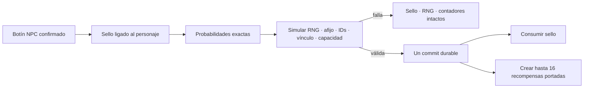

# ADR 0014: recompensas selladas ganadas y afijos deterministas

- Estado: aceptada e implementada
- Fecha: 2026-07-17
- Alcance: inventario y botín, fase 4B
- Continúa: [ADR 0013](0013-repeatable-loot-rights-and-provenance.md)

## Contexto

La fase 4A dejó una autoridad durable para instancias, procedencia, tablas de
botín, RNG y derechos de grupo. La siguiente entrega debe poder conceder un
objeto sellado durante el juego y revelar después su contenido sin ofrecer un
reroll tras un fallo, duplicar la recompensa, consumir el sello a medias ni
convertir el sistema en una mecánica de compra.

Los afijos tampoco pueden ser texto cosmético desconectado del objeto. Deben
formar parte de la identidad efectiva de cada instancia, de su pila, de sus
estadísticas y del estado durable que se recupera después de un reinicio. La
autoría ha de conservar probabilidades enteras exactas y límites que puedan
validarse antes de publicar un mundo.

## Decisión

WorldPack v7 y AreaPack v6 añaden recompensas selladas y afijos; Project v2 no
cambia. `WorldRuntimeSnapshot` avanza a v7, pero SQLite y PostgreSQL permanecen
en esquema v11: el singleton JSON de 2 MiB ya puede guardar la nueva autoridad
y no se crea una tabla espejo.

Un prototipo sellado:

- es `unique`, `maxStackUnits = 1`, consumible y `character_bound`;
- no equipa, cura, ataca, aplica efectos ni actúa como contenedor;
- referencia una única `sealedLootTableId`;
- no puede aparecer entre las instancias iniciales, en tiendas ni como salida
  de otra tabla sellada; y
- solo se abre si su procedencia durable es `npc_loot`, está portado como raíz,
  ligado al actor y fuera de cualquier reserva de trade.

No existen compra de tiradas, llaves, moneda premium, pity ni cajas pagadas.
La procedencia `npc_loot` marca durablemente el sello obtenido jugando; la
procedencia `sealed_reward` registra en cada resultado la apertura, tabla y
entrada que lo generaron.

## Autoría y límites

`ItemPrototype.sealedLootTableId` enlaza el sello con una tabla normal. Una
tabla usada por un sello tiene un peor caso de dieciséis unidades y no puede
producir otro prototipo sellado ni ser a la vez una fuente `npc_spawn` directa.

`GameplayDefinition` incorpora `affixes` y `affixPools`. Una entrada garantizada
o ponderada de tipo `item` puede referenciar `affixPoolId`. Cada pool realiza
exactamente una selección ponderada entre `affix` y `nothing`, mediante el
mismo rejection sampling entero que el botín. No hay pools anidados.

Un afijo tiene ID, etiqueta, posición `prefix|suffix` y solo dos modificadores
cerrados: `attackBonusDelta` y `healAmountDelta`. Solo se aplica a prototipos
`unique`, como máximo uno por instancia. No cambia peso, slots, capacidad,
rareza, política ni nivel. La suma usa aritmética comprobada y respeta los
límites de gameplay existentes.

La forma canónica de tablas y pools tiene SHA-256 durable. La instancia guarda
una copia acotada del afijo aplicado y sus digests; un cambio posterior del
WorldPack no reescribe botín ya concedido. Esos IDs y digests nunca se proyectan
al jugador.

## Apertura atómica

`open <sello>` clona primero RNG y contadores. Sobre una representación
prospectiva completa:

1. tira la tabla y, cuando corresponda, el pool de afijos;
2. reserva IDs distintos y crea como máximo dieciséis raíces;
3. aplica vínculo al actor y las estadísticas efectivas;
4. valida grafo, slots, peso, máximo global de instancias y presupuesto de
   snapshot v7 de 2 MiB; y
5. solo entonces consume el sello y publica RNG, contadores, procedencia,
   afijos, inventario y evento en el mismo commit del actor.

Cualquier error anterior o fallo de persistencia restaura exactamente sello,
RNG, contadores, secuencia y mundo. Una reapertura o replay no genera una
segunda recompensa.

## Contrato visible

El texto ofrece `reward odds <sello> [página]` y `open <sello>`. Web dispone de
acciones estructuradas equivalentes y Telnet/GMCP conserva la misma información.
Las probabilidades muestran fracciones exactas `numerator/denominator`,
cantidades mínimas/máximas y la posibilidad de afijo, paginadas de veinte en
veinte. Una tabla sellada admite como máximo 1.024 filas visibles, contando
cada entrada guaranteed/weighted y las filas de cada pool de afijos referido.
Los nombres efectivos, el afijo y sus modificadores se expresan también en
texto; el color nunca es la única señal. IDs y digests internos no se publican.

Las escenas siguen limitadas a 14 KiB Web y 48 KiB Telnet. Los eventos de una
apertura agregan como máximo dieciséis referencias opacas, respetan batches de
dieciséis, coalescing y recuperación por snapshot autoritativo.

## Compatibilidad y recuperación

El decoder sigue dirigido por versión. v1–v5 conservan su admisión cruda de
1 MiB; v6 y v7 usan 2 MiB. Un DTO v6 estricto rechaza campos v7 inyectados y la
migración v6→v7 añade `itemAffixes: []` a cada instancia y
`nextRewardOpenId: 1` en la raíz sin inventar procedencia.
WorldPack v2–v6 y AreaPack v1–v5 normalizan sin recompensas selladas ni afijos y
rechazan schema smuggling.

El arranque valida que cada afijo pertenezca a una instancia existente y
`unique`, que sus valores/digests sean íntegros y que ninguna recompensa
sellada viole procedencia, vínculo o ubicación. Mover, comprobar, respaldar y
migrar SQLite→PostgreSQL leen la misma autoridad v7.

## Consecuencias

La entrega añade variedad durable y una apertura verificable sin monetización
aleatoria. A cambio, cada mutación de inventario debe considerar afijos al
derivar pilas, nombres, estadísticas, trade y tamaño del snapshot.

Need/greed, master-loot, reparto por contribución, tablas anidadas, condiciones,
scripts de recompensa, múltiples afijos, reroll y pity quedan fuera de 4B.
