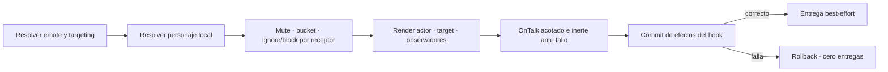

# ADR 0016: emotes de sala authored con plantillas cerradas

- Estado: aceptada e implementada
- Fecha: 2026-07-17
- Alcance: comunicación ampliada, fase 5B
- Continúa: [hoja de ruta social, staff y botín](../design/social-staff-and-loot-roadmap.md)

## Contexto

Un emote de MUD expresa una acción visible —sonreír, asentir o saludar— sin
ser diálogo. Aceptar `emote <texto libre>` convertiría al servidor en un
repetidor de prosa arbitraria que puede suplantar mensajes del sistema, abusar
de ANSI/MXP/HTML y producir resultados distintos entre navegador y Telnet.

Tiamud ya dispone de un router social, mute, ignore/block, bucket de chat,
buzones acotados y commit anterior a la entrega. Los emotes deben reutilizar
esas fronteras sin crear historial, tabla SQL ni otra autoridad de percepción.

## Decisión de autoría

WorldPack v9 y AreaPack v8 añaden como máximo 32 `socialEmotes`. WorldProject
permanece en v2, `WorldRuntimeSnapshot` en v7 y SQLite/PostgreSQL en esquema
v11: un emote no es estado durable.

```json
{
  "id": "tiamud:smile",
  "command": "smile",
  "name": "Sonreír",
  "audience": "room",
  "targeting": "optional_character",
  "templates": {
    "untargeted": {
      "actor": "Sonríes.",
      "others": "{actor} sonríe."
    },
    "targeted": {
      "actor": "Sonríes a {target}.",
      "target": "{actor} te sonríe.",
      "others": "{actor} sonríe a {target}."
    }
  }
}
```

`audience` solo admite `room`. `targeting` es `none`,
`optional_character` o `required_character`. El ID sigue la identidad gameplay
de 1–64 bytes; `command` tiene 1–32 caracteres ASCII minúsculos y forma
`[a-z][a-z0-9-]*`; `name` ocupa 1–64 bytes. ID y comando son únicos en el mundo,
también al componer áreas.

Solo existen los placeholders `{actor}` y `{target}`:

- `untargeted.actor` no contiene placeholders;
- `untargeted.others` contiene exactamente un `{actor}`;
- `targeted.actor` contiene exactamente un `{target}`;
- `targeted.target` contiene exactamente un `{actor}`; y
- `targeted.others` contiene exactamente uno de cada.

`none` exige únicamente `untargeted`; `required_character`, únicamente
`targeted`; `optional_character`, ambos. Campos o llaves adicionales,
placeholders desconocidos/repetidos, controles y `<`, `>` o `&` en las
plantillas fallan cerrados. Los nombres de personaje son datos: pueden contener
los caracteres seguros admitidos globalmente, se insertan en una sola pasada y
solo se escapan como entidades cuando Telnet negocia MXP. El validador calcula
el peor caso con nombres de 64 bytes y cada render debe caber en 512 bytes
UTF-8. La sustitución recorre segmentos cerrados: nunca reinterpreta `{actor}`
o `{target}` dentro de un nombre insertado ni evalúa `format!` dinámico, Lua,
HTML, ANSI o MXP.

WorldPack v2–v8 y AreaPack v1–v7 normalizan a catálogo vacío y rechazan un
`socialEmotes` inyectado. El importador histórico produce v9 sin inventarlos.

## Acciones y alcance

Texto usa:

```text
emotes
emote <command>
emote <command> <personaje>
```

Web usa `social.emote.list` sin campos y `social.emote` con `emote` y un
`target` opcional. No se reconoce un comando authored como verbo raíz y no hay
campo `message`: toda la prosa procede del WorldPack revisado.

Un objetivo debe ser otro personaje conectado, no ambiguo y en la misma sala.
No se aceptan self, NPC, objetivo remoto u offline. El listado no consume el
bucket ni ejecuta hooks; realizar un emote comparte mute y bucket con chat.



Ignore/block suprime únicamente la copia de cada receptor. El emisor recibe la
misma plantilla aunque el objetivo no la reciba, y los demás observadores
autorizados siguen viendo una acción pública de sala. Así no se filtra una
relación privada ni se convierte ignore en autoridad sobre terceros. Mute es
la herramienta de moderación del actor.

## Proyección y retención

`SocialChannel::Emote` transporta nombre visible del actor y la frase completa
ya renderizada para ese observador. Web la inserta como texto y no antepone de
nuevo el remitente. Telnet presenta `[emote] <frase>` y GMCP reutiliza
`Comm.Channel.Text` con `channel: "emote"`; no aparece un paquete paralelo.

El comando y el nombre se descubren mediante `emotes`/`social.emote.list`. El
ID authored, plantillas/placeholders, identidades durables e ignore/block no
salen. El destino no aparece como campo estructurado de `chat.message`, aunque
su nombre visible puede formar parte de `text`. El emote no entra en `DomainEvent`, snapshot, `reply`,
auditoría de staff, historial ni SQL. Un `OnTalk` válido puede producir los
efectos acotados ya existentes; la entrega comienza solo tras su commit. Un
fallo de script conserva la degradación inerte de `say`, porque no se ha
gastado recurso de gameplay.

## Fuera de 5B

No se añaden emotes globales/de grupo, objetivos NPC, adverbios o texto libre,
historial, correo, tablones, shout/yell ni plantillas cargadas en caliente. Una
futura ampliación debe preservar percepción por observador, límites de frame,
rollback y equivalencia Web/Telnet.
