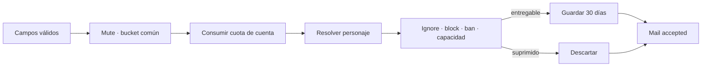
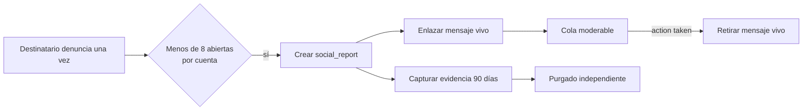

# ADR 0017: correo offline acotado, privado y moderable

- Estado: aceptada e implementada
- Fecha: 2026-07-17
- Alcance: comunicación ampliada, fase 5C
- Continúa: [hoja de ruta social, staff y botín](../design/social-staff-and-loot-roadmap.md)

## Contexto

`tell`, `reply` y telepatía sirven a personajes conectados. Convertirlos en un
historial durable cambiaría sus garantías de presencia, filtraría relaciones de
ignore/block y mezclaría texto efímero con datos personales retenidos. Tiamud
necesita una forma explícita de dejar un mensaje a un personaje desconectado,
con capacidad y tiempo de vida conocidos y una ruta de denuncia que no otorgue
al staff acceso general a correspondencia privada.

## Contrato visible

La sintaxis textual es:

```text
mail
mail list [1..7]
mail read <m+32-hex>
mail delete <m+32-hex>
mail send <personaje> | <asunto> | <cuerpo>
mail report <m+32-hex> | <motivo>
```

Web usa las acciones cerradas `mail.list`, `mail.read`, `mail.delete`,
`mail.send` y `mail.report`. El servidor responde con `mail.list` y
`mail.message`; Telnet ofrece el mismo texto y GMCP publica `Tiamud.Mail 1`
con los paquetes `List` y `Message`. El identificador visible es aleatorio,
opaco e impredecible (`m` más 32 dígitos hexadecimales); nunca expone la clave
SQL, cuenta o personaje durable.

Cada buzón contiene como máximo 64 mensajes, 128 KiB de asunto y cuerpo
combinados y siete páginas de diez. Asunto, cuerpo y motivo admiten
respectivamente 128, 2.048 y 2.048 bytes UTF-8 visibles; el nombre objetivo,
64. El objetivo coincide exactamente, incluidas mayúsculas/minúsculas. `|` se
reserva como separador y se rechaza en nombres y asuntos; cuerpo y motivo sí
pueden conservarlo. Se rechazan controles y marcas bidi de formato. `<`, `>` y `&` son datos:
Svelte los inserta como texto y Telnet los escapa únicamente cuando negocia
MXP.

## Persistencia y caducidad

SQLite y PostgreSQL avanzan al esquema v12 y añaden:

- `social_reports.report_kind`, con vocabulario cerrado `character`/`mail`
  para conservar el origen moderable sin retener el cuerpo;
- `social_mail_messages`, con remitente visible capturado, destinatario,
  referencia pública, lectura, caducidad y denuncia opcional;
- `social_mail_usage`, con ventanas por cuenta; y
- `social_mail_report_evidence`, separada del mensaje vivo.

Los mensajes caducan exactamente tras 30 días. El purgado trabaja en lotes de
256 y toda lectura filtra caducados aunque el mantenimiento vaya retrasado. El
remitente durable es anulable al borrar su personaje, pero su nombre capturado
permite entender el mensaje; borrar el destinatario elimina su buzón. No hay
outbox, búsqueda, carpetas, adjuntos, reenvío, retirada ni correo grupal.



`send` se resuelve en una transacción. La cuota es por cuenta, no por
personaje: 20 intentos por hora y 50 por día, en ventanas fijas. Tras superar
las guardas comunes de mute y bucket, todo intento con campos válidos la
consume antes de resolver el nombre o aplicar política, incluso objetivo
desconocido, ambiguo, propio o entrega suprimida.
La misma cuenta puede escribir a otro personaje propio, pero no al personaje
emisor. Existe además un máximo global de 100.000 mensajes vivos.

Ignore del receptor, block bilateral, destinatario baneado, buzón lleno o
límite global producen la misma aceptación que una inserción. Así el emisor no
puede sondear relaciones privadas ni capacidad. Un objetivo inexistente,
ambiguo o idéntico responde con el único error genérico de destinatario no
disponible; superar la cuota sí es un error explícito para que el cliente pueda
detener reintentos. El correo no activa `OnTalk`, `reply`, snapshots,
`DomainEvent` ni notificaciones online.

## Lectura, borrado y denuncia

Listar exige ser el destinatario. Leer marca el mensaje de forma idempotente;
borrar lo elimina de inmediato. La lista nunca contiene el cuerpo. Las
respuestas estructuradas solo se encolan para la sesión Web/Telnet solicitante
y respetan el límite de frame.



Solo el destinatario puede denunciar una carta y solo una vez. Se permiten
ocho denuncias de correo abiertas por cuenta y hasta 10.000 evidencias
globales. Crear la denuncia, capturar remitente/asunto/cuerpo y enlazar el
mensaje es atómico. La evidencia caduca a los 90 días aunque el usuario borre
la carta. El `report_kind` durable permite que una denuncia todavía abierta
siga contando para el límite de ocho después de purgar su cuerpo; no prolonga
la retención de evidencia. Una resolución `action taken` retira el mensaje vivo. El listado de
staff muestra referencia, asunto y extracto acotado, no ofrece exploración de
buzones ni vuelca el cuerpo completo en auditoría. La auditoría conserva solo
la operación y el ID de denuncia.

## Consecuencias y exclusiones

El correo es deliberadamente otro producto social: durable, consultado bajo
demanda y con minimización de datos. `tell`, telepatía, emotes y canales
conservan su semántica efímera. El coste es una migración y mantenimiento de
cuotas/evidencia equivalentes en SQLite y PostgreSQL.

Quedan para 5D los tablones compartidos y para una fase posterior la
comunicación espacial (`shout`/`yell`). Cifrado extremo a extremo, correo entre
servidores, filtros de usuario, notificación push y exportación de buzones no
forman parte de esta versión.
