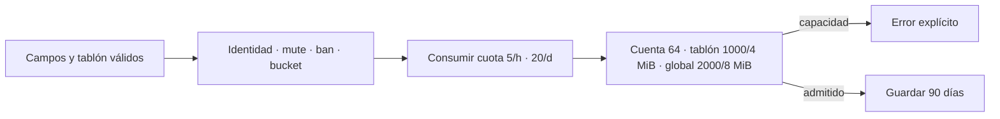
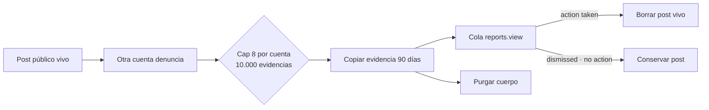

# ADR 0018: tablones comunitarios acotados y moderables

- Estado: aceptada e implementada en fase 5D
- Fecha: 2026-07-17
- Alcance: comunicación durable compartida, fase 5D
- Continúa: [hoja de ruta social, staff y botín](../design/social-staff-and-loot-roadmap.md)

## Contexto

El correo 5C permite correspondencia privada y los canales sirven conversación
efímera. Ninguno debe convertirse en un archivo público: hacerlo mezclaría
privacidad, retención y paginación con garantías que no poseen. Tiamud necesita
un lugar explícito donde una comunidad pueda publicar información durable,
consultarla bajo demanda y denunciarla sin crear un historial general de chat.

Los futuros bundles de áreas calientes aún no existen. Ligar ahora posts SQL a
salas o `AreaPack` produciría registros huérfanos al reemplazar, descargar o
renombrar un área. La primera versión usa por ello un catálogo global cerrado:

- `general`: conversación comunitaria deliberada;
- `newbie`: preguntas y orientación para personas nuevas.

Ambos son legibles y publicables por todo personaje registrado y activo. Un
tablón authored, privado, de guild o ligado a una sala exige otra decisión que
defina propiedad, alias/tombstones y ciclo de vida junto a áreas calientes.

## Contrato visible

Texto ofrece exactamente:

```text
board
board list <general|newbie> [1..100]
board read <b+32-hex>
board post <general|newbie> | <asunto> | <cuerpo>
board delete <b+32-hex>
board report <b+32-hex> | <motivo>
```

`board` devuelve el catálogo. Web usa las acciones cerradas
`board.catalog/list/read/post/delete/report` y las respuestas
`board.catalog/list/entry`. Telnet ofrece el mismo texto y GMCP negocia
`Tiamud.Board 1` con `Tiamud.Board.Catalog`, `.List` y `.Entry`. Nunca se
reutiliza `Comm.Channel.Text` ni se hace fan-out: lista y detalle vuelven solo a
la sesión que los solicitó.

La línea de comando Telnet admite como máximo 8 KiB, suficientes para comando,
separadores, asunto máximo y cuerpo de 4.096 bytes. Una línea mayor se descarta
completa antes de aceptar la siguiente; no se ejecuta un prefijo truncado.
Todo paquete GMCP, incluido nombre, espacio y JSON, conserva su máximo de 8
KiB. Si el escape JSON hace que `Tiamud.Board.Entry` completo no quepa, el
mismo paquete conserva todos los campos del resumen, el mayor prefijo UTF-8
del cuerpo que sí cabe, `truncated: true` y:

```json
{"overflow":{"package":"Tiamud.Board.Entry","maximumBytes":8192,"originalBytes":4096}}
```

`originalBytes` mide el cuerpo UTF-8 original, no el JSON escapado. El texto
Telnet conserva siempre el cuerpo completo. El mismo encoder protege de forma
defensiva `Tiamud.Mail.Message`, aunque su cuerpo canónico máximo de 2.048
bytes cabe normalmente en un paquete.

La referencia visible es `b` más 32 dígitos hexadecimales minúsculos generados
con aleatoriedad criptográfica. No expone PK SQL, cuenta, personaje ni digest.
El asunto admite 128 bytes UTF-8 visibles, el cuerpo 4.096 y el motivo 2.048.
`|` está reservado y se rechaza en el asunto; cuerpo y motivo pueden
conservarlo. Controles C0/C1, DEL y marcas bidi se rechazan; `<`, `>` y `&`
siguen siendo texto y MXP los escapa solo al renderizar.

Una entrada inexistente, caducada o borrada produce un único error no
disponible. Borrar exige el mismo personaje autor. Denunciar exige otra cuenta
y una publicación aún viva. No existe edición: así el contenido denunciado no
cambia debajo de su evidencia.

## Límites, cuota y retención

- diez resúmenes por página; páginas solicitables `1..=100`;
- `totalPages = max(1, ceil(totalPosts / 10))`; una página válida posterior al
  total devuelve una lista vacía;
- retención exacta de 90 días por publicación;
- 1.000 publicaciones y 4 MiB vivos por tablón;
- 2.000 publicaciones y 8 MiB vivos globales;
- 64 publicaciones vivas por cuenta entre todos sus personajes; y
- cuota por cuenta de cinco intentos/hora y veinte/día en ventanas fijas.

Ignore y block no cambian un contenido deliberadamente público ni su
paginación. Mute y ban impiden publicar, pero no leer, borrar contenido propio
o denunciar. Publicar comparte el bucket social común y después usa la cuota
durable propia; borrar no devuelve cuota. Una capacidad llena es pública y
produce error explícito. Un intento válido que alcanza la transacción consume
cuota aunque el límite de cuenta, tablón, bytes o global impida insertarlo.



Postear no activa `OnTalk`, no modifica `reply`, no crea `DomainEvent`, no
entra en snapshots y no produce notificación online.

## Persistencia y concurrencia

SQLite y PostgreSQL avanzan al esquema v13. El snapshot runtime sigue en v7;
WorldPack v9, AreaPack v8 y WorldProject v2 no cambian. SQL añade:

- `social_board_posts`, con referencia pública, tablón cerrado, autor/nombre
  capturado, asunto/cuerpo, enlace de denuncia y caducidad;
- `social_board_usage`, con ventanas por cuenta; y
- `social_board_report_evidence`, independiente del post vivo.

`social_reports.report_kind` amplía su vocabulario cerrado a `board`. SQLite
reconstruye de forma transaccional el padre y sus dos hijos mail para cambiar
ese `CHECK` sin romper FKs; conserva IDs, enlaces y bytes, ejecuta
`foreign_key_check` antes de confirmar y no toca el snapshot. PostgreSQL
reemplaza la constraint nombrada. El mover offline copia las tres tablas,
reportes y secuencias en orden padre-hijo.

SQLite mantiene un escritor. PostgreSQL toma primero el lock advisory global de
tablones y después la fila de cuota de la cuenta; todos los caminos conservan
ese orden. Cuenta y bytes se calculan solo sobre filas no caducadas. No se
añaden contadores espejo que puedan divergir.

La purga combina posts y evidencia en lotes máximos de 256: al arrancar es
fail-closed y cada hora es no fatal pero observable. Lecturas, capacidad y
evidencia staff filtran siempre por caducidad, aunque el borrado físico se
retrase.

## Moderación

Una publicación admite una denuncia global como máximo. Esto evita duplicar
el mismo cuerpo y saturar la cola; `canReport` no revela información privada
porque la publicación es pública. La transacción:

1. comprueba que autor y denunciante pertenecen a cuentas distintas;
2. exige menos de ocho denuncias `board` abiertas de la cuenta denunciante;
3. exige menos de 10.000 evidencias `board` vivas globales;
4. crea un `social_report` de tipo `board`;
5. copia tablón, referencia, autor, asunto, cuerpo y tiempos; y
6. enlaza condicionalmente el post o revierte todo ante una carrera.

La evidencia dura 90 días desde la denuncia y sobrevive al borrado o caducidad
del post. `report_kind='board'` permanece si la denuncia sigue abierta después
de purgar el cuerpo, por lo que el límite de ocho no se recupera por esperar.
Eliminar el personaje/cuenta conserva la política de cascada de privacidad del
sistema de reportes actual.

Staff usa las capacidades existentes `reports.view` y `reports.resolve`. Ve
tablón, asunto y extracto acotado, no vuelca el cuerpo en auditoría. Resolver
`action_taken` elimina el post vivo; `dismissed` y `no_action` lo conservan.
No existe un segundo comando de borrado staff sin denuncia/evidencia.



## Cliente oficial y exclusiones

El navegador presenta un panel “Tablones” separado del feed y del correo, con
selector, lista paginada, detalle `<article>`, formulario, borrado propio y
denuncia. Svelte inserta todo como texto: no hay `{@html}`, Markdown, autolinks
ni contenido remoto. No existe estado leído/no leído. El ingreso WebSocket
rechaza claves JSON duplicadas en cualquier objeto, también anidado, antes de
deserializar una acción: nunca aplica semántica last-key-wins.

Publicar, borrar y denunciar no cambian la vista de forma optimista. El cliente
acota y correlaciona sus metadatos pendientes por `requestId`, bloquea envíos
duplicados mientras corresponda y espera un `action.result`. Solo un resultado
exitoso invalida la lista, retira una entrada borrada o marca una denuncia; un
fallo conserva lista, detalle y los borradores de asunto, cuerpo o motivo para
que la persona pueda corregirlos y reintentar.

Quedan fuera de 5D: archivo de canales, respuestas/hilos, edición, búsqueda,
likes, reacciones, adjuntos, imágenes, pinning permanente, anonimato,
suscripciones, push, federación, exportación, tablones de party/guild/staff y
tablones authored por sala/área.
