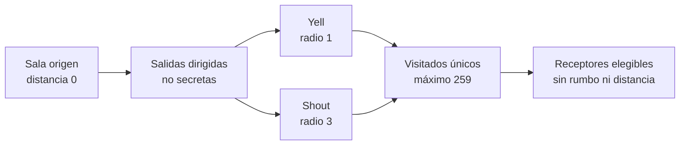

# ADR 0019: voz espacial acotada sin revelar topología

- Estado: aceptada; implementada en fase 5E
- Fecha: 2026-07-17
- Alcance: conversación efímera espacial, fase 5E
- Continúa: [hoja de ruta social, staff y botín](../design/social-staff-and-loot-roadmap.md)

## Contexto

`say` cubre una sala y los canales cubren audiencias suscritas que no dependen
del mapa. Convertir `yell` o `shout` en alias de un canal global perdería la
geografía del MUD; recorrer el mundo sin límite convertiría, en cambio, una
línea de texto en trabajo y fan-out no acotados. La propagación tampoco puede
usar salidas secretas ni publicar rumbo o distancia, porque eso revelaría
topología que la percepción ordinaria mantiene en el servidor.

La voz espacial reutiliza el router social, los buzones acotados por sesión,
mute, ignore/block, el bucket común y la frontera de commit ya existentes. No
necesita otra autoridad durable, un archivo de chat ni cambios de autoría.

## Acciones y límites de texto

Texto ofrece exactamente:

```text
yell <mensaje>
shout <mensaje>
```

Web usa `social.yell` y `social.shout`, cada una con el único campo adicional
obligatorio `message`. No acepta `target`, `channel`, distancia, dirección ni
otros campos, aunque uno conocido llegue como `null`. El mensaje visible ocupa
`1..=512` bytes UTF-8 y aplica el mismo rechazo de controles inseguros que el
chat actual.

Telnet analiza los mismos comandos. Una entrega usa `SocialChannel::Yell` o
`SocialChannel::Shout`; el texto es completo y, cuando `Comm` está negociado,
GMCP reutiliza `Comm.Channel.Text` con `channel: "yell"` o `"shout"`. No se
crea un paquete Tiamud paralelo.

## Alcance espacial

El actor calcula una búsqueda en anchura sobre el grafo de salas ya cargado:

- la sala origen está a distancia cero e integra la audiencia;
- `yell` alcanza distancias `0..=1`;
- `shout` alcanza distancias `0..=3`;
- solo se recorren salidas dirigidas desde la sala visitada;
- una salida marcada secreta no se atraviesa, aunque el emisor o receptor
  pudiera percibirla o tuviera autoridad administrativa;
- las direcciones se recorren en el orden canónico cerrado y cada sala se
  visita como máximo una vez, por lo que ciclos y rutas convergentes no
  duplican entregas; y
- la búsqueda admite como máximo 259 salas, incluida la de origen. Al llegar al
  límite no expande más nodos.

Con seis direcciones canónicas, el peor árbol sin convergencias de radio tres
es `1 + 6 + 36 + 216 = 259`. El límite se conserva de forma explícita aunque
el mundo normal tenga menos ramas.



Ni el mensaje Web, el texto Telnet ni GMCP incluyen ruta, primera dirección,
distancia o sala de origen. El receptor solo conoce el nombre visible del
emisor, el canal y el texto. El orden determinista sirve para acotar y probar
la búsqueda, no se convierte en una señal observable de topología.

## Política, percepción y commit

Emitir `yell` o `shout` comparte mute y el bucket social común con `say`,
`tell`, telepatía y emotes. Un actor silenciado o sin cuota recibe error y no
ejecuta hooks ni entrega copias.

Para cada receptor, ignore del emisor, block bilateral o el flag
`condition.deaf` suprimen `say`, `yell` y `shout`. Ser sordo no impide emitir
voz. La confirmación propia del actor no cambia según el conjunto de
receptores, de modo que no revela ignore, block, sordera, ocupación de salas ni
la existencia de una ruta. Un receptor elegible recibe como máximo una copia,
aunque varias rutas alcancen su sala.

`OnTalk` se ejecuta exactamente una vez en la sala origen, no una vez por sala
ni por receptor. Sus efectos acotados se confirman antes de cualquier entrega.
Un fallo durable restaura el checkpoint y publica cero copias; tras un commit
correcto, la entrega a buzones de sesión es best-effort y no revierte el mundo.

## Retención y formatos

La voz espacial es efímera. No crea `DomainEvent` con el cuerpo, no actualiza
`reply`, no se suscribe, no se consulta después y no entra en historial,
auditoría, correo, tablones, SQL o snapshots. SQLite/PostgreSQL permanecen en
esquema v13; WorldPack v9, AreaPack v8, WorldProject v2 y
`WorldRuntimeSnapshot` v7 no cambian.

La topología procede del WorldPack completo ya validado y cargado. Esta
decisión no anticipa carga/reemplazo/LRU de áreas: cuando ADR 0005 se
implemente, una acción seguirá viendo una sola revisión coherente del grafo y
la transición deberá preservar checkpoint, rollback y un único mundo
autoritativo.

## Exclusiones y aceptación

Quedan fuera de 5E: archivo o búsqueda de voz, replay, suscripciones,
notificaciones offline, mensajes de grupo por proximidad, volumen o lenguaje,
atenuación gradual, puertas con estado audible, obstáculos acústicos authored,
dirección/distancia visible, voz global y propagación entre paquetes no
cargados.

Core, actor, Web, Telnet/GMCP, cliente oficial y bot estricto demuestran el
mismo contrato, incluidas las pruebas de radio, ciclo, convergencia, salida
secreta, límite de 259, ignore/block/deaf, mute/bucket y rollback. La evidencia
integrada y sus exclusiones se conservan en el registro de fase 5E; el ADR por
sí solo no sustituye esa evidencia.
