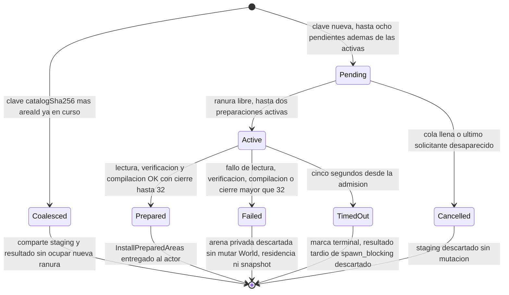
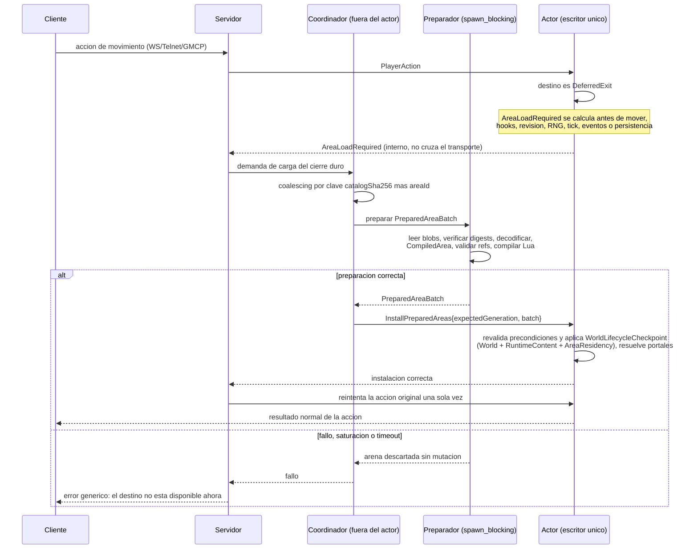

# ADR 0020: carga local aditiva de áreas bajo demanda

- Estado: aceptada e implementada en la fase 6B
- Fecha: 2026-07-17
- Alcance: residencia aditiva en runtime desde el catálogo local de 6A
- Desarrolla: [ADR 0005](0005-hot-area-lifecycle.md)

## Contexto

La fase 6A publicó un catálogo estricto, bundles inmutables y un WorldPack
monolítico de respaldo, todos direccionados por contenido. Antes de 6B, el
servidor construía siempre un `World` y un `RuntimeContent` completos antes de
abrir listeners. Además, el checkpoint en memoria protegía estado dinámico,
pero no incluía toda la topología, los catálogos estáticos, `RuntimeContent` ni
residencia. No era seguro insertar una parte del mundo con aquel checkpoint y
la frontera de rollback anterior.

Esta fase introduce el paso mínimo útil siguiente: cargar áreas locales cuando
una entrada real las necesita y conservarlas hasta que termine el proceso. No
intenta todavía reemplazar una revisión, descargar memoria ni aceptar una
publicación nueva durante la partida. Así se separa el problema de instalación
atómica del problema posterior, bastante mayor, de drenaje, migración,
checkpoint por área y LRU.

## Decisión y frontera de fase

6B añade un modo de runtime explícito basado en el registro local verificado de
6A. La identidad de su generación es el SHA-256 de los bytes canónicos exactos
del catálogo, no `catalogRevision`, el path ni el contenido actual del puntero
`area-active`.

En este modo:

- la generación queda fijada antes de abrir listeners;
- el conjunto residente solo puede crecer;
- una demanda prepara fuera del actor y el actor instala un lote completo o
  ninguno;
- todas las áreas usadas, definiciones globales incorporadas y scripts quedan
  residentes hasta apagar el proceso; y
- el WorldPack monolítico sigue siendo respaldo verificable y la ruta de
  runtime monolítica sigue siendo válida para mundos pequeños.

Cambiar `area-active`, publicar otro catálogo o modificar el fichero usado para
resolverlo no cambia una generación en ejecución. El proceso conserva los
bytes y el digest ya verificados y no vuelve a consultar el puntero. Para usar
otra publicación hay que reiniciar. Si se seleccionó el modo catálogo y su
verificación falla, el arranque falla cerrado; no cae silenciosamente al mundo
embebido ni mezcla ambas fuentes.

No pertenecen a 6B:

- sustitución de revisiones o coexistencia de generaciones;
- drenaje, descarga, checkpoint por área, LRU, histéresis o presupuesto de
  memoria residente;
- precarga especulativa;
- red, compresión, registro remoto o firma remota; ni
- migración de estado vivo, transferencia de autoridad NPC entre áreas o
  rollback operativo a otra publicación.

## Arranque y generación fijada

El arranque resuelve una sola ruta de catálogo content-addressed del registro
local, conserva sus bytes, verifica el SHA-256 de la ruta y aplica el contrato
completo de 6A. Cada lectura posterior de un bundle vuelve a comprobar su path,
tamaño, digest, esquema, compatibilidad, ownership y `CompiledArea` contra esa
copia del catálogo. El modo `unsigned_local` continúa presuponiendo un host
confiable; 6B no lo convierte en una raíz de confianza multioperador.

Catálogo y WorldPack de respaldo se validan antes de crear el directorio
SQLite o abrir/migrar el backend seleccionado. Las purgas sociales se retrasan
hasta después de restore/replay, validaciones y confirmación inicial, antes de
readiness. Son mantenimiento no bloqueante: se registra su fallo, pero no se
declara fallido un mundo cuya autoridad ya fue confirmada.

La construcción inicial depende de la autoridad durable encontrada:

1. Si existe un `WorldRuntimeSnapshot`, se preparan e instalan **todas** las
   entradas de la generación antes de restaurarlo.
2. Si no existe snapshot pero hay un ledger de eventos que deba reproducirse,
   se carga igualmente la generación completa antes del replay.
3. Solo con snapshot y ledger vacíos se instala el área propietaria de
   `startRoomId` y el cierre transitivo de sus dependencias duras. La readiness
   exige que ese lote esté activo y, si introdujo estado dinámico inicial, que
   su persistencia haya sido confirmada.

La carga completa de arranque no convierte 256 entradas en un cierre de
dependencias de 256. Recorre el catálogo en orden canónico mediante lotes de
como máximo 32 áreas y conserva la barrera de startup cerrada hasta completar
todos. Mientras exista un snapshot o ledger previo, esos lotes son construcción
provisional: no publican listeners ni persisten sus instancias iniciales antes
de que la autoridad durable se restaure o reproduzca. Un fallo descarta el
proceso de arranque sin modificar el backend.

Cargar la generación completa antes de una restauración o replay evita que un
objeto, NPC, sala o definición durable parezca inválido solo porque su área aún
no reside. No cambia `WorldRuntimeSnapshot` v7 ni el esquema SQL v13: el
catálogo determina la topología estática y el snapshot sigue siendo la única
autoridad del estado dinámico que ya contiene.

La ubicación durable de un personaje tampoco se corrige a la sala inicial. Si
la sala pertenece a una entrada conocida pero no residente, el acceso provoca
la misma demanda acotada antes de entrar. Si el ID no pertenece a la generación
o la carga falla, el acceso falla cerrado con un error público genérico. Nunca
se teletransporta silenciosamente a `startRoomId`.

## Topología parcial y `DeferredExit`

Una sala residente puede conservar una salida cuyo destino válido pertenece a
un área no residente. El core la representa mediante un `DeferredExit`
inmutable con, como mínimo:

- `targetRoomId` estable;
- `targetAreaId` resuelto por ownership del catálogo;
- revisión mínima exigida por el portal; y
- SHA-256 de la generación a la que pertenece.

Al instalar el área destino, el actor resuelve las salidas diferidas del lote y
las entradas ya residentes que apunten a él. La resolución forma parte del
mismo checkpoint de ciclo de vida; no existe un instante observable en que la
sala destino esté activa pero una mitad del portal se haya parcheado.

Intentar movimiento a un `DeferredExit` produce únicamente el resultado
interno `AreaLoadRequired`. Este resultado se calcula antes de mover al
personaje, ejecutar hooks, avanzar revisión, RNG o tick, emitir eventos o
preparar persistencia. La acción original sigue siendo una sola admisión a
efectos de cuota, deduplicación y respuesta; el reintento automático no vuelve
a cobrarla.

`AreaLoadRequired` no cruza WebSocket, Telnet ni GMCP. El servidor entrega la
demanda al coordinador y, después de una instalación correcta, reintenta la
acción original **una sola vez** contra el estado actual del actor. El reintento
vuelve a autorizar y validar todas las precondiciones ordinarias. Si vuelve a
pedir un área, si la sesión cambió o si cualquier precondición ya no se cumple,
termina sin un segundo ciclo de carga.

### Un portal no es una dependencia dura

`hardDependencies` deriva solo de referencias cruzadas estructurales que no
son `RoomExit`. Esas dependencias entran en el lote porque la definición
solicitada no puede instalarse correctamente sin ellas. En cambio, cada
`RoomExit` cruzado ya está descrito como `portals`: puede permanecer como
`DeferredExit` y solo dispara carga cuando se intenta atravesar.

Por tanto, un portal no fija residencia ni entra por sí mismo en el cierre
duro. Esta separación permite que ciclos normales de caminos no carguen el
mundo entero. `AreaPack.dependsOn` conserva su significado editorial
exhaustivo, pero no sustituye el `hardDependencies` derivado del catálogo. Las
`softDependencies` de catálogo v1 siguen vacías y 6B no inventa precarga.

Una ubicación inicial `ItemInstanceContainer` cruzada sí es una referencia
estructural, no un portal. El catálogo publica tanto la arista hijo→contenedor
como la arista inversa contenedor→hijo. Así ambos pertenecen al mismo cierre
duro y se materializan antes de que una persona pueda mover, llenar o ligar el
contenedor. Al abrir una generación, el runtime reconstruye esta exigencia a
partir del WorldPack de respaldo y rechaza el catálogo si falta cualquiera de
las dos aristas; la validez no depende de una mutación de juego anterior.

## Coordinador acotado fuera del actor

Una única instancia por proceso coordina demanda y staging. Su clave de
coalescing es exactamente `(catalogSha256, areaId)`. Peticiones concurrentes de
la misma clave comparten preparación y resultado; nunca abren lectores,
validadores o compiladores duplicados para esa área y generación.

Los límites cerrados son:

- hasta **dos** preparaciones activas;
- hasta **ocho** trabajos distintos pendientes, además de los activos;
- **cinco segundos** desde la admisión del trabajo hasta entregar o cancelar
  todo su staging; y
- hasta **32 áreas** en el cierre transitivo solicitado, incluida el área raíz.

Una clave ya coalescida no consume otro slot de trabajo. Sus solicitantes
siguen sujetos a las colas y vidas acotadas de sesión existentes. Cola llena,
timeout, cancelación del último solicitante, cierre superior a 32 o cualquier
fallo de lectura/verificación/compilación descartan la arena privada completa.
No mutan `World`, `RuntimeContent`, residencia, snapshot ni ledger.

Cada solicitante posee un guard de espera. Si desaparece el último mientras el
trabajo aún espera permiso, un `Notify` despierta la cola y la cancela sin
esperar a obtener el semáforo. Si vence el timeout, el trabajo queda marcado
antes de notificar: una petición tardía no puede agruparse con esa marca
terminal ni revivir staging que ya excedió su vida. El solicitante recibe el
fallo a los cinco segundos, pero Rust no puede cancelar de forma segura un
`spawn_blocking` ya iniciado: ese trabajo conserva su permiso y la marca hasta
terminar, y su resultado tardío se descarta sin entrar en el actor.

El cierre se calcula solo sobre `hardDependencies`, en orden determinista y
contra el catálogo fijado. Se restan las áreas que ya son residentes y se
prepara el resto como un único `PreparedAreaBatch`. Leer blobs, verificar
digests, decodificar, convertir `CompiledArea`, validar referencias y compilar
Lua ocurre fuera del actor y sin acceso a su estado mutable.

## Instalación atómica en el actor

El coordinador entrega un comando interno
`InstallPreparedAreas { expectedGeneration, batch }`. Antes de tocar estado, el
actor vuelve a comprobar:

- que `expectedGeneration` es su `catalogSha256` fijado;
- que cada área sigue ausente o coincide exactamente con la misma revisión y
  digest ya residente;
- que cada área sigue vinculada a la revisión y digest preparados para esa
  generación; y
- que no se introduce ningún ID duplicado, retargeting ni referencia semántica
  fuera del lote más el conjunto residente.

El preparador ya verificó bytes exactos, bundle, cierre duro, ownership y
portales contra el catálogo fijado. El actor no vuelve a derivar ese catálogo:
revalida la identidad content-addressed del resultado y las precondiciones que
dependen de su estado vivo.

La instalación usa un `WorldLifecycleCheckpoint` que cubre conjuntamente:

1. `World`, incluida topología, índices de IDs, prototipos, catálogos estáticos,
   entidades y todo el estado del `WorldCheckpoint` existente;
2. `RuntimeContent`, incluidas variantes, medios, scripts compilados, semilla y
   su orden determinista; y
3. `AreaResidency`, con generación, áreas/revisiones/digests residentes y
   enlaces diferidos o resueltos.

El lote incorpora definiciones, crea el estado inicial que corresponda,
resuelve portales y solo entonces publica el nuevo conjunto residente. Cualquier
error restaura las tres partes exactas. No se proyecta escena, evento ni
entrega social durante la instalación; una acción reintentada produce después
su resultado normal.

Las definiciones de alcance global que se incorporen —progresión, habilidades,
emotes y las que se añadan al cargar prototipos, tablas y fuentes de botín,
afijos, medios o scripts— quedan fijadas durante toda la generación. 6B nunca
las elimina ni sustituye.

La identidad de mundo, sala inicial, semilla RNG, defaults de personaje y el
catálogo completo de creación/progresión, habilidades y emotes se extraen del
WorldPack de respaldo ya contrastado con los bundles y se fijan al arrancar.
Así `/api/character-options` y las reglas globales no cambian porque otra
persona visite una región. Salas, instancias, prototipos de objeto, NPC, botín,
afijos, medios y scripts pueden incorporarse con su área; sus IDs solo se
añaden y después permanecen inmutables y residentes.

Una instancia inicial `NpcSpawn` puede pertenecer a un área distinta de su NPC.
Si el NPC ya reside, la instalación incorpora el ID a su botín fijo en el mismo
checkpoint, valida el máximo de raíces y marca el lote como estado dinámico.
Si NPC e instancia llegan juntos, se aplica la misma unión al crear el NPC. En
ambos órdenes la relación queda completa o se restaura íntegra; nunca queda una
instancia `HeldByNpc` que el NPC no pueda resolver como botín.

El flujo completo de una demanda —desde el movimiento hacia un `DeferredExit`
hasta el reintento único— recorre el cliente, el servidor, el coordinador fuera
del actor y el propio actor sin exponer nunca la mecánica de carga:

## Persistencia y recuperación

Residencia y salidas diferidas son estado reconstruible y no se añaden al
snapshot. Una instalación puramente estática se confirma en memoria sin crear
un evento de dominio ni escribir un snapshot nuevo.

Si el lote añade estado dinámico que sí pertenece al snapshot actual —por
ejemplo instancias iniciales, NPC activos, apariciones o contadores derivados—,
el actor debe confirmar el `WorldRuntimeSnapshot` resultante mediante la
transacción durable existente **antes** de publicar el lote y antes del
reintento. Un fallo del backend restaura el `WorldLifecycleCheckpoint` completo.
No se persiste una autoridad paralela por área.

Esto evita que una caída entre instalación y movimiento pueda duplicar o
resucitar estado inicial. Tras reiniciar, la presencia de snapshot o ledger
obliga a cargar la generación completa antes de restaurar, por lo que el
snapshot v7 conserva todas sus referencias válidas aunque la residencia de la
ejecución anterior no se haya guardado.

## Errores públicos y observabilidad

Los clientes no conocen área, revisión, digest, staging ni generación. Un
rechazo por saturación, timeout, bundle inválido, dependencia, instalación o
destino no disponible usa un mensaje genérico equivalente a «El destino no
está disponible ahora». No revela si el área existe, estaba descargada o falló
una comprobación concreta. Web, Telnet y GMCP no añaden acciones ni paquetes de
administración para 6B.

Las métricas usan nombres y etiquetas cerrados de baja cardinalidad:

- trabajos activos/pendientes, demandas, coalescing y rechazos;
- resultado y etapa cerrada de preparación/instalación;
- latencia, bytes preparados y tamaño del cierre; y
- número de áreas residentes y salidas diferidas.

Nunca usan `areaId`, room ID, revisión, digest ni `catalogSha256` como label.
Esos identificadores pueden aparecer solo en logs operativos acotados. La
readiness falla si la generación fijada, el área inicial o una restauración
completa dejan de ser coherentes; el fallo posterior de un área todavía no
solicitada no vuelve no-ready por sí solo al proceso.

## Mapa implementado

- `world-pack/src/area_catalog.rs` sigue siendo la frontera estricta para
  catálogo, bundle, digests, ownership, dependencias y portales; 6B no crea
  otro formato. `area_registry.rs` abre la generación exacta, indexa ownership
  y lee cada bundle de forma perezosa con nueva verificación.
- `mud-server/src/world_loader.rs` separa la conversión pura de un
  `CompiledArea` hacia un lote preparado, reutilizando validación y compilación
  del arranque monolítico.
- `mud-server/src/area_runtime.rs`, fuera de `world_actor`, posee lectura local,
  coalescing, semáforos, cola, timeout y staging.
- `mud-core/src/lib.rs` incorpora topología parcial, `DeferredExit`, el
  resultado interno sin mutación y operaciones de instalación/rollback sobre
  `World`.
- `mud-server/src/runtime_content.rs` admite merge determinista y checkpoint de
  variantes, medios y scripts sin ejecutar staging.
- `mud-server/src/world_actor.rs` posee residencia, instalación, barrera de
  persistencia y la única publicación autoritativa.
- `mud-server/src/main.rs` fija y verifica la generación antes de abrir
  listeners y elige de forma excluyente modo monolítico o catálogo.
- Los adaptadores de persistencia conservan snapshot v7 y esquema v13; solo se
  reutiliza su commit atómico cuando el lote crea estado dinámico.

La evidencia integrada y sus límites se conservan en el
[registro de fase 6B](../project/log/2026-07-17-additive-local-area-loading-phase-6b.md).

## Aceptación

La aceptación de 6B exige pruebas enfocadas e integradas que demuestren, como
mínimo:

- arranque vacío con área inicial más cierre duro, y arranque con
  snapshot/ledger cargando la generación completa antes de restaurar/reproducir;
- portal diferido sin mutación, instalación y reintento único correctos;
- ciclos de portales sin carga transitiva y cierre duro determinista hasta el
  límite exacto de 32;
- coalescing concurrente, dos activos, ocho pendientes, timeout de cinco
  segundos, cola llena y cancelación;
- bundle alterado, generación obsoleta, dependencia ausente, ID duplicado y
  fallo de compilación sin cambio observable;
- rollback exacto de `World`, `RuntimeContent` y residencia en cada punto de
  instalación y ante fallo durable;
- instalación estática sin escritura y estado dinámico inicial confirmado una
  sola vez, también después de caída/reinicio;
- ubicación durable conocida cargada bajo demanda y ubicación desconocida
  rechazada sin fallback; y
- métricas sin labels de alta cardinalidad y errores públicos sin IDs o
  digests.

La entrega conserva además las pruebas monolíticas, formato, clippy estricto,
SQLite/PostgreSQL cuando cambie la ruta durable, límites adversariales y humo
del candidato exacto. Tener tipos, un lector de bundles o un `DeferredExit` sin
la barrera y rollback completos no satisface esta decisión.

## Consecuencias

Un mundo grande puede pagar memoria de reglas y entidades solo a medida que
las visita, manteniendo autoría modular y una única autoridad. El coste crece
monótonamente durante la ejecución: 6B mejora arranque y residencia inicial,
pero no es todavía una solución de memoria estable a largo plazo.

Fijar una generación evita mezclar revisiones y hace razonable el reintento de
movimiento, a cambio de que una nueva publicación no aparezca hasta reiniciar.
La descarga y el reemplazo requieren las fases siguientes del ADR 0005 porque
necesitan pins, drenaje, generación durable, checkpoints por área y rollback de
datos; no se simulan liberando mapas o siguiendo de nuevo `area-active`.
