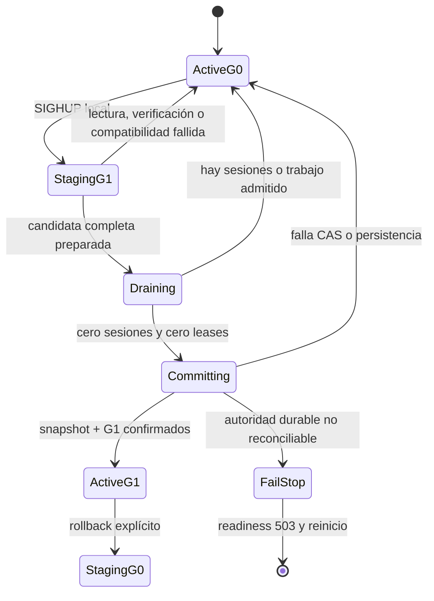

# ADR 0021: sustitución quiescente y durable de generaciones de área

- Estado: aceptada e implementada para la fase 6C mínima.
- Fecha: 2026-07-17.
- Desarrolla: [ADR 0005](0005-hot-area-lifecycle.md).
- Continúa: [ADR 0020](0020-additive-local-area-loading.md).

## Contexto

Las fases 6A y 6B publican generaciones locales inmutables y permiten cargar
áreas de una generación fijada. El actor puede crecer desde el área inicial
hasta la generación completa, pero no puede cambiar de generación sin reiniciar.

Una sustitución parcial todavía no es demostrablemente segura. `World` y
`RuntimeContent` contienen índices y estado que abarcan varias áreas; no todos
los NPC, objetos, temporizadores, scripts o reglas conservan ownership suficiente
para retirar una sola revisión sin dejar referencias de la anterior. El login y
el movimiento también atraviesan almacenamiento, coordinador y actor, por lo que
un cambio sin barrera podría empezar en una generación y terminar en otra.

La primera entrega de 6C debe resolver el fallo más importante —publicar y
recuperar una nueva generación sin reiniciar ni mezclar contenido— sin fingir
que ya existen migraciones vivas, descarga individual o un LRU seguro.

## Decisión

La fase 6C mínima sustituye **la generación completa** mediante un corte
quiescente:



La activación normal y el rollback recorren el mismo protocolo. La diferencia
es intencional: una activación normal exige revisión de catálogo creciente; un
rollback debe solicitarse como tal y apuntar a una generación inmutable retenida.
Nunca se interpreta automáticamente una revisión menor como autorización para
revertir.

Este corte no expulsa, mueve ni desconecta jugadores. Si existe una sesión viva,
un login/entrada admitido o una carga aditiva en curso, la operación devuelve
`busy`, reabre admisiones y conserva G0 exacta. El operador puede reintentar
cuando el mundo quede vacío.

## Identidad durable y esquema SQL v14

`WorldRuntimeSnapshot` v7 continúa siendo la única autoridad del estado dinámico
compartido. No se añade un octavo formato solo para guardar un dato operativo.
SQLite y PostgreSQL avanzan al esquema v14 con una fila singleton:

```text
world_area_generation
  world_id
  active_catalog_sha256
  previous_catalog_sha256 | null
  activation_sequence
  updated_at
```

No se persisten rutas. El servidor deriva la ruta content-addressed exacta a
partir de la raíz de registro configurada, `world_id` y el SHA-256. La primera
ejecución sin autoridad de personajes ni mundo liga la generación verificada
con secuencia 1 antes de readiness. Una base 6B/v13 con cualquier personaje
durable —aunque aún no tenga snapshot ni ledger— y todavía sin fila solo puede
ligar su G0 exacta si el operador confirma el mismo digest mediante
`TIAMUD_ACK_LEGACY_AREA_GENERATION`; la variable se retira después. Esto impide
confundir una adopción 6B conocida con una migración monolítica implícita. Si ya
existe una liga durable, el arranque abre exactamente esa generación aunque el
puntero editorial `area-active` anuncie otra.

La transición usa compare-and-swap sobre mundo, generación activa, generación
anterior y secuencia. En la misma transacción se confirma el snapshot v7 actual
y se avanza el puntero durable. Por tanto:

- una caída antes del commit recupera G0;
- una caída después del commit recupera G1;
- dos activaciones concurrentes no pueden publicar ambas; y
- un fallo de persistencia no autoriza ningún swap en memoria.

El último snapshot conserva su marca de secuencia de eventos y sigue siendo
autoritativo frente al ledger. La tabla de generación no duplica objetos,
personajes ni estado de juego.

## Superficie operativa

La primera superficie es deliberadamente local:

1. `area-publish` escribe blobs inmutables y sustituye atómicamente el puntero
   `area-active` del mundo.
2. En modo catálogo, `SIGHUP` pide al proceso reconciliar ese puntero.
3. El proceso abre el catálogo exacto, vuelve a leer el puntero para detectar
   una publicación cooperante concurrente y verifica la release completa.
4. Antes del corte adquiere en lectura el mismo lock cooperativo por mundo que
   usan `area-publish` y `area-select`, revalida el puntero y conserva el lock
   hasta resolver el commit.
5. Si el digest ya está activo, la petición es un `noop`.
6. Si difiere, comienza staging; el protocolo de jugador nunca recibe la ruta,
   los IDs de área ni el digest.

No se añade un comando Web, Telnet, GMCP ni de personaje para activar contenido.
`unsigned_local` presupone que el host y el registro son confiables; no convierte
un SHA-256 en firma ni permite registros remotos.

## Staging completo y compatibilidad

Staging sucede fuera del actor y no ejecuta mutaciones contra G0. La candidata
debe abrir y verificar el catálogo, fallback y todos los bundles, convertirlos
y construir un `World`, `RuntimeContent` y coordinador privados completos.

6C mínima no incluye una migración de estado. Por ello exige:

- mismo `worldId`, nombre, `startRoomId`, semilla/contrato RNG y conjunto de
  áreas;
- mismo ownership y mismos IDs estables de sala, incluido VNUM legado;
- igualdad exacta de progresión, clases, talentos, habilidades y emotes;
- igualdad exacta de prototipos e instancias iniciales de objeto;
- igualdad exacta de prototipos, spawns y conjuntos de habilidades NPC;
- igualdad exacta de tablas/fuentes de botín, afijos y pools; y
- `persistentMigrationVersion == 0` en todas las entradas.

Una activación normal exige `catalogRevision` mayor y, cuando cambian los bytes
de un área, una revisión de área estrictamente mayor. Un bundle idéntico conserva
su revisión.

Con esas invariantes sí pueden cambiar, de forma coherente y en la misma
generación, la prosa, títulos, salidas, medios, percepción, variantes, metadatos
de presentación y scripts Lua síncronos que ya pasan las cuotas y pruebas de
contenido. No se puede reutilizar un ID con otro significado.

Antes de persistir, el actor restaura el snapshot dinámico actual de G0 sobre el
`World` privado de G1. La restauración y sus validaciones pueden fallar; por eso
ocurren antes del commit y el candidato se descarta en caso de error.

## Barrera y orden del commit

El runtime mantiene un router generacional compartido y una barrera de admisión.
Cada entrada, acción que pueda demandar un área y preparación adquiere un lease
de la generación observada. Al comenzar el drenaje se cierran nuevos leases y
se espera a que terminen los ya aceptados. Todo lote preparado incluye la
generación base; un resultado tardío de G0 se rechaza después de publicar G1.

El tramo crítico es:

```text
adquirir lock editorial compartido y revalidar area-active
  -> cerrar admisión
  -> comprobar cero sesiones y cero leases
  -> capturar snapshot actual de G0
  -> restaurar y validar snapshot sobre candidato G1
  -> CAS durable: snapshot + identidad G1
  -> swap infalible de World + RuntimeContent + coordinador
  -> publicar Active(G1)
  -> reabrir admisión
```

No se mantiene el actor bloqueado durante lectura, hashing, JSON, conversión o
compilación. Después del commit durable solo se permiten asignaciones en memoria
preparadas de antemano. Si una invariante interna hiciera imposible ese swap,
el proceso falla cerrado y el siguiente arranque recupera G1, que ya es la
autoridad confirmada.

Si el backend devuelve error después de un `COMMIT` potencial, el actor relee
la identidad durable: confirma y publica G1 si coincide con el destino, reabre
G0 si coincide con el origen y, ante cualquier tercer estado o fallo de
lectura, conserva la barrera en `Committing`, detiene el actor y deja readiness
en 503. Nunca continúa sirviendo una autoridad dudosa.

## Recuperación y rollback

Al arrancar en modo catálogo:

1. se valida la configuración y una generación local antes de crear o migrar la
   base de datos;
2. se abre el backend y se lee `world_area_generation`;
3. si existe, se abre por digest la generación durable, no la publicación más
   reciente;
4. se construye completa antes de restaurar snapshot o reproducir ledger; y
5. readiness solo se abre cuando actor, snapshot y fila durable coinciden.

Los blobs de G0 no se eliminan al activar G1. Para rollback, el operador publica
o selecciona el catálogo retenido y solicita explícitamente la reversión. Como
no hay migración persistente, se vuelve a exigir compatibilidad simétrica y
quiescencia. La secuencia durable siempre aumenta, aunque la revisión editorial
seleccionada sea anterior.

La fase no implementa historial ilimitado ni GC. `previous_catalog_sha256`
conserva la generación inmediatamente anterior para diagnóstico/rollback; las
políticas de retención de blobs pertenecen a operación del registro.

## Observabilidad y errores

Las métricas usan enums cerrados y ninguna etiqueta contiene mundo, área,
revisión, ruta o digest. Deben distinguir como mínimo estados de transición y
resultados `noop`, `activated`, `rolled_back`, `busy`, `incompatible`,
`verification_failed`, `persistence_failed` y `conflict`, además de latencia.

Los digests pueden aparecer acotados en logs locales de operador. Los clientes
solo reciben disponibilidad genérica; una activación fallida no filtra catálogo,
rutas del host ni contenido no perceptible. Una candidata fallida no vuelve
non-ready a G0. Una contradicción entre autoridad durable y actor al arrancar sí
impide readiness.

## Fuera de alcance de este corte

- sustituir una sola área mientras otras conservan su revisión;
- mantener jugadores dentro durante drenaje o migrarlos entre generaciones;
- migraciones semánticas directas o inversas;
- transferencia interárea de NPC, combate o transacciones;
- checkpoints por área, retirada de índices y descarga individual;
- presupuesto de memoria, precarga adaptativa, LRU e histéresis;
- GC automático de generaciones/checkpoints;
- registro remoto, compresión o firma; y
- activación remota mediante protocolo de juego o panel de administración.

Estas exclusiones son condiciones de seguridad, no promesas implícitas. La
siguiente fase solo podrá descargar por área cuando el modelo conserve ownership
completo, pins observables, checkpoint durable e instalación/retirada atómica.

## Pruebas de aceptación

- una candidata con cambios permitidos se activa y conserva snapshot, RNG,
  tick, NPC, objetos, botín, trades, grupos y personajes offline;
- cambios de ID, ownership, reglas globales, prototipos, spawns, loot o afijos se
  rechazan antes del drenaje;
- bundle ausente/alterado y puntero que cambia durante staging conservan G0;
- sesión, login o carga en vuelo producen `busy` sin mutación parcial;
- un lote G0 tardío no puede instalarse después de G1;
- fallo del backend y CAS obsoleto conservan G0 byte a byte;
- recuperación antes/después del commit elige respectivamente G0/G1;
- rollback explícito G1 -> G0 incrementa la secuencia durable;
- migraciones v13 -> v14, backend vacío y transferencia SQLite -> PostgreSQL
  conservan la identidad; y
- métricas y errores públicos no exponen labels o datos controlados por contenido.
