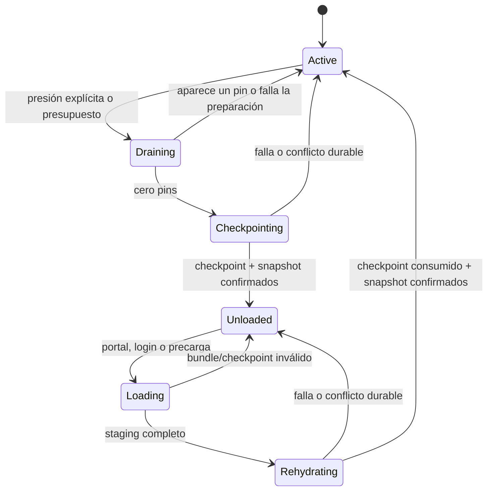

# ADR 0022: retirada reversible de unidades de área

- Estado: aceptada; primera vertical interna implementada, aceptación 6D parcial.
- Fecha: 2026-07-17.
- Desarrolla: [ADR 0005](0005-hot-area-lifecycle.md).
- Continúa: [ADR 0020](0020-additive-local-area-loading.md) y
  [ADR 0021](0021-quiescent-area-generation-cutover.md).

## Contexto

Las fases 6A–6C publican bundles locales inmutables, cargan áreas bajo demanda
y sustituyen de forma quiescente una generación completa. Ese runtime todavía
es aditivo dentro de cada generación: un área incorporada permanece residente
hasta apagar el proceso.

Descargar un mapa de índices no sería una retirada segura. El snapshot v7 era
global, conserva todos los NPC, instancias, botín y jobs, y al restaurar mezcla
estado authored ausente. Si se eliminara una región solo de memoria, el siguiente
arranque podría resucitar su estado inicial o duplicar el checkpoint. Además,
`RuntimeContent` y varios índices globales no conservan todavía propiedad por
área, y un objeto puede abandonar su región de origen sin que deba fijarla para
siempre.

La primera fase 6D debe demostrar una transición durable completa antes de
añadir políticas de presupuesto o LRU. El objetivo mínimo útil es retirar y
rehidratar la **misma revisión** de una unidad vacía de áreas, dentro de la misma
generación, incluyendo estado dinámico real. Sustituir una revisión individual,
migrar jugadores vivos o mezclar generaciones permanece fuera de este corte.

El árbol actual ya implementa snapshot v8, esquema v15, checkpoint dinámico,
SCC/cierre inverso, pins del dominio, desmontaje/reinstalación de contenido,
CAS en ambos adaptadores y la ruta interna de retiro/rehidratación de la misma
revisión. Esta decisión permanece parcial porque todavía faltan la aceptación
integral, una superficie operativa, presupuesto/LRU, medición RSS y el resto de
gates enumerados al final.

## Decisión

Una unidad de retirada es una componente fuertemente conexa del grafo de
`hardDependencies`. Una petición incluye también su cierre inverso residente o
se rechaza: ninguna unidad activa puede depender duramente de otra descargada.
El área propietaria de `startRoomId` permanece siempre fijada.

El ciclo por unidad es:



La primera implementación no expone retirada a Web, Telnet, GMCP ni comandos
de personaje. La política operativa permanece local, acotada y observable.

## Identidad y autoridad durable

`WorldRuntimeSnapshot` avanza a v8. Conserva la autoridad dinámica global de
v7 y añade un manifiesto acotado de residencia. Cada unidad registra exactamente
una de estas formas:

```text
Resident {
  unitId, areaIds, revisionDigests, residencyEpoch
}

Retired {
  unitId, areaIds, revisionDigests, residencyEpoch,
  checkpointVersion, checkpointSha256
}
```

El `unitId` es un digest canónico derivado de la generación y la lista ordenada
de áreas; no es un ID editorial controlado por contenido. Las revisiones y
digests deben coincidir con el catálogo durable activo. El epoch aumenta en
cada retiro o rehidratación y hace obsoleto cualquier staging tardío.

SQLite y PostgreSQL avanzan al esquema v15 con una tabla
`world_area_checkpoints`. Su clave liga mundo, generación, unidad, revisión y
epoch; guarda versión, tick lógico capturado, bytes JSON estrictos y SHA-256.
No guarda rutas, definiciones estáticas ni una segunda copia del estado global.
Tamaño, conteo, profundidad y referencias están acotados.

Checkpoint, snapshot v8 y manifiesto de residencia se confirman en una única
transacción CAS. No existe un instante durable en que el mismo NPC u objeto sea
simultáneamente autoridad global y autoridad del checkpoint.

## Estado del checkpoint

El primer corte debe retirar al menos:

- NPC idle y NPC derrotados con `respawnAtTick` absoluto;
- raíces de objetos en salas, en NPC o en staging, con todo su subárbol;
- procedencia de esas instancias, afijos aplicados y derechos de botín de suelo;
- encuentros ya resueltos y plazos expresados como ticks lógicos absolutos;
- salidas hacia la unidad, que vuelven a `DeferredExit`; y
- capas de presentación, variantes y Lua que sean propiedad de la unidad.

No entra en el checkpoint de unidad:

- RNG, revisión y contadores globales, que nunca retroceden al rehidratar;
- objetos cuyo root está llevado, equipado, reservado en trade o contenido en
  una raíz de personaje;
- personajes offline, cuya sala durable dispara carga antes de entrar; ni
- definiciones inmutables que todavía referencia estado global vivo.

Las definiciones portátiles retenidas por objetos que salieron de la unidad se
mantienen por referencia content-addressed; no fijan todas las salas, NPC o
scripts de su área de origen. Solo se liberan cuando dejan de tener referencias
y existe evidencia de que volverán a estar disponibles desde el bundle exacto.

## Pins y barrera

Cada unidad conserva pins RAII con clase cerrada, propietario interno, epoch y
edad observable. Como mínimo fijan una unidad:

- sesión conectada, login o reconexión hacia una de sus salas;
- entrada, acción o preparación admitida;
- combate, derrota no resuelta, trade o mutación económica que la atraviese;
- NPC activo con estado no serializable por el primer checkpoint;
- callback Lua, temporizador o job no convertido a dato durable;
- commit de persistencia aceptado y no resuelto;
- staging, backup, snapshot, migración o corte 6C; y
- inspección operativa mediante lease temporal acotado.

Un pin no caduca en silencio. Termina por resultado explícito, cancelación segura
o fallo visible. Las referencias opacas del cliente nunca son pins.

Retirada:

```text
resolver SCC + cierre inverso
  -> cerrar nuevas entradas a la unidad
  -> exigir cero pins
  -> construir World/RuntimeContent candidato sin la unidad
  -> construir y validar checkpoint
  -> CAS: checkpoint + snapshot v8 Retired
  -> swap infalible de candidato y residencia
  -> liberar arenas y reabrir el resto del mundo
```

Rehidratación:

```text
adquirir lease de generación y epoch
  -> leer/verificar bundles + checkpoint fuera del actor
  -> aplicar jobs vencidos contra el tick global actual
  -> construir candidato completo
  -> CAS: snapshot v8 Resident + consumir checkpoint
  -> swap infalible y reabrir entradas
  -> reintentar una vez la entrada original
```

Si un commit tiene resultado ambiguo, se relee la autoridad durable siguiendo
el patrón de 6C. Solo se publica el lado que SQL confirma; un tercer estado o
fallo de lectura detiene el actor y mantiene readiness 503.

## Arranque y recuperación

La migración v14→v15 crea la tabla vacía. La primera normalización v7→v8 solo
ocurre después de abrir y verificar la generación durable exacta; marca como
residentes las unidades que aquella generación necesita para restaurar v7.

El objetivo final es que un snapshot v8 construya solo el área inicial y las
unidades `Resident`. La primera vertical actual abre y verifica la generación
completa, reconstruye en privado las retiradas en orden durable, valida cada
marcador `Retired` contra su checkpoint y desmonta esas unidades antes de abrir
readiness. Esa materialización transitoria no cierra el ahorro de arranque ni
RSS. Un personaje offline ubicado en una unidad retirada provoca rehidratación
antes de adquirir su sesión; nunca se relocaliza silenciosamente.

Una caída antes del CAS conserva el estado anterior. Después del CAS, el
arranque sigue el manifiesto v8 aunque el swap en memoria no hubiera terminado.
Repetir retiro o rehidratación con el mismo epoch es idempotente.

## Interacción con generaciones 6C

El puntero SQL v14/v15 sigue identificando una generación completa. Antes de
activar o revertir una generación mediante 6C se rehidratan todas las unidades
retiradas y se aplica la barrera quiescente existente. De este modo, el CAS de
generación continúa operando sobre un snapshot completo y no mezcla dos
manifiestos parciales.

El reemplazo de una revisión individual no pertenece a este ADR. Requerirá un
manifiesto durable compuesto `areaId -> revisión/digest`, compatibilidad y
migraciones directas/inversas; no se simulará cambiando el singleton de
generación.

## Presupuesto, LRU e histéresis

El LRU se habilita solo después de demostrar retiro, restart y rehidratación y
de medir descenso real de estructuras y RSS. `estimatedMemoryBytes` del catálogo
es una estimación editorial, no un límite de seguridad.

La política posterior será LRU ponderado y mantendrá:

- área inicial y margen de seguridad siempre residentes;
- mínimo y máximo de bytes/unidades configurables y acotados;
- recencia, frecuencia, coste de recarga y dependencias;
- cooldown e histéresis para evitar thrashing; y
- rechazo controlado cuando no exista candidato sin pins.

Reducir solo un gauge, conservar el fallback completo duplicado o mover mapas a
otra colección no cuenta como ahorro demostrado.

## Observabilidad

Las métricas usan únicamente labels cerrados de baja cardinalidad:

- unidades por estado y áreas residentes;
- pins por clase y edad máxima;
- retiros/rehidrataciones por resultado;
- bytes y latencia de checkpoint/carga;
- presión de presupuesto, misses, precargas útiles y ciclos evitados; y
- conflictos, resultados ambiguos y fallos de validación/persistencia.

Área, mundo, revisión, digest, epoch y rutas solo aparecen en logs operativos
acotados, nunca como labels Prometheus ni en errores públicos.

## Fuera de alcance

- jugadores vivos dentro de una unidad durante retiro;
- migraciones semánticas o sustitución de revisión individual;
- NPC atravesando áreas, combate o trade entre unidades;
- corutinas, closures o handles Lua serializados;
- GC automático de generaciones o checkpoints retenidos;
- coordinación multiproceso, registro remoto, compresión o firma; y
- activar, retirar o recolectar mediante protocolos de juego.

## Aceptación de la primera entrega

- SCC y cierre inverso son deterministas ante ciclos y orden de catálogo;
- un área inicial, sesión, combate, trade o job no serializable impide retiro;
- NPC idle/respawn y objetos de sala/NPC/staging sobreviven retiro, restart y
  rehidratación sin duplicación ni resurrección authored;
- objetos llevados conservan prototipo, afijo, vínculo y operación mientras su
  área de origen está retirada;
- jobs vencidos usan el tick actual sin restaurar RNG o contadores antiguos;
- caída antes/durante/después de ambos CAS recupera una sola autoridad;
- resultados tardíos de un epoch anterior no se instalan;
- login y portal rehidratan antes de entrar y reintentan una sola vez;
- SQLite/PostgreSQL, mover y admin comparten v15/v8 exactos;
- un mundo sintético demuestra descenso de índices, contenido y RSS; y
- formato, tests integrados, clippy, MSRV, licencias, humo y reauditoría pasan.

Hasta que toda esta evidencia exista, la matriz debe distinguir la arquitectura
aceptada de la retirada implementada y no atribuir LRU a Tiamud.
