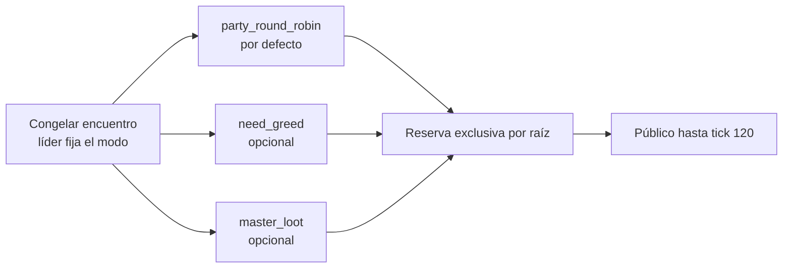

# ADR 0023: reparto de botín need/greed y master-loot

- Estado: propuesta (borrador para revisión humana; no implementada)
- Fecha: 2026-07-18
- Alcance: inventario y botín, fase de reparto avanzado
- Desarrolla: [ADR 0013](0013-repeatable-loot-rights-and-provenance.md)
- Continúa: [ADR 0014](0014-earned-sealed-rewards-and-deterministic-affixes.md)

## Contexto

La fase 4A ([ADR 0013](0013-repeatable-loot-rights-and-provenance.md)) dejó una
autoridad durable para instancias, procedencia, tablas de botín, RNG y derechos
de grupo. Congela una cohorte por encuentro, reparte round-robin, admite
`loot pass`, reserva cada raíz durante 20 ticks, publica hasta el 120 y persiste
todo en `WorldRuntimeSnapshot`. La fase 4B ([ADR 0014](0014-earned-sealed-rewards-and-deterministic-affixes.md))
añadió sellos ganados jugando y afijos deterministas sin monetización.

El único modo de reparto de grupo hoy es `party_round_robin`: un cursor
monotónico por `PartyId` asigna raíces en orden y `loot pass` cede al siguiente
miembro. Es predecible y restart-safe, pero no ofrece elección social. Muchos
grupos quieren distinguir entre quien necesita una raíz para usarla y quien solo
la codicia, o dejar que un líder confiado la asigne. Ambos patrones —need/greed
y master-loot— son mecánicas clásicas de MUD que el baseline aún no expresa.

Añadir ese reparto no puede debilitar ninguna invariante ya aceptada. Una
elección discrecional debe seguir siendo determinista, exactly-once y
restart-safe; nunca puede filtrar quién ganó, mezclar RNG con el combate,
resucitar una raíz tras un reinicio ni violar la política de vínculo de un
objeto restringido. Tampoco puede derivar autoridad de la prosa, del XP, de la
clase ni de la contribución de un combate que hoy es de un solo atacante.

Esta decisión define la primera entrega cerrada del reparto avanzado. Pity,
cajas, llaves, moneda premium, tiradas pagadas y reparto por contribución
quedan fuera, igual que en 4A/4B.

## Decisión

El reparto avanzado **extiende** 4A/4B; no lo sustituye. `party_round_robin`
sigue siendo el modo por defecto y su camino atómico de cursor y `loot pass`
permanece intacto. Las recompensas selladas y los afijos de 4B no cambian.

El **líder de la party** elige el modo de reparto en el momento en que se congela
el encuentro (`LootEncounter`), nunca antes ni después, y nunca derivado de
prosa, XP o clase. Los tres modos cerrados son:

- `party_round_robin`: el actual, sin cambios, y el que se aplica si no hay
  party, si la cohorte es de una sola persona o si el líder no elige otro;
- `need_greed`: por cada raíz se abre una ventana de decisión acotada en ticks;
  cada miembro elegible de la cohorte declara `need`, `greed` o `pass` y la
  resolución determinista concede una reserva exclusiva idéntica a la de
  round-robin; y
- `master_loot`: el líder asigna cada raíz a un miembro concreto de la cohorte
  dentro de una ventana acotada; la asignación es en sí una reserva con las
  mismas reglas de exclusividad y caducidad.



Ningún modo crea una segunda autoridad. La elección, la ventana de decisión, las
declaraciones y la asignación viven en el mismo `WorldRuntimeSnapshot` que las
reservas de 4A y se confirman en la misma mutación checkpointed que genera el
botín. No se añade una tabla SQL espejo.

## Modos y elección del líder

El modo se guarda en `LootEncounter` al congelarlo, junto a la cohorte ordenada
por `CharacterId` que 4A ya define: el iniciador siempre entra; se añaden hasta
cinco miembros conectados, vivos y en la misma sala; las altas posteriores se
excluyen; y los derechos ya creados sobreviven a una desconexión posterior. La
cohorte máxima es de seis participantes, incluido el iniciador.

Solo el líder de la party del iniciador puede fijar `need_greed` o `master_loot`,
y solo antes de la derrota. Si no hay party, si el iniciador no es líder o si la
cohorte queda en una sola persona al morir el NPC, el encuentro resuelve
`party_round_robin` sin excepción. No existe un líder automático: sin elección
explícita, el modo por defecto es round-robin. Cambiar el modo después de la
derrota no está permitido; la elección es parte de la base congelada.

El vocabulario de modo es cerrado, igual que las políticas `rights` de 4A. Una
fuente de botín no declara modo: `rights` sigue siendo `credited_character` o
`party_round_robin` en la autoría del WorldPack, y el modo avanzado es una
elección de runtime del líder sobre un encuentro `party_round_robin`, no un
campo authored. `credited_character` nunca admite need/greed ni master-loot,
porque no hay cohorte a la que repartir.

## Reserva y ventana de decisión

Cada raíz sigue el modelo de reserva de 4A: exclusiva mientras
`logicalTick < claimUntilTick`, pública a los 20 ticks y despawn a los 120. El
reparto avanzado no altera esos plazos ni el máximo de 64 raíces por derrota ni
el presupuesto de 2.048 reservas.

Sobre ese modelo, `need_greed` y `master_loot` añaden una **ventana de decisión**
por raíz, acotada y siempre menor o igual que la exclusividad de 20 ticks:

- al materializarse una raíz bajo un modo avanzado se abre su ventana con
  `decideUntilTick = createdTick.checked_add(decisionWindowTicks)`, con
  `decisionWindowTicks` fijo en el rango `1..=20`;
- mientras la ventana está abierta la raíz no es reclamable por nadie: no tiene
  todavía beneficiario exclusivo;
- la ventana se cierra al llegar a `decideUntilTick`, o antes si todos los
  miembros elegibles ya declararon (`need_greed`) o el líder ya asignó
  (`master_loot`); y
- al cerrarse se resuelve de forma determinista y se instala una reserva
  exclusiva idéntica a la de round-robin, con `claimUntilTick` derivado de
  `createdTick` como en 4A, de modo que la ventana consume parte del plazo de 20
  ticks y **nunca lo extiende**.

Una raíz jamás queda atascada. Si la ventana expira sin ninguna declaración
`need`/`greed`, o si el líder no asigna en `master_loot`, la raíz cae al reparto
por defecto: se asigna por el cursor round-robin de la cohorte congelada y, si
ese beneficiario tampoco la reclama antes de los 20 ticks, pasa a pública según
las reglas vigentes. El fallback es siempre round-robin o público; ningún modo
avanzado puede bloquear una raíz indefinidamente.

Los aritméticos de ventana, tirada y contadores usan operaciones `checked`. Si
un plazo o contador no puede incrementarse, la transición se rechaza cerrada o
la raíz cae al fallback, nunca se envuelve ni reutiliza un valor.

## RNG y resolución exactly-once

En `need_greed`, la resolución al cerrar la ventana es determinista:

1. todas las declaraciones `need` vencen a todas las declaraciones `greed`;
2. dentro del conjunto ganador —todos los `need`, o todos los `greed` si no hubo
   `need`— se desempata con una tirada entera sin sesgo, mediante el mismo
   rejection sampling que 4A, sobre los candidatos ordenados de forma estable por
   `CharacterId`;
3. si aún hubiera empate numérico irresoluble, el desempate final estable es el
   menor `CharacterId`; y
4. si nadie declaró `need` ni `greed` (todos `pass` o silencio), la raíz cae al
   fallback round-robin descrito arriba.

En `master_loot`, no hay tirada: el ganador es el miembro de la cohorte que el
líder asignó, siempre que siga siendo elegible; si dejó de serlo o el líder no
asignó, la raíz cae al fallback.

La tirada de desempato **no perturba la secuencia RNG del combate**. Igual que
4A añadió una operación uniforme específica y probada para botín, el reparto
avanza una operación entera dedicada y acotada; el combate conserva su secuencia.

La elección de modo, las declaraciones, la asignación, la tirada de desempato,
la reserva resultante, el cursor, la procedencia, el NPC, el XP, los contadores,
los eventos y el snapshot forman **una única mutación checkpointed**, la misma
que 4A usa al resolver una derrota. El commit durable confirma todo o el
checkpoint restaura todo, incluido el RNG y los contadores.

La resolución es restart-safe:

- una decisión en vuelo al reiniciar se resuelve de forma determinista con las
  declaraciones ya persistidas o, si la ventana no puede completarse con
  seguridad, cae al fallback round-robin sin doble concesión;
- los derechos ya creados sobreviven al reinicio y la reconexión, igual que en
  4A;
- no se concede dos veces una raíz ni se vuelve a tirar tras un reinicio; y
- una tirada ya persistida nunca se recalcula: la reserva ya instalada es la
  autoridad.

## Impacto en snapshot y persistencia

No se añade una tabla SQL espejo. `WorldRuntimeSnapshot` sigue siendo la única
autoridad de instancias, procedencia, encuentros y reservas. La entrega avanza
el snapshot a la **siguiente versión aditiva** (v9 sobre el v8 vigente),
añadiendo solo campos al nivel de `LootEncounter` y de la reserva:

```text
LootEncounter.distributionMode: party_round_robin | need_greed | master_loot
LootEncounter.leaderId: CharacterId | null
GroundLootReservation.decision: LootDecision | null
```

`LootDecision` es una forma cerrada y acotada por raíz:

```text
LootDecision {
  mode: need_greed | master_loot
  decideUntilTick: u64
  declarations: CharacterId -> need | greed | pass   // solo need_greed
  assignedTo: CharacterId | null                      // solo master_loot
}
```

Las claves de `declarations` y `assignedTo` deben pertenecer a la cohorte
congelada del encuentro; una identidad ajena, un modo incoherente con el campo
poblado o un `decideUntilTick` fuera de rango se rechazan cerrados en acción,
restore y replay. `party_round_robin` deja `decision = null` y `leaderId` puede
ser `null`.

Los DTO de versiones anteriores normalizan a `party_round_robin` con
`decision = null` y `leaderId = null`, sin inventar declaraciones ni
asignaciones. Introducir `distributionMode`, `decision` o `leaderId`, incluso
vacíos, en una versión anterior se rechaza como schema-smuggling, igual que 4A
rechaza los campos de botín inyectados en snapshots previos. La conversión a v9
es la única que crea los valores por defecto.

El snapshot conserva su presupuesto físico vigente (2 MiB para v6+), sin ampliar
el límite: los campos añadidos son acotados y por raíz, dentro de las 2.048
reservas y las seis cohortes máximas ya presupuestadas. SQLite y PostgreSQL
mantendrían el JSON singleton en su transacción existente y requerirían una
migración transaccional de esquema con paridad SQLite/PostgreSQL, sin tabla
espejo ni doble escritura, como en 4A.

## Percepción y protocolo

Web, Telnet y GMCP comparten dominio, proyección y opacidad. Ningún cliente
recibe `CharacterId`, `PartyId`, drop ID, tabla, procedencia, cohorte **ni
quién ganó** una raíz. El beneficiario ve su raíz como `yours`; los terceros
solo ven `reserved` o, durante la ventana de decisión, un estado `deciding`
opaco sin declaraciones ajenas ni identidades. Una declaración `need`/`greed`/
`pass` propia es visible solo para quien la emite; nadie ve las declaraciones de
los demás antes de la resolución, y la resolución no revela el conjunto ganador
ni las tiradas.

Las acciones de texto, en la línea de las de 4A (`loot`, `loot status`,
`loot pass`, `take`), añaden:

```text
loot need <referencia-opaca|nombre-exacto>
loot greed <referencia-opaca|nombre-exacto>
loot pass <referencia-opaca|nombre-exacto>       // ya existente
loot assign <referencia-opaca> <objetivo-opaco>  // solo líder, master_loot
```

`loot pass` conserva su semántica de 4A y, bajo `need_greed`, equivale a no
declarar; repetir la misma declaración propia es idempotente. `loot assign` solo
lo acepta el líder bajo `master_loot`, sobre un `<objetivo-opaco>` que es un
selector de sesión derivado de la sal, nunca un `CharacterId`.

Web añade formas cerradas equivalentes con un único campo relevante y todos los
campos entran en la firma de deduplicación:

| Acción | Campos exactos adicionales |
| --- | --- |
| `loot.need` | `target` |
| `loot.greed` | `target` |
| `loot.pass` | `target` |
| `loot.assign` | `target`, `recipient` |

GMCP reutiliza la escena e inventario existentes y no crea una segunda
autoridad, igual que 4A. Los eventos de decisión y resolución respetan los
batches de 16 eventos, el coalescing, las ventanas semánticas de 14 KiB Web y
48 KiB Telnet y la recuperación por snapshot autoritativo. Ningún evento, aviso
ni truncado revela beneficiarios, declaraciones ni IDs internos.

## Fuera de alcance

Esta decisión **no** incluye y prohíbe explícitamente:

- pity o suelo de probabilidad de cualquier tipo;
- cajas de botín, llaves, moneda premium ni tiradas pagadas;
- need/greed que viole la política de vínculo: una raíz o descendiente
  `character_bound`, `non_transferable` o restringido nunca puede tirarse
  need/greed ni asignarse por master-loot a un personaje al que ligaría de forma
  ilegal. La elegibilidad se filtra: esas raíces caen al reparto acreditado o
  round-robin que respeta el vínculo, o el candidato inelegible se excluye de la
  tirada;
- reparto por contribución de combate: el combate vigente es de un solo atacante
  y de alcance de conexión; medir contribución sería deshonesto y queda fuera;
- líder automático sin selección explícita: sin elección del líder, el modo es
  siempre `party_round_robin`; y
- cualquier autoridad derivada de prosa, XP, clase, talentos o WorldPack.

Estas exclusiones son condiciones de honestidad y seguridad, no promesas
implícitas de una fase posterior.

## Límites acotados

| Recurso | Límite |
| --- | ---: |
| Participantes de cohorte, incluido iniciador | 6 |
| Raíces por derrota | 64 |
| Reservas globales | 2.048 |
| Ventana de decisión por raíz | `1..=20` ticks |
| Exclusividad por raíz | 20 ticks (sin cambio) |
| Despawn por raíz | 120 ticks (sin cambio) |
| Declaraciones por raíz en `need_greed` | una por miembro de cohorte |
| Asignación por raíz en `master_loot` | una, por el líder |
| Pesos y tiradas de desempato | enteros con aritmética `checked` |

La ventana de decisión usa ticks lógicos, no tiempo de pared, y nunca extiende
la exclusividad ni el despawn. Los contadores y plazos usan aritmética
`checked`; un valor que no pueda incrementarse cae al fallback o rechaza la
transición.

## Diagrama del flujo need/greed

```mermaid
sequenceDiagram
    autonumber
    participant Cohorte
    participant Actor as Actor/Dominio
    participant RNG
    participant Snapshot

    Note over Actor: Encuentro congelado; líder fijó need_greed
    Actor->>Actor: Derrota confirmada, materializa raíces
    loop por cada raíz
        Actor->>Cohorte: Abrir ventana de decisión (<=20 ticks)
        Cohorte-->>Actor: declarar need / greed / pass
        Note over Actor: Cierra al agotar ventana o al declarar todos
        Actor->>Actor: need vence a greed
        Actor->>RNG: tirada entera sin sesgo (rejection sampling)
        RNG-->>Actor: ganador; desempate final por CharacterId
        Actor->>Actor: filtrar elegibilidad por política de vínculo
    end
    Actor->>Snapshot: un commit: NPC · XP · RNG · reservas · eventos
    Snapshot-->>Actor: confirmado o checkpoint restaura todo
    Actor->>Cohorte: reserva exclusiva (opaca; sin revelar ganador)
```

## Plan de pruebas

Las pruebas de aceptación de esta propuesta deberían cubrir como mínimo:

- el modo por defecto `party_round_robin` no cambia: cursor, `loot pass`,
  exclusividad 20 y despawn 120 siguen idénticos;
- solo el líder fija `need_greed` o `master_loot`, y solo antes de la derrota;
  cualquier otro personaje o momento se rechaza;
- en `need_greed`, toda declaración `need` vence a toda `greed`;
- un empate entre iguales se rompe con la tirada entera sin sesgo y, si persiste,
  por el menor `CharacterId`, de forma determinista y reproducible con la misma
  semilla;
- una raíz o descendiente `character_bound`/`non_transferable`/restringido nunca
  se asigna a un personaje que violaría su vínculo: cae al reparto acreditado o
  round-robin, o el candidato se filtra de la tirada;
- la expiración de la ventana sin declaraciones, o sin asignación en
  `master_loot`, cae al fallback round-robin/público sin atascar la raíz;
- un reinicio con una decisión en vuelo resuelve de forma determinista o cae al
  fallback, conserva los derechos ya creados y nunca concede dos veces ni vuelve
  a tirar;
- la interacción con la supresión por capacidad de 4A: una raíz suprimida no abre
  ventana ni concede reserva, y la supresión no bloquea derrota ni XP;
- la opacidad nunca filtra el ganador, las declaraciones ajenas ni ningún ID
  interno en Web, Telnet, GMCP ni bot;
- paridad SQLite/PostgreSQL del snapshot v9 y su migración transaccional, sin
  tabla espejo; y
- rechazo de schema-smuggling: los DTO anteriores no aceptan `distributionMode`,
  `decision` ni `leaderId`, y la conversión a v9 normaliza a
  `party_round_robin` con `decision = null`.

## Consecuencias

La entrega añadiría dos modos de reparto social —need/greed y master-loot— sin
otra autoridad, sin monetización y sin debilitar ninguna invariante de 4A/4B. El
round-robin atómico y las recompensas selladas permanecen como camino por
defecto e intactos. A cambio, cada resolución de botín debe considerar el modo
del encuentro, la ventana de decisión por raíz y el filtro de elegibilidad por
vínculo, y el snapshot crece con campos acotados por raíz que exigen migración y
paridad de persistencia.

El reparto por contribución de combate sigue aplazado hasta que exista un
combate multiatacante real y honesto. Pity, cajas, llaves, moneda premium y
tiradas pagadas permanecen fuera del baseline. Esta propuesta es un borrador
para revisión humana; no está implementada ni verificada.
