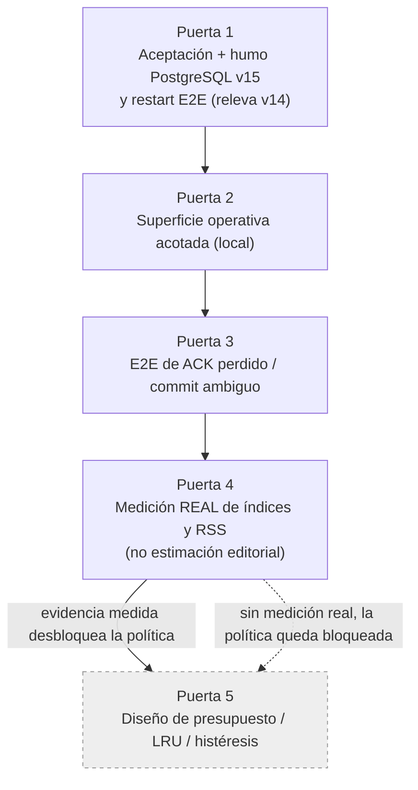

# ADR 0024: plan de cierre de la aceptación 6D

- Estado: aceptada — implementación parcial. Gate 2 (superficie de
  retirada/rehidratación por staff) implementado el 2026-07-18, incluida la
  corrección del teardown que impedía la proyección tras retirar. Gates 1, 3, 4
  y 5 siguen pendientes.
- Fecha: 2026-07-18
- Desarrolla: [ADR 0022](0022-reversible-area-unit-retirement.md)
- Continúa: [ADR 0005](0005-hot-area-lifecycle.md)

## Contexto

La fase 6D —retirada reversible de unidades de área— está **implementada
parcialmente**. [ADR 0022](0022-reversible-area-unit-retirement.md) aceptó su
arquitectura y el árbol actual ya contiene la primera vertical interna:
snapshot v8 con manifiesto de residencia, esquema v15 con
`world_area_checkpoints`, SCC y cierre inverso deterministas, pins de dominio
con clase cerrada y epoch, checkpoint acotado de NPC/objetos, desmontaje y
reinstalación exactos de contenido, CAS en ambos adaptadores y la ruta interna
del actor que retira una unidad vacía de la misma revisión y la rehidrata antes
de la entrada. La recuperación valida manifiesto y checkpoints antes de abrir
readiness.

Esa vertical no cierra la fase. Faltan la aceptación integral, una superficie
operativa, la medición real de descenso de índices/RSS, el E2E específico de
ACK perdido 6D y la política de presupuesto/LRU/histéresis. Este ADR **no
propone arquitectura nueva**: formaliza la **secuencia ordenada de puertas**
necesaria para mover 6D de «parcialmente implementada» a «aceptada», y fija qué
puerta desbloquea a cuál.

Dos hechos de honestidad gobiernan todo lo que sigue y deben restablecerse sin
suavizar:

- **La retirada de hoy no es todavía un ahorro de RSS.** La primera vertical
  abre y verifica la generación **completa** al arrancar, reconstruye en privado
  las unidades retiradas en orden durable, valida cada marcador `Retired`
  contra su checkpoint y solo después las desmonta antes de readiness. Esa
  materialización transitoria «materializar y luego desmontar» **no reduce aún**
  el arranque ni la memoria residente del proceso.
- **`estimatedMemoryBytes` del catálogo es una estimación editorial, no un
  límite de seguridad.** Ninguna política puede tratarlo como presupuesto ni
  como cota que garantice retirada.

Además, ninguna medición reciente sustituye la evidencia PostgreSQL histórica.
La última aceptación PostgreSQL integral retenida es v14. El gate local actual
pasa 792/792 pruebas Rust y PostgreSQL v15 22/22 del adaptador+mover y 8/8 del
servidor, pero eso es la **línea base pre-puerta**: **no** es una aceptación
integral v15 ni un humo v15 que releve al histórico v14. Este ADR no concede por
sí mismo ese pase; define las puertas que lo producirían.

## Decisión

Se fija una **secuencia obligatoria de cinco puertas**. El orden es normativo:
una puerta anterior desbloquea a la siguiente, y el diseño de política de memoria
(LRU/presupuesto/histéresis) es **explícitamente el último** y solo se permite
después de que exista medición real. No se altera ninguna invariante de
ADR 0022; cada puerta añade evidencia verificable, no comportamiento nuevo no
diseñado.

La arista discontinua es la dependencia central: **la medición bloquea la
política**. Sin la evidencia de la puerta 4, la puerta 5 no puede diseñarse ni
proponerse como implementable.

## Puerta 1 — Aceptación integral y humo PostgreSQL v15 con restart E2E

Objetivo: producir una aceptación v15 y un humo que **releven** el humo y la
aceptación histórica v14, cubriendo la transición durable completa retiro →
restart → rehidratación. Mientras esta puerta no pase, v14 sigue siendo la única
aceptación integral retenida.

Criterios medibles y verificables:

- retiro durable de una unidad vacía y sin pins → reinicio del proceso →
  rehidratación sin duplicación ni resurrección de estado authored;
- la recuperación reconstruye siguiendo el manifiesto v8 y valida cada marcador
  `Retired` contra su checkpoint antes de readiness;
- login o portal hacia una unidad retirada la rehidratan **antes de entrar** y
  reintentan la entrada una sola vez; nunca reubican en silencio;
- un commit ambiguo relee la autoridad durable según el patrón de
  [ADR 0021](0021-quiescent-area-generation-cutover.md): se publica solo el lado
  que SQL confirma; un tercer estado o fallo de lectura detiene el actor y
  mantiene readiness 503;
- paridad exacta SQLite/PostgreSQL en esquema v15, manifiesto v8, checkpoints,
  mover y admin;
- humo PostgreSQL v15 real: abre esquema 15, retira y rehidrata al menos una
  unidad, confirma readiness/Web/Telnet, residencia esperada y cierre limpio,
  documentado como evidencia que releva el humo v14; y
- formato/diff, clippy estricto de workspace, MSRV Rust 1.88, cargo-deny,
  licencias/avisos y reauditoría 0 P1/P2, con un registro fechado retenido.

## Puerta 2 — Superficie operativa acotada (implementada 2026-07-18)

Objetivo: exponer una superficie acotada que permita **solicitar** el retiro y
la rehidratación de una unidad vacía y sin pins, con autorización explícita y
auditoría.

**Reconciliación de diseño.** El borrador inicial exigía una superficie «solo
local» sin comando de red. Se revisó: la moderación de fase 2 (`inspect`,
`where`, `goto`, `transfer`, `restore`, `announce`, `audit`) ya opera mediante
comandos de staff que viajan por el protocolo de juego, autorizados por
capacidad cerrada y auditados. Acoplar la retirada 6D a ese mismo patrón es más
coherente que un CLI/SIGHUP separado y no relaja ninguna garantía. Por tanto la
superficie es un **comando de staff con capacidad**, no un canal local aparte.

Implementado y verificado:

- comandos `staff area retire <área> | <motivo>` y
  `staff area rehydrate <área> | <motivo>`, parseados en `parse_action` y con
  paridad Web/Telnet;
- autorización por la capacidad cerrada existente `StaffAssign` (perfiles
  administrator/implementor), sin añadir una 13.ª capacidad ni brecha de
  migración; la acción concreta se desambigua en el registro de auditoría;
- reutiliza **exactamente** las guardas existentes (área inicial, personaje
  conectado, combate, trade, estado transitorio de NPC, referencias cruzadas de
  SCC): una unidad con cualquier pin devuelve `busy`/`invalid`, reabre
  admisiones y **nunca** expulsa, mueve ni desconecta jugadores; `prepare` es
  read-only y no muta ante rechazo;
- orden atómico: capacidad → operación (CAS/checkpoint existente, exactly-once,
  restart-safe) → auditoría append-only **solo en éxito**; sin fila de auditoría
  ante fallo;
- proyección de cliente acotada, sin IDs/digests internos;
- **corrección de teardown**: la retirada ahora poda las salas retiradas de la
  memoria de mapa por sesión (`ObserverView.discovered_rooms`), de modo que la
  proyección tras retirar ya no falla `InvalidEntity`; se revierte exacto por el
  checkpoint de ciclo de vida;
- pruebas deterministas cubren `busy`, éxito, rechazo del área inicial, falta de
  capacidad, y un extremo-a-extremo retirada→proyección→rehidratación con
  catálogo y SQLite reales; el servidor pasa además con PostgreSQL real. Formato,
  clippy estricto y fmt pasan.

Pendiente en esta puerta: una superficie de **observación** del estado de
unidad/pin/checkpoint y métricas Prometheus de baja cardinalidad con enums
cerrados y sin etiquetas de área/mundo/revisión/digest.

## Puerta 3 — E2E de ACK perdido 6D y fallos ambiguos

Objetivo: demostrar por E2E que un ACK durable perdido o ambiguo durante
cualquiera de los dos CAS (retiro o rehidratación) se resuelve a **una sola
autoridad**, sin instalar resultados de un epoch anterior.

Criterios medibles y verificables:

- ante ACK durable perdido o ambiguo en el CAS de retiro **o** de rehidratación,
  el actor relee el estado durable y publica exactamente el lado confirmado por
  SQL;
- un tercer estado o un fallo de lectura detiene el actor y mantiene readiness
  503; nunca sirve una autoridad dudosa;
- un resultado tardío de un epoch anterior no se instala tras avanzar el epoch;
- repetir retiro o rehidratación con el mismo epoch es idempotente y no duplica
  ni resucita estado;
- inyección de fallo antes/durante/después de cada CAS recupera una sola
  autoridad en restart, con paridad SQLite/PostgreSQL; y
- formato/diff, clippy, MSRV, licencias y reauditoría 0 P1/P2 pasan, con
  evidencia E2E retenida.

## Puerta 4 — Medición real de descenso de índices y RSS

Objetivo: aportar **medición real** —no estimación editorial— de que retirar una
unidad reduce estructuras vivas y memoria del proceso. Esta puerta desbloquea la
puerta 5.

Criterios medibles y verificables:

- un mundo sintético o representativo demuestra un descenso **medible** de los
  mapas de índices, de `RuntimeContent` y del RSS del proceso tras el retiro,
  retenido como artefacto de evidencia;
- el comportamiento «materializar al arrancar y luego desmontar» de la vertical
  actual se **sustituye o se mide** de modo que se exhiba una reducción genuina;
  mientras materialice la generación completa antes de desmontar, no cuenta como
  ahorro;
- se cita y aplica la regla de ADR 0022: «Reducir solo un gauge, conservar el
  fallback completo duplicado o mover mapas a otra colección no cuenta como
  ahorro demostrado»;
- la medición es reproducible, con procedimiento y cifras retenidas, y distingue
  arranque, régimen y post-retiro; y
- formato/diff, clippy, MSRV, licencias y reauditoría pasan, con registro
  fechado que enlaza la evidencia.

## Puerta 5 — Diseño de política de presupuesto/LRU/histéresis (última)

Objetivo: **solo tras** las puertas 1–4, y condicionada a la evidencia medida de
la puerta 4, diseñar la política de memoria. Esta puerta es de diseño/propuesta;
no autoriza por sí sola habilitar LRU en producción.

Criterios medibles y verificables:

- el diseño se apoya explícitamente en las cifras de la puerta 4; sin esa
  evidencia el diseño no se acepta;
- LRU ponderado que mantiene el área inicial y un margen de seguridad siempre
  residentes;
- mínimo y máximo de bytes/unidades configurables y acotados;
- ponderación por recencia, frecuencia, coste de recarga y dependencias;
- cooldown e histéresis contra thrashing de carga/descarga;
- rechazo controlado cuando no existe candidato sin pins, sin violar integridad
  para recuperar memoria; y
- el diseño se somete a revisión humana como propuesta antes de cualquier
  implementación; ninguna cifra concreta se inventa en este ADR.

## Observabilidad

Todas las puertas conservan la disciplina de ADR 0022: labels cerrados de baja
cardinalidad para unidades por estado, pins por clase y edad,
retiros/rehidrataciones por resultado, bytes y latencia de checkpoint/carga,
presión de presupuesto y conflictos/ambigüedades/fallos. Área, mundo, revisión,
digest, epoch y rutas **nunca** aparecen como labels Prometheus ni en errores
públicos; solo en logs operativos acotados. Ninguna etiqueta se deriva de
contenido controlado por el autor.

## Lo que NO se promete

Este ADR es un plan de gates; no promete comportamiento no diseñado ni concede
pases:

- descarga automática de unidades por presupuesto (queda tras la puerta 5);
- GC automático de generaciones o checkpoints retenidos;
- coordinación multiproceso, registro remoto, compresión o firma;
- sustitución de una revisión individual, que requerirá un manifiesto durable
  compuesto `areaId -> revisión/digest`, compatibilidad y migraciones
  directas/inversas totales; no se simulará mediante el singleton de generación;
- mantener jugadores vivos dentro de una unidad durante el retiro;
- activación, retirada o recolección mediante protocolos de juego; y
- un pase v15: este ADR **no** concede aceptación integral v15; define las
  puertas que la producirían. Hasta la puerta 1, la aceptación PostgreSQL
  integral retenida sigue siendo v14.

Una unidad se retira **solo** cuando está vacía, sin pins y dentro de la misma
generación/revisión. Ninguna puerta relaja esa condición.

## Consecuencias

Mientras las cinco puertas no pasen, la matriz de completitud debe seguir
distinguiendo la **arquitectura aceptada** (ADR 0022) de la **retirada
implementada** (primera vertical interna) y de la **aceptación cerrada** (este
plan). El gate local 792/792 Rust y PostgreSQL v15 22/22 + 8/8 es línea base
pre-puerta, no aceptación integral. Como cierra ADR 0022: hasta que exista toda
esta evidencia, **no atribuir LRU a Tiamud**, y el modo monolítico sigue siendo
válido y preferente para mundos que caben con margen en memoria.
