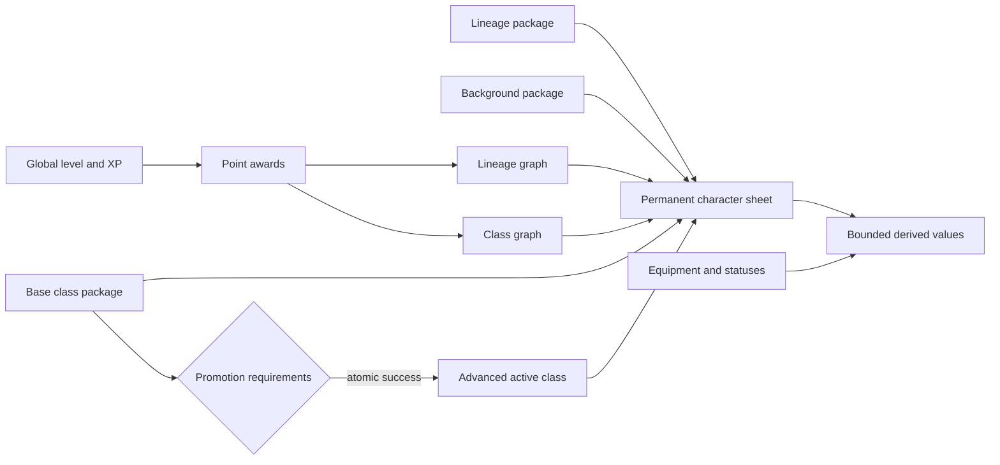
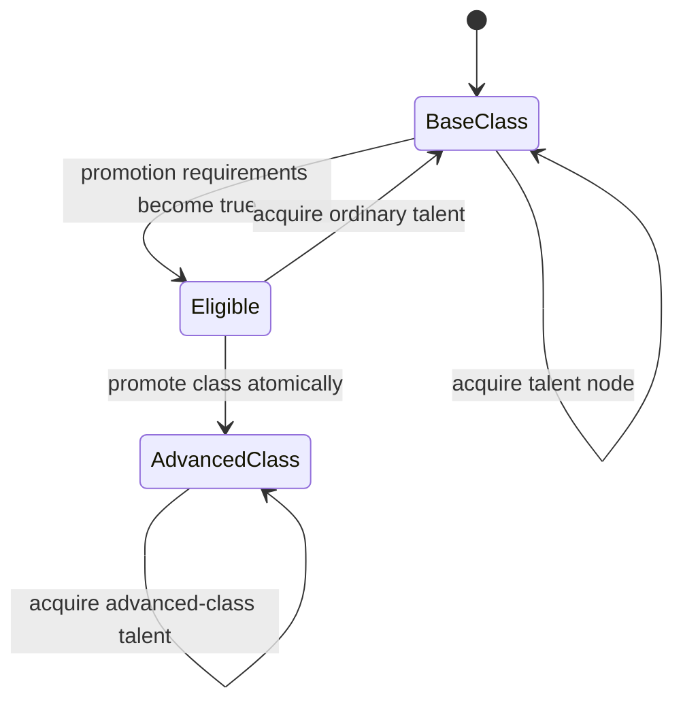

# Character progression v3

Status: implemented v3 character-model design, carried by WorldPack v7.

This document defines Tiamud's canonical character vocabulary and the first
bounded progression model. It replaces the overloaded v2 `archetype` concept
before any public deployment. Historical WorldPack v3/v2 and Envy/Merc data are
import inputs; they are normalized into this model rather than dictating its
public API.

## Goals

- Keep one understandable character level and XP curve.
- Let world authors combine identity and role without a lineage × class
  matrix.
- Make ordinary development choices and actual class promotion distinct.
- Keep every requirement and grant bounded, inspectable and testable.
- Make new classes, lineages and branches content changes, not Rust changes.
- Preserve deterministic simulation and a simple single-host runtime.

The MVP does not include multiclassing, class-specific XP, reversible class
promotion, arbitrary progression scripts or a graphical tree editor.

## Canonical vocabulary

| Term | Meaning |
| --- | --- |
| Lineage | Optional mechanical fantasy origin or inherited supernatural condition. It may grant modest concrete capabilities, never morality or culture. |
| Background | The character's learned individual history, such as guard or apprentice. |
| Base class | The active adventuring discipline selected at creation. |
| Specialization | A class-bound development branch that changes play style without changing class identity. |
| Talent | A ranked node bought with an authored point currency. A talent never changes class identity. |
| Advanced class | An atomic promotion that changes the active class and its future class rewards. |
| Transformation | A separate overlay such as a curse or blessing. It is reserved for a later version and does not rewrite lineage or class history. |

`Race` is accepted only as an importer or UI synonym. `Archetype` remains a
v2 import term; the v3 runtime and protocol use `class`.

## Composition



Creation applies packages in a fixed order: neutral sheet baseline, lineage,
background and base class. The sheet baseline has zero attributes, skills and
resource capacity, so a base class must provide positive maximum health and
authored creation grants become the actual totals instead of being added to
hidden legacy stats. Level 1, starting currency and other non-sheet engine
defaults remain runtime policy. Creation alone fills health and granted
resource pools; later capacity grants never heal or refill them.

Later permanent grants come only from explicit level, promotion or talent
definitions. V1 stores the composed sheet plus acquisition history, not a
reversible contribution ledger. Equipment and timed statuses are not permanent
progression and must not satisfy a requirement that explicitly asks for a
permanent attribute.

The v3 implementation starts with one active class. Promotion records class
history, applies its one-time grants exactly once and changes the future class
reward track without resetting level or XP.

## XP and development points

There is one global cumulative curve. The Lantern Square demonstration uses
the explicit formula below as authored data, not hard-coded engine behavior:

```text
total XP for level L = 100 × (L - 1)²

level       2    3    4     5     6     7     8     9    10
total XP  100  400  900  1600  2500  3600  4900  6400  8100
```

Milestones may award bounded lineage or class points. They never choose an
exclusive node automatically. Separate lineage XP and class XP are rejected
for the MVP: they increase grind and migration complexity without improving
the first world.

The demonstration cadence is:

- one general class-talent point at every level from 2 through 10;
- one lineage-development point at levels 3, 6 and 9;
- normal advanced-class promotion at level 5;
- cross-discipline promotion no earlier than level 6.

The cadence and every threshold remain WorldPack data.

## Talent acquisition and class promotion

These are separate authoritative actions.



`AcquireTalent` validates graph ownership, rank, point balance,
prerequisites, exclusions and all grants, then debits and applies in one world
actor transaction. `PromoteClass` validates the current or historical source
class, exclusive promotion group and authored requirements, then records
history, applies one-time grants and changes `activeClassId` atomically.

Animations, UI transitions and external scripts never participate in either
transaction.

## Bounded requirement language

The schema uses a closed requirement tree with maximum depth and node count.
The first version supports:

- minimum global level;
- permanent or effective attribute minimum;
- skill minimum;
- completed quest or declared progression signal;
- character or world flag;
- selected lineage or background;
- current or historical class;
- acquired node rank;
- known ability;
- `all`, `any` and `not` composition.

Hidden requirements return an authored safe hint, never a secret flag ID or
unseen quest name. Requirement evaluation is pure and produces an explainable
result for builders and tests.

Example:

```json
{
  "all": [
    { "kind": "level_at_least", "value": 5 },
    { "kind": "current_class", "classId": "tiamud:vanguard" },
    { "kind": "attribute_at_least", "statId": "defence", "value": 8, "scope": "permanent" },
    { "kind": "skill_at_least", "skillId": "combat", "value": 20 },
    { "kind": "node_rank_at_least", "nodeId": "tiamud:guarded-stance", "rank": 1 },
    { "kind": "quest_completed", "questId": "tiamud:north-gate", "hint": "Secure the northern road." }
  ]
}
```

## Bounded grants

The first version permits checked integer grants for:

- attributes and skills;
- resource maximum and regeneration;
- ability learning;
- resistance percentage;
- development points;
- bounded semantic tags.

No Lua or arbitrary expression can apply permanent grants. Every operation is
validated against final cumulative caps before publication and again before
application. A maximum-health increase changes the maximum but is not a heal;
a resource-capacity increase preserves its current amount, and a new resource
starts empty.

## Authoring shape

The exact serialized shape is owned by the WorldPack v7 Rust types and tests;
“v3” in this document names the character model, not the current pack schema.
This reduced example illustrates the intended ergonomics:

```json
{
  "schemaVersion": 7,
  "gameplay": {
    "characterProgression": {
      "defaults": {
        "lineageId": "tiamud:mortal",
        "backgroundId": "tiamud:caravan-scout",
        "baseClassId": "tiamud:wanderer"
      },
      "levelThresholds": [
        { "level": 2, "totalExperienceRequired": 100, "pointAwards": { "talent": 1 } },
        { "level": 3, "totalExperienceRequired": 400, "pointAwards": { "lineage": 1, "talent": 1 } }
      ],
      "lineages": [
        {
          "id": "tiamud:stonekin",
          "name": "Stonekin",
          "description": "A magically stone-bound lineage with unusual stability.",
          "uiOrder": 20,
          "creationGrants": [
            { "kind": "attribute", "attributeId": "max_health", "amount": 4 },
            { "kind": "resistance", "damageType": "physical", "percent": 5 }
          ],
          "talentGraphIds": ["tiamud:stonekin-talents"]
        }
      ],
      "advancedClasses": [
        {
          "id": "tiamud:bastion",
          "name": "Bastion",
          "description": "A Vanguard who turns practiced defence into shelter for an entire company.",
          "uiOrder": 20,
          "fromClassIds": ["tiamud:vanguard"],
          "exclusiveGroup": "primary_promotion",
          "requirements": [
            { "disclosure": "public", "kind": "level", "minimum": 5 },
            { "disclosure": "public", "kind": "permanent_attribute", "attributeId": "defence", "minimum": 5 }
          ],
          "promotionGrants": [
            { "kind": "attribute", "attributeId": "defence", "amount": 3 },
            { "kind": "attribute", "attributeId": "max_health", "amount": 8 },
            { "kind": "resistance", "damageType": "physical", "percent": 5 }
          ],
          "talentGraphIds": ["tiamud:martial-talents"]
        }
      ]
    }
  }
}
```

Authoring tools must provide `validate`, `preview-character`,
`explain-requirements` and deterministic balance reports before a graphical
editor is considered.

## Initial demonstration content

The first catalog is deliberately asymmetric and small.

| Kind | Definitions |
| --- | --- |
| Lineages | Mortal, Stonekin, Embermarked |
| Backgrounds | Caravan Scout, Archive Apprentice, City Guard |
| Base classes | Wanderer, Vanguard, Arcanist |
| Advanced classes | Pathfinder from Wanderer; Bastion from Vanguard; Stormcaller from Arcanist; Spellblade from Vanguard or Arcanist |

Pathfinder demonstrates exploration requirements, Bastion a defensive node,
Stormcaller a caster path, and level-six Spellblade cross-entry requirements.
The world does not create two branches per class merely for visual symmetry.

## Validation invariants

The initial publication budgets are deliberately smaller than the engine's
numeric ranges so every valid acquisition history remains persistable:

| Collection | Hard maximum |
| --- | ---: |
| Lineages / backgrounds | 16 / 16 |
| Base / advanced classes | 32 / 64 |
| Talent graphs / nodes per graph / ranks per node | 16 / 32 / 5 |
| Point pools / selected talent nodes / class-history entries | 4 / 32 / 8 |
| Grants per authored entry | 32 |
| Requirement depth / nodes | 8 / 128 |

The authoring and runtime crates share and cross-check the common limits. The
runtime additionally caps durable selections, tags and received signals, and a
maximal snapshot must remain below the persistence adapter's 64 KiB boundary.

- Definition IDs are stable, lowercase, namespaced and never reused.
- UI ordering is explicit; canonical storage still sorts by ID.
- Curves are contiguous from level 2 and cumulative XP strictly increases.
- Graph IDs and node IDs are unique; prerequisites are acyclic and reachable.
- Node ranks, costs, point balances and exclusive groups are bounded.
- Every referenced class, graph, ability and declared signal exists.
- Requirements and grants stay within depth, count and numeric caps.
- Cumulative initial plus automatic plus node grants cannot exceed engine caps.
- Promotion source classes exist and a promotion cannot target itself.
- A character can apply a promotion or node rank at most once per authorized
  acquisition.

## Compatibility and versioning

Because Tiamud has no public deployment, v3 adopts clean names now instead of
preserving a misleading public `archetype` API. A v2 normalizer maps each
archetype to a base class, its starting values to creation grants, and its
milestones to global/class automatic grants. Envy/Merc areas without character
packages receive reviewed defaults.

Once v3 content is published, IDs and acquisition semantics become durable.
Aliases, tombstone policies and full contribution-ledger migrations are
future release requirements, not complexity imposed on the unreleased MVP.

## Tests and observability

Required coverage includes schema bounds, graph cycles, requirement depth,
invalid cross references, cumulative overflow, deterministic acquisition,
exclusive branches, atomic promotion rollback, JSON round trips, v2
normalization, SQLite/PostgreSQL snapshot parity and property tests over random
valid graphs. Operator diagnostics should identify the source definition and
failed invariant without exposing hidden requirement keys to players.
