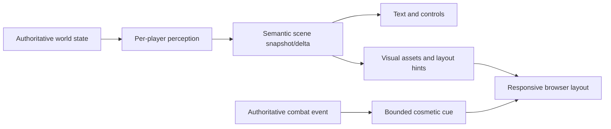
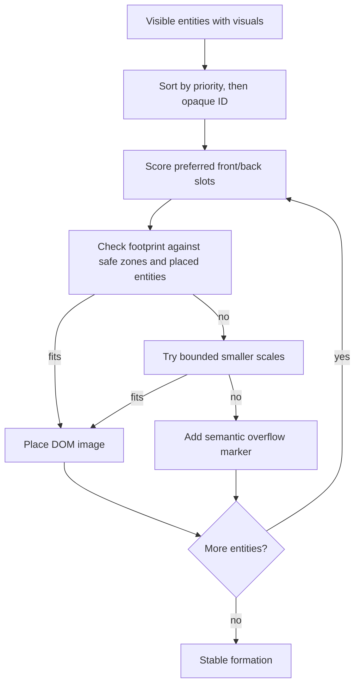

# Optional scene compositor v1

Status: bounded browser-first foundation implemented and tested; reviewed
demonstration sprites remain unpublished. Text and semantic entity state remain
authoritative.

Tiamud scenes already project an atmospheric image plus visible NPC and item
lists. The compositor may decorate those same visible entities with
transparent assets and short reactions. It never changes visibility,
targeting, timing, collision, combat or persistence.

## Boundaries



- The server decides which entities and assets a player may know.
- The server sends normalized hints, never CSS pixels or executable markup.
- The browser chooses responsive placement and may discard all decoration.
- Telnet remains complete; supporting GMCP clients may opt into a later
  `Tiamud.Entities` package.
- Gameplay never waits for download, decode, layout or animation.

## Entity presentation

Presentation metadata travels in a capability-gated web sidecar on the scene
snapshot, not in the core `SceneView` or GMCP entity shape. Each annotation
must match an already visible semantic item or NPC by the same session-opaque
entity ID. A visual definition contains:

- semantic layer: ground item, creature or effect;
- reviewed raster asset reference;
- required static idle pose and optional attack, hit and defeated poses;
- normalized bottom-centre preferred anchor;
- normalized footprint and optional safe slot preferences;
- bounded priority and alternative/decorative semantics.

Hidden entity prototypes, variants and asset manifests are resolved before
projection and are never sent as a catalog.

## Layout algorithm

The server supplies intent; the client performs deterministic responsive
placement.



The first implementation uses normalized front and back rows, authored
rectangular safe zones and bottom-centre footprints. It prefers overflow to
material overlap. No algorithm can promise that arbitrary numbers of large
sprites never overlap, so the contract is explicit: compose at most ten
individual browser entities initially; lower-priority entities remain in the
normal semantic lists and may be summarized by a decorative roster marker.

Layout is a pure function of the current snapshot. It carries no previous-slot
state, so snapshots, reconnects and tests reproduce the same ranked
formation. CSS transitions may smooth a change but never influence assignment.
Layout recomputes on scene, breakpoint or composition changes, not on every
animation frame. DOM images and CSS transforms are the MVP; Canvas and WebGL
are rejected until measured content requires them.

## Cosmetic cues

The wire vocabulary is closed:

```json
{
  "v": 1,
  "type": "message.append",
  "data": {
    "revision": 42,
    "kind": "gameplay",
    "text": "The gate-stalker recoils from your strike.",
    "actorId": "opaque-player-id",
    "targetId": "opaque-entity-id",
    "cue": {
      "kind": "hit",
      "entityId": "opaque-entity-id",
      "pose": "hit",
      "intensity": 2,
      "durationMs": 320
    }
  }
}
```

The client compatibility vocabulary is `attack`, `hit`, `heal` and `defeat`.
Intensity is 1–3 and duration is at most 800 ms. A cue names a predeclared
pose; it cannot supply a URL, animation name, CSS or script. The authoritative
server currently emits this closed NPC-only subset:

| Domain fact after successful observer projection | Cue subject and value |
| --- | --- |
| `NpcAbilityUsed` | projected NPC actor: `attack`, pose `attack`, intensity 2, 420 ms |
| unmatched `CharacterDamaged` (the NPC basic attack) | projected NPC actor: `attack`, pose `attack`, intensity 2, 420 ms |
| `NpcDamaged` with positive remaining health | projected NPC target: `hit`, pose `hit`, intensity 2, 320 ms |
| `NpcDefeated` | projected NPC target: `defeat`, pose `defeated`, intensity 3, 700 ms |

An ability's matching `CharacterDamaged` event is batch-suppressed, and lethal
`NpcDamaged` is left undecorated so the following `NpcDefeated` produces one
defeat cue. All other events produce no cue. Derivation pairs the authoritative
`DomainEvent` with its observer-specific `ViewEvent`, never prose, and copies
only the projected opaque actor/target ID. The web adapter further requires
that opaque ID in the previous or current authorized presentation sidecar.
Unperceived events and entities without reviewed presentation produce no cue.

`heal` remains reserved in the bounded browser parser but is not emitted by
the server. Player characters are not separate scene-presentation entities in
v1, so player-targeted poses are not composited. Status cues remain deferred
until NPC status is part of the reconstructable scene snapshot.

The client applies authoritative state first and cosmetics second. The
semantic message's existing sequence and revision identify ordering; no
separate cosmetic message can create a sequence gap. Cues for removed or
invisible entities are ignored. On reconnect/resync, the client renders the
current static state and does not replay old attacks. A normal same-view
snapshot retains the cue only if the same opaque entity remains in the new
semantic/presentation join. Removal or view change clears it. In particular,
the current implementation has no defeat tombstone: authoritative NPC removal
wins immediately, so the declared 700 ms does not guarantee a lingering fade.

Cue-decorated narrative messages use the existing non-critical event priority.
If one is dropped under backpressure, the next authoritative snapshot restores
all gameplay state and no animation replay is required.

## Assets and formats

Atmospheric opaque art is currently AVIF-first with WebP/JPEG fallbacks.
Transparent atmosphere inputs currently publish PNG only. The implemented
static entity-sprite profile publishes alpha WebP with PNG fallback at 320 and
640 pixels. AVIF alpha should be added after its deterministic RGBA path and
measurements show a useful size/decode benefit; it is not assumed merely
because opaque AVIF is efficient. SVG, HTML, CSS, JavaScript, `data:` URLs and
third-party hosts are not accepted.

All assets are reviewed, content-addressed, same-origin and bounded. The
browser verifies declared type/size policy and uses immutable caching. A pose
failure falls back to idle; idle failure removes only decoration.

Suggested starting budgets:

| Budget | Initial limit |
| --- | ---: |
| Individually composed entities | 10 (hard protocol ceiling 16) |
| Static entity rendition | 512 KiB |
| Initial room media | about 3 MiB |
| Concurrent moving cues | 2 |
| Cue duration | 800 ms |
| Decoded entity media | 32 MiB mobile / 64 MiB desktop |
| Concurrent sprite decodes | 2 mobile / 4 desktop |

These are configurable client budgets, not promises that every room should
consume them.

## Protocol and synchronization

The existing `entity.upsert` and `entity.remove` messages are a useful bridge,
but dense composed scenes require atomic batches. The next negotiated protocol
should use:

- a scene snapshot with `viewId` and `revision`;
- a delta with `baseRevision`, `revision`, `deltaId` and ordered semantic ops;
- atomic application to a shadow state before rendering;
- a bounded per-session delta ring for contiguous resync;
- snapshot fallback, optionally chunked, when the 16 KiB WebSocket frame
  budget would be exceeded;
- cosmetic fields embedded in perception-filtered semantic events, never an
  independent sequenced message.

Projection always happens before diffing. Raw stable world IDs and hidden
entities never enter a delta.

## Accessibility and preference policy

- Semantic prose, entity lists, health and actions remain present when all
  images fail.
- Entity sprites are decorative when the adjacent semantic list already names
  them, preventing duplicate screen-reader announcements.
- Screen-reader and Save-Data modes fetch no sprite media.
- Reduced-motion mode applies the final static pose without shake, lunge,
  flash or fade.
- Forced-colours mode hides decorative imagery.
- The sprite layer has no pointer events; actions remain native controls.
- Animation is never the only indication of damage, status or defeat.

## Security and performance invariants

- Only allowlisted same-origin content-addressed raster paths are accepted.
- Normalized positions, footprints, priorities, poses and cue values are
  clamped or rejected before reaching styles.
- Entity and pose counts are bounded before JSON allocation or DOM creation.
- No player-authored text becomes markup, CSS, an asset path or an alt string.
- Resync, view change and entity removal cancel stale cues; a same-view normal
  snapshot may retain one only while its opaque subject remains presented.
- Missing media cannot stall the world actor or its critical output queue.

## Implementation status and next phases

1. **Complete:** pure deterministic layout, presentation-sidecar and
   semantic-cue parser tests.
2. **Complete:** strict authoring definitions and perception-safe projection
   of static entity poses. Normal and recovery frames shed optional
   annotations before the 16 KiB budget; Telnet/GMCP shapes are unchanged.
3. **Complete:** browser wiring with preference gating, overflow and
   responsive tests.
4. **Complete:** batch-aware authoritative NPC attack/hit/defeat derivation on
   the existing `message.append`, projected opaque-ID gating, same-view cue
   retention and deterministic clearing on resync/view change/removal.
5. **Next:** publish a reviewed sample sprite set through the existing
   quarantine/provenance pipeline and add deterministic visual fixtures.
6. **Later:** atomic dense-scene deltas and measured media budgets.
7. **Later:** player-avatar composition, heal emission, a bounded defeat
   tombstone, additional poses or effects only when authored content justifies
   them.

Builder preview, deterministic screenshot fixtures, localization, encounter
formation hints and a compact inspect card are natural later additions. A
general animation scripting language, runtime image generation and required
GPU acceleration are explicit non-goals.
