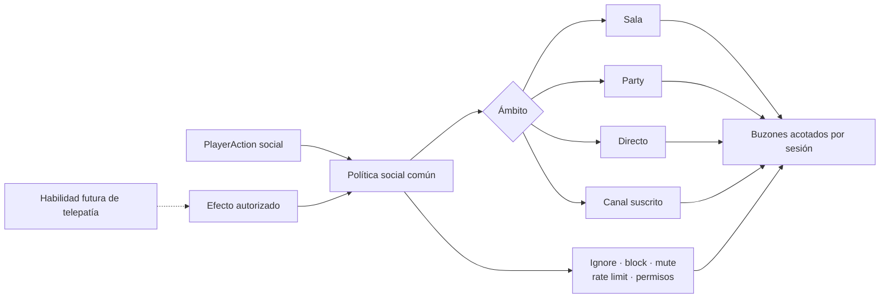
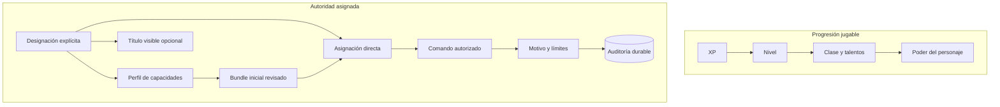
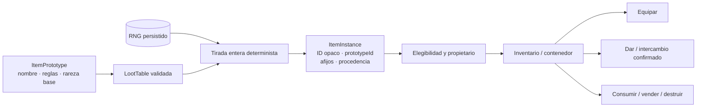

# Hoja de ruta de sistemas sociales, staff e inventario/botín

Estado: auditoría de implementación y diseño de continuación, 2026-07-16.

Este documento distingue lo que Tiamud implementa hoy de los sistemas que son
habituales en algunos MUD clásicos o convenientes para un mundo persistente
moderno. No convierte cada antecedente histórico en un requisito. El código y
las pruebas siguen siendo la autoridad sobre comportamiento actual; la
[matriz de completitud](../project/COMPLETION_MATRIX.md) conserva la autoridad
sobre la aceptación de la especificación histórica.

## Resumen ejecutivo

- Sí existen grupos persistentes de hasta seis miembros: crear, invitar,
  aceptar, revocar, expulsar, transferir liderazgo, disolver, salir y consultar
  estado, además de `party say` con alias `gsay`/`gtell`.
- Sí existen `reply` en línea y los canales suscritos `general`, `newbie` y
  `staff`; este último exige perfil `moderator`, `administrator` o
  `implementor`. No existen correo sin conexión, historial durable de
  conversación ni una habilidad de telepatía.
- Sí existen los perfiles `helper`, `builder`, `moderator`, `administrator` e
  `implementor`, doce capacidades cerradas y un título narrativo opcional. La
  XP, la ficha, WorldPack, el perfil visible y el rol legado nunca sustituyen
  la capacidad concreta.
- Sí existen comandos de moderación dentro del juego: reportar, silenciar,
  expulsar, revertir sanciones y cambiar roles según autoridad.
- Sí existen cola/resolución de reportes, inspect/where/goto/transfer/restore,
  anuncios y consulta de auditoría, con motivos obligatorios y límites.
- Sí existen inventario, equipo, consumibles y botín fijo de NPC.
- No existen rareza/tier, peso, capacidad, pilas, contenedores, comercio,
  objetos repetibles ni tablas de botín aleatorias.

Las fases 1, comunicación/grupo, y 2, staff por capacidades, están
implementadas. La secuencia pendiente es: prototipos e instancias de objetos;
propiedad y reparto del botín; y, solo después, rareza y tablas aleatorias.

## Estado verificado en el código

### Conversación y seguridad social

`SocialAction` ofrece `Say`, `PartySay`, `Tell`, `Reply`, listado/alta/baja/envío
de canal, `Who`, `Help`, ignore/block, reportes, mute/ban, reversión de
sanciones y cambio de rol. `SocialChannel` contiene `Announcement`, `Say`,
`Tell`, `Party`, `General`, `Newbie` y `Staff`.

- `say` se entrega a otros personajes conectados en la misma sala;
- `tell` se entrega a un personaje conectado, aunque esté en otra sala;
- `reply` conserva en memoria el ID interno del último remitente cuyo `tell`
  se entregó y exige que siga conectado; no es correo durable;
- `party say` se entrega solo a los demás miembros conectados del grupo;
- `general`, `newbie` y `staff` exigen suscripción durable; `staff` solo está
  disponible para perfiles `moderator`, `administrator` o `implementor`, tanto
  al unirse o enviar como al recibir; `helper` y `builder` no acceden;
- un `tell` bloqueado o ignorado se confirma igual que uno entregado para no
  filtrar el estado privado del receptor;
- el texto y el destinatario están acotados, y el chat tiene rate limit;
- la entrega usa el router directo y los buzones acotados por sesión;
- reportes, relaciones, sanciones y suscripciones sobreviven a un reinicio.

SQLite y PostgreSQL implementan actualmente el esquema v10. Conserva
`social_channel_subscriptions` de v9 y añade perfiles, capacidades, resolución
cerrada de reportes y auditoría append-only; el traslado sin conexión también
los copia. La evidencia histórica PostgreSQL real sigue acreditando v8 y no se
presenta como aceptación v10.

Por tanto, `tell` sirve como mensaje privado online clásico, pero no debe
presentarse como telepatía: no consume una habilidad o recurso, no aplica
alcance, sentidos, interferencias ni condiciones de mundo, y no llega a un
personaje desconectado.

### Parties

`PartyAction` implementa `Create`, `Invite`, `Accept`, `Revoke`, `Kick`,
`Transfer`, `Disband`, `Leave` y `Status`.

- máximo de seis miembros;
- solo el líder invita, revoca, expulsa, transfiere y disuelve;
- máximo de doce invitaciones pendientes;
- una invitación expira tras veinte ticks lógicos;
- la transferencia explícita exige otro miembro; si el líder sale, el
  liderazgo pasa de forma determinista al primer miembro restante;
- un miembro desconectado sigue perteneciendo al grupo y aparece como
  acompañante ausente;
- el snapshot durable conserva parties e invitaciones.

Accept, revoke, kick y transfer resuelven el nombre de un personaje conectado.
La persistencia de membresía offline no implica que esas operaciones dirigidas
puedan gestionar a un objetivo desconectado.

No hay seguimiento, asistencia/rescate, selección general de aliados, crédito
de misión/XP compartido ni política de botín.

### Staff y moderación

La autorización ejecutable es de cuenta y comprueba una capacidad concreta.
Los roles `Player`, `Moderator`, `Admin` solo conservan el tier legado de
moderación y percepción; nunca son suficientes para ejecutar un comando ni
abren por sí solos el canal `staff`. Ese canal exige perfil `moderator`,
`administrator` o `implementor`; `helper` y `builder` no acceden. El primer
registro de una base nueva conserva Admin como bootstrap legado y recibe
perfil `implementor` con las doce capacidades. Los Admin migrados desde v9
reciben `administrator`. Existe recuperación offline de emergencia para una
instalación sin admin.

Los perfiles cerrados y su bundle inicial son:

| Perfil | Bundle inicial |
| --- | --- |
| `helper` | `reports.view`, `reports.resolve` |
| `builder` | Ninguna capacidad implícita; se asigna explícitamente lo necesario. |
| `moderator` | Reportes más `moderation.mute`, `moderation.ban` |
| `administrator` | Las doce capacidades. |
| `implementor` | Las doce capacidades; rango operativo excepcional. |

El `lore_title` opcional puede presentar “Angel”, “Semidiós”, “Dios” u otro
título del mundo, pero no concede autoridad. Las capacidades canónicas son:

```text
reports.view       reports.resolve
moderation.mute    moderation.ban
staff.assign       staff.inspect       staff.where
staff.goto         staff.transfer      staff.restore
staff.announce     staff.audit
```

Cambiar un perfil borra las asignaciones anteriores y siembra exactamente el
bundle revisado del perfil nuevo; las capacidades directas se aplican después,
de forma explícita. Tanto la asignación como las acciones dirigidas rechazan la
propia cuenta y cualquier objetivo de rango igual o superior.

Dentro del juego se pueden ejecutar `report`, `mute`, `unmute`, `ban`,
`unban`, `role` y la superficie staff de fase 2. Todos los cambios sensibles
exigen motivo. La cola solo contiene reportes abiertos; resolver requiere uno
de `dismissed`, `action_taken`, `no_action` y conserva resolución, motivo,
responsable y fecha.

```text
staff
staff status
staff reports <motivo>
staff resolve <id> <dismissed|action_taken|no_action> <motivo>
staff inspect <nombre> | <motivo>
staff where <nombre> | <motivo>
staff goto <nombre> | <motivo>
staff transfer <nombre> | <motivo>
staff restore <nombre> | <motivo>
staff announce <texto> | <motivo>
staff audit <motivo>
staff profile <nombre> <helper|builder|moderator|administrator|implementor|none> <título|none> | <motivo>
staff capability <grant|revoke> <nombre> <capacidad> | <motivo>
```

Inspect/where/goto/transfer/restore resuelven un personaje conectado y no son
administración offline. Perfil/capacidad y resolución de reportes usan
identidad durable. Las mutaciones y su entrada de auditoría se escriben
atómicamente; `staff_audit` es append-only por restricciones y triggers en
ambos adaptadores. Siguen ausentes `load/spawn`, `purge`, `invis`, `holylight`,
`snoop`, `switch`, `force` y edición online. `tiamud-admin` permanece en la
capa de operador.

### Inventario y botín

Un objeto actual del WorldPack es simultáneamente una definición y una
instancia única identificada por su ID estable. Puede estar staged, en una
sala, en un inventario, equipado, en posesión de un NPC o consumido. Las reglas
añaden opcionalmente un slot de equipo, ataque, curación, consumo y un efecto
acotado. Los slots actuales son arma, cuerpo y abalorio.

Un prototipo de NPC declara una lista fija de IDs de objetos. El validador
exige que existan, no se repitan y no se asignen a más de un spawn. Esos
objetos se entregan al NPC al cargar el mundo y se transfieren al derrotarlo.
Esto es botín fijo y determinista, no una tabla aleatoria repetible.

## Qué muestran los MUD clásicos

Las referencias oficiales de CircleMUD documentan familias de funciones como
grupo y `gsay`, comunicación pública, seguimiento/asistencia/rescate, correo y
tablones, y una superficie amplia de comandos de wizard. Sus niveles mínimos
de comando también separan parte de la autoridad inmortal del avance mortal:

- [índice oficial del código fuente de CircleMUD](https://www.circlemud.org/pub/jelson/CircleMUD/3.x/uncompressed/current/src/);
- [referencia cruzada oficial de funciones](https://www.circlemud.org/cdp/cxref/comm.c.html);
- [manual oficial de comandos de wizard](https://www.circlemud.org/pub/CircleMUD/3.x/uncompressed/circle30bpl21/doc/wizhelp.pdf);
- [notas oficiales sobre canales y niveles mínimos](https://www.circlemud.org/cdp/wtfaq/chap3-1.html);
- [notas oficiales sobre niveles inmortales adicionales](https://www.circlemud.org/cdp/wtfaq/level.html).

Estas fuentes sirven para identificar categorías, no para copiar código,
textos de ayuda o decisiones de seguridad. Tiamud es una implementación limpia
y conserva sus propios límites de licencia, accesibilidad, autoridad,
persistencia y single writer.

## Comunicación implementada y ampliaciones futuras

La fase 1 conserva una sola política social; ningún canal está implementado de
forma independiente en WebSocket, Telnet o la interfaz. La futura telepatía
deberá entrar por esa misma política.



### Fase 1 entregada

1. Implementado `party say <texto>` con alias `gtell`/`gsay`, usando la
   membresía durable actual.
2. Implementado `reply <texto>` con el ID interno en memoria del último
   remitente válido, no un nombre ambiguo ni un ID estable expuesto.
3. Implementados revocar invitación, expulsar, transferir y disolver.
4. Implementados los canales suscritos `newbie`, `general` y `staff`, con
   permisos, rate limit, mute, ignore/block y entrega mediante buzones
   acotados. La suscripción persiste en ambos adaptadores; `staff` exige perfil
   `moderator`, `administrator` o `implementor`.
5. Pendiente `shout`/`yell` como propagación espacial definida por el mundo y
   acotada, no como otro nombre para el canal global.
6. Pendientes emotes/sociales con plantillas estrictas que nunca conviertan
   texto del jugador en ANSI, HTML, MXP o instrucciones evaluables.

Web usa acciones estructuradas y representa los siete valores de
`SocialMessage`; Telnet comparte los comandos de texto y proyecta cada entrega
como texto y como `Comm.Channel.Text` cuando GMCP `Comm` está negociado. Esta
paridad no convierte GMCP en una segunda autoridad.

El correo offline, tablones y guild/clan chat pueden seguir después. Requieren
retención, límites, búsqueda/moderación, eliminación y reglas de privacidad
propias.

### Telepatía

La telepatía debe ser data-driven y opcional por mundo. Una definición mínima
necesita:

- habilidad o efecto que la habilita;
- destinatario directo o party;
- coste y cooldown;
- alcance o ausencia explícita de alcance;
- sentidos/estados que permiten emitir y recibir;
- interferencias y zonas que la bloquean;
- una proyección textual completa para ambos transportes;
- los mismos límites sociales, ignore, block, mute y auditoría aplicables al
  resto de comunicaciones.

No se debe disfrazar `tell` como telepatía porque eso impediría a cada
WorldPack decidir su ficción y sus reglas.

## Staff: rango visible, capacidad real

Los niveles de personaje y la autoridad administrativa deben seguir siendo
dos ejes independientes.



Los perfiles canónicos son identificadores operativos no localizados. “Angel”,
“Semidiós” o “Dios” caben como `lore_title`, nunca como autorización. La
comprobación usa el conjunto efectivo de capacidades y la jerarquía negativa
de perfiles; rechaza objetivos iguales o superiores aunque exista la capacidad
funcional. Cada comando de mundo implementado exige motivo, limita el alcance,
opera sobre un personaje conectado y deja auditoría durable.

`force`, `snoop` y `switch` tienen riesgos de abuso y privacidad; no son
requisitos del baseline. `load/spawn` y `purge` pueden romper la economía o la
persistencia si no trabajan con instancias y transacciones. El apagado, backup
y migración deben seguir en la capa operativa salvo una necesidad medida.

La construcción online tampoco debe mutar definiciones vivas arbitrariamente.
Un futuro OLC debería producir un borrador AreaPack, ejecutar el validador,
publicar un WorldPack inmutable y usar activación/rollback controlados.

## Inventario, tiers e instancias

“Tier de inventario” puede significar rareza del objeto o capacidad de carga.
Son sistemas distintos y deben modelarse por separado.



### Fundamento obligatorio

1. `ItemPrototype`: contenido authored estable y reutilizable.
2. `ItemInstance`: ID durable único, `prototypeId`, origen, ubicación,
   propietario/eligibilidad y, cuando proceda, seed o afijos resueltos.
3. Inventario acotado por slots y peso; contenedores con capacidad y
   profundidad máximas. Las pilas solo agrupan instancias fungibles con los
   mismos metadatos.
4. Transferencia atómica: `give` para casos simples e intercambio confirmado
   por ambas partes para objetos valiosos. Objetos de quest, ligados o no
   transferibles deben declararlo.
5. Derechos de botín: ventana exclusiva y política inicial determinista, por
   ejemplo round-robin, antes de dejarlo libre en la sala.

### Rareza y nivel de objeto

Una rareza cerrada como common/uncommon/rare/epic/legendary puede servir para
presupuesto de poder, frecuencia y presentación, pero no debe ser solo un
color. El cliente y Telnet deben mostrar texto y significado. El WorldPack
puede localizar las etiquetas visibles sin cambiar la enum canónica.

`itemLevel`, calidad y afijos son ejes diferentes. Deben tener límites authored
por slot/tier/nivel y aritmética saturada. Una rareza alta no puede saltarse
requisitos, capacidades o validación económica.

### Tablas y cofres aleatorios

Una tabla de botín segura necesita:

- pesos enteros acotados y suma comprobada;
- número mínimo/máximo de tiradas y cantidades acotadas;
- condiciones con la gramática declarativa existente, no scripts arbitrarios;
- reglas de únicos y duplicados;
- RNG persistido para que un reinicio no permita repetir o cambiar la tirada;
- creación, asignación, evento de dominio y snapshot en la misma transacción;
- procedencia durable para diagnóstico y economía;
- probabilidades visibles para cualquier contenedor aleatorio.

Los cofres conseguidos jugando pueden ser contenido normal si no se venden
llaves, tiradas ni moneda premium y si sus probabilidades son transparentes.
Las loot boxes de pago quedan fuera del baseline: añaden incentivos y riesgos
legales/éticos que no son necesarios para el motor. Si algún día se plantea
monetización, es preferible vender cosméticos conocidos o apoyo de precio fijo.

## Otros sistemas MUD candidatos

| Sistema | Estado actual | Cuándo considerarlo |
| --- | --- | --- |
| Emotes/sociales | Ausente. | Con el router social ampliado y plantillas seguras. |
| Mail y tablones | Ausente. | Después de definir retención, cuotas, moderación y privacidad. |
| Guilds/clanes | Ausente. | Tras estabilizar parties, canales y autoridad comunitaria. |
| Puertas, llaves y contenedores | Ausente como sistema general. | Con instancias, profundidad acotada y persistencia de estado. |
| Give/trade/auction | Ausente. | Tras propiedad durable, operación atómica y antifraude básico. |
| Crafting | Ausente. | Cuando haya prototipos repetibles y sinks económicos. |
| Housing | Ausente. | Cuando el contenido necesite instancias persistentes privadas. |
| Pets/mounts | Ausente. | Después de followers y reglas de party/NPC. |
| Duelo/PvP | Ausente. | Solo con consentimiento, seguridad, muerte/recompensa y moderación diseñados. |
| Facciones/reputación/idiomas | Ausente. | Como contenido data-driven cuando exista una necesidad narrativa. |
| Remort/rebirth | Ausente. | No prioritario mientras v3 aún necesita balance y migraciones. |
| OLC in-game | Ausente. | Como staging/validación/publicación, nunca mutación libre del runtime. |

## Plan por fases y aceptación

### Fase 1 — comunicación y grupo — implementada

- chat de grupo, `reply`, revocación/expulsión/transferencia/disolución;
- canales `newbie`/`general`/`staff` suscritos y moderados;
- paridad navegador, texto Telnet y GMCP;
- cobertura de ignore/block/mute, límites, desconexión, perfil de `staff` y cero
  fuga entre grupos.

### Fase 2 — staff por capacidades — implementada

- perfiles y capacidades separados de progresión;
- cola y resolución cerrada de reportes y razones obligatorias;
- inspect/where/goto/transfer/restore/announce/audit acotados;
- autorización negativa, jerarquía, persistencia v10 y auditoría append-only
  en SQLite/PostgreSQL;
- acciones estructuradas Web y texto/announcement Telnet+GMCP equivalentes;
- ninguna autoridad obtenible mediante XP, clase, talento o WorldPack.

### Fase 3 — objetos repetibles e inventario — pendiente

- migración prototype/instance;
- slots/peso, stacks y contenedores acotados;
- give e intercambio confirmado;
- snapshot, rollback, migración y proyección opaca en ambos transportes.

### Fase 4 — propiedad, rareza y botín aleatorio — pendiente

- elegibilidad y distribución de party;
- rareza/item level/afijos con presupuestos;
- tablas enteras validadas y tirada transaccional restart-safe;
- probabilidades visibles, pruebas estadísticas deterministas y límites de
  economía;
- cofres solo como recompensa de juego en el baseline.

### Fase 5 — comunidad y contenido — pendiente

- emotes, mail/boards y guilds según necesidades observadas;
- crafting/auction/housing solo con sinks, cuotas y moderación;
- OLC únicamente sobre el pipeline de artefactos revisados.

Cada fase debe preservar el single writer, una sola persistencia seleccionada,
rollback exacto, límites de frame/cola, percepción antes de protocolo, IDs
opacos y equivalencia funcional entre browser y Telnet.
