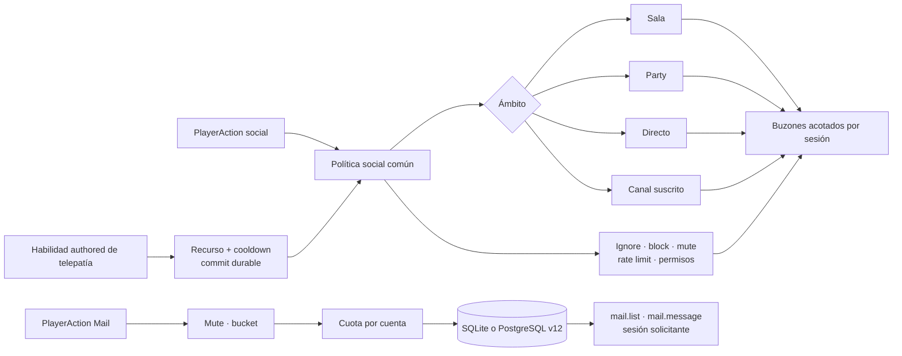
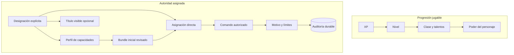
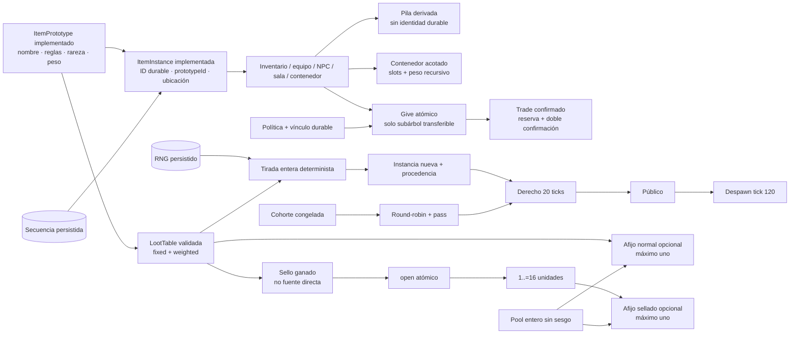

# Hoja de ruta de sistemas sociales, staff e inventario/botín

Estado: auditoría de implementación y diseño de continuación, 2026-07-17.

Este documento distingue lo que Tiamud implementa hoy de los sistemas que son
habituales en algunos MUD clásicos o convenientes para un mundo persistente
moderno. No convierte cada antecedente histórico en un requisito. El código y
las pruebas siguen siendo la autoridad sobre comportamiento actual; la
[matriz de completitud](../project/COMPLETION_MATRIX.md) conserva la autoridad
sobre la aceptación de la especificación histórica.

## Resumen ejecutivo

- Sí existen grupos persistentes de hasta seis miembros: crear, invitar,
  aceptar, revocar, expulsar, transferir liderazgo, disolver, salir y consultar
  estado, además de `party say` con alias `gsay`/`gtell`.
- Sí existen `reply` en línea y los canales suscritos `general`, `newbie` y
  `staff`; este último exige perfil `moderator`, `administrator` o
  `implementor`. También existe telepatía directa online como habilidad
  authored con recurso, cooldown, interferencia por sala y supresión privada.
  También existen emotes de sala authored, con plantillas cerradas por
  perspectiva y targeting local cerrado: sin objetivo, opcional u obligatorio.
  También existe correo offline explícito con buzón, cuotas, caducidad y
  denuncia acotados. No existe historial general durable de conversación.
- Sí existen los perfiles `helper`, `builder`, `moderator`, `administrator` e
  `implementor`, doce capacidades cerradas y un título narrativo opcional. La
  XP, la ficha, WorldPack, el perfil visible y el rol legado nunca sustituyen
  la capacidad concreta.
- Sí existen comandos de moderación dentro del juego: reportar, silenciar,
  expulsar, revertir sanciones y cambiar roles según autoridad.
- Sí existen cola/resolución de reportes, inspect/where/goto/transfer/restore,
  anuncios y consulta de auditoría, con motivos obligatorios y límites.
- Sí existen inventario, equipo, consumibles, botín fijo de NPC, prototipos
  reutilizables, instancias durables, capacidad por slots/peso y
  rareza/`itemLevel` textual. También existen pilas fungibles derivadas,
  contenedores acotados, cantidades, consulta paginada, `give` atómico y las
  políticas `transferable`, `character_bound` y `non_transferable`. También
  existe trade bilateral confirmado mediante reservas durables, revisión y
  doble confirmación de objetos y moneda.
- Sí existen tablas enteras fixed+repeatable, procedencia durable, derechos de
  20 ticks, reparto de cohorte round-robin, `loot pass` y despawn al tick 120.
- Sí existen recompensas selladas ganadas jugando, `open`, consulta exacta y
  paginada con `reward odds` y un afijo acotado para botín único normal o
  sellado. No existen need/greed, master-loot, reparto por contribución, pity,
  cajas, llaves o tiradas pagadas.

Las fases 1, comunicación/grupo, 2, staff por capacidades, 3A, fundamento de
objetos, 3B, pilas/contenedores, 3C, entrega/políticas, y 3D, trade confirmado,
están implementadas. También están implementadas 4A, botín repetible con
derechos y procedencia, y 4B, sellos ganados y afijos deterministas.
Las fases 5A, telepatía directa authored, 5B, emotes de sala authored, y 5C,
correo offline acotado, también están implementadas.

## Estado verificado en el código

### Conversación y seguridad social

`SocialAction` ofrece `Say`, `PartySay`, `Tell`, `Reply`, listado/alta/baja/envío
de canal, `Who`, `Help`, ignore/block, reportes, mute/ban, reversión de
sanciones y cambio de rol. `PlayerAction::Telepathy` separa la mutación de
habilidad del chat ordinario. `SocialChannel` contiene `Announcement`, `Say`,
`Tell`, `Telepathy`, `Emote`, `Party`, `General`, `Newbie` y `Staff`.

- `say` se entrega a otros personajes conectados en la misma sala;
- `tell` se entrega a un personaje conectado, aunque esté en otra sala;
- `reply` conserva en memoria el ID interno del último remitente cuyo `tell`
  se entregó y exige que siga conectado; no es correo durable;
- `party say` se entrega solo a los demás miembros conectados del grupo;
- `general`, `newbie` y `staff` exigen suscripción durable; `staff` solo está
  disponible para perfiles `moderator`, `administrator` o `implementor`, tanto
  al unirse o enviar como al recibir; `helper` y `builder` no acceden;
- un `tell` bloqueado o ignorado se confirma igual que uno entregado para no
  filtrar el estado privado del receptor;
- el texto y el destinatario están acotados, y el chat tiene rate limit;
- la entrega usa el router directo y los buzones acotados por sesión;
- reportes, relaciones, sanciones y suscripciones sobreviven a un reinicio.

SQLite y PostgreSQL implementan actualmente el esquema v12. Conserva
`social_channel_subscriptions` de v9 y añade perfiles, capacidades, resolución
cerrada de reportes y auditoría append-only de v10; v11 admite snapshots v6 y
v7 de hasta 2 MiB sin relajar el límite legacy v1–v5 de 1 MiB; v12 añade las
tres tablas acotadas del correo offline. El traslado sin conexión también los
copia. La evidencia histórica PostgreSQL real sigue acreditando v8 y no se
presenta como aceptación v12.

Por tanto, `tell` sigue siendo el mensaje privado online clásico y no se
presenta como telepatía. La telepatía de 5A entra por una habilidad distinta:
consume recurso/cooldowns, admite interferencia authored y tampoco llega a un
personaje desconectado.

### Parties

`PartyAction` implementa `Create`, `Invite`, `Accept`, `Revoke`, `Kick`,
`Transfer`, `Disband`, `Leave` y `Status`.

- máximo de seis miembros;
- solo el líder invita, revoca, expulsa, transfiere y disuelve;
- máximo de doce invitaciones pendientes;
- una invitación expira tras veinte ticks lógicos;
- la transferencia explícita exige otro miembro; si el líder sale, el
  liderazgo pasa de forma determinista al primer miembro restante;
- un miembro desconectado sigue perteneciendo al grupo y aparece como
  acompañante ausente;
- el snapshot durable conserva parties e invitaciones.

Accept, revoke, kick y transfer resuelven el nombre de un personaje conectado.
La persistencia de membresía offline no implica que esas operaciones dirigidas
puedan gestionar a un objetivo desconectado.

No hay seguimiento, asistencia/rescate, selección general de aliados ni
crédito de misión/XP compartido. La única política de botín de grupo actual es
round-robin sobre una cohorte próxima congelada; no hay need/greed, master-loot
o contribución.

### Staff y moderación

La autorización ejecutable es de cuenta y comprueba una capacidad concreta.
Los roles `Player`, `Moderator`, `Admin` solo conservan el tier legado de
moderación y percepción; nunca son suficientes para ejecutar un comando ni
abren por sí solos el canal `staff`. Ese canal exige perfil `moderator`,
`administrator` o `implementor`; `helper` y `builder` no acceden. El primer
registro de una base nueva conserva Admin como bootstrap legado y recibe
perfil `implementor` con las doce capacidades. Los Admin migrados desde v9
reciben `administrator`. Existe recuperación offline de emergencia para una
instalación sin admin.

Los perfiles cerrados y su bundle inicial son:

| Perfil | Bundle inicial |
| --- | --- |
| `helper` | `reports.view`, `reports.resolve` |
| `builder` | Ninguna capacidad implícita; se asigna explícitamente lo necesario. |
| `moderator` | Reportes más `moderation.mute`, `moderation.ban` |
| `administrator` | Las doce capacidades. |
| `implementor` | Las doce capacidades; rango operativo excepcional. |

El `lore_title` opcional puede presentar “Angel”, “Semidiós”, “Dios” u otro
título del mundo, pero no concede autoridad. Las capacidades canónicas son:

```text
reports.view       reports.resolve
moderation.mute    moderation.ban
staff.assign       staff.inspect       staff.where
staff.goto         staff.transfer      staff.restore
staff.announce     staff.audit
```

Cambiar un perfil borra las asignaciones anteriores y siembra exactamente el
bundle revisado del perfil nuevo; las capacidades directas se aplican después,
de forma explícita. Tanto la asignación como las acciones dirigidas rechazan la
propia cuenta y cualquier objetivo de rango igual o superior.

Dentro del juego se pueden ejecutar `report`, `mute`, `unmute`, `ban`,
`unban`, `role` y la superficie staff de fase 2. Todos los cambios sensibles
exigen motivo. La cola solo contiene reportes abiertos; resolver requiere uno
de `dismissed`, `action_taken`, `no_action` y conserva resolución, motivo,
responsable y fecha.

```text
staff
staff status
staff reports <motivo>
staff resolve <id> <dismissed|action_taken|no_action> <motivo>
staff inspect <nombre> | <motivo>
staff where <nombre> | <motivo>
staff goto <nombre> | <motivo>
staff transfer <nombre> | <motivo>
staff restore <nombre> | <motivo>
staff announce <texto> | <motivo>
staff audit <motivo>
staff profile <nombre> <helper|builder|moderator|administrator|implementor|none> <título|none> | <motivo>
staff capability <grant|revoke> <nombre> <capacidad> | <motivo>
```

Inspect/where/goto/transfer/restore resuelven un personaje conectado y no son
administración offline. Perfil/capacidad y resolución de reportes usan
identidad durable. Las mutaciones y su entrada de auditoría se escriben
atómicamente; `staff_audit` es append-only por restricciones y triggers en
ambos adaptadores. Siguen ausentes `load/spawn`, `purge`, `invis`, `holylight`,
`snoop`, `switch`, `force` y edición online. `tiamud-admin` permanece en la
capa de operador.

### Inventario y botín

WorldPack v9/AreaPack v8 separan `itemPrototypes` de
`initialItemInstances`. El prototipo contiene nombre, descripción, aliases,
equipo/ataque/curación/efecto, peso, coste de slot, rareza, nivel y políticas
cerradas. Cada instancia durable referencia un prototipo y comienza en una
sala, un `npc_spawn`, `staged` o dentro de otra instancia contenedor. En runtime
puede estar además en inventario, equipada, en poder de un NPC o consumida. Los
slots de equipo actuales son arma, cuerpo y abalorio.

El runtime crea instancias distintas del mismo prototipo con una secuencia
monotónica persistida. `ItemInstanceId`, `prototypeId` y spawn no salen del
servidor; Web, Telnet y GMCP reciben un ID opaco distinto por unidad, derivado
de una sal criptográficamente aleatoria nueva por sesión. Telnet lo muestra
como referencia y permite usarlo como selector exacto. Una pila visible usa la
referencia opaca de su primer miembro visible ordenado; las consultas textuales
ambiguas fallan en vez de escoger una unidad arbitraria. La fase histórica 4A
añadió procedencia
durable exacta: `authored_initial`, `legacy_snapshot`, `runtime_created` o
`npc_loot` con tabla/digest/entrada/tirada; esa procedencia nunca sale del
servidor.

La presentación de un objeto se autoriza por instancia visible, pero el
registro `entityMedia` se comparte por prototipo. La política
`roomPerception.hiddenItems` apunta a la instancia concreta; no es una regla de
visibilidad para todas las unidades del prototipo.

Cada personaje tiene capacidad por slots y peso. El peso suma inventario y
equipo y todos sus descendientes; los slots cuentan solo raíces de inventario,
agrupadas por pila. Un contenedor `unique` no consumible cuenta slots de hijos
directos agrupados y peso de todos sus descendientes. El grafo rechaza ciclos y
una quinta arista. Equipar, desequipar, reemplazar, tomar, soltar, introducir y
extraer prevalidan el estado prospectivo completo antes de mutar.

Las pilas `fungible` se derivan por ubicación/prototipo/vínculo, ordenan
unidades por ID y se dividen por `maxStackUnits`; no se persiste `quantity` ni
un ID de pila. `take`/`drop`/`put`/`get`/`give` mueven 1..=256 unidades y
`contents` pagina 20 grupos.
La rareza cerrada, `itemLevel`, peso unitario/total, cantidad, slots y capacidad
se muestran como texto; Web usa `container.contents`, Telnet texto equivalente
y GMCP `Char.Items.List` con ubicación `container`. Las vistas añaden política,
estado ligado y `canGive`, sin exponer el dueño durable.

El propietario efectivo se obtiene en la raíz del grafo. Al adquirir desde
sala/NPC/staging se liga recursivamente cada descendiente `character_bound` al
personaje; `non_transferable` restringe el cambio sin persistir un dueño. Un
subárbol solo puede cambiar de personaje o volver al mundo si todas sus
instancias son `transferable`, cerrando el bypass mediante contenedores.
`give [cantidad] <objeto> to <personaje>` solo acepta raíces portadas, otro
personaje conectado en la misma sala y capacidad bilateral. Ignore del
receptor y block bilateral lo impiden con un error genérico. El cambio,
snapshot y `ItemsGiven` se confirman o revierten juntos.

`trade` mantiene objetos y moneda en sus autoridades y los reserva en el
snapshot. Admite hasta 64 negociaciones, una por personaje, 8 líneas por lado
y 128 raíces transferibles entre ambos. Los dos participantes deben seguir
conectados, juntos, fuera de combate y permitidos por ignore/block. Cada cambio
material incrementa una revisión y limpia confirmaciones; dos identidades
distintas deben confirmar la misma revisión y digest. La liquidación construye
ambos inventarios y saldos finales antes de confirmar todo en un único commit.
Separación, combate, derrota, desconexión, cambio social, expiración o reinicio
cancelan de forma cerrada. Web, Telnet y `Char.Trade 1` GMCP proyectan ofertas,
reservas y saldo gastable con IDs opacos por sesión.

El botín fijo continúa como instancia inicial ubicada en `npc_spawn`, pero 4A
añade una `lootSource` repetible con una `lootTable` de garantizados y pools
ponderados enteros. Cada fuente se resuelve una sola vez por derrota mediante
rejection sampling. Fijos y generables suman como máximo 64 raíces; tirada,
RNG, contador, procedencia, derechos, NPC, XP, eventos y snapshot se confirman
o revierten juntos. Si falta capacidad, lo generado se suprime de forma
durable sin bloquear la derrota ni permitir reroll.

`credited_character` reserva las raíces al iniciador. `party_round_robin`
congela una cohorte de hasta seis personajes conectados, vivos y próximos,
revalida a los acompañantes en la derrota y avanza un cursor durable. El
beneficiario puede usar `loot pass`; la raíz es exclusiva durante 20 ticks,
pública después y se retira al tick 120. Web, Telnet y GMCP solo muestran
`yours` con ticks restantes, `reserved` sin identidad, o público; las pilas se
parten por ese acceso.

4B añade sellos `unique`, consumibles y `character_bound` que solo pueden
obtenerse desde una tabla normal asociada a un NPC. No son instancias iniciales,
su tabla de apertura no puede ser fuente directa ni generar otro sello, produce
1..=16 unidades y expone como máximo 1.024 filas de probabilidad. `open` y
`reward odds` comparten el mismo dominio en Web, Telnet y GMCP; odds informa
las probabilidades authored exactas sin revelar RNG, IDs estables ni digests.

Las entradas normales o selladas de cantidad uno pueden referenciar un pool de
afijos para un prototipo `unique`, no sellado. Hay como máximo un afijo por
instancia, con 512 definiciones, 256 pools, 64 entradas por pool, 4.096 entradas
totales, etiquetas de 64 bytes y deltas positivos de ataque/curación de hasta
1.000. La selección ponderada es entera y sin sesgo; las copias durables
conservan digests de definición, pool y registro sin proyectarlos. Una apertura
confirma o revierte junta consumo, RNG, contador, creación, vínculo y capacidad.
El fallo restaura exactamente el checkpoint. En botín normal la tirada de afijo
se consume aunque después se suprima el drop, evitando rerolls por capacidad.

`WorldRuntimeSnapshot` v7 persiste instancias, contención, contadores de
identidad y apertura, afijos aplicados, vínculo, trade, RNG, procedencia normal
o sellada, encuentros, derechos y cursores. Las lecturas v1–v5 usan DTO exactos
bajo 1 MiB, migran con procedencia legacy y rechazan campos nuevos; v6 y v7
admiten hasta 2 MiB. Un v6 estricto sube a v7 con `itemAffixes: []` en cada
instancia y contador de apertura uno. SQLite y PostgreSQL confirman esa única
autoridad en la transacción de esquema v12, sin tabla espejo de loot/escrow.
Al restaurar se conservan nuevas instancias authored sin resucitar runtime
ausente. La barrera valida por lotes propietarios, vínculos, cohortes y
beneficiarios; cancela encuentros abiertos antes de readiness, pero conserva
los derechos de suelo ya creados.

Las escenas densas conservan una ventana semántica determinista de 14 KiB en
Web y 48 KiB en Telnet, con prioridad propia→pública→reservada y aviso de
reducción. Cada batch proyecta como máximo 16 eventos y un exceso se coalesce
con snapshot autoritativo; esto no introduce replay general.

## Qué muestran los MUD clásicos

Las referencias oficiales de CircleMUD documentan familias de funciones como
grupo y `gsay`, comunicación pública, seguimiento/asistencia/rescate, correo y
tablones, y una superficie amplia de comandos de wizard. Sus niveles mínimos
de comando también separan parte de la autoridad inmortal del avance mortal:

- [índice oficial del código fuente de CircleMUD](https://www.circlemud.org/pub/jelson/CircleMUD/3.x/uncompressed/current/src/);
- [referencia cruzada oficial de funciones](https://www.circlemud.org/cdp/cxref/comm.c.html);
- [manual oficial de comandos de wizard](https://www.circlemud.org/pub/CircleMUD/3.x/uncompressed/circle30bpl21/doc/wizhelp.pdf);
- [notas oficiales sobre canales y niveles mínimos](https://www.circlemud.org/cdp/wtfaq/chap3-1.html);
- [notas oficiales sobre niveles inmortales adicionales](https://www.circlemud.org/cdp/wtfaq/level.html).

Estas fuentes sirven para identificar categorías, no para copiar código,
textos de ayuda o decisiones de seguridad. Tiamud es una implementación limpia
y conserva sus propios límites de licencia, accesibilidad, autoridad,
persistencia y single writer.

## Comunicación implementada y ampliaciones futuras

Las fases 1, 5A y 5B conservan una sola política social efímera; ningún canal está
implementado de forma independiente en WebSocket, Telnet o la interfaz. La
telepatía ya entra por esa política después de mutar gameplay de forma durable.
El correo 5C comparte mute/bucket, pero después sigue una transacción y una
proyección privada distintas: no entra en el router de chat.



### Fase 1 entregada

1. Implementado `party say <texto>` con alias `gtell`/`gsay`, usando la
   membresía durable actual.
2. Implementado `reply <texto>` con el ID interno en memoria del último
   remitente válido, no un nombre ambiguo ni un ID estable expuesto.
3. Implementados revocar invitación, expulsar, transferir y disolver.
4. Implementados los canales suscritos `newbie`, `general` y `staff`, con
   permisos, rate limit, mute, ignore/block y entrega mediante buzones
   acotados. La suscripción persiste en ambos adaptadores; `staff` exige perfil
   `moderator`, `administrator` o `implementor`.
5. Pendiente `shout`/`yell` como propagación espacial definida por el mundo y
   acotada, no como otro nombre para el canal global.
6. Implementados emotes de sala authored con plantillas estrictas que nunca
   convierten texto del jugador en ANSI, HTML, MXP o instrucciones evaluables.

Web usa acciones estructuradas y representa los nueve valores de
`SocialMessage`; Telnet comparte los comandos de texto y proyecta cada entrega
como texto y como `Comm.Channel.Text` cuando GMCP `Comm` está negociado. Esta
paridad no convierte GMCP en una segunda autoridad.

Los tablones y guild/clan chat pueden seguir después. Requieren retención,
límites, búsqueda/moderación, eliminación y reglas de privacidad propias.

### Fase 5A — telepatía directa authored — implementada

WorldPack v8/AreaPack v7 implementan una comunicación cerrada
`telepathy/direct_online`. Una habilidad válida:

- es `spell|utility`, `single_ally` y no pertenece a un NPC;
- tiene al menos un coste de recurso y cooldown positivo;
- no combina daño, curación ni estados;
- dirige un pensamiento de hasta 512 bytes a otro personaje conectado;
- puede bloquear hasta 64 salas existentes;
- rechaza al emisor derrotado, recuperándose, aturdido o sin recursos; y
- confirma recurso/cooldowns antes de la entrega Web/Telnet/GMCP.

Ignore/block y la receptividad del receptor se usan solo para decidir entrega:
su resultado nunca cambia la confirmación del emisor. No hay `DomainEvent` con
texto/destino, no se enlaza `reply` y no existe entrega offline o grupal. El
contrato aceptado está en
[ADR 0015](../decisions/0015-authored-online-telepathy.md).

### Fase 5B — emotes de sala authored — implementada

WorldPack v9/AreaPack v8 admiten hasta 32 emotes de audiencia `room`. Cada
definición fija comando, nombre, targeting
`none|optional_character|required_character` y plantillas cerradas para actor,
objetivo y observadores. Solo existen `{actor}` y `{target}`; la sustitución se
hace en una pasada y no reinterpreta marcadores dentro de los nombres
insertados.

`emotes` lista sin consumir el bucket. `emote <comando> [personaje]` comparte
mute y rate limit con chat y resuelve únicamente otro personaje conectado y no
ambiguo de la misma sala. Ignore/block se aplica por receptor: no cambia la
confirmación del actor ni la copia de terceros autorizados. `OnTalk` se ejecuta
de forma acotada y la entrega Web/Telnet/GMCP empieza solo después del commit;
un rollback publica cero copias.

No hay texto libre, IDs authored en transporte, `DomainEvent`, `reply`,
historial, snapshot o SQL. El contrato está en
[ADR 0016](../decisions/0016-authored-room-emotes.md).

### Fase 5C — correo offline acotado — implementada

`mail list/read/delete/send/report` separa la correspondencia durable de
`tell`, `reply`, telepatía y chat. El buzón admite 64 mensajes, 128 KiB y siete
páginas de diez; cada carta vive 30 días. Tras mute y el bucket común, los
intentos con campos válidos consumen por cuenta una cuota de 20 por hora y 50
por día antes de resolver el nombre.
Ignore/block, ban y capacidad suprimen la entrega con la misma aceptación que
un guardado, de modo que el emisor no sondea estado privado.

SQLite/PostgreSQL v12 persisten mensaje, cuota y evidencia denunciada. Solo el
destinatario puede leer, borrar o denunciar una vez; hasta ocho denuncias de
correo abiertas por cuenta capturan evidencia durante 90 días. Staff ve el
asunto y un extracto acotado en la cola, no explora buzones ni registra cuerpos
en auditoría. Web `mail.list`/`mail.message`, texto Telnet y `Tiamud.Mail 1`
comparten dominio. No hay outbox, búsqueda, adjuntos, correo grupal ni
notificación online. El contrato está en
[ADR 0017](../decisions/0017-bounded-offline-mail.md).

## Staff: rango visible, capacidad real

Los niveles de personaje y la autoridad administrativa deben seguir siendo
dos ejes independientes.



Los perfiles canónicos son identificadores operativos no localizados. “Angel”,
“Semidiós” o “Dios” caben como `lore_title`, nunca como autorización. La
comprobación usa el conjunto efectivo de capacidades y la jerarquía negativa
de perfiles; rechaza objetivos iguales o superiores aunque exista la capacidad
funcional. Cada comando de mundo implementado exige motivo, limita el alcance,
opera sobre un personaje conectado y deja auditoría durable.

`force`, `snoop` y `switch` tienen riesgos de abuso y privacidad; no son
requisitos del baseline. `load/spawn` y `purge` pueden romper la economía o la
persistencia si no trabajan con instancias y transacciones. El apagado, backup
y migración deben seguir en la capa operativa salvo una necesidad medida.

La construcción online tampoco debe mutar definiciones vivas arbitrariamente.
Un futuro OLC debería producir un borrador AreaPack, ejecutar el validador,
publicar un WorldPack inmutable y usar activación/rollback controlados.

## Inventario, tiers e instancias

“Tier de inventario” puede significar rareza del objeto o capacidad de carga.
Son sistemas distintos y deben modelarse por separado.



### Fundamento y secuencia

1. Implementado: `ItemPrototype`, contenido authored estable y reutilizable.
2. Implementado: `ItemInstance`, ID durable único, `prototypeId` y ubicación;
   el snapshot y rollback incluyen la secuencia creadora.
3. Implementado: inventario acotado por slots/peso, contenedores con capacidad
   y profundidad máximas, y pilas derivadas que agrupan unidades fungibles por
   ubicación/prototipo sin persistir cantidad.
4. Implementado: `give` atómico para casos simples y políticas declaradas
   `transferable`, `character_bound` y `non_transferable`, aplicadas al
   propietario efectivo y al subárbol completo.
5. Implementado: intercambio confirmado por ambas partes para ofertas de
   objetos y moneda, con reserva durable acotada e invalidación ante cualquier
   cambio material.
6. Implementado: tablas enteras fixed+repeatable, procedencia, ventana
   exclusiva de 20 ticks, round-robin de cohorte y `loot pass`; publicación y
   despawn ocurren a 20/120 ticks.
7. Implementado: sellos obtenidos jugando, probabilidades exactas, apertura
   atómica y un afijo acotado para botín único normal o sellado.

### Rareza y nivel de objeto

La rareza cerrada `common|uncommon|rare|epic|legendary` ya forma parte del
prototipo y se muestra como texto en navegador y Telnet/GMCP; nunca depende solo
del color.

`itemLevel`, calidad y afijos son ejes diferentes. El contrato actual no deriva
la potencia del afijo de la rareza: valida deltas positivos acotados, tipo de
objeto compatible y estadísticas efectivas dentro de los caps runtime. Una
rareza alta no puede saltarse requisitos, capacidad o validación económica.

### Tablas y recompensas selladas

La fase histórica 4A implementó tablas con pesos enteros acotados, suma
comprobada, cantidades y tiradas limitadas, `nothing`, RNG persistido con rejection sampling,
procedencia durable y commit atómico. No incluye tablas anidadas, condiciones,
afijos, reglas de únicos, pity ni scripts de recompensa. El peor caso fijo más
generado se valida a 64 raíces por derrota.

4B está implementada con WorldPack v7/AreaPack v6 y snapshot v7. Un sello debe
ganarse en una tabla normal de NPC; `reward odds` muestra las probabilidades
exactas y `open` confirma o revierte atómicamente sello, RNG, contador,
instancias, vínculos y capacidad. El afijo opcional funciona tanto en botín
normal como sellado y queda copiado con procedencia/digests opacos. Las loot
boxes, llaves, tiradas pagadas y pity quedan fuera del baseline; need/greed,
master-loot y reparto por contribución requieren otro diseño.

## Otros sistemas MUD candidatos

| Sistema | Estado actual | Cuándo considerarlo |
| --- | --- | --- |
| Emotes/sociales | Emotes de sala authored implementados con plantillas cerradas, targeting local y paridad Web/Telnet/GMCP. | Emotes globales/de grupo solo con audiencia, percepción, cuotas y privacidad explícitas. |
| Mail y tablones | Correo offline 5C implementado con retención, cuotas, privacidad y evidencia moderable; tablones ausentes. | Tablones 5D con capacidad, caducidad, permisos y moderación propios, sin reutilizar el buzón privado como historial público. |
| Guilds/clanes | Ausente. | Tras estabilizar parties, canales y autoridad comunitaria. |
| Puertas y llaves | Ausentes como sistema general; los contenedores de inventario sí existen. | Cuando el estado abierto/cerrado, acceso y llaves tenga autoría/persistencia explícita. |
| Give | Implementado para raíces portadas, misma sala, capacidad bilateral y subárbol enteramente transferible. | Ampliarlo solo si se diseña entrega remota/offline con política explícita. |
| Trade/auction | Trade directo confirmado implementado; subasta ausente. | Subastas solo tras definir mercado offline, retención, cuotas y abuso económico. |
| Crafting | Ausente. | Cuando haya prototipos repetibles y sinks económicos. |
| Housing | Ausente. | Cuando el contenido necesite instancias persistentes privadas. |
| Pets/mounts | Ausente. | Después de followers y reglas de party/NPC. |
| Duelo/PvP | Ausente. | Solo con consentimiento, seguridad, muerte/recompensa y moderación diseñados. |
| Facciones/reputación/idiomas | Ausente. | Como contenido data-driven cuando exista una necesidad narrativa. |
| Remort/rebirth | Ausente. | No prioritario mientras v3 aún necesita balance y migraciones. |
| OLC in-game | Ausente. | Como staging/validación/publicación, nunca mutación libre del runtime. |

## Plan por fases y aceptación

### Fase 1 — comunicación y grupo — implementada

- chat de grupo, `reply`, revocación/expulsión/transferencia/disolución;
- canales `newbie`/`general`/`staff` suscritos y moderados;
- paridad navegador, texto Telnet y GMCP;
- cobertura de ignore/block/mute, límites, desconexión, perfil de `staff` y cero
  fuga entre grupos.

### Fase 2 — staff por capacidades — implementada

- perfiles y capacidades separados de progresión;
- cola y resolución cerrada de reportes y razones obligatorias;
- inspect/where/goto/transfer/restore/announce/audit acotados;
- autorización negativa, jerarquía, persistencia v10 y auditoría append-only
  en SQLite/PostgreSQL;
- acciones estructuradas Web y texto/announcement Telnet+GMCP equivalentes;
- ninguna autoridad obtenible mediante XP, clase, talento o WorldPack.

### Fase 3A — fundamento prototype/instance — implementada

- WorldPack v4/AreaPack v3, normalización v3/v2 y v2/v1 respectivamente;
- prototipos reutilizables, instancias durables y contador monotónico;
- snapshot v2, conversión explícita desde v1 y rollback exacto;
- slots/peso, rareza/`itemLevel` textual e IDs opacos en ambos transportes;
- en aquel corte, snapshot único en SQLite/PostgreSQL v10, sin tabla espejo.

### Fase 3B — pilas y contenedores — implementada

- WorldPack v5/AreaPack v4 y snapshot v3 con conversión explícita v1/v2/v3;
- pilas fungibles derivadas, sin cantidad ni identidad de pila durable;
- contenedores únicos con slots, peso recursivo, profundidad cuatro y ciclos
  rechazados antes de mutar;
- cantidades máximas 256, `contents` paginado a 20 grupos y selectores opacos;
- paridad de datos/acciones en Web, Telnet y `Char.Items.List` GMCP.

### Fase 3C — entrega y políticas — implementada

- `give` atómico, propietario efectivo y políticas de transferencia
  ejecutables;
- binding durable en snapshot v4, migración cerrada desde v1-v3 y paridad
  Web/Telnet/GMCP;
- ignore/block, capacidad bilateral, replay/rollback y proyección opaca.

### Fase 3D — intercambio confirmado — implementada

- reserva durable sin custodia separada, doble confirmación e invalidación ante
  cambios;
- límites globales/por participante, expiración, política social y cancelación
  ante separación, combate, derrota, desconexión o reinicio;
- liquidación simultánea de objetos/moneda, snapshot v5 y paridad
  Web/Telnet/GMCP.

El contrato aceptado e implementado está en
[ADR 0012](../decisions/0012-confirmed-trade-reservations.md).

### Fase 4A — botín repetible, derechos y procedencia — implementada

- WorldPack v6/AreaPack v5/WorldProject v2 con una tabla y fuente canónicas;
- snapshot v6 y esquema SQL v11; legacy v1–v5 limitado a 1 MiB y v6 a 2 MiB;
- pesos enteros, rejection sampling y resolución exactly-once de botín fijo más
  repetible, con máximo combinado de 64 raíces;
- procedencia durable, cohorte congelada, round-robin, `loot pass`, exclusividad
  20 ticks y despawn 120;
- supresión por capacidad sin bloquear derrota/XP ni permitir reroll;
- arranque que valida identidades y cancela encuentros abiertos sin borrar
  derechos resueltos;
- privacidad y acciones equivalentes en Web/Telnet/GMCP, con ventanas
  semánticas 14/48 KiB y batches/coalescing de 16 eventos.

El contrato aceptado e implementado está en
[ADR 0013](../decisions/0013-repeatable-loot-rights-and-provenance.md).

### Fase 4B — selladas y afijos — implementada

- WorldPack v7/AreaPack v6/WorldProject v2, con normalización estricta de
  formatos anteriores sin inventar sellos ni afijos;
- sellos ganados únicamente desde botín normal de NPC, sin instancias iniciales,
  fuente sellada directa ni cadenas sello→sello;
- `open` y `reward odds` con probabilidades exactas, máximo 16 unidades y 1.024
  filas visibles por tabla sellada;
- un afijo máximo en unidades `unique` no selladas, tanto en botín normal como
  sellado, con vocabulario, pesos, cantidades, deltas y caps cerrados;
- RNG determinista sin sesgo, rollback exacto ante fallo de capacidad y
  consumo de la tirada normal aunque el drop termine suprimido;
- snapshot v7 con afijos, procedencia sellada y contador de apertura; upgrade
  exacto desde v6, límites de 1 MiB para v1–v5 y 2 MiB para v6–v7; y
- paridad de dominio Web/Telnet/GMCP con referencias, RNG, contadores y digests
  internos opacos.

El contrato aceptado e implementado está en
[ADR 0014](../decisions/0014-earned-sealed-rewards-and-deterministic-affixes.md).

Need/greed, master-loot y reparto por contribución no forman parte de 4B sin
diseño adicional. Cajas, llaves y tiradas pagadas permanecen fuera.

### Fase 5 — comunidad y contenido — en curso

- 5A telepatía directa authored: implementada;
- 5B emotes authored con plantillas y audiencias seguras: implementada;
- 5C correo offline con cuotas/retención/moderación: implementada;
- 5D tablones moderables: pendiente;
- guilds según necesidades observadas;
- crafting/auction/housing solo con sinks, cuotas y moderación;
- OLC únicamente sobre el pipeline de artefactos revisados.

Cada fase debe preservar el single writer, una sola persistencia seleccionada,
rollback exacto, límites de frame/cola, percepción antes de protocolo, IDs
opacos y equivalencia funcional entre browser y Telnet.
