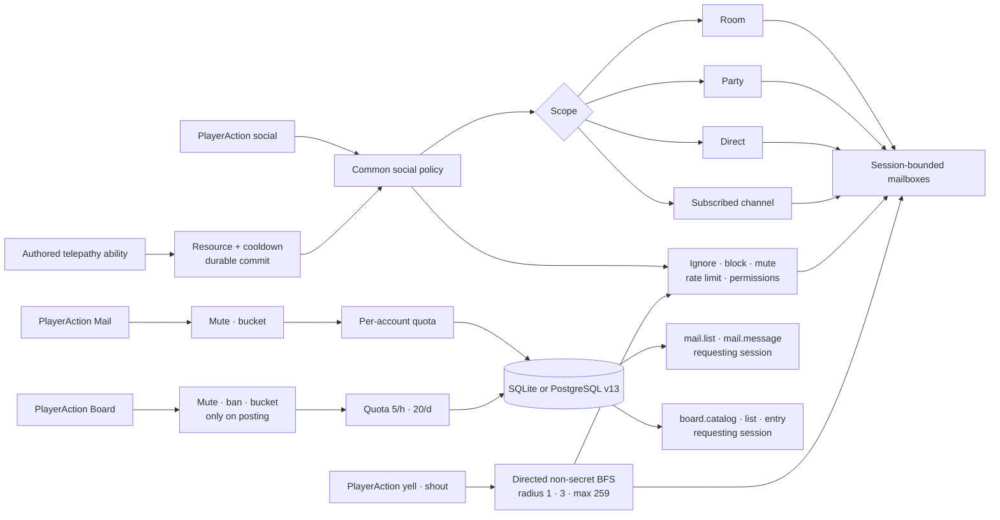
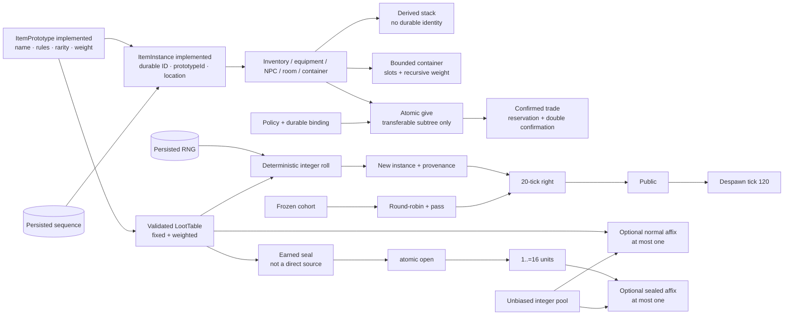

# Social systems, staff, and inventory/loot roadmap

Status: implementation audit and continuation design, 2026-07-17.

This document distinguishes what Tiamud implements today from the systems that
are common in some classic MUDs or convenient for a modern persistent world. It
does not turn every historical precedent into a requirement. The code and the
tests remain the authority over current behavior; the project's private
completion records keep the authority over acceptance of the historical
specification.

## Executive summary

- Persistent parties of up to six members do exist: create, invite, accept,
  revoke, kick, transfer leadership, disband, leave, and query status, plus
  `party say` with the `gsay`/`gtell` aliases.
- Online `reply` and the subscribed channels `general`, `newbie`, and `staff`
  do exist; the last one requires a `moderator`, `administrator`, or
  `implementor` profile. Direct online telepathy also exists as an authored
  ability with resource, cooldown, per-room interference, and private
  suppression. Authored room emotes also exist, with closed per-perspective
  templates and closed local targeting: none, optional, or required. Explicit
  offline mail with a bounded mailbox, quotas, expiry, and reporting also
  exists, and public `general`/`newbie` boards with their own retention, quota,
  capacity, and moderable evidence also exist. There is no durable general
  conversation history. The 5E spatial voice implements `yell`/`shout` and has
  its final gate completed.
- The profiles `helper`, `builder`, `moderator`, `administrator`, and
  `implementor` do exist, along with twelve closed capabilities and an optional
  narrative title. XP, the character sheet, WorldPack, the visible profile, and
  the legacy role never substitute for the concrete capability.
- In-game moderation commands do exist: report, mute, kick, revert sanctions,
  and change roles according to authority.
- A report queue/resolution, inspect/where/goto/transfer/restore, announcements,
  and audit queries do exist, with mandatory reasons and limits.
- Inventory, equipment, consumables, fixed NPC loot, reusable prototypes,
  durable instances, slot/weight capacity, and textual rarity/`itemLevel` do
  exist. Derived fungible stacks, bounded containers, quantities, paginated
  queries, atomic `give`, and the `transferable`, `character_bound`, and
  `non_transferable` policies also exist. Confirmed bilateral trade via durable
  reservations, revision, and double confirmation of items and currency also
  exists.
- Fixed+repeatable full tables, durable provenance, 20-tick rights, round-robin
  cohort distribution, `loot pass`, and despawn at tick 120 do exist.
- Sealed rewards earned by playing, `open`, exact and paginated queries via
  `reward odds`, and a bounded affix for normal or sealed unique loot do exist.
  Need/greed, master-loot, contribution-based distribution, pity, boxes, keys,
  and paid rolls do not exist.

Phases 1, communication/group; 2, capability-based staff; 3A, item foundation;
3B, stacks/containers; 3C, delivery/policies; and 3D, confirmed trade, are
implemented. 4A, repeatable loot with rights and provenance, and 4B, earned
seals and deterministic affixes, are also implemented. Phases 5A, direct
authored telepathy; 5B, authored room emotes; 5C, bounded offline mail; and 5D,
bounded community boards, are also implemented, and 5D keeps its final gate.
Phase 5E, bounded spatial voice, is also implemented and keeps its final gate.

## State verified in the code

### Conversation and social safety

`SocialAction` offers `Say`, `PartySay`, `Tell`, `Reply`, channel
list/subscribe/unsubscribe/send, `Who`, `Help`, ignore/block, reports, mute/ban,
sanction reversal, and role change. `PlayerAction::Telepathy` separates the
ability mutation from ordinary chat. `SocialChannel` contains `Announcement`,
`Say`, `Tell`, `Telepathy`, `Emote`, `Party`, `General`, `Newbie`, and `Staff`.

- `say` is delivered to other connected characters in the same room;
- `tell` is delivered to a connected character, even in another room;
- `reply` keeps in memory the internal ID of the last sender whose `tell` was
  delivered and requires them to still be connected; it is not durable mail;
- `party say` is delivered only to the other connected members of the group;
- `general`, `newbie`, and `staff` require a durable subscription; `staff` is
  only available to `moderator`, `administrator`, or `implementor` profiles,
  whether joining, sending, or receiving; `helper` and `builder` have no access;
- a blocked or ignored `tell` is confirmed just like a delivered one so as not
  to leak the receiver's private state;
- text and recipient are bounded, and chat is rate limited;
- delivery uses the direct router and the session-bounded mailboxes;
- reports, relationships, sanctions, and subscriptions survive a restart.

SQLite and PostgreSQL currently implement schema v13. It keeps
`social_channel_subscriptions` from v9 and adds profiles, capabilities, closed
report resolution, and append-only audit from v10; v11 admits v6 and v7
snapshots of up to 2 MiB without relaxing the legacy v1–v5 limit of 1 MiB; v12
adds the three bounded tables of offline mail; v13 adds board posts, quota, and
evidence and extends `report_kind` to `board`. The offline mover copies them
too. The real historical PostgreSQL evidence still credits v8 and is not
presented as v13 acceptance.

Therefore, `tell` remains the classic online private message and is not
presented as telepathy. The 5A telepathy enters through a distinct ability: it
consumes resource/cooldowns, admits authored interference, and likewise does not
reach a disconnected character.

### Parties

`PartyAction` implements `Create`, `Invite`, `Accept`, `Revoke`, `Kick`,
`Transfer`, `Disband`, `Leave`, and `Status`.

- maximum of six members;
- only the leader invites, revokes, kicks, transfers, and disbands;
- maximum of twelve pending invitations;
- an invitation expires after twenty logical ticks;
- explicit transfer requires another member; if the leader leaves, leadership
  passes deterministically to the first remaining member;
- a disconnected member still belongs to the group and appears as an absent
  companion;
- the durable snapshot keeps parties and invitations.

Accept, revoke, kick, and transfer resolve the name of a connected character.
Offline membership persistence does not imply that those targeted operations can
manage a disconnected target.

There is no following, assist/rescue, general ally selection, or shared
quest/XP credit. The only current group loot policy is round-robin over a frozen
nearby cohort; there is no need/greed, master-loot, or contribution.

### Staff and moderation

Executable authorization is per-account and checks a concrete capability. The
`Player`, `Moderator`, `Admin` roles only keep the legacy tier of moderation and
perception; they are never sufficient to execute a command nor do they by
themselves open the `staff` channel. That channel requires a `moderator`,
`administrator`, or `implementor` profile; `helper` and `builder` have no
access. The first registration of a new database keeps Admin as a legacy
bootstrap and receives the `implementor` profile with the twelve capabilities.
Admins migrated from v9 receive `administrator`. There is emergency offline
recovery for an installation without an admin.

The closed profiles and their initial bundle are:

| Profile | Initial bundle |
| --- | --- |
| `helper` | `reports.view`, `reports.resolve` |
| `builder` | No implicit capability; assigned explicitly as needed. |
| `moderator` | Reports plus `moderation.mute`, `moderation.ban` |
| `administrator` | All twelve capabilities. |
| `implementor` | All twelve capabilities; exceptional operative rank. |

The optional `lore_title` may present “Angel”, “Demigod”, “God”, or another
world title, but it grants no authority. The canonical capabilities are:

```text
reports.view       reports.resolve
moderation.mute    moderation.ban
staff.assign       staff.inspect       staff.where
staff.goto         staff.transfer      staff.restore
staff.announce     staff.audit
```

Changing a profile erases the previous assignments and seeds exactly the
reviewed bundle of the new profile; direct capabilities are applied afterwards,
explicitly. Both assignment and targeted actions reject one's own account and
any target of equal or higher rank.

In-game one can execute `report`, `mute`, `unmute`, `ban`, `unban`, `role`, and
the phase 2 staff surface. All sensitive changes require a reason. The queue only
contains open reports; resolving requires one of `dismissed`, `action_taken`,
`no_action` and keeps resolution, reason, responsible party, and date.

```text
staff
staff status
staff reports <reason>
staff resolve <id> <dismissed|action_taken|no_action> <reason>
staff inspect <name> | <reason>
staff where <name> | <reason>
staff goto <name> | <reason>
staff transfer <name> | <reason>
staff restore <name> | <reason>
staff announce <text> | <reason>
staff profile <name> <helper|builder|moderator|administrator|implementor|none> <title|none> | <reason>
staff capability <grant|revoke> <name> <capability> | <reason>
```

Inspect/where/goto/transfer/restore resolve a connected character and are not
offline administration. Profile/capability and report resolution use durable
identity. Mutations and their audit entry are written atomically; `staff_audit`
is append-only by constraints and triggers in both adapters. Still absent are
`load/spawn`, `purge`, `invis`, `holylight`, `snoop`, `switch`, `force`, and
online editing. `tiamud-admin` remains in the operator layer.

### Inventory and loot

WorldPack v9/AreaPack v8 separate `itemPrototypes` from `initialItemInstances`.
The prototype contains name, description, aliases,
equipment/attack/healing/effect, weight, slot cost, rarity, level, and closed
policies. Each durable instance references a prototype and starts in a room, an
`npc_spawn`, `staged`, or inside another container instance. At runtime it can
additionally be in inventory, equipped, held by an NPC, or consumed. The current
equipment slots are weapon, body, and trinket.

The runtime creates distinct instances of the same prototype with a persisted
monotonic sequence. `ItemInstanceId`, `prototypeId`, and spawn never leave the
server; Web, Telnet, and GMCP receive a distinct opaque ID per unit, derived
from a cryptographically random salt that is new per session. Telnet shows it as
a reference and allows using it as an exact selector. A visible stack uses the
opaque reference of its first ordered visible member; ambiguous textual queries
fail instead of picking an arbitrary unit. The historical phase 4A added exact
durable provenance: `authored_initial`, `legacy_snapshot`, `runtime_created`, or
`npc_loot` with table/digest/entry/roll; that provenance never leaves the
server.

An item's presentation is authorized per visible instance, but the
`entityMedia` record is shared per prototype. The `roomPerception.hiddenItems`
policy points to the concrete instance; it is not a visibility rule for all
units of the prototype.

Each character has capacity by slots and weight. Weight sums inventory and
equipment and all of their descendants; slots count only inventory roots,
grouped by stack. A non-consumable `unique` container counts slots of grouped
direct children and weight of all its descendants. The graph rejects cycles and
a fifth edge. Equip, unequip, replace, take, drop, put, and get pre-validate the
full prospective state before mutating.

`fungible` stacks are derived by location/prototype/binding, order units by ID,
and split by `maxStackUnits`; neither `quantity` nor a stack ID is persisted.
`take`/`drop`/`put`/`get`/`give` move 1..=256 units and `contents` paginates 20
groups. The closed rarity, `itemLevel`, unit/total weight, quantity, slots, and
capacity are shown as text; Web uses `container.contents`, Telnet equivalent
text, and GMCP `Char.Items.List` with location `container`. The views add
policy, bound state, and `canGive`, without exposing the durable owner.

The effective owner is obtained at the graph root. On acquisition from
room/NPC/staging, each `character_bound` descendant is recursively bound to the
character; `non_transferable` restricts the change without persisting an owner. A
subtree can only change character or return to the world if all of its instances
are `transferable`, closing the bypass through containers.
`give [quantity] <item> to <character>` only accepts carried roots, another
connected character in the same room, and bilateral capacity. The receiver's
ignore and bilateral block prevent it with a generic error. The change,
snapshot, and `ItemsGiven` are committed or reverted together.

`trade` keeps items and currency in their authorities and reserves them in the
snapshot. It admits up to 64 negotiations, one per character, 8 lines per side,
and 128 transferable roots between the two. Both participants must remain
connected, together, out of combat, and permitted by ignore/block. Each material
change increments a revision and clears confirmations; two distinct identities
must confirm the same revision and digest. Settlement builds both final
inventories and balances before committing everything in a single commit.
Separation, combat, defeat, disconnect, social change, expiry, or restart cancel
it in a closed manner. Web, Telnet, and `Char.Trade 1` GMCP project offers,
reservations, and spendable balance with session-opaque IDs.

Fixed loot continues as an initial instance located at `npc_spawn`, but 4A adds
a repeatable `lootSource` with a `lootTable` of guaranteed entries and integer
weighted pools. Each source is resolved only once per defeat via rejection
sampling. Fixed and generable together sum at most 64 roots; roll, RNG, counter,
provenance, rights, NPC, XP, events, and snapshot are committed or reverted
together. If capacity is missing, what was generated is suppressed durably
without blocking the defeat or allowing a reroll.

`credited_character` reserves the roots to the initiator. `party_round_robin`
freezes a cohort of up to six connected, alive, and nearby characters,
revalidates the companions on defeat, and advances a durable cursor. The
beneficiary can use `loot pass`; the root is exclusive for 20 ticks, public
afterwards, and is removed at tick 120. Web, Telnet, and GMCP only show `yours`
with remaining ticks, `reserved` without identity, or public; stacks are split
by that access.

4B adds `unique`, consumable, and `character_bound` seals that can only be
obtained from a normal table associated with an NPC. They are not initial
instances, their opening table cannot be a direct source nor generate another
seal, it produces 1..=16 units, and it exposes at most 1,024 probability rows.
`open` and `reward odds` share the same domain in Web, Telnet, and GMCP; odds
reports the exact authored probabilities without revealing RNG, stable IDs, or
digests.

Normal or sealed entries of quantity one can reference an affix pool for a
`unique`, non-sealed prototype. There is at most one affix per instance, with
512 definitions, 256 pools, 64 entries per pool, 4,096 total entries, 64-byte
labels, and positive attack/healing deltas of up to 1,000. The weighted
selection is integer and unbiased; the durable copies keep definition, pool, and
record digests without projecting them. An opening commits or reverts together
consumption, RNG, counter, creation, binding, and capacity. Failure restores
exactly the checkpoint. In normal loot the affix roll is consumed even if the
drop is later suppressed, avoiding capacity-based rerolls.

`WorldRuntimeSnapshot` v7 persists instances, containment, identity and opening
counters, applied affixes, binding, trade, RNG, normal or sealed provenance,
encounters, rights, and cursors. The v1–v5 reads use exact DTOs under 1 MiB,
migrate with legacy provenance, and reject new fields; v6 and v7 admit up to 2
MiB. A strict v6 upgrades to v7 with `itemAffixes: []` on each instance and an
opening counter of one. SQLite and PostgreSQL commit that single authority in
the schema v13 transaction, without a mirror loot/escrow table. On restore, new
authored instances are kept without resurrecting absent runtime. The barrier
validates owners, bindings, cohorts, and beneficiaries in batches; it cancels
open encounters before readiness, but keeps the floor rights already created.

Dense scenes keep a deterministic semantic window of 14 KiB in Web and 48 KiB in
Telnet, with own→public→reserved priority and a reduction notice. Each batch
projects at most 16 events and an excess is coalesced with an authoritative
snapshot; this does not introduce general replay.

## What classic MUDs show

The official CircleMUD references document families of functions such as group
and `gsay`, public communication, following/assist/rescue, mail and boards, and
a broad wizard command surface. Their minimum command levels also separate part
of the immortal authority from mortal advancement:

- [official index of the CircleMUD source code](https://www.circlemud.org/pub/jelson/CircleMUD/3.x/uncompressed/current/src/);
- [official cross-reference of functions](https://www.circlemud.org/cdp/cxref/comm.c.html);
- [official wizard command manual](https://www.circlemud.org/pub/CircleMUD/3.x/uncompressed/circle30bpl21/doc/wizhelp.pdf);
- [official notes on channels and minimum levels](https://www.circlemud.org/cdp/wtfaq/chap3-1.html);
- [official notes on additional immortal levels](https://www.circlemud.org/cdp/wtfaq/level.html).

These sources serve to identify categories, not to copy code, help texts, or
security decisions. Tiamud is a clean implementation and keeps its own limits of
license, accessibility, authority, persistence, and single writer.

## Implemented communication and future extensions

Phases 1, 5A, and 5B keep a single ephemeral social policy; no channel is
implemented independently on WebSocket, Telnet, or the interface. Telepathy
already enters through that policy after durably mutating gameplay. The 5C mail
shares mute/bucket, but afterwards follows a distinct transaction and a distinct
private projection: it does not enter the chat router. The 5D boards share the
posting guards and afterwards use their own public quota/storage; they only
respond to the requesting session.



### Phase 1 delivered

1. Implemented `party say <text>` with the `gtell`/`gsay` aliases, using the
   current durable membership.
2. Implemented `reply <text>` with the in-memory internal ID of the last valid
   sender, not an ambiguous name or an exposed stable ID.
3. Implemented revoke invitation, kick, transfer, and disband.
4. Implemented the subscribed channels `newbie`, `general`, and `staff`, with
   permissions, rate limit, mute, ignore/block, and delivery via bounded
   mailboxes. The subscription persists in both adapters; `staff` requires a
   `moderator`, `administrator`, or `implementor` profile.
5. Implemented `shout`/`yell` 5E as directed and bounded spatial propagation,
   not as another name for the global channel.
6. Implemented authored room emotes with strict templates that never turn player
   text into ANSI, HTML, MXP, or evaluable instructions.

Web uses structured actions and represents the eleven values of `SocialMessage`;
Telnet shares the text commands and projects each delivery as text and as
`Comm.Channel.Text` when GMCP `Comm` is negotiated. This parity does not turn
GMCP into a second authority. `Yell` and `Shout` are part of the current closed
vocabulary.

Guild/clan chat can follow later. The boards already have their own retention,
limits, moderation, deletion, and public rules; they do not include search,
threads, editing, or subscriptions.

### Phase 5A — direct authored telepathy — implemented

WorldPack v8/AreaPack v7 implement a closed `telepathy/direct_online`
communication. A valid ability:

- is `spell|utility`, `single_ally`, and does not belong to an NPC;
- has at least one resource cost and a positive cooldown;
- does not combine damage, healing, or statuses;
- directs a thought of up to 512 bytes to another connected character;
- can block up to 64 existing rooms;
- rejects a sender who is defeated, recovering, stunned, or out of resources; and
- confirms resource/cooldowns before Web/Telnet/GMCP delivery.

Ignore/block and the receiver's receptivity are used only to decide delivery:
their result never changes the sender's confirmation. There is no `DomainEvent`
with text/destination, `reply` is not linked, and there is no offline or group
delivery. The accepted contract is in
[ADR 0015](../decisions/0015-authored-online-telepathy.md).

### Phase 5B — authored room emotes — implemented

WorldPack v9/AreaPack v8 admit up to 32 emotes with a `room` audience. Each
definition fixes command, name, targeting
`none|optional_character|required_character`, and closed templates for actor,
target, and observers. Only `{actor}` and `{target}` exist; substitution is done
in a single pass and does not reinterpret markers inside the inserted names.

`emotes` lists without consuming the bucket. `emote <command> [character]`
shares mute and rate limit with chat and resolves only another connected and
unambiguous character in the same room. Ignore/block is applied per receiver: it
does not change the actor's confirmation or the third-party authorized copy.
`OnTalk` runs in a bounded manner and Web/Telnet/GMCP delivery starts only after
the commit; a rollback publishes zero copies.

There is no free text, authored IDs on the wire, `DomainEvent`, `reply`,
history, snapshot, or SQL. The contract is in
[ADR 0016](../decisions/0016-authored-room-emotes.md).

### Phase 5C — bounded offline mail — implemented

`mail list/read/delete/send/report` separates durable correspondence from
`tell`, `reply`, telepathy, and chat. The mailbox admits 64 messages, 128 KiB,
and seven pages of ten; each letter lives 30 days. After mute and the common
bucket, attempts with valid fields consume per account a quota of 20 per hour and
50 per day before resolving the name. Ignore/block, ban, and capacity suppress
delivery with the same acceptance as a save, so the sender does not probe private
state.

SQLite/PostgreSQL v12 persist message, quota, and reported evidence. Only the
recipient can read, delete, or report once; up to eight open mail reports per
account capture evidence for 90 days. Staff sees the subject and a bounded
excerpt in the queue, does not browse mailboxes or record bodies in the audit.
Web `mail.list`/`mail.message`, Telnet text, and `Tiamud.Mail 1` share the
domain. There is no outbox, search, attachments, group mail, or online
notification. The contract is in
[ADR 0017](../decisions/0017-bounded-offline-mail.md).

### Phase 5D — bounded community boards — implemented

`board` offers the closed global catalog `general`/`newbie`; `board list`,
`read`, `post`, `delete`, and `report` share `PlayerAction::Board`. Web uses
`board.catalog/list/read/post/delete/report`, Telnet the same text, and GMCP
`Tiamud.Board 1`. The `board.catalog/list/entry` responses are pull-only:
`Comm.Channel.Text` is not reused, there is no fan-out or read/unread state.

Each page contains ten summaries, a post lives 90 days, and the account keeps at
most 64 posts. Posting consumes a quota of 5/h and 20/day after mute, ban, and
the common bucket; the ceilings are 1,000 posts/4 MiB per board and 2,000/8 MiB
globally. Ignore/block do not filter public content. The same author-character
can delete; another account can create the single global report of the post. The
evidence lives 90 days, has caps of eight open reports per reporting account and
10,000 global bodies, and integrates with `reports.view`/`reports.resolve`;
`action_taken` removes the live post.

SQLite/PostgreSQL v13 and the mover include posts, quota, and evidence; the
bounded purge is fail-closed at startup and periodic non-fatal. WorldPack v9,
AreaPack v8, WorldProject v2, and snapshot v7 do not change. There is no editing,
threads, search, markup, attachments, push, or party/guild/staff/room/area
boards. The contract is in
[ADR 0018](../decisions/0018-bounded-moderable-community-boards.md).

### Phase 5E — bounded spatial voice — implemented

`yell <message>` covers the origin room and one hop; `shout <message>` reaches up
to three. The BFS follows only directed non-secret exits, deduplicates cycles
and convergent routes, and stops on visiting 259 rooms. It does not publish
bearing, distance, route, or origin room. Web reserves
`social.yell`/`social.shout` with only a `message` of 1..=512 bytes; Telnet keeps
text and GMCP reuses `Comm.Channel.Text`.

Mute and the common bucket prevent emission. Ignore, bilateral block, and
`condition.deaf` suppress `say`/`yell`/`shout` per receiver; a deaf character can
speak and the actor's confirmation does not reveal who heard. `OnTalk` runs once
at the origin and delivery starts after commit; a rollback delivers zero copies.
There is no retention, `reply`, subscription, SQL, or changes to WorldPack,
AreaPack, or snapshot. [ADR 0019](../decisions/0019-bounded-spatial-voice.md)
defines the contract; code, coverage, and integrated gate are finished.

## Staff: visible rank, real capability

Character levels and administrative authority must remain two independent axes.


The canonical profiles are non-localized operative identifiers. “Angel”,
“Demigod”, or “God” fit as a `lore_title`, never as authorization. The check uses
the effective set of capabilities and the negative hierarchy of profiles; it
rejects equal or higher targets even when the functional capability exists. Each
implemented world command requires a reason, limits the scope, operates on a
connected character, and leaves a durable audit.

`force`, `snoop`, and `switch` carry abuse and privacy risks; they are not
baseline requirements. `load/spawn` and `purge` can break the economy or
persistence if they do not work with instances and transactions. Shutdown,
backup, and migration must remain in the operative layer unless there is a
measured need.

Online building also must not arbitrarily mutate live definitions. A future OLC
should produce an AreaPack draft, run the validator, publish an immutable
WorldPack, and use controlled activation/rollback.

## Inventory, tiers, and instances

“Inventory tier” can mean item rarity or carrying capacity. They are distinct
systems and must be modeled separately.



### Foundation and sequence

1. Implemented: `ItemPrototype`, stable and reusable authored content.
2. Implemented: `ItemInstance`, unique durable ID, `prototypeId`, and location;
   the snapshot and rollback include the creating sequence.
3. Implemented: inventory bounded by slots/weight, containers with maximum
   capacity and depth, and derived stacks that group fungible units by
   location/prototype without persisting quantity.
4. Implemented: atomic `give` for simple cases and the declared policies
   `transferable`, `character_bound`, and `non_transferable`, applied to the
   effective owner and the full subtree.
5. Implemented: exchange confirmed by both parties for item and currency offers,
   with bounded durable reservation and invalidation upon any material change.
6. Implemented: fixed+repeatable integer tables, provenance, 20-tick exclusive
   window, cohort round-robin, and `loot pass`; publication and despawn occur at
   20/120 ticks.
7. Implemented: seals earned by playing, exact probabilities, atomic opening, and
   a bounded affix for normal or sealed unique loot.

### Rarity and item level

The closed rarity `common|uncommon|rare|epic|legendary` is already part of the
prototype and is shown as text in the browser and Telnet/GMCP; it never depends
on color alone.

`itemLevel`, quality, and affixes are different axes. The current contract does
not derive affix power from rarity: it validates bounded positive deltas, a
compatible item type, and effective statistics within the runtime caps. A high
rarity cannot skip requirements, capacity, or economic validation.

### Tables and sealed rewards

The historical phase 4A implemented tables with bounded integer weights, a
checked sum, limited quantities and rolls, `nothing`, persisted RNG with
rejection sampling, durable provenance, and atomic commit. It does not include
nested tables, conditions, affixes, unique rules, pity, or reward scripts. The
worst-case fixed plus generated is validated at 64 roots per defeat.

4B is implemented with WorldPack v7/AreaPack v6 and snapshot v7. A seal must be
earned from a normal NPC table; `reward odds` shows the exact probabilities and
`open` commits or reverts atomically seal, RNG, counter, instances, bindings, and
capacity. The optional affix works in both normal and sealed loot and is copied
with opaque provenance/digests. Loot boxes, keys, paid rolls, and pity are
outside the baseline; need/greed, master-loot, and contribution-based
distribution require another design.

## Other candidate MUD systems

| System | Current state | When to consider it |
| --- | --- | --- |
| Emotes/socials | Authored room emotes implemented with closed templates, local targeting, and Web/Telnet/GMCP parity. | Global/group emotes only with explicit audience, perception, quotas, and privacy. |
| Spatial voice | ADR 0019 and phase 5E implemented for `yell` radius one and `shout` radius three, directed non-secret BFS and max 259; core, Web, Telnet/GMCP, and bot parity with an integrated gate. | Archive, bearing/distance, and authored acoustics are out of scope. |
| Mail and boards | 5C offline mail and 5D public boards implemented with separate surfaces, retention, quotas, capacity, and moderable evidence. | Threads, editing, search, or authored/private boards only with explicit ownership and lifecycle; never turn chat or mailbox into a public archive. |
| Guilds/clans | Absent. | After stabilizing parties, channels, and community authority. |
| Doors and keys | Absent as a general system; inventory containers do exist. | When open/closed state, access, and keys have explicit authoring/persistence. |
| Give | Implemented for carried roots, same room, bilateral capacity, and a fully transferable subtree. | Extend it only if remote/offline delivery with explicit policy is designed. |
| Trade/auction | Direct confirmed trade implemented; auction absent. | Auctions only after defining offline market, retention, quotas, and economic abuse. |
| Crafting | Absent. | When there are repeatable prototypes and economic sinks. |
| Housing | Absent. | When content needs private persistent instances. |
| Pets/mounts | Absent. | After followers and party/NPC rules. |
| Duel/PvP | Absent. | Only with consent, safety, death/reward, and moderation designed. |
| Factions/reputation/languages | Absent. | As data-driven content when a narrative need exists. |
| Remort/rebirth | Absent. | Not a priority while v3 still needs balance and migrations. |
| In-game OLC | Absent. | As staging/validation/publication, never free mutation of the runtime. |

## Phased plan and acceptance

### Phase 1 — communication and group — implemented

- group chat, `reply`, revocation/kick/transfer/disband;
- subscribed and moderated `newbie`/`general`/`staff` channels;
- browser, Telnet text, and GMCP parity;
- coverage of ignore/block/mute, limits, disconnect, `staff` profile, and zero
  leakage between groups.

### Phase 2 — capability-based staff — implemented

- profiles and capabilities separate from progression;
- report queue and closed resolution and mandatory reasons;
- bounded inspect/where/goto/transfer/restore/announce/audit;
- negative authorization, hierarchy, v10 persistence, and append-only audit in
  SQLite/PostgreSQL;
- Web structured actions and equivalent Telnet+GMCP text/announcement;
- no authority obtainable through XP, class, talent, or WorldPack.

### Phase 3A — prototype/instance foundation — implemented

- WorldPack v4/AreaPack v3, v3/v2 and v2/v1 normalization respectively;
- reusable prototypes, durable instances, and a monotonic counter;
- snapshot v2, explicit conversion from v1, and exact rollback;
- slots/weight, textual rarity/`itemLevel`, and opaque IDs on both transports;
- at that cut, a single snapshot in SQLite/PostgreSQL v10, without a mirror table.

### Phase 3B — stacks and containers — implemented

- WorldPack v5/AreaPack v4 and snapshot v3 with explicit v1/v2/v3 conversion;
- derived fungible stacks, without quantity or durable stack identity;
- unique containers with slots, recursive weight, depth four, and cycles
  rejected before mutating;
- maximum quantities 256, `contents` paginated to 20 groups, and opaque
  selectors;
- data/action parity in Web, Telnet, and `Char.Items.List` GMCP.

### Phase 3C — delivery and policies — implemented

- atomic `give`, effective owner, and executable transfer policies;
- durable binding in snapshot v4, closed migration from v1-v3, and
  Web/Telnet/GMCP parity;
- ignore/block, bilateral capacity, replay/rollback, and opaque projection.

### Phase 3D — confirmed exchange — implemented

- durable reservation without separate escrow, double confirmation, and
  invalidation upon changes;
- global/per-participant limits, expiry, social policy, and cancellation upon
  separation, combat, defeat, disconnect, or restart;
- simultaneous settlement of items/currency, snapshot v5, and Web/Telnet/GMCP
  parity.

The accepted and implemented contract is in
[ADR 0012](../decisions/0012-confirmed-trade-reservations.md).

### Phase 4A — repeatable loot, rights, and provenance — implemented

- WorldPack v6/AreaPack v5/WorldProject v2 with a canonical table and source;
- snapshot v6 and SQL schema v11; legacy v1–v5 limited to 1 MiB and v6 to 2 MiB;
- integer weights, rejection sampling, and exactly-once resolution of fixed plus
  repeatable loot, with a combined maximum of 64 roots;
- durable provenance, frozen cohort, round-robin, `loot pass`, 20-tick
  exclusivity, and despawn 120;
- capacity-based suppression without blocking defeat/XP or allowing a reroll;
- startup that validates identities and cancels open encounters without deleting
  resolved rights;
- privacy and equivalent actions in Web/Telnet/GMCP, with semantic windows of
  14/48 KiB and batches/coalescing of 16 events.

The accepted and implemented contract is in
[ADR 0013](../decisions/0013-repeatable-loot-rights-and-provenance.md).

### Phase 4B — sealed and affixes — implemented

- WorldPack v7/AreaPack v6/WorldProject v2, with strict normalization of earlier
  formats without inventing seals or affixes;
- seals earned only from normal NPC loot, without initial instances, a direct
  sealed source, or seal→seal chains;
- `open` and `reward odds` with exact probabilities, a maximum of 16 units, and
  1,024 visible rows per sealed table;
- at most one affix on non-sealed `unique` units, in both normal and sealed loot,
  with closed vocabulary, weights, quantities, deltas, and caps;
- deterministic unbiased RNG, exact rollback on capacity failure, and consumption
  of the normal roll even when the drop ends up suppressed;
- snapshot v7 with affixes, sealed provenance, and opening counter; exact upgrade
  from v6, limits of 1 MiB for v1–v5 and 2 MiB for v6–v7; and
- Web/Telnet/GMCP domain parity with opaque internal references, RNG, counters,
  and digests.

The accepted and implemented contract is in
[ADR 0014](../decisions/0014-earned-sealed-rewards-and-deterministic-affixes.md).

Need/greed, master-loot, and contribution-based distribution are not part of 4B
without additional design. Boxes, keys, and paid rolls remain out.

### Phase 5 — community and content — in progress

- 5A direct authored telepathy: implemented;
- 5B authored emotes with templates and safe audiences: implemented;
- 5C offline mail with quotas/retention/moderation: implemented;
- 5D moderable boards: implemented and with a retained integrated gate;
- 5E spatial voice `yell`/`shout`: implemented and with a retained integrated
  gate;
- guilds according to observed needs;
- crafting/auction/housing only with sinks, quotas, and moderation;
- OLC only over the reviewed-artifact pipeline.

Each phase must preserve the single writer, a single selected persistence, exact
rollback, frame/queue limits, perception before protocol, opaque IDs, and
functional equivalence between browser and Telnet.
