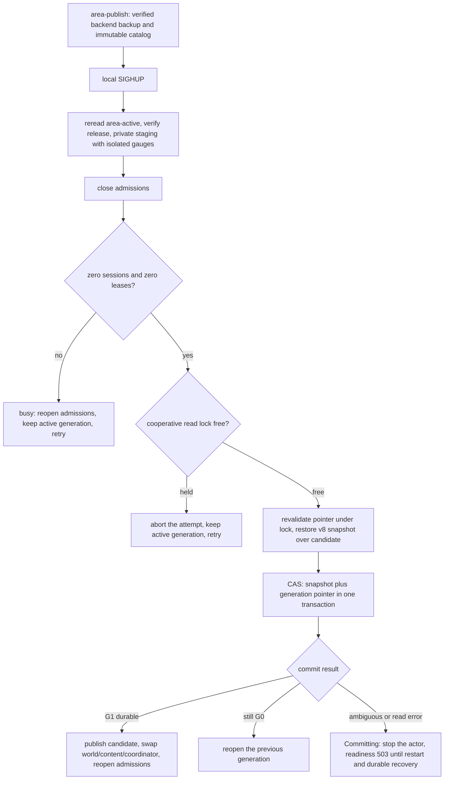

# Single-host operation

This runbook covers a public Tiamud installation on one Linux host. HTTPS/WSS
terminates at Caddy; the Rust server, PostgreSQL, WorldPacks, assets and backups
remain on that host. The public Telnet listener terminates TLS directly in the
server. Telnet credentials must not be exposed over the public Internet until
that listener has a valid certificate; bind explicit plaintext mode only to a
trusted network or firewall it off.

This is a reviewed reference procedure, not evidence that a public production
host has been installed. PostgreSQL is the recommended profile for a new public
host. SQLite remains the executable's zero-configuration fallback for local or
legacy installations and has a separate procedure below. Tiamud selects
exactly one; neither profile requires Kubernetes.

## Layout

```text
/usr/local/bin/tiamud-server
/usr/local/bin/tiamud-admin
/etc/tiamud/tiamud.env
/var/lib/tiamud/
  worlds/lantern-square.world.json
  area-registry/
  backups/

PostgreSQL data and configuration use the distribution's protected paths.
```

Create a dedicated `tiamud` system user, copy the reviewed
[`deploy/tiamud.service`](../../deploy/tiamud.service) to
`/etc/systemd/system/`, copy
[`deploy/tiamud.env.example`](../../deploy/tiamud.env.example) to
`/etc/tiamud/tiamud.env`, provision the local role/database named by its active
PostgreSQL URL, replace credentials, and adjust addresses and paths. To choose
the SQLite fallback instead, comment that URL and enable exactly the documented
`TIAMUD_DB_PATH` line. Install the example
[`deploy/Caddyfile`](../../deploy/Caddyfile) after replacing the hostname.
Install a separately renewed PEM certificate chain and private key at the paths
configured by `TIAMUD_TELNET_TLS_CERT` and `TIAMUD_TELNET_TLS_KEY`; restrict the
key to the `tiamud` service account and restart after atomic certificate
renewal. Startup fails closed when TLS mode has an invalid identity.

The reference unit writes only below `/var/lib/tiamud`, limits address families
to local/IPv4/IPv6 sockets, removes ambient capabilities and isolates devices,
namespaces, kernel controls and other users' process details. Validate it on
the target distribution with `systemd-analyze security tiamud.service`; an
older systemd may require explicitly removing an unsupported directive.

`TIAMUD_TELNET_MODE` defaults to `tls`; there is no implicit downgrade. The
only unencrypted setting is the exact value `plaintext`, which logs a prominent
warning. It exists for development or an explicitly trusted private network:

```sh
TIAMUD_TELNET_MODE=plaintext tiamud-server
```

Do not use that exception for public registration/login or route it through
Caddy: Caddy terminates HTTP(S), not the direct Telnet protocol.

```sh
sudo systemctl daemon-reload
sudo systemctl enable --now tiamud
curl --fail http://127.0.0.1:8080/health/live
curl --fail http://127.0.0.1:8080/health/ready
```

`/health/live` proves that the HTTP process is responding. `/health/ready`
performs bounded probes of both the world actor and selected storage worker and returns
`503` if either cannot answer. Operators must still run `tiamud-admin check`
and the smoke workflow after an update; readiness is not a replacement for
integrity or gameplay verification.

The service writes structured logs to stdout/stderr. `systemd-journald` owns
rotation and retention; configure its host-wide limits to match available disk.

The recommended environment uses `TIAMUD_DATABASE_URL=postgresql://...`.
`TIAMUD_DB_PATH` selects the mutually exclusive SQLite fallback; an explicit
`sqlite://...` URL is also accepted. With neither variable the executable uses
`data/tiamud.db`, which is useful locally but is not the new-public-host
recommendation. Startup selects exactly one store and readiness reports its
backend; Tiamud never dual-writes.

## Story sessions

Story sessions ([ADR 0029](../decisions/0029-story-session-instances-and-story-protocol.md),
proposed, phase S2) are disabled unless `TIAMUD_STORY_DIR` names a directory
of `*.story.json` StoryPacks. At startup, before any database or listener
opens, every pack is parsed and validated with `tiamud-story-core`; an invalid
pack, a duplicate story id, an empty directory, more than 64 packs or more
than 1,024 directory entries stops the server.

- `TIAMUD_STORY_MAX_INSTANCES` (`1..=4096`, default `256`) bounds live
  instances; each account may hold one.
- `TIAMUD_STORY_IDLE_SECONDS` (`60..=86400`, default `1800`) evicts an idle
  instance. Eviction, leaving and restarts lose progress: there are no
  persisted save slots before S3.
- An optional `story-media.json` in the same directory,
  `{"formatVersion":1,"assets":{"<asset-id>":"assets/<sha256>/audio-<name>.ogg"}}`,
  maps authored cue asset ids to reviewed content-addressed audio already
  served by the web build. Unmapped cues never play.

Story metrics carry no story, node or account labels:
`tiamud_story_catalog_stories`, `tiamud_story_instances`,
`tiamud_story_instances_started_total`,
`tiamud_story_instances_closed_total{reason}`,
`tiamud_story_enter_rejected_total{reason}` and
`tiamud_story_inputs_total{result}`. While a player is in a story the
character stays connected and visible in its room.

## Rate limits and metrics

The environment example configures bounded browser authentication and command
token buckets:

- `TIAMUD_AUTH_ATTEMPTS_PER_MINUTE` and `TIAMUD_AUTH_BURST` apply per source IP
  to browser and Telnet registration and login.
- `TIAMUD_COMMANDS_PER_SECOND` and `TIAMUD_COMMAND_BURST` apply per browser
  WebSocket or entered Telnet connection.
- `TIAMUD_MAX_SESSIONS_PER_ACCOUNT` and `TIAMUD_MAX_SESSIONS_PER_IP` cap
  concurrent entered sessions across browser and Telnet (defaults `4` and
  `16`). Permits are released on disconnect, including cancelled connections.

These application controls complement, but do not replace, host-level firewall
and reverse-proxy connection and request limits.

The WebSocket `command.submit` stays limited to 1,024 bytes; a Telnet line
admits up to 8 KiB so that `board post` can carry the maximum subject and body
and discards any longer line entirely. WebSocket JSON ingestion rejects
duplicate keys at any depth. Do not raise the proxy or listener limits to
bypass those application controls.

Prometheus-format metrics are available only from the server's loopback
listener in the reference deployment:

```sh
curl --fail http://127.0.0.1:8080/metrics
```

The reviewed Caddy configuration deliberately returns `404` for public
`/metrics` requests. The endpoint covers connections by WebSocket and Telnet
transport, authenticated sessions, action totals/errors/latency, world-queue
depth, authentication throttling, coalesced output and slow-client disconnects,
dropped output and per-transport output-queue depth, selected-database
transactions/errors/latency and queue depth, ticks/errors/latency, scripts/errors/timeouts/
latency, and resident process memory. Alert at minimum on readiness loss,
database or tick errors, script timeouts, slow-client disconnect or dropped-
output growth, a persistently full world/database/transport queue, and sustained
resident-memory growth.

## Graceful shutdown

`SIGTERM` and `SIGINT` stop new HTTP and Telnet acceptance, notify active
listeners, and place a shutdown barrier behind already accepted world actions.
The reference service allows five seconds for Telnet sessions, ten seconds for
the actor, and five seconds for persistence to drain and close before logging a
timeout. Keep systemd's stop timeout above those internal bounds. A timeout or
forced kill requires an integrity check before returning the instance to
service. For SQLite, use the repository CLI:

```sh
sudo systemctl stop tiamud
tiamud-admin check \
  --database /var/lib/tiamud/data/tiamud.db \
  --world-pack /var/lib/tiamud/worlds/lantern-square.world.json
```

For PostgreSQL, use the installation's native consistency/recovery procedure,
then check Tiamud readiness and smoke behavior. `tiamud-admin check` and its
backup subcommands are SQLite tools and are not PostgreSQL recovery evidence.

## SQLite fallback: backup and verification

This section applies to the SQLite local/legacy profile. Create backups on a
filesystem covered by the host's normal off-machine backup policy. Every
command refuses to overwrite an existing destination.

```sh
tiamud-admin backup create \
  --database /var/lib/tiamud/data/tiamud.db \
  --output /var/lib/tiamud/backups/tiamud-2026-07-15.sqlite3

tiamud-admin backup verify \
  --backup /var/lib/tiamud/backups/tiamud-2026-07-15.sqlite3
```

Exercise restore periodically into a new path, validate it, and remove the test
copy only after the check succeeds:

```sh
tiamud-admin backup restore \
  --backup /var/lib/tiamud/backups/tiamud-2026-07-15.sqlite3 \
  --database /var/lib/tiamud/restore-test/tiamud.db
```

Define retention by recovery requirements rather than available local space.
For a small public host, keep several daily and weekly verified snapshots,
copy them off-host, monitor free space before each backup, and periodically
restore a selected off-host copy into a new path. A backup that has not passed
`backup verify` and a restore exercise is not established recovery evidence.

Restore character rows and the shared world snapshot from the same committed
database point. Ability cooldowns are absolute world-tick deadlines, so copying
characters into a different world clock or combining independently restored
fragments is unsupported; use the verified whole-backend recovery path.

## Event retention and SQLite file size

In current schema v16, both SQLite and PostgreSQL retain the
`last_event_sequence` snapshot watermark behavior. The same transaction retains the
covered 10,000-sequence suffix and removes only rows older than that watermark;
sequence gaps can make the exact row count smaller. A database without a
snapshot is never compacted. This keeps normal runtime storage bounded without
weakening snapshot/event atomicity.

Offline mail and community boards use separate physical-retention loops.
Startup must complete one purge batch for each surface before readiness;
failure blocks startup. A live actor then retries once per hour. Mail deletes
at most 256 expired messages/evidence rows per run; the board purge similarly
combines at most 256 expired posts/evidence rows. A periodic failure is warned
without stopping play because every list/read, capacity and evidence query
filters expiry independently; delayed maintenance never makes expired content
visible or count against a live limit. Repeated errors or a growing expired-row
backlog are operational alerts, not a reason to raise a batch without
measurement.

SQLite normally places deleted rows on its internal free-page list and reuses
those pages for later writes. The database file therefore may not become
physically smaller after event compaction. Do not run `VACUUM` against the live
server. If reclaiming filesystem space is operationally necessary, treat it as
offline maintenance: stop Tiamud, create and verify a backup, perform the
operator-reviewed rebuild on a separate copy or during the maintenance window,
verify integrity and a restore, then restart the service.

## SQLite schema migration

Stop the server so no process holds the authoritative database, then run the
shared migrator. A verified safety snapshot is mandatory and is created before
the first schema write.

```sh
sudo systemctl stop tiamud
tiamud-admin migrate \
  --database /var/lib/tiamud/data/tiamud.db \
  --backup /var/lib/tiamud/backups/pre-migrate-2026-07-15.sqlite3
sudo systemctl start tiamud
```

Schema v11 changes the physical bound of the opaque `world_runtime` singleton,
not its authority or representation. SQLite rebuilds that table transactionally
during v10→v11 and preserves its singleton key, snapshot version, JSON,
`last_event_sequence` and update timestamp. PostgreSQL replaces the named size
constraint and advances `tiamud_schema` in the same migration chain. Neither
backend creates a mirror loot table, converts the snapshot to `jsonb` or writes
to both stores.

Schema v12 adds bounded offline mail without changing the runtime snapshot:
the closed `social_reports.report_kind` marker, `social_mail_messages`,
per-account `social_mail_usage` and the independently retained
`social_mail_report_evidence`. The marker keeps an open mail report in the
per-account cap after its 90-day evidence body is purged; it does not extend
body retention. The v11→v12 step is additive in both backends. Keep the
pre-migration backup until inbox, quota, report resolution, restart and the
selected backend's integrity checks pass.

Schema v13 adds the two closed public boards without changing the runtime
snapshot: `social_board_posts`, per-account `social_board_usage`, retained
`social_board_report_evidence` and `report_kind='board'`. SQLite rebuilds
`social_reports` plus both mail child tables transactionally to widen the
closed `CHECK`; it copies parents before children, checks foreign keys before
commit and preserves all v12 IDs, links and bytes. PostgreSQL replaces its
named constraint. Keep the v12 safety backup until catalog/list/read/post/
delete/report, staff resolution, expiry, restart and integrity checks pass.

Schema v14 adds the `world_area_generation` singleton. It stores the world ID,
the active and previous catalog digests, the activation sequence and the
timestamp; it stores no host paths and does not duplicate runtime state. The
v13→v14 migration is additive. In that baseline, a 6C cutover updated this row
and `WorldRuntimeSnapshot` v7 in the same transaction via compare-and-swap; v15
keeps the boundary with snapshot v8.
Keep the backup until startup, activation, explicit rollback and the selected
backend's integrity checks pass.

Schema v15 adds `world_area_checkpoints` without changing the generational
binding. Each row retains generation, unit, revisions, epoch, version, tick,
bounded JSON and SHA-256. The v14→v15 migration creates the empty table. Keep
the backup until you validate that a resident v8 snapshot starts, that a retired
manifest fails closed without its exact checkpoint and that the mover copies or
rejects each row atomically. Do not enable LRU or automatic retirements just by
migrating.

Schema v16 adds only `story_saves`, the persisted story save slots of
[ADR 0030](../decisions/0030-story-save-slots-and-schema-v16.md) (proposed).
Each row is keyed by account, story and slot `0..=9` and retains the pack id
and SHA-256, the state format version, an opaque state document of at most
64 KiB and the SHA-256 of its exact bytes; deleting an account cascades to its
slots. Per account at most 16 stories and 1 MiB of state are accepted. The
v15→v16 migration creates the empty table in both backends and changes no other
table or snapshot. The server does not yet expose story sessions, so the table
stays empty until that work lands. SQLite `tiamud-admin backup`,
`verify-backup` and `restore` copy the table with the rest of the database;
PostgreSQL `pg_dump` or physical backups must include it. A v15 binary refuses a
v16 database as a future schema: rolling the binary back requires restoring
the backup taken before the migration, which also discards any slot written
after it.

For an existing 6B installation, the v14 row is born empty and there is no way
to automatically reconstruct which v13 catalog was running. Recovery without a
snapshot/ledger may still contain characters; that is why the server consults
both authorities. If shared recovery or any durable character exists, the first
v14 startup must use **exactly the same G0** as the last v13 startup. Mandatory
procedure:

1. stop the service and create/verify backups of the backend and the full
   registry;
2. record the exact path and SHA-256 of the G0 `TIAMUD_AREA_CATALOG`;
3. install/migrate v14 without publishing or selecting another catalog;
4. temporarily set
   `TIAMUD_ACK_LEGACY_AREA_GENERATION=<exact-sha256-G0>`, still boot with G0 and
   verify readiness, logs and the `world_area_generation` row;
5. remove that variable from the service configuration after binding; and
6. only then publish or select G1 and use the 6C SIGHUP.

Do not combine a binary/schema upgrade and a catalog change. The first v14
binding accepts G0 as the initial authority and does not traverse
compatibility/CAS against an absent prior identity; using G1 at that moment
would skip the 6C gate and lose durable rollback to G0.

An empty base, or one with accounts but no characters or world recovery, can
bind its first generation without ACK. Do not use this exception to convert an
existing monolithic authority to a catalog: 6C does not define that migration.
The variable fails closed in monolithic mode, with an existing binding, without
recovery/character to acknowledge, or if it does not match the canonical
SHA-256.

The decoder applies a dual admission rule: raw legacy snapshots v1-v5 remain
limited to 1 MiB, while v6-v8 snapshots and new commits may use up
to 2 MiB. This prevents an oversized old document from using migration as a
way around its original bound. A strict v6 document expands to the exact v7
form with empty applied-affix state and sealed-open counter one; v7 additionally
retains applied affixes plus sealed reward provenance and open counters. The
whole snapshot remains one authority: a successful `open` commits seal
consumption, RNG advancement, counters, created items, bindings and capacity
together, while any failure restores the checkpoint exactly. Always keep the
pre-migration backup until integrity, readiness, restart and gameplay checks
pass.

## Emergency Implementor recovery

Schema migration never recreates canonical staff authority during an ordinary
restart. If an installation has no `administrator` or `implementor` profile,
stop the server and use the explicit, audited break-glass command with an
existing registered account:

```sh
sudo systemctl stop tiamud
tiamud-admin backup create \
  --database /var/lib/tiamud/data/tiamud.db \
  --output /var/lib/tiamud/backups/pre-admin-recovery.sqlite3
tiamud-admin recover-admin \
  --database /var/lib/tiamud/data/tiamud.db \
  --account Keeper
sudo systemctl start tiamud
```

The command requires schema v16 and refuses to run while any operational
`administrator` or `implementor` profile exists. A legacy `admin` role alone
does not count as executable authority. Recovery replaces the target's profile
with `implementor`, clears its lore title and previous direct assignments,
installs exactly the twelve closed capabilities, and retains the legacy
`admin` role only for compatibility. Profile, bundle, role, canonical
append-only `staff_audit` entry and compatibility `moderation_audit` entry
commit in one transaction; any failure rolls all of them back.

`tiamud-admin` remains SQLite-only. For PostgreSQL, stop the server, take and
verify the installation's normal `pg_dump` or physical backup, then run
`psql "$TIAMUD_DATABASE_URL" --set=target_account=Keeper` and apply this
equivalent schema-v16 transaction:

```sql
BEGIN;
LOCK TABLE accounts, staff_profiles, staff_capability_assignments,
           moderation_audit, staff_audit IN EXCLUSIVE MODE;
SELECT set_config('tiamud.recovery_account', :'target_account', true);
DO $$
DECLARE
    target_id BIGINT;
    recovered_at BIGINT := floor(extract(epoch FROM now()))::BIGINT;
BEGIN
    IF (SELECT version FROM tiamud_schema WHERE singleton = 1) IS DISTINCT FROM 16 THEN
        RAISE EXCEPTION 'Implementor recovery requires Tiamud schema 16';
    END IF;
    IF EXISTS (
        SELECT 1 FROM staff_profiles
        WHERE profile_key IN ('administrator', 'implementor')
    ) THEN
        RAISE EXCEPTION 'an administrator or implementor profile already exists';
    END IF;
    SELECT id INTO target_id
    FROM accounts
    WHERE lower(name) = lower(current_setting('tiamud.recovery_account'))
      AND auth_state = 'registered';
    IF target_id IS NULL THEN
        RAISE EXCEPTION 'the target must be an existing registered account';
    END IF;

    UPDATE accounts SET role = 'admin' WHERE id = target_id;

    INSERT INTO staff_profiles
        (account_id, profile_key, lore_title, assigned_by_account_id,
         created_at, updated_at)
    VALUES
        (target_id, 'implementor', NULL, target_id, recovered_at, recovered_at)
    ON CONFLICT (account_id) DO UPDATE SET
        profile_key = EXCLUDED.profile_key,
        lore_title = NULL,
        assigned_by_account_id = EXCLUDED.assigned_by_account_id,
        updated_at = EXCLUDED.updated_at;

    DELETE FROM staff_capability_assignments WHERE account_id = target_id;
    INSERT INTO staff_capability_assignments
        (account_id, capability, assigned_by_account_id, created_at)
    SELECT target_id, recovered.capability, target_id, recovered_at
    FROM (VALUES
        ('reports.view'),
        ('reports.resolve'),
        ('moderation.mute'),
        ('moderation.ban'),
        ('staff.assign'),
        ('staff.inspect'),
        ('staff.where'),
        ('staff.goto'),
        ('staff.transfer'),
        ('staff.restore'),
        ('staff.announce'),
        ('staff.audit')
    ) AS recovered(capability);

    INSERT INTO moderation_audit
        (actor_account_id, target_account_id, action, details_json, created_at)
    VALUES
        (target_id, target_id, 'recover_admin',
         '{"profile":"implementor","source":"postgres_break_glass"}',
         recovered_at);
    INSERT INTO staff_audit
        (actor_account_id, target_account_id, capability, action,
         reason, details_json, created_at)
    VALUES
        (target_id, target_id, 'staff.assign', 'recover_admin',
         'Offline break-glass recovery',
         '{"profile":"implementor","source":"postgres_break_glass"}',
         recovered_at);
END $$;
COMMIT;
```

Check that the transaction reports `COMMIT`, verify the profile, all twelve
capabilities and both audit rows, then restart Tiamud. Any raised exception
aborts the transaction; use `ROLLBACK` before correcting the cause.

## PostgreSQL-first public profile

Provision a dedicated local database and least-privilege service role using the
host distribution's PostgreSQL procedure. Configure ordinary monitoring,
`pg_dump`/restore and, where required, point-in-time recovery before publishing
the service. Tiamud creates or verifies its own schema on connection, but its
`backup` subcommands are SQLite tools and must not be represented as PostgreSQL
backup coverage.

Configure exactly one storage line:

```text
TIAMUD_DATABASE_URL=postgresql://tiamud@127.0.0.1/tiamud?sslmode=require
# TIAMUD_DB_PATH is absent
```

The runtime PostgreSQL connector uses Rustls and the operating-system trust
store; URL `sslmode` remains authoritative, including an explicit local
plaintext choice. Exercise registration, login, character creation and
selection, an authored ability, movement, combat, social state, restart and
readiness before publishing the host.

Spatial voice 5E does not change the schema or retain bodies and has passed its
automated integrated gate. A specific operational smoke should place characters
at the origin, a neighbor, a room two hops away and another behind a secret
exit; check `yell` radius one, `shout` radius three, secret exclusion and
suppression by `condition.deaf`, both in Web and in text/GMCP. That manual
scenario was not run as part of 5E and must not be inferred from the general
smoke.

### Move an existing SQLite installation

To change an existing installation, stop Tiamud, create and verify a current
SQLite snapshot, provision an empty PostgreSQL database, then run the explicit
one-way offline mover. Prefer the environment variable so credentials do not
appear in the process list:

```sh
sudo systemctl stop tiamud
tiamud-admin backup create \
  --database /var/lib/tiamud/data/tiamud.db \
  --output /var/lib/tiamud/backups/pre-postgres.sqlite3
tiamud-admin backup verify \
  --backup /var/lib/tiamud/backups/pre-postgres.sqlite3

TIAMUD_POSTGRES_URL='postgresql://tiamud@db.example/tiamud?sslmode=require' \
  tiamud-migrate-postgres \
  --sqlite /var/lib/tiamud/backups/pre-postgres.sqlite3 \
  --confirm-offline
```

The mover requires the current SQLite schema v16, including durable social
channel subscriptions, staff profiles, capability assignments, report
resolutions, staff audit, offline mail usage/messages and retained mail-report
evidence, board posts, usage and retained evidence, and the durable area
generation row, every validated area checkpoint and every story save slot
when present. Each story save row is checked against the shared row contract
(bounds, metadata agreement and the SHA-256 of its exact bytes) before the
PostgreSQL transaction opens; one corrupt slot aborts the whole move. It refuses a
non-empty target and commits schema
plus rows in one PostgreSQL transaction. Configure exactly one line in the
service environment and remove/comment the other:

```text
TIAMUD_DATABASE_URL=postgresql://tiamud@db.example/tiamud?sslmode=require
# TIAMUD_DB_PATH is absent
```

Exercise registration, login, movement, combat and social state before deleting
or archiving the SQLite rollback copy. For schema v16 explicitly send, list,
read, delete and report mail, restart, and confirm that the moved PostgreSQL
state retains the inbox, usage quota and report evidence. Also publish, list,
read, delete and report one board post; confirm post quota/evidence survive the
move, resolve the report and verify readiness again.

In the Telnet/GMCP check, separately confirm that a maximum post line preserves
the full text body and that every negotiated packet stays under 8 KiB. A
`Tiamud.Board.Entry` whose JSON escape does not fit must remain the same packet,
with a summary, a UTF-8 prefix of `body`, `truncated: true` and `overflow` with
packet, maximum and original bytes. The equivalent `Tiamud.Mail.Message`
fallback is defensive: the canonical 2,048-byte mail body normally fits in
full.
The repository's retained [PostgreSQL 18 schema-v8 acceptance
run](../project/log/2026-07-16-postgresql-v8-acceptance.md) proves the earlier v8 adapter,
verified SQLite recovery, atomic mover, mixed runtime gameplay and durable
authenticated restart against a separate disposable server process. Separately,
an isolated checksummed PostgreSQL 18.4 instance passes the v13 adapter and
real mover suite 19/19 after correcting a v6 fixture defect, including a
representative current SQLite source. Focused real-server tests also cover the
board/runtime flow and concurrent advisory-lock quota path. These checks do not
establish monitoring,
TLS, PostgreSQL backup/restore or point-in-time recovery for a production
installation.

## Quiescent area generation cutover

This operation only exists when the service uses
`TIAMUD_AREA_REGISTRY` + `TIAMUD_AREA_CATALOG`. The first run binds the verified
catalog in SQL (v14+) before readiness. On later restarts the durable row prevails:
the server derives the exact path from the registry, `worldId` and digest even
if `area-active` points to a different publication. A catalog-bound base cannot
start in monolithic WorldPack mode. If migrating from v13, first complete the G0
binding described in the previous section; do not use this flow to introduce G1
in the same first v14 startup.

A 6C activation does not apply an area patch. It verifies and builds **the whole
generation** outside the actor. It must preserve the world/start room, RNG,
gameplay, initial items and instances, NPCs, loot, affixes, area set, ownership,
room IDs and VNUMs; it does not admit persistent migration. Only prose, exits
and validated presentation/perception/synchronous-Lua layers may change.

Increasing activation flow:

1. create and verify the backend backup per this runbook;
2. publish with `tiamud-world area-publish` and keep the exact path of the
   previous catalog;
3. wait for a window with no users and send SIGHUP; and
4. inspect `journalctl -u tiamud` and run readiness/smoke.

```sh
sudo systemctl kill --signal=HUP tiamud
curl --fail http://127.0.0.1:8080/health/ready
```

SIGHUP only reconciles the local pointer; it is not a shutdown signal and there
is no equivalent Web, Telnet, GMCP or staff command. The server rereads the
pointer to detect a concurrent publication, verifies all blobs and does private
staging with isolated gauges; public metrics keep describing the active
generation. It then closes admissions and requires **zero sessions and zero
leases**. If there is an admitted login, action or load, it returns `busy`,
reopens admissions and preserves the active generation without kicking, moving
or disconnecting anyone. The operator must wait and retry another SIGHUP. After
staging, the runtime acquires the cooperative read lock of the registry used by
`area-publish`/`area-select`, then revalidates the pointer, aborts the attempt
if the lock is held and keeps it until the CAS resolves. A cooperating publisher
waits instead of changing `area-active` during the cutover. On Solaris, runtime
and CLI use the same `fcntl` registry protocol compatible with `fd-lock`; they
do not rely on locks from different families.

Under quiescence, the actor requires all resident units and restores the current
v8 snapshot over the candidate, commits snapshot + durable pointer via CAS and
only then swaps world, runtime content and coordinator. Verification,
incompatibility, restore and definitive failures before the commit leave the
previous generation active. A crash before/after the commit recovers the
previous/new identity respectively.

An error returned by the commit may be ambiguous and does **not** prove
rollback. The server rereads `world_area_generation`: if it contains G1 it
publishes the candidate; if it still contains G0 it reopens the previous one. Any
other value or read error leaves the router in `Committing`, stops the actor and
holds readiness 503 without accepting traffic until restart and recovery of the
durable authority.

The operator decision tree during a cutover is:



For rollback, do not hand-edit `area-active`. Select a retained immutable
catalog and request the same cutover:

```sh
tiamud-world area-select \
  --catalog /var/lib/tiamud/area-registry/area-catalogs/<world-key>/<digest>.catalog.json \
  --registry /var/lib/tiamud/area-registry
sudo systemctl kill --signal=HUP tiamud
```

The durable sequence also increases when reverting. `previous_catalog_sha256`
only retains the immediately previous generation; it is not a history and does
not delete blobs. Explicitly retain the catalogs and bundles you need.

6C does not support players during drain, forward/reverse migrations,
per-area revision replacement, LRU, GC, remote registry, compression or signing.
The gate passes 774 Rust tests —329 in the server— and the reaudit 0 P1/0 P2.
Against a disposable PostgreSQL 18, 20/20 adapter tests and 7/7 focused server
tests pass, including the v14 generation CAS. The real smoke opens schema 14,
binds G0 `e954be…15a6` at sequence 1, confirms PostgreSQL/world readiness, Web
200, the Telnet banner, two resident areas, SIGHUP `noop=1` and a clean
actor/store shutdown. The retained SQLite smoke additionally covers G1
activation, G0 rollback and restart. Keep the same procedure over disposable
persistence and registry before a real installation and see the
[PostgreSQL v14/PWA acceptance log](../project/log/2026-07-17-postgresql-v14-and-pwa-acceptance.md).

## Reversible retirement 6D: partial operational state

Schema v15 and snapshot v8 let the internal runtime retire and rehydrate an
empty unit of the same revision. There is not yet an operator command, signal,
endpoint, staff action or LRU policy to request it. Do not hand-edit
`world_area_checkpoints` or the snapshot manifest: they must advance together via
the server's CAS.

Before considering this feature operational in an installation, even though the
focused PostgreSQL v15 tests pass 22/22+8/8, the restart smoke and a specific 6D
lost-ACK E2E remain untested, and the real drop in indices and RSS and a
budget/hysteresis definition remain to be measured. The earlier PostgreSQL v14
evidence does not cover this table. A manifest/checkpoint inconsistency must
block readiness; restore the full verified backend instead of removing an
isolated row.

## Binary and world update

1. Verify the candidate's checksum and OIDC provenance per the
   [release guide](releases.md) and extract it to staging.
2. Create and verify a native PostgreSQL backup or the `tiamud-admin` backup of
   a SQLite installation.
3. Keep the current binary, WorldPack and, in catalog mode, the exact
   registry/catalog under a versioned rollback directory.
4. Stop Tiamud, install the reviewed binary and artifacts, validate the
   WorldPack with `tiamud-world validate` and run the selected backend's
   integrity check (`tiamud-admin check` only covers SQLite).
5. Start the service and test registration, entry, movement and inventory
   against the installed listener, for example:

   ```sh
   node scripts/load.mjs --url http://127.0.0.1:8080 \
     --users 1 --rounds 1 --concurrency 1 --pace-ms 100
   ```

   `scripts/smoke.mjs` helps with the candidate gate, but it starts its own
   temporary debug server and does not exercise the installed service.

If validation or smoke fails, stop the service, restore the previous binary and
WorldPack, keep the failed database for diagnosis and follow the verified
backend recovery. SQLite does not overwrite on restore, so it does not destroy
forensic data; PostgreSQL must provide an equivalent operator-controlled
safeguard. A compatible 6C content rollback uses `area-select` and SIGHUP;
recovering the full database is a distinct operation.

This guide covers the HTTPS/WSS proxy, systemd, graceful shutdown, migration,
backup, restore, readiness, metrics, verified release and rollback. Load and
memory evidence is described in the [soak guide](soak-testing.md). Configuring a
24-hour workflow is not the same as running it; keep the candidate's full report
before considering criterion 19 satisfied.
