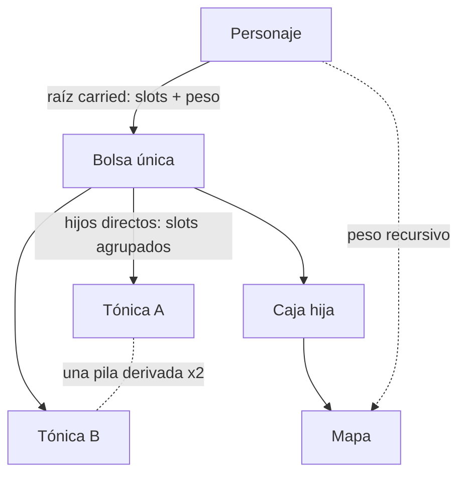

# Especificación técnica de Tiamud v0.3

Estado: especificación de implementación en prelanzamiento, 2026-07-16.

Este documento registra las decisiones actuales de producto y arquitectura de
Tiamud. Sustituye la planificación de personajes y multimedia de la
[especificación histórica v0.2](spec-v0.2.md). Los ADR aceptados y el código
implementado prevalecen cuando este resumen sea menos específico.

## Contrato de producto

Tiamud es un mundo textual multijugador persistente con presentación ilustrada
opcional. Un estado de mundo autoritativo sirve al navegador, Telnet y clientes
MUD compatibles.

El producto debe seguir siendo:

- completamente jugable como texto plano;
- orientado al navegador sin convertirlo en autoridad;
- sencillo de ejecutar en un equipo corriente;
- determinista y acotado en toda frontera no confiable;
- definido por datos para mundo, personajes y medios;
- accesible sin imágenes, color, audio ni movimiento;
- compatible con importación Envy/Merc revisada, sin ejecutar programas
  históricos ni presuponer derechos; e
- independiente de IA, GPU, Kubernetes, Redis o cloud obligatorios.

La IA puede ayudar al desarrollo o autoría sin conexión. Es opcional, acotada,
revisada y nunca participa en el juego autoritativo.

## Despliegue y persistencia

Un servidor Rust posee un actor de mundo y expone HTTP/WebSocket y Telnet. Los
recursos web pueden servirse desde el proceso o un proxy en el mismo host.
PostgreSQL se recomienda para instalaciones públicas nuevas; SQLite es la
alternativa local sin servicio. Se selecciona uno y nunca se hace doble
escritura.

Ambos adaptadores implementan el esquema v10. Conserva las suscripciones
durables v9 y añade perfiles/capacidades de staff, resolución cerrada de
reportes y auditoría append-only. El traslado SQLite→PostgreSQL copia estas
relaciones en una transacción. La aceptación PostgreSQL real retenida es v8;
no se relabela como aceptación v10 y aún falta ejecutar v10 contra un servidor
PostgreSQL real.

La operación está en [single-host.md](operations/single-host.md). Microservicios
y orquestación no son objetivo sin carga medida que lo justifique.

## Datos de mundo y autoría

WorldPack v5 es el objetivo canónico. AreaPack v4 permite composición modular
estricta. WorldPack v4/v3/v2, AreaPack v3/v2/v1 y Envy/Merc se normalizan al
importar o componer; el dominio no conserva vocabulario heredado.

Propiedades obligatorias:

- IDs estables, namespaced, en minúscula;
- estructuras acotadas y validación de referencias;
- artefactos y digests canónicos deterministas;
- pruebas de contenido y vistas previas revisadas;
- sin conversión de imagen online ni IA generativa en juego;
- origen, licencia, procedencia y revisión de medios; y
- resolución en servidor de secretos y variantes de percepción.

Consulta [world-authoring.md](world-authoring.md) y
[character-progression-v3.md](design/character-progression-v3.md).

### Objetos e inventario 3A–3D

WorldPack v5 separa `itemPrototypes`, que contienen contenido y reglas
reutilizables, de `initialItemInstances`, que asignan cada unidad durable a una
sala, un `npc_spawn`, `staged` o a otra instancia contenedor. En runtime
`ItemInstanceId` es una cadena tipada interna; las instancias nuevas usan una
secuencia monotónica incluida en checkpoint, rollback y snapshot. Los clientes
nunca reciben esa identidad ni `prototypeId`: Web, Telnet y GMCP operan con IDs
opacos derivados de una sal criptográficamente aleatoria nueva por sesión.

`entityMedia(kind=item)` referencia un prototipo reusable; el servidor aplica
esa presentación solo a sus instancias ya visibles. En cambio,
`roomPerception.hiddenItems` referencia la instancia concreta. La percepción se
resuelve antes de agrupar, por lo que una unidad oculta no incrementa la
cantidad visible.

Cada prototipo declara peso, coste de slot, rareza cerrada
`common|uncommon|rare|epic|legendary`, `itemLevel`, política de pila y política
de transferencia. `unique` exige `maxStackUnits: 1`; `fungible` admite
`2..=1000`. Las pilas son vistas deterministas por
ubicación/prototipo/vínculo, ordenadas por ID de instancia y partidas por ese
máximo. No se persisten `quantity`, identidad de pila ni una lista duplicada de
miembros:

```text
stackSlots = ceil(quantity / maxStackUnits) × slotCost
totalWeightGrams = quantity × weightGrams
```

Un contenedor debe ser una instancia `unique`, no consumible, con
`maxSlots: 1..=1000` y `maxWeightGrams: 0..=1_000_000`. Sus slots cuentan hijos
directos ya agrupados; su peso usado cuenta todos los descendientes. El peso
del personaje incluye raíces portadas/equipadas y todo su contenido, mientras
sus slots solo cuentan raíces portadas. El grafo rechaza autorreferencias,
ciclos, referencias inválidas y una quinta arista de profundidad.



Antes de mutar se valida una ubicación prospectiva completa; un error no mueve
ninguna unidad ni avanza revisión, RNG o contador. `take` y `drop` aceptan una
cantidad opcional, `put <objeto> in <contenedor>` mueve raíces portadas y
`get <objeto> from <contenedor>` solo hijos directos. Cada mutación admite
1..=256 unidades. `contents` pagina veinte grupos y evita incrustar árboles
recursivos en las fichas o escenas.

WorldPack v5 y AreaPack v4 aceptan el vocabulario cerrado `transferable`,
`character_bound` y `non_transferable`; WorldPack v4, AreaPack v3 y formatos
anteriores solo normalizan `transferable`. El propietario efectivo de una
instancia se obtiene siguiendo como máximo cuatro aristas de contención hasta
una raíz portada o equipada. La primera adquisición por un personaje liga
atómicamente la raíz y cada descendiente `character_bound`. Un objeto ligado
no se desliga ni se reasigna; `non_transferable` no guarda dueño ligado, pero
no puede abandonar al personaje que lo posee. `drop` y todo cambio de dueño
exigen que el subárbol completo sea `transferable`; introducir, extraer,
equipar, desequipar o consumir dentro del grafo del mismo dueño conserva el
vínculo.

```text
give [cantidad] <objeto> to <personaje>
```

`give` mueve únicamente raíces portadas a un receptor distinto, conectado y en
la misma sala. Acepta un selector opaco o un nombre exacto no ambiguo, valida
capacidad de emisor y receptor, y respeta ignore del receptor y block bilateral.
La ubicación de todas las raíces y el evento `ItemsGiven` se confirman como una
sola mutación antes de proyectar salida. No es un intercambio: `trade` usa una
negociación bilateral distinta.

El escrow de trade es una reserva durable, no otra ubicación o saldo. Objetos
y moneda permanecen con su propietario; el índice derivado bloquea raíz,
descendientes y gasto reservado. Cada personaje participa como máximo en un
trade, hay hasta 64 globales, 8 líneas por participante y 128 raíces entre
ambos. Solicitud y negociación caducan a 20 y 120 ticks respectivamente.

Dos personajes conectados, en la misma sala, fuera de combate/derrota y
permitidos por ignore/block pueden negociar. Todo cambio material incrementa
una revisión, recalcula la base canónica y borra confirmaciones. Dos identidades
distintas deben confirmar la misma revisión y digest; entonces el actor valida
prospectivamente ambos grafos, capacidades y saldos y publica los dos lotes, los
dos agregados, la eliminación del trade y su evento en un solo commit. No hay
movimiento parcial ni reembolso al cancelar.

Separación, combate, derrota, desconexión, ban, cambio social, expiración o
reserva inválida cancelan de forma cerrada. Tras reinicio se cargan y validan
los participantes adicionales con presupuesto acotado, se cancelan todos los
trades restaurados y se confirma el snapshot limpio antes de readiness. Web,
texto Telnet, `Char.Trade 1` GMCP y el bot estricto usan selectores privados
opacos, cantidad disponible/reservada y saldo total/reservado/gastable.

Rareza, nivel, peso unitario/total, cantidad, slots y capacidad aparecen como
texto en escena, inventario, equipo y contenidos. El color nunca es la única
señal. Web usa `container.contents`; Telnet ofrece texto equivalente y GMCP
proyecta `Char.Items.List` con ubicación `container`.

`WorldRuntimeSnapshot` v5 conserva `itemInstances`, su grafo de ubicaciones,
el vínculo obligatorio por instancia, el siguiente contador de instancia,
`nextTradeId` y las reservas vivas. El vínculo tiene
exactamente una de estas formas:

```json
{"kind":"unbound"}
{"kind":"character","characterId":42}
```

El decoder lee primero `snapshotVersion` y usa DTO explícitos v1, v2, v3, v4 y
v5; v1-v3 se convierten a `unbound` y v4 produce contador de trade inicial y
mapa vacío. Campos posteriores inyectados en una versión antigua, referencias
huérfanas, ciclos, profundidad, política/vínculo, trades, reservas o contadores
inválidos bloquean el arranque. La restauración conserva instancias iniciales
nuevas del WorldPack y superpone el estado durable, sin resucitar instancias
runtime ausentes. Antes
de abrir listeners se valida por lotes la unión de propietarios raíz y todos los
`CharacterId` ligados, incluso si la instancia está consumida, junto con
equipo, grafo y capacidad; después se descartan esos agregados. SQLite y
PostgreSQL confirman el snapshot como única autoridad en su transacción de
esquema v10; no hay tabla espejo, tabla de escrow ni esquema v11.

Los límites principales son 1.024 prototipos y 8.192 instancias iniciales por
WorldPack, 65.536 instancias runtime, 1 MiB para el snapshot y 1 MiB agregado
para las fichas de propietarios inspeccionadas al arrancar; cada ficha tiene un
máximo de 64 KiB. Lantern Square contiene 9 prototipos y 10 instancias
iniciales; el WorldPack canónico ocupa 49.603 bytes y tiene SHA-256
`f3ab27cb93a2b3c80fe0a9a6ecf8acdd856a45ec1edbda257dd33046a21772c8`.
Los derechos/reparto, procedencia y tablas de botín aleatorias pertenecen a
fases posteriores.

## Modelo de personaje

```text
baseline neutral de ficha
  + concesiones de creación del linaje
  + concesiones del trasfondo opcional
  + concesiones de creación de clase base
  + concesiones de nivel de clase activa
  + rangos adquiridos de talentos de linaje/clase
  + concesiones únicas de promoción avanzada
  = ficha permanente

equipo + estados activos se aplican después
```

El baseline neutral no aporta atributos, skills o capacidad oculta. La clase
base define el inicio real, con adiciones de linaje/trasfondo. La creación llena
vida y recursos una vez; aumentar capacidad después conserva valores actuales.

Términos canónicos: linaje, trasfondo, clase base, talento/especialización y
clase avanzada. `Race` y `archetype` solo son sinónimos de importación/UI.

La primera versión usa:

- una curva acumulada de XP/nivel global;
- una clase activa;
- reservas acotadas separadas para clase y linaje;
- adquisición de talento distinta de promoción;
- requisitos declarativos y concesiones verificadas;
- linaje/trasfondo inmutables tras crear; y
- sin multiclase, XP de clase, promoción reversible ni scripts arbitrarios de
  concesiones permanentes.

Evolución de linaje desarrolla nodos acotados, no sustituye el linaje. La
promoción avanzada cambia identidad atómicamente conservando XP/nivel.

| Dimensión | Definiciones de demostración |
| --- | --- |
| Linajes | Mortal, Stonekin, Embermarked |
| Trasfondos | Caravan Scout, Archive Apprentice, City Guard |
| Clases base | Wanderer, Vanguard, Arcanist |
| Clases avanzadas | Pathfinder, Bastion, Stormcaller, Spellblade |

La curva de ejemplo define `100 × (level - 1)²` para niveles 2–10. Pathfinder,
Bastion y Stormcaller parten de su base al nivel 5; Spellblade permite entrada
Vanguard o Arcanist al nivel 6 con requisitos alcanzables.

Gramática, grafos e invariantes son normativos en el
[diseño v3](design/character-progression-v3.md) y
[ADR 0007](decisions/0007-worldpack-v3-character-model.md).

## Combate, habilidades y seguridad de progresión

Acciones marciales, hechizos y utilidad comparten un modelo acotado con costes,
cooldowns, objetivos, daño/curación, resistencias y estados temporales. Los NPC
usan definiciones iguales y decisión determinista por reglas, nunca IA
generativa runtime.

`martial`, `spell`, `utility` son categorías comunes a WorldPack, Rust y wire
del navegador. `innate` pre-v3 no forma parte del modelo limpio.

Autoría y runtime validan límites acumulados. Aumentar vida máxima no cura;
aumentar capacidad de recurso no rellena y una reserva nueva empieza vacía.
Las acciones permanentes se aplican atómicamente y una sola vez.

La recompensa hard-coded de skill de combate y la misión de demostración son
deuda de política del ejemplo. Deben pasar a señales/recompensas de autoría
antes de un contrato de contenido estable.

## Sistemas sociales, grupos, staff y botín

La fase social 1 está implementada. `say` es local; `tell` llega a un personaje
conectado; `reply` usa en memoria el ID del último remitente cuyo `tell` se
entregó. Los grupos de hasta seis miembros persisten
create/invite/accept/revoke/kick/transfer/disband/leave/status y ofrecen
`party say`, `gsay`, `gtell`.

`general`, `newbie`, `staff` exigen suscripción durable. Unirse, enviar y
recibir `staff` requiere perfil `moderator`, `administrator` o `implementor`;
`helper` y `builder` no acceden. La membresía del grupo sobrevive a la
desconexión, pero accept/revoke/kick/transfer resuelven un nombre conectado y no
administran un objetivo offline.

La misma política, rate limit, mute, ignore/block y buzones por sesión sirve a
acciones web, comandos Telnet y `Comm.Channel.Text` GMCP. No existen correo o
historial durable, shout/yell espacial, telepatía authored, follow/assist/
rescue, selección general de aliados, XP/misión compartida ni reparto de botín.

La autoridad ejecutable de staff es independiente de la ficha y usa una de
doce capacidades cerradas: `reports.view`, `reports.resolve`,
`moderation.mute`, `moderation.ban`, `staff.assign`, `staff.inspect`,
`staff.where`, `staff.goto`, `staff.transfer`, `staff.restore`,
`staff.announce`, `staff.audit`. Nunca se obtiene por XP, nivel, clase,
talentos o WorldPack.

Los perfiles operativos cerrados son `helper`, `builder`, `moderator`,
`administrator`, `implementor`. Siembran bundles revisados de capacidades y
pueden llevar un `lore_title` opcional; perfil y título no sustituyen la
comprobación de capacidad. Los roles `Player`, `Moderator`, `Admin` se
conservan solo como tier legado para moderación y percepción: por sí solos
nunca autorizan un comando ni abren el canal `staff`. Ese canal requiere perfil
`moderator`, `administrator` o `implementor`; `helper` y `builder` no acceden.
La primera cuenta registrada recibe `implementor`; las cuentas Admin migradas
reciben `administrator`. Cambiar perfil elimina las asignaciones anteriores y
siembra exactamente el bundle del perfil nuevo. La jerarquía impide actuar
sobre la propia cuenta o un rango igual/superior.

La fase 2 implementa cola de reportes y resolución `dismissed`,
`action_taken` o `no_action`; `inspect`, `where`, `goto`, `transfer`,
`restore`, `announce`, consulta de auditoría y asignación explícita de
perfil/capacidad. Todas exigen motivo. Las acciones que tocan el mundo resuelven
un personaje conectado; asignaciones y reportes usan identidad durable. Las
mutaciones sensibles y su auditoría se confirman atómicamente, y `staff_audit`
rechaza actualización y borrado.

Sintaxis textual normativa de fase 2:

```text
staff
staff status
staff reports <motivo>
staff resolve <id> <dismissed|action_taken|no_action> <motivo>
staff inspect <nombre> | <motivo>
staff where <nombre> | <motivo>
staff goto <nombre> | <motivo>
staff transfer <nombre> | <motivo>
staff restore <nombre> | <motivo>
staff announce <texto> | <motivo>
staff audit <motivo>
staff profile <nombre> <helper|builder|moderator|administrator|implementor|none> <título|none> | <motivo>
staff capability <grant|revoke> <nombre> <capacidad> | <motivo>
```

Web expone acciones estructuradas estrictas equivalentes. Telnet usa el mismo
analizador; los anuncios llegan como `announcement` en texto, Web
`chat.message` y GMCP `Comm.Channel.Text`.

Los objetos separan prototipo reutilizable e instancia durable con ubicación y
vínculo autoritarios. Los NPC poseen instancias de botín fijo validadas y las
transfieren al morir. Capacidad por slots/peso, rareza textual, `itemLevel`,
pilas fungibles derivadas, contenedores acotados, cantidades, consulta paginada,
tres políticas de transferencia y `give` atómico están implementados. También
lo está el trade confirmado mediante reservas durables, revisión/digest y
liquidación simultánea. Faltan afijos, propiedad y reparto de grupo,
procedencia de drops repetibles y tablas ponderadas. Cajas de botín pagadas o
tiradas con moneda prémium quedan fuera del baseline.

Consulta la [hoja de ruta social/staff/botín](design/social-staff-and-loot-roadmap.md).

## Escenas semánticas y medios

Una escena es una proyección semántica segura ante percepción. Prosa y
entidades estructuradas contienen todo. La imagen atmosférica es opcional.

El compositor añade solo presentación a entidades visibles:

- poses transparentes revisadas de objetos/NPC;
- huella, prioridad y capa normalizadas;
- slots deterministas y zonas seguras en cliente;
- máximo de diez sprites y overflow semántico;
- pistas cortas `attack`/`hit`/`defeat` derivadas por servidor (`heal` queda
  reservado en cliente); y
- gating completo para lector, Save-Data, movimiento, colores y multimedia.

Las anotaciones viajan como sidecar web, no en `SceneView`, evitando expansión
GMCP y fugas. El servidor decide visibilidad/sprite; manifiestos, geometría; el
navegador, colocación adaptable. Layout es función pura del snapshot.

El juego nunca espera medios. Las pistas decaen a `idle` y no se reproducen tras
resync. Un snapshot de la misma vista retiene la pista solo si el NPC opaco
sigue presentado; retirada/cambio/resync limpia. No hay jugador compuesto ni
lápida persistente en v1. Consulta
[scene-compositor-v1.md](design/scene-compositor-v1.md) y
[ADR 0008](decisions/0008-optional-scene-compositor.md).

## Formatos multimedia

- Atmósfera opaca: AVIF, luego WebP/JPEG.
- Sprite transparente: WebP alfa + PNG.
- AVIF alfa: aplazado hasta demostrar ruta RGBA determinista útil.
- Atmósfera transparente/lossless: PNG.
- SVG/HTML/CSS/JavaScript, hosts remotos arbitrarios y `data:` inline:
  rechazados.

Recursos mismo-origen, inmutables y direccionados por contenido. Poses estáticas
en v1; animación CSS acotada. Vídeo, WebP animado y composición runtime quedan
aplazados.

## Protocolo

`tiamud.v1` WebSocket sigue experimental. Clientes reciben IDs opacos derivados
de una sal criptográficamente aleatoria nueva por sesión, además de revisiones
y secuencias por sesión. Texto y percepción preceden cada representación.

Salvaguardas implementadas:

- 16 KiB compactos por frame WebSocket de salida;
- recuperación correlacionada `sync.scene`/`sync.player`, aplicada como par; y
- escena GMCP grande degradada a escena mínima más aviso acotado, nunca silencio.

Antes del primer hito público, cambios densos deberían migrar a batches
atómicos `baseRevision`/`revision`. Las pistas decoran `message.append`; no crean
secuencia ni se infieren de prosa. Referencia:
[tiamud-v1.md](protocol/tiamud-v1.md).

## Invariantes de accesibilidad y seguridad

- Una imagen nunca contiene información exclusiva.
- Modo lector desactiva arte decorativo salvo petición explícita.
- Texto de jugador no se convierte en ANSI/MXP/HTML/CSS/URL/alt sin escape y
  validación contextual.
- Gráficos terminales requieren capacidad y consentimiento explícitos.
- Recursos pesados viajan por HTTPS, no GMCP/Telnet.
- Parsers, subnegociaciones, profundidad JSON, colas, scripts, recursos y
  descompresión tienen límites.
- Entidades ocultas, salas secretas y variantes no resueltas no se precargan.

## Estado de implementación

| Área | Estado al actualizar v0.3 |
| --- | --- |
| Combate y habilidades acotadas | Baseline implementado y probado |
| Límites acumulados y nivel sin relleno | Implementado y probado |
| WorldPack v5/AreaPack v4, validador, normalizador y catálogo | Integrado en servidor; entradas WorldPack v4/v3/v2 y AreaPack v3/v2/v1 se normalizan |
| Linaje/clase/talento/promoción y persistencia | Implementado y probado |
| Creación v3 navegador/Telnet | Default/none/explícito implementado |
| Ficha, talentos y promociones web | Implementado y probado |
| Recuperación dividida, frame gate y fallback GMCP | Implementado y probado |
| Compositor navegador y accesibilidad | Implementado y probado |
| Perfil de sprite transparente | WebP alfa + PNG implementado |
| Sidecar de entidades seguro | Implementado; sin sprites de muestra |
| Pistas de combate | Ataque/golpe/derrota NPC; sin jugador/heal/lápida |
| Social fase 1 y esquema v10 | Grupos/chat/reply/canales y paridad Web/Telnet/GMCP implementados; aceptación PostgreSQL real v10 aún no retenida |
| Staff fase 2 | Perfiles/capacidades, reportes, acciones acotadas, razones, Web/Telnet y auditoría append-only implementados; aceptación PostgreSQL real v10 aún no retenida |
| Inventario fase 3A | Prototype/instance, snapshot v2 migrado desde v1, slots/peso, rareza/`itemLevel`, IDs opacos y paridad Web/Telnet/GMCP implementados; puertas locales integradas superadas |
| Inventario fase 3B | Pilas derivadas, contenedores acotados, snapshot v3 migrado desde v1/v2, cantidades/paginación y paridad Web/Telnet/GMCP implementados; puertas locales integradas superadas |
| Inventario fase 3C | Snapshot v4 con vínculo durable y migración v1-v3, tres políticas, `give` atómico, opacidad y paridad Web/Telnet/GMCP implementados; puertas locales soportadas superadas |
| Inventario fase 3D | Snapshot v5 migrado desde v4, reservas durables, doble confirmación y liquidación simultánea de objetos/moneda en Web/Telnet/GMCP; puertas integradas y Playwright final 36/36 superados |
| Protocolo atómico de delta denso | Pendiente |

En la evidencia histórica integrada de fase 3A pasan formato, pruebas bloqueadas del workspace
y clippy estricto; 77 pruebas de core, 80 de WorldPack, 28 del importador y 195
del servidor; `svelte-check` sin errores ni avisos, 100/100 pruebas web y build;
30/30 escenarios Playwright soportados; y las comprobaciones de licencias y
avisos generados para 307 dependencias Rust y 76 web. No se ejecutaron
PostgreSQL real v10, WebKit local ni soak de 24 horas. Estas puertas locales no
demuestran por sí solas publicación o CI.

La evidencia histórica integrada de 3B pasó formato/check/clippy, 499/499
pruebas Rust, 103/103 web, 30/30 Playwright Chromium/Firefox, 80/80 Node, humo,
carga CI y soak corto. También pasaron `cargo-deny`, licencias y avisos 307
Rust/76 web. No se ejecutaron PostgreSQL real v10, WebKit local ni soak de 24
horas; las puertas locales no demuestran por sí solas publicación o CI.

En el árbol integrado de fase 3C pasaron 513/513 pruebas Rust: 93 core, 95
WorldPack, 28 importador, 207 servidor y 90 restantes. También pasaron
`svelte-check` con 0 errores y 0 avisos, 103/103 pruebas web, 81/81 Node y
32/32 escenarios Playwright soportados, 16 Chromium y 16 Firefox. WebKit no
arrancó en aquel gate por bibliotecas GTK/GStreamer ausentes. No se ejecutaron
PostgreSQL real v10 ni soak de 24 horas; estas comprobaciones locales sobre un
árbol dirty no demuestran CI, publicación o producción.

En el árbol integrado de fase 3D pasan formato, clippy estricto y 550 pruebas
Rust: 102 core, 97 WorldPack, 28 importador, 231 servidor y 92 restantes del
workspace, incluidas 23 admin. También pasan `svelte-check`, build, 107 Vitest
y 83 Node/bot. El pase Playwright final completa 36/36 escenarios, 18 Chromium
y 18 Firefox. Pasan licencias, avisos, humo, carga de 16 usuarios/32
rondas sin errores y soak corto de 30 s con 44 rondas, 97 acciones y 8/8
readiness. No se ejecutaron PostgreSQL real v10, WebKit local ni soak de 24
horas; estas puertas locales no demuestran CI, publicación o producción.

Una pieza aislada no es una funcionalidad end-to-end. Actualiza documentación
cuando las puertas de integración cambien.

## Puertas de aceptación

Personajes v3:

1. Selección de linaje/trasfondo/clase en navegador y texto.
2. Ficha acotada idéntica en cada persistencia.
3. XP concede puntos sin curar/recargar.
4. Talentos/exclusiones atómicos y durables.
5. Cada clase avanzada tiene ruta alcanzable.
6. Spellblade cubierto desde Vanguard y Arcanist.
7. Grafos inválidos/cíclicos/sobre límite no publican.
8. V2/Envy normaliza determinista o falla con diagnóstico.

Compositor:

1. Assets solo para entidades visibles.
2. Assets inválidos no cambian listas/acciones.
3. Layout determinista, adaptable, acotado y overflow textual.
4. Lector/Save-Data no descarga sprites.
5. Movimiento reducido muestra resultado estático.
6. Pistas derivadas de eventos y eliminadas en resync.
7. Sin exceder presupuesto WebSocket/GMCP.
8. Telnet plano completo y limpio.

Inventario 3B:

1. Pilas derivadas nunca crean cantidad o identidad durable duplicada.
2. Límites de pila y slots/peso se cumplen con aritmética comprobada.
3. El peso recursivo incluye descendientes y los slots solo hijos directos.
4. Ciclos, profundidad 5 y sobrecapacidad fallan sin mutación parcial.
5. Selectores opacos y percepción preceden a la agrupación.
6. Cantidad máxima 256 y `contents` máximo 20 grupos por página.
7. Snapshot v1/v2/v3 falla cerrado y conserva propietarios offline válidos.
8. Web, texto Telnet y GMCP expresan los mismos hechos autorizados.

Inventario 3C:

1. Snapshot v4 exige un vínculo cerrado por instancia; v1-v3 migran a
   `unbound` y rechazan campos de otra versión.
2. Adquirir liga recursivamente y una política restringida no puede eludirse
   mediante un contenedor, drop, give, replay o rollback.
3. `give` mueve 1..=256 raíces portadas entre personajes distintos, conectados
   y próximos, con capacidad bilateral y una sola revisión/evento.
4. Ignore y block impiden la entrega sin revelar cuál de esas políticas existe.
5. Un fallo de commit, capacidad, política, desconexión previa o selector no
   válido no publica estado, evento ni salida parcial.
6. Ningún propietario durable se proyecta; emisor y receptor reciben selectores
   opacos propios, el observador local solo narración y el remoto nada.
7. Web, texto Telnet, GMCP, SQLite, PostgreSQL, admin y mover comparten decoder,
   autorización y semántica.

Inventario 3D:

1. Snapshot v5 exige forma canónica, IDs y reservas acotadas; v4 solo migra a
   contador inicial y mapa vacío, sin schema-smuggling.
2. Cada raíz y subárbol reservado queda bloqueado, y el saldo gastable excluye
   toda moneda ofrecida sin crear otra autoridad.
3. Una mutación material incrementa una revisión y elimina confirmaciones; dos
   identidades distintas confirman la misma revisión y digest.
4. La liquidación simultánea valida ambos inventarios y saldos finales antes de
   confirmar personajes, snapshot y evento en una transacción.
5. Sala, conexión, combate/derrota, ignore/block, política, capacidad,
   expiración y desconexión se vuelven a comprobar de forma cerrada.
6. Reinicio carga participantes adicionales con presupuesto acotado, valida y
   cancela reservas antes de readiness; replay no reaplica monedas.
7. Web, texto Telnet, `Char.Trade 1`, páginas GMCP, bot, SQLite, PostgreSQL,
   admin y mover comparten acciones, límites, decoder y opacidad por sesión.

## Trabajo aplazado o rechazado

Aplazado hasta necesidad demostrada: transformaciones, culturas, respec,
rangos de clase, editor de grafos, simulación de balance, medios animados,
gráficos raster terminales y carga caliente. El compositor necesita sprites
revisados; avatar, heal cue y lápida son mejoras opcionales.

Rechazado como baseline: Kubernetes, microservicios, Redis, object storage
obligatorio, generación de imagen runtime, decisiones LLM runtime, layout de
píxeles en servidor, física espacial continua, Canvas/WebGL para diez sprites,
scripts generales de progresión y blobs multimedia por Telnet.
