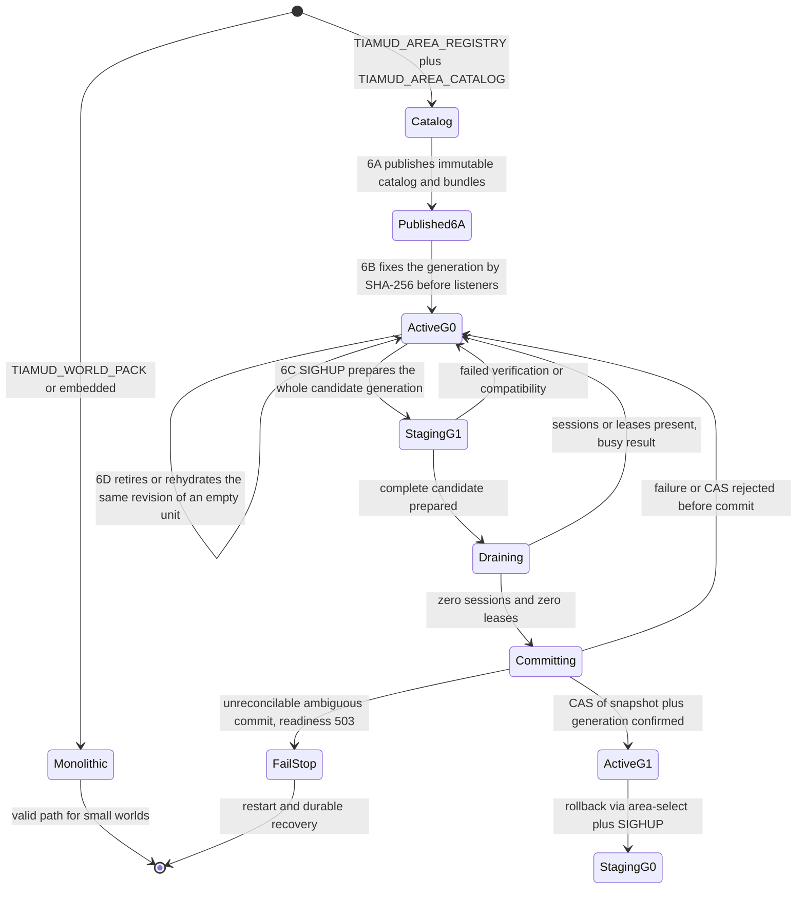
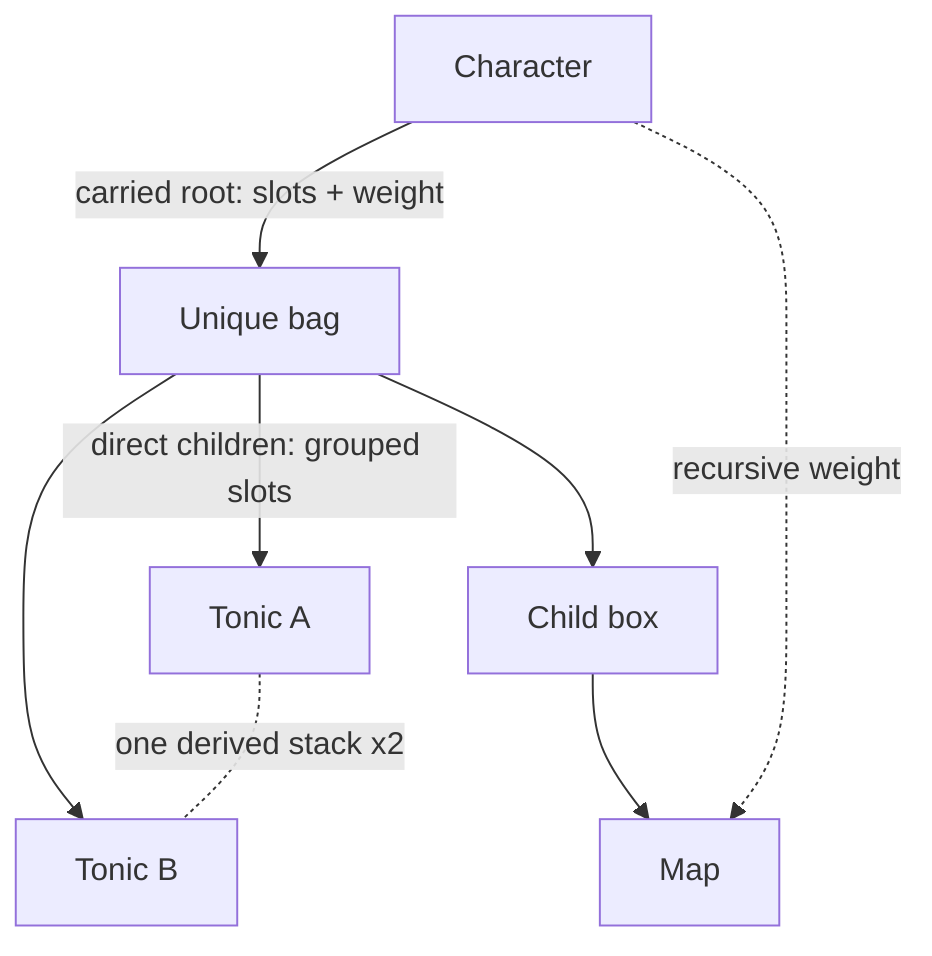

# Tiamud technical specification v0.3

Status: pre-release implementation specification, 2026-07-17.

This document records the current product and architecture decisions for
Tiamud. It supersedes the character and multimedia planning of the
[historical v0.2 specification](archive/spec-v0.2.md). Accepted ADRs and
implemented code prevail where this summary is less specific.

## Product contract

Tiamud is a persistent multiplayer text world with optional illustrated
presentation. An authoritative world state serves the browser, Telnet and
compatible MUD clients.

The product must remain:

- fully playable as plain text;
- browser-oriented without making the browser an authority;
- simple to run on an ordinary machine;
- deterministic and bounded at every untrusted boundary;
- data-defined for world, characters and media;
- accessible without images, color, audio or motion;
- compatible with reviewed Envy/Merc import, without running historical
  programs or presuming rights; and
- independent of mandatory AI, GPU, Kubernetes, Redis or cloud.

AI may assist development or authoring offline. It is optional, bounded,
reviewed and never participates in authoritative play.

## Deployment and persistence

A Rust server owns a world actor and exposes HTTP/WebSocket and Telnet. Web
assets can be served from the process or a proxy on the same host. PostgreSQL is
recommended for new public installations; SQLite is the local, service-free
alternative. One is selected and dual-writing never happens.

Both adapters implement schema v15. It preserves the social and staff relations
of v9/v10 and transactionally widens the physical bound of the current opaque
snapshot to 2 MiB. Legacy snapshots v1–v5 remain limited to 1 MiB when decoded;
v6, v7 and v8 admit 2 MiB. The SQLite→PostgreSQL move copies these relations,
the durable generation identity and the area-unit checkpoints together with the
runtime in one transaction. The retained historical runtime acceptance is v8 and
is not relabeled as v13. Real PostgreSQL 18.4 passes 19/19 on the v13
adapter+mover, including a representative migration; that evidence is not
relabeled as v14. The server covers the real board/runtime flow and advisory
concurrency. The current v14 acceptance passes 20/20 adapter tests and 7/7
focused server tests, including the generation CAS; its smoke binds G0 and
validates `noop`, readiness, Web, Telnet and two resident areas. That evidence is
schema v14 and is not relabeled as v15. See the
[PostgreSQL v14/PWA log](project/log/2026-07-17-postgresql-v14-and-pwa-acceptance.md).

Operations are in [single-host.md](operations/single-host.md). Microservices and
orchestration are not a goal without measured load that justifies them.

## World data and authoring

WorldPack v9 is the canonical target. AreaPack v8 allows strict modular
composition under WorldProject v2. WorldPack v8/v7/v6/v5/v4/v3/v2, AreaPack
v7/v6/v5/v4/v3/v2/v1 and Envy/Merc are normalized on import or composition; the
domain keeps no legacy vocabulary and invents no seals, affixes, telepathy or
emotes.

Mandatory properties:

- stable, namespaced, lowercase IDs;
- bounded structures and reference validation;
- deterministic canonical artifacts and digests;
- reviewed content tests and previews;
- no online image conversion or generative AI in play;
- media origin, license, provenance and review; and
- server-side resolution of secrets and perception variants.

Room titles and their variants occupy `1..=128` bytes; base or variant
descriptions occupy `1..=8192`
bytes. They are validated as normalized UTF-8 and safe text; the limits are on
bytes, not code points.

See [world-authoring.md](world-authoring.md) and
[character-progression-v3.md](design/character-progression-v3.md).

### Catalog, additive loading, full cutover and reversible retirement 6A–6D

Monolithic WorldPack remains a valid execution path. The alternative local path
requires `TIAMUD_AREA_REGISTRY` and `TIAMUD_AREA_CATALOG` together; it is
exclusive with `TIAMUD_WORLD_PACK` and fails closed if the pair is incomplete.
Phase 6A publishes canonical, immutable and verifiable catalog and bundles.
Phase 6B fixes, before listeners, a generation identified by the SHA-256 of the
exact canonical catalog bytes and does not observe the editorial `area-active`
pointer again.

The full lifecycle runs from mode selection to per-unit reversible retirement:



With an empty `WorldRuntimeSnapshot` and ledger, the server installs the area
that owns `startRoomId` and its transitive closure of hard dependencies. If any
of those authorities exists, it loads the whole generation before restore or
replay. A `RoomExit` between areas is not a hard dependency: the source room
keeps a `DeferredExit` with destination and required revision. Attempting to
cross it produces an internal result before mutating world, revision, tick, RNG,
hooks, events or persistence. After preparing and installing, the same action is
reauthorized and retried exactly once. A known durable location may trigger a
load; a room the catalog does not own fails closed, with no fallback to
`startRoomId`.

The single coordinator shares jobs by `(catalogSha256, areaId)`, admits two
active preparations, eight additional pending, five seconds from admission and a
hard maximum closure of 32 areas. It reads, verifies, converts and compiles Lua
outside the actor. The actor publishes the whole batch or none under a joint
checkpoint of `World`, `RuntimeContent` and residency. A static install writes no
snapshot; if initial instances or NPCs that are part of snapshot v8 appear, their
state is committed via the existing durable transaction before publishing. The
public result is generic and metrics do not use IDs, revisions, digests or
generations as labels.

Phase 6B only grows residency until shutdown. 6C allows replacing **the whole
generation**, not an individual area. In catalog mode, the first run binds,
before readiness, the `worldId`, active digest and activation sequence in the SQL
v15 singleton `world_area_generation`. A later startup derives the exact path
from the registry and that durable digest, even if the editorial `area-active`
pointer has changed. The current baseline uses `WorldRuntimeSnapshot` v8 and no
other authority for items, NPCs, loot or characters appears.

When migrating from 6B/schema v13 with shared recovery or characters, the v14 row
is born empty: the first startup must preserve the exact G0 catalog and verify
its durable binding.
Switching to G1 at the same time would prevent comparing against a prior identity
that v13 did not store and would bypass the compatibility/CAS gate. G1 is
published or selected only after the verified binding of G0. That first startup
requires
`TIAMUD_ACK_LEGACY_AREA_GENERATION=<exact-sha256-G0>` matching the catalog; the
variable is removed after binding.

`StartupWorldRecovery::Empty` does not guarantee that durable authority is
missing: there may be characters even if no snapshot or ledger exists. Without a
generational binding, shared recovery or any durable character requires the exact
ACK of the known 6B G0. An empty base, or one with accounts but no characters or
world recovery, can bind without ACK. Monolithic with world/character
authority→catalog is not an implicit 6C migration. The ACK is rejected in
monolithic mode, with an existing binding, without recovery/character to
acknowledge, or against a different digest.
`CharacterStore::has_durable_character_authority` applies that check in SQLite,
PostgreSQL, the measured wrapper and test memory.

A local SIGHUP opens `area-active`, rereads its bytes to detect a concurrent
cooperating publication, verifies the full release and builds, outside the actor,
a private `World`, `RuntimeContent` and coordinator. The candidate publishes no
gauges: metrics keep describing the active generation until the confirmed swap. A
normal activation requires an increasing `catalogRevision` and a higher revision
for each modified bundle. The command
`tiamud-world area-select --catalog <path> --registry <dir>`
makes the selection of a previous immutable generation explicit; the subsequent
SIGHUP traverses the same barrier as rollback and always increments the durable
sequence. After staging, the runtime acquires the cooperative read lock used by
`area-publish`/`area-select`, revalidates the pointer under that lock and holds it
until the CAS resolves; a held lock aborts the attempt.
On Solaris, runtime and publishers use the same `fcntl` registry protocol
compatible with `fd-lock`, not two families of locks that can ignore each other.

6C provides no semantic migration: it requires the same world and `startRoomId`,
RNG and full rules, initial prototypes/instances, NPCs/spawns/sets, loot,
affixes, area set, ownership, room IDs and legacy VNUMs; all entries declare
`persistentMigrationVersion == 0`. It may change prose, titles, exits, resources,
perception, variants, presentation and already-validated synchronous Lua scripts.

Before the cutover, admissions are closed, 6D is required to keep no retired
units, and zero sessions and zero leases for entry, action or load are required.
If there is activity, the result is `busy`: nobody is kicked, disconnected or
teleported. The actor captures the current v8 snapshot, restores it over the
candidate and commits, via compare-and-swap, the snapshot and the generation
pointer in a single transaction. Only then does it swap world, content and
coordinator in memory and reopen admissions. A definitive failure before the
commit, including a rejected CAS, preserves the previous generation. An ambiguous
commit result is resolved by rereading the SQL authority: a durable G1 is
published, G0 is reopened and any other value or read error leaves the router in
`Committing`, stops the actor and holds readiness 503 without admissions until
restart/durable recovery.

6D adds a separate internal path to retire and rehydrate the **same revision** of
an empty unit: the SCC of the hard graph plus its reverse closure. The initial
area and any live pin prevent retirement. Snapshot v8 records `Resident|Retired`;
SQL v15 adds `world_area_checkpoints`. The checkpoint retains idle/respawn NPCs,
regional roots and subtrees, provenance, affixes and ground loot; what is
carried/equipped stays global. Rehydration does not rewind tick, RNG, revision or
allocators. The CAS confirms or consumes checkpoint and snapshot before
publishing, and startup validates both before readiness.

6D remains `Partial`: it lacks an operational surface, budget/LRU, hysteresis, a
specific lost-ACK E2E and RSS measurement.
The exact test counts and per-phase status are the single authority of
[`docs/project/COMPLETION_MATRIX.md`](project/COMPLETION_MATRIX.md); the retained
local evidence is not CI, release or production evidence.
Still out of scope are revision replacement, players during
retirement, migrations, GC, networking, compression and remote signing. The
contracts are in
[ADR 0020](decisions/0020-additive-local-area-loading.md) and
[ADR 0021](decisions/0021-quiescent-area-generation-cutover.md), and 6D in
[ADR 0022](decisions/0022-reversible-area-unit-retirement.md).

### Items, inventory and loot 3A–4B

WorldPack v9 separates `itemPrototypes`, which contain reusable content and
rules, from `initialItemInstances`, which assign each durable unit to a room, an
`npc_spawn`, `staged` or another container instance. At runtime `ItemInstanceId`
is an internal typed string; new instances use a monotonic sequence included in
checkpoint, rollback and snapshot. Clients never receive that identity or
`prototypeId`: Web, Telnet and GMCP operate with opaque IDs derived from a
cryptographically random salt that is new per session.

`entityMedia(kind=item)` references a reusable prototype; the server applies that
presentation only to its already-visible instances. In contrast,
`roomPerception.hiddenItems` references the concrete instance. Perception is
resolved before grouping, so a hidden unit does not increase the visible
quantity.

Each prototype declares weight, slot cost, closed rarity
`common|uncommon|rare|epic|legendary`, `itemLevel`, stack policy and transfer
policy. `unique` requires `maxStackUnits: 1`; `fungible` admits `2..=1000`. Stacks
are deterministic views by location/prototype/binding, ordered by instance ID and
split by that maximum. `quantity`, stack identity and a duplicated member list are
not persisted:

```text
stackSlots = ceil(quantity / maxStackUnits) × slotCost
totalWeightGrams = quantity × weightGrams
```

A container must be a `unique`, non-consumable instance with
`maxSlots: 1..=1000` and `maxWeightGrams: 0..=1_000_000`. Its slots count already
grouped direct children; its used weight counts all descendants. The character's
weight includes carried/equipped roots and all their contents, while its slots
only count carried roots. The graph rejects self-references, cycles, invalid
references and a fifth depth edge.



Before mutating, a full prospective location is validated; an error moves no unit
and advances no revision, RNG or counter. `take` and `drop` accept an optional
quantity, `put <item> in <container>` moves carried roots and
`get <item> from <container>` only direct children. Each mutation admits
1..=256 units. `contents` paginates twenty groups and avoids embedding recursive
trees in the sheets or scenes.

The current WorldPack v9 and AreaPack v8, like WorldPack v8/v7/v6/v5 and AreaPack
v7/v6/v5/v4, accept the closed vocabulary `transferable`, `character_bound` and
`non_transferable`; WorldPack v4, AreaPack v3 and earlier formats only normalize
`transferable`. The effective owner of an instance is obtained by following at
most four containment edges up to a carried or equipped root. The first
acquisition by a character atomically binds the root and every `character_bound`
descendant. A bound item is not unbound or reassigned; `non_transferable` keeps no
bound owner but cannot leave the character that owns it. `drop` and every owner
change require the whole subtree to be `transferable`; inserting, extracting,
equipping, unequipping or consuming within the same owner's graph preserves the
binding.

```text
give [quantity] <item> to <character>
```

`give` moves only carried roots to a distinct, connected receiver in the same
room. It accepts an opaque selector or an exact unambiguous name, validates
sender and receiver capacity, and respects the receiver's ignore and bilateral
block. The location of all roots and the `ItemsGiven` event are committed as a
single mutation before projecting output. It is not an exchange: `trade` uses a
distinct bilateral negotiation.

The trade escrow is a durable reservation, not another location or balance. Items
and currency stay with their owner; the derived index locks the root,
descendants and reserved spend. Each character participates in at most one trade,
there are up to 64 global, 8 lines per participant and 128 roots between both.
Request and negotiation expire at 20 and 120 ticks respectively.

Two connected characters, in the same room, out of combat/defeat and permitted by
ignore/block can negotiate. Every material change increments a revision,
recomputes the canonical base and clears confirmations. Two distinct identities
must confirm the same revision and digest; then the actor prospectively validates
both graphs, capacities and balances and publishes the two batches, the two
aggregates, the trade removal and its event in a single commit. There is no
partial move or refund on cancellation.

Separation, combat, defeat, disconnection, ban, social change, expiration or an
invalid reservation cancel closed. After restart the additional participants are
loaded and validated with a bounded budget, all restored trades are cancelled and
the clean snapshot is confirmed before readiness. Web, Telnet text, `Char.Trade 1`
GMCP and the strict bot use opaque private selectors, available/reserved quantity
and total/reserved/spendable balance.

Rarity, level, unit/total weight, quantity, slots and capacity appear as text in
scene, inventory, equipment and contents. Color is never the only signal. Web
uses `container.contents`; Telnet offers equivalent text and GMCP projects
`Char.Items.List` with location `container`.

`WorldRuntimeSnapshot` v8 retains from v7 `itemInstances`, its location graph,
the mandatory per-instance binding, the next instance counter,
`nextTradeId`, the trade reservations, RNG, `itemAffixes`,
`nextRewardOpenId` and five loot fields: `nextLootDropId`,
`itemProvenance`, `lootEncounters`, `groundLoot` and `partyLootCursors`.
Provenance additionally distinguishes `SealedReward` rewards. The binding has
exactly one of these forms:

```json
{"kind":"unbound"}
{"kind":"character","characterId":42}
```

The decoder reads `snapshotVersion` first and uses explicit DTOs v1–v8; v1–v3 are
converted to `unbound`, v4 produces an empty trade state and v1–v5 receive
provenance `legacy_snapshot { sourceVersion }` without inventing rights. v6 fields
are strictly converted to v7 with `itemAffixes: []` on each instance and
`nextRewardOpenId: 1`. Later fields injected into an old version, orphan
references, cycles,
depth, policy/binding, trades, provenance, rights, reservations or invalid
counters block startup. Restoration keeps new initial instances from the
WorldPack and overlays the durable state, without resurrecting absent runtime
instances.

Before opening listeners, the union of identities referenced by the snapshot is
validated in batches. For root owners and bound IDs, sheets are loaded and
existence, equipment, graph and capacity are checked without turning disconnected
identities into active characters; for cohorts or beneficiaries that appear only
in loot, an `existence-only` query is performed. Then the still-open loot
encounters and their combat state are cancelled in a commit prior to readiness;
already-resolved `groundLoot` rights survive intact. SQLite and PostgreSQL commit
the snapshot as the single global authority in their schema v15 transaction; there
is no mirror loot or escrow table and no dual write.

The main limits are 1,024 prototypes and 8,192 initial instances per WorldPack,
65,536 runtime instances, 1 MiB for a legacy v1–v5 snapshot and 2 MiB for the
v6–v8 snapshots. The aggregate budget of inspected owner
sheets at startup remains 1 MiB and each sheet has a maximum of 64 KiB. Lantern
Square contains 3 rooms, 10 prototypes, 9 initial instances, 2 tables, 1 source,
1 affix, 1 pool, 1 telepathic ability and 1 room emote; the canonical WorldPack
occupies 53,567 bytes and has SHA-256
`9a75894a9e2e0c48d20257633f323d52bbe78b9db106de8c497f4784392b5e75`.

WorldPack v7/AreaPack v6 admit guaranteed drops and weighted pools with integer
weights. Entries are canonically ordered and each selection uses rejection
sampling, avoiding modulo bias. An `npc_spawn` source resolves once per defeat;
fixed and generable loot add up to at most 64 roots. Roll, RNG, counter,
provenance, rights, NPC, XP, events and snapshot are committed or reverted
together.

The `credited_character` policy reserves all roots to the initiator. The
`party_round_robin` policy freezes, when the encounter begins, a cohort of up to
six nearby, connected and living characters, always with the initiator; on defeat
it rechecks the companions' proximity and party. A durable cursor distributes the
roots and `loot pass <reference>` yields one to the next eligible identity without
renewing the deadline. The right is exclusive for 20 ticks, becomes public
afterward and what is unclaimed is removed at tick 120. Need/greed, master-loot
and contribution-based distribution are not part of 4A.

Each root keeps closed provenance `authored_initial`, `legacy_snapshot`,
`runtime_created` or `npc_loot` with a canonical table digest. If, after pruning,
the worst case does not fit under the instance/rights budgets, fixed roots have
priority and the remaining generation is durably suppressed:
defeat and XP are committed, RNG and `dropId` advance and a restart does not allow
a reroll. At the historical 4A boundary there were no affixes or sealed rewards
yet; boxes, keys or paid rolls were already out of the baseline.

Phase 4B is implemented in WorldPack v7/AreaPack v6. A seal is a `unique`,
consumable, `character_bound`, non-structural prototype with no effects, which
admits no initial instance. It must be generated by a normal table associated
with an NPC; its sealed table cannot be a direct `lootSource` or produce another
seal. Each opening generates 1..=16 units and admits up to 1,024 base and
conditional probability rows visible via `reward odds`.

A normal or sealed entry of quantity exactly one can reference a pool that
selects, with integer weights and without bias, a single affix or `nothing` for a
`unique`, `maxStackUnits: 1` and unsealed prototype. The WorldPack admits 512
affixes, 256 pools, 64 entries per pool and 4,096 total weighted entries; each
label occupies up to 64 bytes and each positive attack or healing delta is at
most 1,000. Type compatibility and effective caps are validated before publishing
and on load.

`open` commits together seal consumption, RNG, counter, creation, affix, binding,
capacity, provenance and event; a failure restores the exact checkpoint. In
normal loot, the affix roll is consumed even if the generation ends up suppressed
to prevent a capacity reroll. Durable copies of the affix keep definition, pool
and registry digests, while internal IDs, RNG, counters and digests are not
projected. Web, Telnet and GMCP share this authority and show authorized stats via
opaque references. The contract is in
[ADR 0014](decisions/0014-earned-sealed-rewards-and-deterministic-affixes.md).
Pity, need/greed, master-loot, contribution-based distribution, boxes, keys and
paid rolls remain out.

## Character model

```text
neutral sheet baseline
  + lineage creation grants
  + optional background grants
  + base class creation grants
  + active class level grants
  + acquired lineage/class talent ranks
  + unique advanced-promotion grants
  = permanent sheet

equipment + active states apply afterward
```

The neutral baseline contributes no attributes, skills or hidden capacity. The
base class defines the real start, with lineage/background additions. Creation
fills life and resources once; increasing capacity afterward keeps current values.

Canonical terms: lineage, background, base class, talent/specialization and
advanced class. `Race` and `archetype` are only import/UI synonyms.

The first version uses:

- a cumulative global XP/level curve;
- one active class;
- separate bounded pools for class and lineage;
- talent acquisition distinct from promotion;
- declarative requirements and verified grants;
- immutable lineage/background after creation; and
- no multiclass, class XP, reversible promotion or arbitrary permanent-grant
  scripts.

Lineage evolution develops bounded nodes, it does not replace the lineage.
Advanced promotion changes identity atomically while preserving XP/level.

| Dimension | Demonstration definitions |
| --- | --- |
| Lineages | Mortal, Stonekin, Embermarked |
| Backgrounds | Caravan Scout, Archive Apprentice, City Guard |
| Base classes | Wanderer, Vanguard, Arcanist |
| Advanced classes | Pathfinder, Bastion, Stormcaller, Spellblade |

The example curve defines `100 × (level - 1)²` for levels 2–10. Pathfinder,
Bastion and Stormcaller start from their base at level 5; Spellblade allows a
Vanguard or Arcanist entry at level 6 with achievable requirements.

Grammar, graphs and invariants are normative in the
[v3 design](design/character-progression-v3.md) and
[ADR 0007](decisions/0007-worldpack-v3-character-model.md).

## Combat, abilities and progression safety

Martial actions, spells and utility share a bounded model with costs,
cooldowns, targets, damage/healing, resistances and temporary states. NPCs use
identical definitions and deterministic rule-based decisions, never runtime
generative AI.

`martial`, `spell`, `utility` are categories common to WorldPack, Rust and the
browser wire. Pre-v3 `innate` is not part of the clean model.

Authoring and runtime validate cumulative limits. Increasing maximum life does
not heal; increasing resource capacity does not refill and a new pool starts
empty. Permanent actions apply atomically and exactly once.

The hard-coded combat-skill reward and the demonstration quest are policy debt of
the example. They must move to authored signals/rewards before a stable content
contract.

## Social systems, groups, staff and loot

Social phase 1 is implemented. `say` is local; `tell` reaches a connected
character; `reply` uses in memory the ID of the last sender whose `tell` was
delivered. Groups of up to six members persist
create/invite/accept/revoke/kick/transfer/disband/leave/status and offer
`party say`, `gsay`, `gtell`.

`general`, `newbie`, `staff` require a durable subscription. Joining, sending and
receiving `staff` requires a `moderator`, `administrator` or `implementor`
profile; `helper` and `builder` do not access it. Group membership survives
disconnection, but accept/revoke/kick/transfer resolve a connected name and do not
administer an offline target.

Phase 5A adds direct online telepathy without turning `tell` into something else.
WorldPack v8/AreaPack v7 can mark a `spell|utility`,
`single_ally` ability, without damage/healing/state, with at least one positive
cost, positive cooldown and up to 64 blocked rooms. The actor must know it and be
alive, free of stun/recovery and in a permitted room. Resource, ability cooldown
and global cooldown are committed before delivery. The receiver's ignore/block,
state or room suppress delivery without revealing it; the thought and destination
do not persist and do not update `reply`.

The same policy, rate limit, mute, ignore/block and per-session mailboxes serve
web actions, Telnet commands and `Comm.Channel.Text` GMCP. Offline mail is a
separate durable surface: 64 messages and 128 KiB per mailbox, pages of
10, 30-day expiry, per-account quotas of 20/h and 50/day and a report with
90-day evidence. It uses `mail.*`, Telnet text and `Tiamud.Mail 1`; acceptance
does not reveal ignore/block, ban or capacity. There is no durable general
history, global/group emotes, group/offline telepathy,
follow/assist/rescue, general ally selection or shared XP/quest. Spatial
`shout`/`yell` voice is implemented as phase 5E. The implemented loot
distribution is limited to the nearby cohort
and round-robin of 4A.

Phase 5B adds up to 32 `socialEmotes` in WorldPack v9/AreaPack v8. Each one
is local to the room and uses distinct closed templates for actor, target and
observers, with only `{actor}`/`{target}`, a maximum render of 512 bytes and
one-pass substitution that does not reinterpret names. `emotes` lists and
`emote <command> [character]` executes; Web uses `social.emote.list` and
`social.emote`. There is no free text. A target is another connected character,
unambiguous and in the same room. Ignore/block suppresses per receiver, `OnTalk`
is committed before delivery and the `emote` channel shares Web, Telnet and GMCP
without entering events, `reply`, snapshots, audit, history or SQL.

The durable and privacy contract of 5C is fixed in
[ADR 0017](decisions/0017-bounded-offline-mail.md).

Phase 5D adds two public global boards, `general` and `newbie`, without turning
channels or mail into a history. Text offers `board`, `board list`,
`read`, `post`, `delete` and `report`; Web uses exact `board.*` actions and GMCP
negotiates `Tiamud.Board 1`. Catalog, pages and detail return only to the
requesting session: there is no fan-out, notification or `Comm.Channel.Text`.

Telnet accepts lines bounded to 8 KiB to hold the post command and a maximum
body; a longer line is discarded entirely. Each GMCP packet remains bounded to 8
KiB. If the escaped JSON of `Tiamud.Board.Entry` does not fit, the same packet
keeps the summary, a UTF-8 prefix of the body and `truncated`/`overflow`
metadata; the Telnet text keeps the full body.

Each page contains ten summaries and admits pages 1..=100; each post lives 90
days. An account keeps up to 64 posts and consumes a transactional quota of
5/h and 20/day. Each board admits 1,000 posts/4 MiB and the set 2,000/8 MiB.
Mute, ban and the social bucket prevent posting; ignore/block do not alter
deliberately public content. The same author-character can delete and
another account can file the single global report of the post. Evidence
lives 90 days, with a maximum of eight open board reports per reporting
account and 10,000 global evidences, and is resolved with the existing
staff capabilities; `action_taken` removes the live post.

SQLite/PostgreSQL v13 add `social_board_posts`, `social_board_usage` and
`social_board_report_evidence`, and `report_kind='board'`. The combined purge
works in batches of up to 256, fails closed at startup and is non-fatal but
observable every hour. The mover copies parent, children, posts, evidence and
quota in order. WorldPack v9, AreaPack v8, WorldProject v2 and snapshot v7 do not
change. There is no editing, threads, search, markup, attachments, subscriptions,
push or party/guild/staff/room/area boards. The contract is in
[ADR 0018](decisions/0018-bounded-moderable-community-boards.md).

Phase 5E defines `yell <message>` and `shout <message>` as ephemeral voice over
the room graph. `yell` reaches distances `0..=1` and `shout` `0..=3`; the
emitter's room is distance zero. A deterministic BFS traverses only directed
non-secret exits, visits each room once and stops after 259 rooms including the
origin. Cycles or convergent paths do not duplicate copies. No transport projects
first direction, distance, route or origin room.

The body occupies `1..=512` visible UTF-8 bytes. Web reserves the exact actions
`social.yell` and `social.shout`, both with only `message`; Telnet uses the text
commands and GMCP reuses `Comm.Channel.Text` with channel `yell` or
`shout`. Mute and the common bucket prevent emission. Ignore, bilateral block and
`condition.deaf` suppress per receiver `say`, `yell` and `shout`; a deaf character
can still speak and the actor's confirmation does not reveal which copies were
delivered.

`OnTalk` runs exactly once in the origin room. Delivery begins only after
confirming its effects; a rollback publishes zero messages. Voice does not
update `reply`, creates no history, subscription or replay and does not enter SQL,
snapshot, mail, boards or audit. WorldPack v9, AreaPack v8, WorldProject
v2, snapshot v7 and SQL schema v13 remain unchanged. The contract is in
[ADR 0019](decisions/0019-bounded-spatial-voice.md); implementation and final
evidence are complete.

The executable staff authority is independent of the sheet and uses one of
twelve closed capabilities: `reports.view`, `reports.resolve`,
`moderation.mute`, `moderation.ban`, `staff.assign`, `staff.inspect`,
`staff.where`, `staff.goto`, `staff.transfer`, `staff.restore`,
`staff.announce`, `staff.audit`. It is never obtained via XP, level, class,
talents or WorldPack.

The closed operational profiles are `helper`, `builder`, `moderator`,
`administrator`, `implementor`. They seed reviewed capability bundles and can
carry an optional `lore_title`; profile and title do not replace the capability
check. The roles `Player`, `Moderator`, `Admin` are kept only as a legacy tier
for moderation and perception: by themselves they never authorize a command or
open the `staff` channel. That channel requires a `moderator`, `administrator` or
`implementor` profile; `helper` and `builder` do not access it. The first
registered account receives `implementor`; migrated Admin accounts receive
`administrator`. Changing profile removes the previous assignments and seeds
exactly the new profile's bundle. The hierarchy prevents acting on one's own
account or an equal/higher rank.

Phase 2 implements a report queue and resolution `dismissed`,
`action_taken` or `no_action`; `inspect`, `where`, `goto`, `transfer`,
`restore`, `announce`, audit query and explicit assignment of
profile/capability. All require a reason. Actions that touch the world resolve
a connected character; assignments and reports use a durable identity. Sensitive
mutations and their audit are committed atomically, and `staff_audit`
rejects update and delete.

Normative phase 2 text syntax:

```text
staff
staff status
staff reports <reason>
staff resolve <id> <dismissed|action_taken|no_action> <reason>
staff inspect <name> | <reason>
staff where <name> | <reason>
staff goto <name> | <reason>
staff transfer <name> | <reason>
staff restore <name> | <reason>
staff announce <text> | <reason>
staff audit <reason>
staff profile <name> <helper|builder|moderator|administrator|implementor|none> <title|none> | <reason>
staff capability <grant|revoke> <name> <capability> | <reason>
```

Web exposes strict equivalent structured actions. Telnet uses the same parser;
announcements arrive as `announcement` in text, Web `chat.message` and GMCP
`Comm.Channel.Text`.

Items separate a reusable prototype and a durable instance with authoritative
location and binding. NPCs own validated fixed-loot instances and transfer them
on death. Capacity by slots/weight, textual rarity, `itemLevel`, derived fungible
stacks, bounded containers, quantities, paginated query, three transfer policies
and atomic `give` are implemented. So is the trade confirmed via durable
reservations, revision/digest and simultaneous settlement. 4A adds whole
fixed+repeatable tables, provenance, 20-tick rights, round-robin group
distribution, `loot pass`, advertisement and despawn at tick 120. 4B adds seals
earned with `open`/`reward odds` and a bounded affix for unique normal or sealed
loot. Need/greed, master-loot, contribution and pity are not implemented. Paid
loot boxes or premium-currency rolls remain out of the baseline.

See the [social/staff/loot roadmap](design/social-staff-and-loot-roadmap.md).

## Semantic scenes and media

A scene is a perception-safe semantic projection. Prose and structured entities
contain everything. The atmospheric image is optional.

The compositor adds only presentation to visible entities:

- reviewed transparent poses of items/NPCs;
- normalized footprint, priority and layer;
- deterministic slots and client-safe zones;
- a maximum of ten sprites and semantic overflow;
- short `attack`/`hit`/`defeat` hints derived by the server (`heal` remains
  reserved in the client); and
- full gating for reader, Save-Data, motion, colors and multimedia.

Annotations travel as a web sidecar, not in `SceneView`, avoiding GMCP
expansion and leaks. The server decides visibility/sprite; manifests, geometry;
the browser, adaptive placement. Layout is a pure function of the snapshot.

The game never waits on media. Hints decay to `idle` and do not play after
resync. A snapshot of the same view retains the hint only if the opaque NPC is
still presented; retirement/change/resync clears it. There is no composed player
or persistent tombstone in v1. See
[scene-compositor-v1.md](design/scene-compositor-v1.md) and
[ADR 0008](decisions/0008-optional-scene-compositor.md).

## Multimedia formats

- Opaque atmosphere: AVIF, then WebP/JPEG.
- Transparent sprite: WebP alpha + PNG.
- AVIF alpha: deferred until a useful deterministic RGBA path is demonstrated.
- Transparent/lossless atmosphere: PNG.
- SVG/HTML/CSS/JavaScript, arbitrary remote hosts and inline `data:`:
  rejected.

Same-origin, immutable, content-addressed resources. Static poses in v1; bounded
CSS animation. Video, animated WebP and runtime composition are deferred.

## Protocol

`tiamud.v1` WebSocket remains experimental. Clients receive opaque IDs derived
from a cryptographically random salt that is new per session, plus revisions
and per-session sequences. Text and perception precede every representation.

Implemented safeguards:

- 16 KiB compact per outbound WebSocket frame;
- recursive rejection of duplicate JSON keys in any WebSocket object
  before deserializing it;
- a deterministic semantic scene window of 14 KiB in Web and 48 KiB in
  Telnet, prioritizing own, public and others' reserved loot before truncating
  entities/prose with an explicit notice;
- batches of at most 16 projected events, with coalescing and an authoritative
  snapshot when a burst is larger; and
- correlated `sync.scene`/`sync.player` recovery, applied as a pair; and
- a large GMCP scene degraded to a minimal scene plus a bounded notice, never
  silence.

Before the first public milestone, dense changes should migrate to atomic
`baseRevision`/`revision` batches. Hints decorate `message.append`; they do not
create a sequence and are not inferred from prose. Reference:
[tiamud-v1.md](protocol/tiamud-v1.md).

## Accessibility and safety invariants

- An image never contains exclusive information.
- Reader mode disables decorative art unless explicitly requested.
- Player text is not converted to ANSI/MXP/HTML/CSS/URL/alt without escape and
  contextual validation.
- Terminal graphics require explicit capability and consent.
- Heavy resources travel over HTTPS, not GMCP/Telnet.
- Parsers, subnegotiations, JSON depth, queues, scripts, resources and
  decompression have limits.
- Hidden entities, secret rooms and unresolved variants are not preloaded.
- The browser does not optimistically apply board posting, deletion or report:
  it waits for a correlated `action.result`, bounds pending items, keeps
  drafts on failure and invalidates views only after success.

## Implementation status

| Area | Status at v0.3 update |
| --- | --- |
| Combat and bounded abilities | Baseline implemented and tested |
| Cumulative limits and level without refill | Implemented and tested |
| WorldPack v9/AreaPack v8/WorldProject v2, validator, normalizer and catalog | Integrated; WorldPack v8/v7/v6/v5/v4/v3/v2 and AreaPack v7/v6/v5/v4/v3/v2/v1 entries normalize without inventing seals, affixes, telepathy, emotes or absent loot |
| Areas 6A/6B/6C | Local catalog/bundles, additive loading and full quiescent replacement implemented. 6C adds SQL v14 identity, exact startup, SIGHUP, private staging, migration-free compatibility, zero sessions/leases, snapshot+pointer CAS and explicit rollback. The gate passes 774 Rust tests/329 server and the reaudit 0 P1/0 P2; the SQLite smoke G0→G1→G0/restart is retained. Real PostgreSQL 18 passes 20/20 adapter tests and 7/7 server tests with v14 CAS; its smoke binds G0 sequence 1 and validates `noop`, readiness, Web, Telnet and two resident areas. No per-area replacement/unload or LRU |
| Areas 6D | Partial: snapshot v8, SQL v15, checkpoints, SCC/reverse closure, pins, internal same-revision retirement/rehydration and fail-closed recovery implemented. Server passes 337/337 and PostgreSQL v15 22/22+8/8; no operational surface, budget/LRU, RSS measurement or aggregated integral gate |
| Lineage/class/talent/promotion and persistence | Implemented and tested |
| v3 browser/Telnet creation | Default/none/explicit implemented |
| Web sheet, talents and promotions | Implemented and tested |
| Split recovery, frame gate and GMCP fallback | Implemented and tested |
| Browser compositor and accessibility | Implemented and tested |
| PWA identity | Manifest, favicon, 192/512 icons, maskable and Apple Touch implemented; 125 Vitest, check 0/0 and build. Retained Playwright remains at 46 scenarios, with no new pass attributed |
| Transparent sprite profile | WebP alpha + PNG implemented |
| Safe entity sidecar | Implemented; no sample sprites |
| Combat hints | NPC attack/hit/defeat; no player/heal/tombstone |
| Social phase 1 and current schema v15 | Groups/chat/reply/channels and Web/Telnet/GMCP parity implemented; real PostgreSQL v13/v14 remains historical evidence, not a v15 pass |
| Communication phase 5A | Authored direct online telepathy with cost/cooldowns, per-room blocking, private suppression, commit before delivery and Web/Telnet/GMCP parity; telepathy does not persist or deliver offline/group |
| Communication phase 5B | Authored local emotes with closed templates and non-recursive render, closed local targeting without none/optional/required, per-receiver ignore/block, commit before delivery and Web/Telnet/GMCP parity; no free text, persistence or global/group emotes |
| Communication phase 5C | Explicit offline mail with per-account quotas, bounded mailbox/expiry/pagination, opaque references, acceptance that does not leak policy/capacity, report with 90-day evidence and Web/Telnet/`Tiamud.Mail 1` parity; no general history, outbox, attachments or group mail |
| Communication phase 5D | Public `general`/`newbie` boards with bounded pages, quota, capacity, retention, own deletion, single report and staff evidence; Web/Telnet/`Tiamud.Board 1` parity, UTF-8 GMCP fallback and correlated Web confirmation; final gate passed |
| Communication phase 5E | `yell` radius one and `shout` radius three implemented via directed, deterministic BFS, without secret exits and maximum 259; exact Web actions, Telnet/GMCP, per-receiver deafness and post-commit delivery; final gate passed |
| Staff phase 2 | Profiles/capabilities, reports, bounded actions, reasons, Web/Telnet and append-only audit implemented; real PostgreSQL v14 covered, installation-specific production operation |
| Inventory phase 3A | Prototype/instance, snapshot v2 migrated from v1, slots/weight, rarity/`itemLevel`, opaque IDs and Web/Telnet/GMCP parity implemented; supported integrated local gates passed |
| Inventory phase 3B | Derived stacks, bounded containers, snapshot v3 migrated from v1/v2, quantities/pagination and Web/Telnet/GMCP parity implemented; supported integrated local gates passed |
| Inventory phase 3C | Snapshot v4 with durable binding and v1-v3 migration, three policies, atomic `give`, opacity and Web/Telnet/GMCP parity implemented; supported local gates passed |
| Inventory phase 3D | Snapshot v5 migrated from v4, durable reservations, double confirmation and simultaneous settlement of items/currency in Web/Telnet/GMCP; integrated gates and final Playwright 36/36 passed |
| Loot phase 4A | Snapshot v6 strictly migrated from v1–v5, whole fixed+repeatable tables, rejection sampling, provenance, round-robin/pass, 20/120 ticks, privacy and Web/Telnet/GMCP parity implemented |
| Loot phase 4B | WorldPack v7/AreaPack v6 and snapshot v7; earned seals, `open`, exact odds, unique normal/sealed affix, rollback, caps and opacity implemented |
| Bounded dense projection | Web/Telnet semantic windows, batches of 16 and coalescing with authoritative snapshot implemented; it is not a general event journal/replay |

In the integrated historical evidence of phase 3A, format, workspace locked tests
and strict clippy pass; 77 core tests, 80 WorldPack, 28 importer and 195
server; `svelte-check` with no errors or warnings, 100/100 web tests and build;
30/30 supported Playwright scenarios; and the license and generated-notice checks
for 307 Rust and 76 web dependencies. Real PostgreSQL v10, local WebKit and a
24-hour soak were not run. These local gates do not by themselves prove
publication or CI.

The integrated historical evidence of 3B passed format/check/clippy, 499/499
Rust tests, 103/103 web, 30/30 Playwright Chromium/Firefox, 80/80 Node, smoke,
CI load and short soak. `cargo-deny`, licenses and notices 307 Rust/76 web also
passed. Real PostgreSQL v10, local WebKit and a 24-hour soak were not run; the
local gates do not by themselves prove publication or CI.

In the integrated tree of phase 3C, 513/513 Rust tests passed: 93 core, 95
WorldPack, 28 importer, 207 server and 90 remaining. `svelte-check` with 0 errors
and 0 warnings, 103/103 web tests, 81/81 Node and
32/32 supported Playwright scenarios, 16 Chromium and 16 Firefox, also passed.
WebKit did not start in that gate due to missing GTK/GStreamer libraries.
Real PostgreSQL v10 and a 24-hour soak were not run; these local checks over a
dirty tree do not prove CI, publication or production.

In the integrated tree of phase 3D, format, strict clippy and 550 Rust tests
pass: 102 core, 97 WorldPack, 28 importer, 231 server and 92 remaining of the
workspace, including 23 admin. `svelte-check`, build, 107 Vitest
and 83 Node/bot also pass. The final Playwright pass completes 36/36 scenarios,
18 Chromium and 18 Firefox. Licenses, notices, smoke, 16-user/32-round load
without errors and a short 30 s soak with 44 rounds, 97 actions and 8/8
readiness pass. Real PostgreSQL v10, local WebKit and a 24-hour soak were not
run; these local gates do not prove CI, publication or production.

In the integrated tree of phase 4A, format, strict clippy and 587 Rust tests
pass: 113 core, 240 server, 112 WorldPack and 122 remaining. 109 Vitest, 84
Node/bot, 19 Chromium scenarios, licenses and
notices for 307 Rust dependencies/76 web, `cargo-deny` advisories/sources and
smoke also pass. The exact full load completes 16 bootstraps/32 rounds with zero
errors and 57,774,080 bytes of RSS growth under the 96 MiB limit; the short 30 s
soak completes 58 rounds, 127 actions, readiness 8/8 and zero errors without
continuous growth. Real PostgreSQL v11, Firefox, WebKit, a real reader and a
24-hour soak were not run; this local evidence does not prove release or
production.

In the integrated tree of phase 5A, format/diff/clippy and 630 Rust tests pass:
131 core, 252 server, 123 WorldPack and 124 remaining. The web passes check 0/0,
113 Vitest, build and 42/42 supported Playwright (21 Chromium and 21 Firefox); the
Node/bot suite passes 86/86. `cargo-deny`, licenses and notices 307
Rust/76 web also pass. The canonical WorldPack v8 measures 53,040 bytes and has
SHA-256
`109670f74056ab67d711fba520f7ad74d1cd16b8c72c06bd257839d89827dbc6`.
Real PostgreSQL v11, WebKit, a manual reader and a 24 h soak were not run.

In the integrated tree of phase 5B, format/diff/clippy and 652 Rust tests pass:
139 core, 257 server, 132 WorldPack and 124 remaining. The web passes check 0/0,
114 Vitest, build and 44/44 supported Playwright (22 Chromium and 22 Firefox); the
Node/bot suite passes 86/86. `cargo-deny`, licenses and notices 307
Rust/76 web also pass. The WorldPack v9/AreaPack v8 recomposition is identical,
measures 53,567 bytes and has SHA-256
`9a75894a9e2e0c48d20257633f323d52bbe78b9db106de8c497f4784392b5e75`.
Real PostgreSQL v11, WebKit, a manual reader, load/soak or a 24 h soak were not
run.

In the final tree of phase 5D, format/diff/strict clippy and 691 Rust tests
(146 core, 283 server, 132 WorldPack, 130 remaining) pass. Real PostgreSQL 18.4
passes adapter+mover 19/19 and focused server 5/5. Web passes check 0/0, 122
Vitest, build and 46/46 supported Playwright (23 Chromium, 23 Firefox); 88
Node, smoke, advisories/sources and licenses/notices 307 Rust/76 web pass. Audit: 0
P1/P2/P3. WebKit, a manual reader, mixed load/soak or a 24h soak were not run.

Phase 5E passes 695 Rust tests, 123 Vitest, 46/46 supported Playwright, 88
Node, format, clippy, build, smoke and supply chain; the audit leaves 0
P1/P2/P3 open. The
[5E log](project/log/2026-07-17-bounded-spatial-voice-phase-5e.md) retains
the executed evidence and the uncovered gates.

An isolated piece is not an end-to-end feature. Update documentation
when the integration gates change.

## Acceptance gates

Characters v3:

1. Lineage/background/class selection in browser and text.
2. Identical bounded sheet in each persistence.
3. XP grants points without healing/refilling.
4. Atomic and durable talents/exclusions.
5. Each advanced class has an achievable path.
6. Spellblade covered from Vanguard and Arcanist.
7. Invalid/cyclic/over-limit graphs do not publish.
8. V2/Envy normalizes deterministically or fails with diagnostics.

Compositor:

1. Assets only for visible entities.
2. Invalid assets do not change lists/actions.
3. Deterministic, adaptive, bounded layout and textual overflow.
4. Reader/Save-Data does not download sprites.
5. Reduced motion shows a static result.
6. Event-derived hints removed on resync.
7. No exceeding the WebSocket/GMCP budget.
8. Full and clean plain Telnet.

Inventory 3B:

1. Derived stacks never create duplicated durable quantity or identity.
2. Stack and slot/weight limits are enforced with checked arithmetic.
3. Recursive weight includes descendants and slots only direct children.
4. Cycles, depth 5 and over-capacity fail without a partial mutation.
5. Opaque selectors and perception precede grouping.
6. Maximum quantity 256 and `contents` maximum 20 groups per page.
7. Snapshot v1/v2/v3 fails closed and preserves valid offline owners.
8. Web, Telnet text and GMCP express the same authorized facts.

Inventory 3C:

1. Snapshot v4 requires a closed per-instance binding; v1-v3 migrate to
   `unbound` and reject fields from another version.
2. Acquisition binds recursively and a restricted policy cannot be bypassed
   via a container, drop, give, replay or rollback.
3. `give` moves 1..=256 carried roots between distinct, connected
   and nearby characters, with bilateral capacity and a single revision/event.
4. Ignore and block prevent delivery without revealing which of those policies exists.
5. A commit, capacity, policy, prior-disconnection or invalid-selector failure
   publishes no partial state, event or output.
6. No durable owner is projected; sender and receiver receive their own opaque
   selectors, the local observer only narration and the remote one nothing.
7. Web, Telnet text, GMCP, SQLite, PostgreSQL, admin and mover share decoder,
   authorization and semantics.

Inventory 3D:

1. Snapshot v5 requires canonical form, IDs and bounded reservations; v4 only
   migrates to an initial counter and empty map, without schema-smuggling.
2. Each root and reserved subtree is locked, and the spendable balance excludes
   all offered currency without creating another authority.
3. A material mutation increments a revision and clears confirmations; two
   distinct identities confirm the same revision and digest.
4. Simultaneous settlement validates both inventories and final balances before
   committing characters, snapshot and event in one transaction.
5. Room, connection, combat/defeat, ignore/block, policy, capacity,
   expiration and disconnection are rechecked closed.
6. Restart loads additional participants with a bounded budget, validates and
   cancels reservations before readiness; replay does not reapply currency.
7. Web, Telnet text, `Char.Trade 1`, GMCP pages, bot, SQLite, PostgreSQL,
   admin and mover share actions, limits, decoder and per-session opacity.

Loot 4A:

1. WorldPack v6/AreaPack v5 validate references, integer weights and the worst
   fixed+generated case of 64 roots; earlier versions reject 4A fields.
2. Snapshot v6 preserves provenance, encounters, rights and cursor; v1–v5 are
   migrated with the exact form under 1 MiB and v6 is bounded to 2 MiB.
3. The same seed and snapshot produce the same result via rejection
   sampling; a failed commit reverts RNG, counter, NPC, XP and items.
4. Cohort, round-robin and `loot pass` preserve rights across reconnection and
   restart; exclusivity expires at tick 20 and despawn at 120.
5. Insufficient capacity suppresses generation, advances the roll durably
   and never blocks the defeat or allows a reroll.
6. Web, Telnet and GMCP project only `yours`, `reserved` or public via opaque
   IDs; they do not reveal beneficiary, cohort, table, provenance or durable drop.
7. Dense scenes respect Web 14 KiB/Telnet 48 KiB semantic windows,
   batches of 16, notice/coalescing and recovery via an authoritative snapshot.

Loot 4B:

1. WorldPack v7/AreaPack v6 validate earned-only seals, affix pools,
   references, compatibility, maximums of 16 units and 1,024 odds rows;
   earlier formats reject 4B fields.
2. Snapshot v7 preserves `itemAffixes`, sealed provenance and opening
   counter; v6 migrates exactly with empty affixes/counter one, v1–v5 stay
   under 1 MiB and v6–v7 under 2 MiB.
3. `reward odds` publishes exact authored and paginated probabilities; it does not
   reveal RNG, internal identities, counters or provenance/affix digests.
4. `open` commits or reverts together seal, RNG, counter, items, affixes,
   bindings, capacity, provenance and event; a failure leaves no partial consumption.
5. Normal and sealed loot share unbiased integer weighted selection and one
   maximum affix per unique unit; a normal roll is consumed even if the drop
   ends up suppressed.
6. Web, Telnet and GMCP share actions, limits, pages and opaque references.
7. Pity, need/greed, master-loot, contribution-based distribution and paid rewards
   are not part of this phase.

Communication 5D:

1. Closed catalog, pages 1..=100 of ten, opaque public IDs and exact DTOs
   work identically in text, Web and `Tiamud.Board 1`, always pull-only.
2. Visible text and fields respect 128/4,096/2,048 bytes; dangerous controls,
   bidi marks and `|` in the subject fail before persisting.
3. Quotas 5/h and 20/day, cap 64 per account, 1,000/4 MiB per board and 2,000/8
   MiB global are computed over live posts and admit no over-limit races.
4. Mute/ban/bucket block posting; reading, deleting one's own and reporting stay
   available, and ignore/block never modify public visibility or pagination.
5. Only the same author-character deletes; a distinct account creates at most
   one global report, with caps 8/10,000 and independent 90-day evidence.
6. SQLite/PostgreSQL v13, v12→v13 migration, restore and mover preserve FKs,
   reports, quota, posts and evidence; the purge is never necessary to
   apply logical expiration.
7. The browser presents safe text in a separate accessible panel, without
   `{@html}`, Markdown, autolinks, remote resources or read/unread state.
8. Telnet admits the maximum post within 8 KiB; `Tiamud.Board.Entry` preserves
   summary, UTF-8 prefix and overflow metadata if the escaped JSON exceeds 8
   KiB, while text preserves the full body.
9. Web JSON with duplicate keys fails at any depth; post/delete/
   report only change the UI after a correlated `action.result`, without losing
   drafts on rejection or accepting pending duplicates.

Communication 5E — demonstrated over the integrated tree:

1. `yell` and `shout` accept exactly 1..=512 bytes and the Web forms do not
   admit fields outside `message`.
2. The BFS includes the origin, respects radius one/three, follows directed
   non-secret edges, deduplicates cycles/convergences and does not exceed 259 rooms.
3. Text, Web and `Comm.Channel.Text` deliver channel, actor and body without
   direction, distance, route or internal room identity.
4. Mute/bucket block emission; ignore/block/deaf suppress only the receiver's
   copy and never alter the actor's confirmation.
5. `OnTalk` runs once at the origin; commit precedes the fan-out and rollback
   publishes zero copies.
6. WorldPack/AreaPack/WorldProject, snapshot, SQL schema, `reply`,
   retention and subscriptions do not change.

Areas 6C — implemented and with a closed functional gate:

1. Startup binds a first generation and, afterward, recovers by digest the
   SQL v14 authority even if `area-active` announces another; a monolithic
   source cannot open a base already bound to a catalog.
2. SIGHUP verifies a stable pointer, catalog, fallback and complete bundles and
   builds the candidate outside the actor; tamper or a pointer change preserves
   the active generation.
3. Gameplay, RNG, initial items, NPCs, loot, affixes, areas, ownership, room
   IDs/VNUMs and zero migration are closed incompatibilities; the permitted
   changes of prose, exit and presentation are restored with the snapshot.
4. Zero sessions and zero leases are a commit condition. Activity returns
   `busy` without disconnecting or publishing partial state; a late result of the
   previous generation cannot be installed into the new one.
5. SQLite/PostgreSQL commit snapshot v7 and the durable pointer via CAS in the same
   transaction. A definitive rejection preserves the previous generation; an
   ambiguous result rereads SQL and publishes G1, reopens G0 or is fail-stop in
   `Committing` with readiness 503.
6. Increasing activation and explicit rollback increment the durable sequence;
   `area-select` only selects an already-published blob, never migrates data.
7. Public metrics and errors do not expose world, area, revision, path or digest;
   staging does not overwrite gauges of the active generation. The gate passes 774
   Rust tests —329 in the server—, format/diff, clippy, MSRV, cargo-deny,
   licenses/notices 308 Rust/76 web, Svelte 0/0 and 125 Vitest; the reaudit
   remains at 0 P1/0 P2. Real PostgreSQL 18 passes 20/20 adapter tests and 7/7
   server tests, including the v14 CAS. The SQLite smoke covers
   bind/noop/activation/rollback, restart, readiness/Web/Telnet, metrics and
   shutdown; the PostgreSQL smoke binds G0 sequence 1 and validates `noop`, readiness,
   Web, Telnet, two resident areas and a clean shutdown.

## Deferred or rejected work

Deferred until demonstrated need: transformations, cultures, respec,
class ranks, graph editor, balance simulation, animated media,
terminal raster graphics, revision replacement and **per-area** policy/LRU.
Additive local loading 6B and the full quiescent cutover 6C already exist;
6D only provides a partial internal vertical of same-revision
retirement/rehydration. The compositor needs reviewed
sprites; avatar, heal cue and tombstone are optional improvements. Need/greed,
master-loot, contribution-based distribution and pity require additional design.

Rejected as baseline: Kubernetes, microservices, Redis, mandatory object
storage, runtime image generation, runtime LLM decisions, server-side pixel
layout, continuous spatial physics, Canvas/WebGL for ten sprites,
general progression scripts and multimedia blobs over Telnet.
Boxes, keys or paid rolls also remain out.
