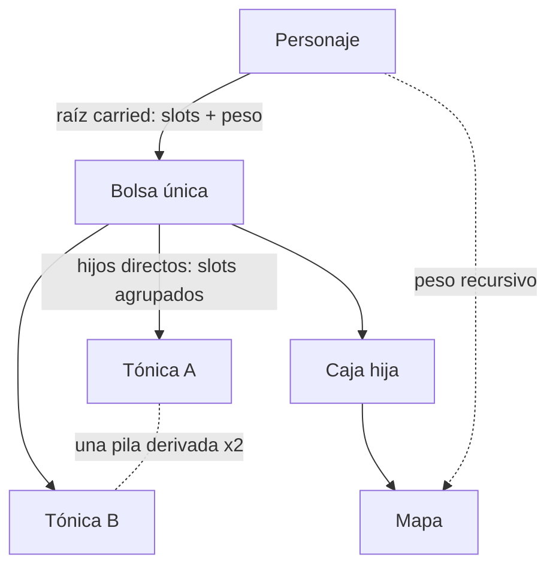

# Especificación técnica de Tiamud v0.3

Estado: especificación de implementación en prelanzamiento, 2026-07-17.

Este documento registra las decisiones actuales de producto y arquitectura de
Tiamud. Sustituye la planificación de personajes y multimedia de la
[especificación histórica v0.2](spec-v0.2.md). Los ADR aceptados y el código
implementado prevalecen cuando este resumen sea menos específico.

## Contrato de producto

Tiamud es un mundo textual multijugador persistente con presentación ilustrada
opcional. Un estado de mundo autoritativo sirve al navegador, Telnet y clientes
MUD compatibles.

El producto debe seguir siendo:

- completamente jugable como texto plano;
- orientado al navegador sin convertirlo en autoridad;
- sencillo de ejecutar en un equipo corriente;
- determinista y acotado en toda frontera no confiable;
- definido por datos para mundo, personajes y medios;
- accesible sin imágenes, color, audio ni movimiento;
- compatible con importación Envy/Merc revisada, sin ejecutar programas
  históricos ni presuponer derechos; e
- independiente de IA, GPU, Kubernetes, Redis o cloud obligatorios.

La IA puede ayudar al desarrollo o autoría sin conexión. Es opcional, acotada,
revisada y nunca participa en el juego autoritativo.

## Despliegue y persistencia

Un servidor Rust posee un actor de mundo y expone HTTP/WebSocket y Telnet. Los
recursos web pueden servirse desde el proceso o un proxy en el mismo host.
PostgreSQL se recomienda para instalaciones públicas nuevas; SQLite es la
alternativa local sin servicio. Se selecciona uno y nunca se hace doble
escritura.

Ambos adaptadores implementan el esquema v12. Conserva las relaciones sociales
y de staff de v9/v10 y amplía de forma transaccional el límite físico del
snapshot opaco actual a 2 MiB. Los snapshots legacy v1–v5 continúan limitados a
1 MiB al decodificarse; v6 y v7 admiten 2 MiB. El traslado
SQLite→PostgreSQL copia estas relaciones y
el runtime en una transacción. La aceptación PostgreSQL real retenida es v8;
no se relabela como aceptación v12 y aún falta ejecutar v12 contra un servidor
PostgreSQL real.

La operación está en [single-host.md](operations/single-host.md). Microservicios
y orquestación no son objetivo sin carga medida que lo justifique.

## Datos de mundo y autoría

WorldPack v9 es el objetivo canónico. AreaPack v8 permite composición modular
estricta bajo WorldProject v2. WorldPack v8/v7/v6/v5/v4/v3/v2, AreaPack
v7/v6/v5/v4/v3/v2/v1 y Envy/Merc se normalizan al importar o componer; el dominio
no conserva vocabulario heredado ni inventa sellos, afijos, telepatía o emotes.

Propiedades obligatorias:

- IDs estables, namespaced, en minúscula;
- estructuras acotadas y validación de referencias;
- artefactos y digests canónicos deterministas;
- pruebas de contenido y vistas previas revisadas;
- sin conversión de imagen online ni IA generativa en juego;
- origen, licencia, procedencia y revisión de medios; y
- resolución en servidor de secretos y variantes de percepción.

Los títulos de sala y sus variantes ocupan `1..=128` bytes; las descripciones
base o de variante ocupan `1..=8192`
bytes. Se validan como UTF-8 normalizado y texto seguro; los límites son de
bytes, no de puntos de código.

Consulta [world-authoring.md](world-authoring.md) y
[character-progression-v3.md](design/character-progression-v3.md).

### Objetos, inventario y botín 3A–4B

WorldPack v9 separa `itemPrototypes`, que contienen contenido y reglas
reutilizables, de `initialItemInstances`, que asignan cada unidad durable a una
sala, un `npc_spawn`, `staged` o a otra instancia contenedor. En runtime
`ItemInstanceId` es una cadena tipada interna; las instancias nuevas usan una
secuencia monotónica incluida en checkpoint, rollback y snapshot. Los clientes
nunca reciben esa identidad ni `prototypeId`: Web, Telnet y GMCP operan con IDs
opacos derivados de una sal criptográficamente aleatoria nueva por sesión.

`entityMedia(kind=item)` referencia un prototipo reusable; el servidor aplica
esa presentación solo a sus instancias ya visibles. En cambio,
`roomPerception.hiddenItems` referencia la instancia concreta. La percepción se
resuelve antes de agrupar, por lo que una unidad oculta no incrementa la
cantidad visible.

Cada prototipo declara peso, coste de slot, rareza cerrada
`common|uncommon|rare|epic|legendary`, `itemLevel`, política de pila y política
de transferencia. `unique` exige `maxStackUnits: 1`; `fungible` admite
`2..=1000`. Las pilas son vistas deterministas por
ubicación/prototipo/vínculo, ordenadas por ID de instancia y partidas por ese
máximo. No se persisten `quantity`, identidad de pila ni una lista duplicada de
miembros:

```text
stackSlots = ceil(quantity / maxStackUnits) × slotCost
totalWeightGrams = quantity × weightGrams
```

Un contenedor debe ser una instancia `unique`, no consumible, con
`maxSlots: 1..=1000` y `maxWeightGrams: 0..=1_000_000`. Sus slots cuentan hijos
directos ya agrupados; su peso usado cuenta todos los descendientes. El peso
del personaje incluye raíces portadas/equipadas y todo su contenido, mientras
sus slots solo cuentan raíces portadas. El grafo rechaza autorreferencias,
ciclos, referencias inválidas y una quinta arista de profundidad.



Antes de mutar se valida una ubicación prospectiva completa; un error no mueve
ninguna unidad ni avanza revisión, RNG o contador. `take` y `drop` aceptan una
cantidad opcional, `put <objeto> in <contenedor>` mueve raíces portadas y
`get <objeto> from <contenedor>` solo hijos directos. Cada mutación admite
1..=256 unidades. `contents` pagina veinte grupos y evita incrustar árboles
recursivos en las fichas o escenas.

WorldPack v9 y AreaPack v8 actuales, igual que WorldPack v8/v7/v6/v5 y AreaPack
v7/v6/v5/v4, aceptan el vocabulario cerrado `transferable`, `character_bound` y
`non_transferable`; WorldPack v4, AreaPack v3 y formatos anteriores solo
normalizan `transferable`. El propietario efectivo de una
instancia se obtiene siguiendo como máximo cuatro aristas de contención hasta
una raíz portada o equipada. La primera adquisición por un personaje liga
atómicamente la raíz y cada descendiente `character_bound`. Un objeto ligado
no se desliga ni se reasigna; `non_transferable` no guarda dueño ligado, pero
no puede abandonar al personaje que lo posee. `drop` y todo cambio de dueño
exigen que el subárbol completo sea `transferable`; introducir, extraer,
equipar, desequipar o consumir dentro del grafo del mismo dueño conserva el
vínculo.

```text
give [cantidad] <objeto> to <personaje>
```

`give` mueve únicamente raíces portadas a un receptor distinto, conectado y en
la misma sala. Acepta un selector opaco o un nombre exacto no ambiguo, valida
capacidad de emisor y receptor, y respeta ignore del receptor y block bilateral.
La ubicación de todas las raíces y el evento `ItemsGiven` se confirman como una
sola mutación antes de proyectar salida. No es un intercambio: `trade` usa una
negociación bilateral distinta.

El escrow de trade es una reserva durable, no otra ubicación o saldo. Objetos
y moneda permanecen con su propietario; el índice derivado bloquea raíz,
descendientes y gasto reservado. Cada personaje participa como máximo en un
trade, hay hasta 64 globales, 8 líneas por participante y 128 raíces entre
ambos. Solicitud y negociación caducan a 20 y 120 ticks respectivamente.

Dos personajes conectados, en la misma sala, fuera de combate/derrota y
permitidos por ignore/block pueden negociar. Todo cambio material incrementa
una revisión, recalcula la base canónica y borra confirmaciones. Dos identidades
distintas deben confirmar la misma revisión y digest; entonces el actor valida
prospectivamente ambos grafos, capacidades y saldos y publica los dos lotes, los
dos agregados, la eliminación del trade y su evento en un solo commit. No hay
movimiento parcial ni reembolso al cancelar.

Separación, combate, derrota, desconexión, ban, cambio social, expiración o
reserva inválida cancelan de forma cerrada. Tras reinicio se cargan y validan
los participantes adicionales con presupuesto acotado, se cancelan todos los
trades restaurados y se confirma el snapshot limpio antes de readiness. Web,
texto Telnet, `Char.Trade 1` GMCP y el bot estricto usan selectores privados
opacos, cantidad disponible/reservada y saldo total/reservado/gastable.

Rareza, nivel, peso unitario/total, cantidad, slots y capacidad aparecen como
texto en escena, inventario, equipo y contenidos. El color nunca es la única
señal. Web usa `container.contents`; Telnet ofrece texto equivalente y GMCP
proyecta `Char.Items.List` con ubicación `container`.

`WorldRuntimeSnapshot` v7 conserva `itemInstances`, su grafo de ubicaciones,
el vínculo obligatorio por instancia, el siguiente contador de instancia,
`nextTradeId`, las reservas de trade, RNG, `itemAffixes`,
`nextRewardOpenId` y cinco campos de botín: `nextLootDropId`,
`itemProvenance`, `lootEncounters`, `groundLoot` y `partyLootCursors`. La
procedencia distingue además las recompensas `SealedReward`. El vínculo tiene
exactamente una de estas formas:

```json
{"kind":"unbound"}
{"kind":"character","characterId":42}
```

El decoder lee primero `snapshotVersion` y usa DTO explícitos v1–v7; v1–v3 se
convierten a `unbound`, v4 produce un estado de trade vacío y v1–v5 reciben
procedencia `legacy_snapshot { sourceVersion }` sin inventar derechos. Campos
de v6 se convierten estrictamente a v7 con `itemAffixes: []` en cada instancia y
`nextRewardOpenId: 1`. Campos posteriores inyectados en una versión antigua,
referencias huérfanas, ciclos,
profundidad, política/vínculo, trades, procedencia, derechos, reservas o
contadores inválidos bloquean el arranque. La restauración conserva instancias
iniciales nuevas del WorldPack y superpone el estado durable, sin resucitar
instancias runtime ausentes.

Antes de abrir listeners se valida por lotes la unión de identidades referidas
por el snapshot. Para propietarios raíz e IDs ligados se cargan fichas y se
comprueban existencia, equipo, grafo y capacidad sin convertir identidades
desconectadas en personajes activos; para cohortes o beneficiarios que solo
aparecen en botín se realiza una consulta `existence-only`. Después se cancelan
los encuentros de botín aún abiertos y su estado de combate en un commit previo
a readiness; los derechos `groundLoot` ya resueltos sobreviven intactos. SQLite
y PostgreSQL confirman el snapshot como única autoridad en su transacción de
esquema v12; no hay tabla espejo de loot o escrow ni doble escritura.

Los límites principales son 1.024 prototipos y 8.192 instancias iniciales por
WorldPack, 65.536 instancias runtime, 1 MiB para un snapshot legacy v1–v5 y 2
MiB para el snapshot v6 compatible y el v7 actual. El presupuesto agregado de
fichas de
propietarios inspeccionadas al arrancar sigue siendo 1 MiB y cada ficha tiene
un máximo de 64 KiB. Lantern Square contiene 3 salas, 10 prototipos, 9
instancias iniciales, 2 tablas, 1 fuente, 1 afijo, 1 pool, 1 habilidad
telepática y 1 emote de sala; el WorldPack canónico ocupa 53.567
bytes y tiene SHA-256
`9a75894a9e2e0c48d20257633f323d52bbe78b9db106de8c497f4784392b5e75`.

WorldPack v7/AreaPack v6 admiten drops garantizados y pools ponderados con
pesos enteros. Las entradas se ordenan canónicamente y cada selección usa
rejection sampling, evitando sesgo de módulo. Una fuente `npc_spawn` se
resuelve una sola vez por derrota; botín fijo y generable suman como máximo 64
raíces. Tirada, RNG, contador, procedencia, derechos, NPC, XP, eventos y
snapshot se confirman o revierten juntos.

La política `credited_character` reserva todas las raíces al iniciador. La
política `party_round_robin` congela al empezar el encuentro una cohorte de
hasta seis personajes próximos, conectados y vivos, siempre con el iniciador;
en la derrota vuelve a comprobar proximidad y party de los acompañantes. Un
cursor durable reparte las raíces y `loot pass <referencia>` cede una a la
siguiente identidad elegible sin renovar el plazo. El derecho es exclusivo
durante 20 ticks, pasa a público después y lo no reclamado se retira al tick
120. Need/greed, master-loot y reparto por contribución no forman parte de 4A.

Cada raíz conserva procedencia cerrada `authored_initial`, `legacy_snapshot`,
`runtime_created` o `npc_loot` con digest canónico de tabla. Si tras la poda no
cabe el peor caso bajo los presupuestos de instancias/derechos, las raíces
fijas tienen prioridad y la generación restante se suprime de forma durable:
la derrota y XP se confirman, RNG y `dropId` avanzan y un reinicio no permite
reroll. En la frontera histórica 4A todavía no existían afijos ni recompensas
selladas; las cajas, llaves o tiradas pagadas ya quedaban fuera del baseline.

La fase 4B está implementada en WorldPack v7/AreaPack v6. Un sello es un
prototipo `unique`, consumible, `character_bound`, no estructural y sin efectos,
que no admite instancia inicial. Debe ser generado por una tabla normal
asociada a un NPC; su tabla sellada no puede ser `lootSource` directa ni
producir otro sello. Cada apertura genera 1..=16 unidades y admite hasta 1.024
filas de probabilidad base y condicional visibles mediante `reward odds`.

Una entrada normal o sellada de cantidad exactamente uno puede referenciar un
pool que elija, con pesos enteros y sin sesgo, un único afijo o `nothing` para
un prototipo `unique`, `maxStackUnits: 1` y no sellado. El WorldPack admite 512
afijos, 256 pools, 64 entradas por pool y 4.096 entradas ponderadas totales;
cada etiqueta ocupa hasta 64 bytes y cada delta positivo de ataque o curación
es como máximo 1.000. La compatibilidad del tipo y los caps efectivos se
validan antes de publicar y al cargar.

`open` confirma juntos consumo del sello, RNG, contador, creación, afijo,
vínculo, capacidad, procedencia y evento; un fallo restaura el checkpoint
exacto. En botín normal, la tirada de afijo se consume aunque la generación
termine suprimida para impedir reroll por capacidad. Las copias durables del
afijo conservan digests de definición, pool y registro, mientras IDs internos,
RNG, contadores y digests no se proyectan. Web, Telnet y GMCP comparten esta
autoridad y muestran estadísticas autorizadas mediante referencias opacas. El
contrato está en el
[ADR 0014](decisions/0014-earned-sealed-rewards-and-deterministic-affixes.md).
Pity, need/greed, master-loot, reparto por contribución, cajas, llaves y tiradas
pagadas permanecen fuera.

## Modelo de personaje

```text
baseline neutral de ficha
  + concesiones de creación del linaje
  + concesiones del trasfondo opcional
  + concesiones de creación de clase base
  + concesiones de nivel de clase activa
  + rangos adquiridos de talentos de linaje/clase
  + concesiones únicas de promoción avanzada
  = ficha permanente

equipo + estados activos se aplican después
```

El baseline neutral no aporta atributos, skills o capacidad oculta. La clase
base define el inicio real, con adiciones de linaje/trasfondo. La creación llena
vida y recursos una vez; aumentar capacidad después conserva valores actuales.

Términos canónicos: linaje, trasfondo, clase base, talento/especialización y
clase avanzada. `Race` y `archetype` solo son sinónimos de importación/UI.

La primera versión usa:

- una curva acumulada de XP/nivel global;
- una clase activa;
- reservas acotadas separadas para clase y linaje;
- adquisición de talento distinta de promoción;
- requisitos declarativos y concesiones verificadas;
- linaje/trasfondo inmutables tras crear; y
- sin multiclase, XP de clase, promoción reversible ni scripts arbitrarios de
  concesiones permanentes.

Evolución de linaje desarrolla nodos acotados, no sustituye el linaje. La
promoción avanzada cambia identidad atómicamente conservando XP/nivel.

| Dimensión | Definiciones de demostración |
| --- | --- |
| Linajes | Mortal, Stonekin, Embermarked |
| Trasfondos | Caravan Scout, Archive Apprentice, City Guard |
| Clases base | Wanderer, Vanguard, Arcanist |
| Clases avanzadas | Pathfinder, Bastion, Stormcaller, Spellblade |

La curva de ejemplo define `100 × (level - 1)²` para niveles 2–10. Pathfinder,
Bastion y Stormcaller parten de su base al nivel 5; Spellblade permite entrada
Vanguard o Arcanist al nivel 6 con requisitos alcanzables.

Gramática, grafos e invariantes son normativos en el
[diseño v3](design/character-progression-v3.md) y
[ADR 0007](decisions/0007-worldpack-v3-character-model.md).

## Combate, habilidades y seguridad de progresión

Acciones marciales, hechizos y utilidad comparten un modelo acotado con costes,
cooldowns, objetivos, daño/curación, resistencias y estados temporales. Los NPC
usan definiciones iguales y decisión determinista por reglas, nunca IA
generativa runtime.

`martial`, `spell`, `utility` son categorías comunes a WorldPack, Rust y wire
del navegador. `innate` pre-v3 no forma parte del modelo limpio.

Autoría y runtime validan límites acumulados. Aumentar vida máxima no cura;
aumentar capacidad de recurso no rellena y una reserva nueva empieza vacía.
Las acciones permanentes se aplican atómicamente y una sola vez.

La recompensa hard-coded de skill de combate y la misión de demostración son
deuda de política del ejemplo. Deben pasar a señales/recompensas de autoría
antes de un contrato de contenido estable.

## Sistemas sociales, grupos, staff y botín

La fase social 1 está implementada. `say` es local; `tell` llega a un personaje
conectado; `reply` usa en memoria el ID del último remitente cuyo `tell` se
entregó. Los grupos de hasta seis miembros persisten
create/invite/accept/revoke/kick/transfer/disband/leave/status y ofrecen
`party say`, `gsay`, `gtell`.

`general`, `newbie`, `staff` exigen suscripción durable. Unirse, enviar y
recibir `staff` requiere perfil `moderator`, `administrator` o `implementor`;
`helper` y `builder` no acceden. La membresía del grupo sobrevive a la
desconexión, pero accept/revoke/kick/transfer resuelven un nombre conectado y no
administran un objetivo offline.

La fase 5A añade telepatía directa online sin convertir `tell` en otra cosa.
WorldPack v8/AreaPack v7 pueden marcar una habilidad `spell|utility`,
`single_ally`, sin daño/curación/estado, con al menos un coste positivo,
cooldown positivo y hasta 64 salas bloqueadas. El actor debe conocerla y estar
vivo, libre de stun/recuperación y en una sala permitida. Recurso, cooldown de
habilidad y cooldown global se confirman antes de entregar. Ignore/block,
estado o sala del receptor suprimen la entrega sin revelarlo; el pensamiento y
destino no persisten y no actualizan `reply`.

La misma política, rate limit, mute, ignore/block y buzones por sesión sirve a
acciones web, comandos Telnet y `Comm.Channel.Text` GMCP. El correo offline es
una superficie durable separada: 64 mensajes y 128 KiB por buzón, páginas de
10, caducidad de 30 días, cuotas por cuenta de 20/h y 50/día y denuncia con
evidencia de 90 días. Usa `mail.*`, texto Telnet y `Tiamud.Mail 1`; la
aceptación no revela ignore/block, ban o capacidad. No existen historial
general durable, shout/yell espacial, emotes globales/de grupo, telepatía de grupo/offline,
follow/assist/rescue, selección general de aliados ni XP/misión compartida. El
reparto de botín implementado se limita a la cohorte próxima y round-robin de
4A.

La fase 5B añade hasta 32 `socialEmotes` en WorldPack v9/AreaPack v8. Cada uno
es local a la sala y usa plantillas cerradas distintas para actor, objetivo y
observadores, con solo `{actor}`/`{target}`, render máximo de 512 bytes y
sustitución en una pasada que no reinterpreta nombres. `emotes` lista y
`emote <comando> [personaje]` ejecuta; Web usa `social.emote.list` y
`social.emote`. No hay texto libre. Un objetivo es otro personaje conectado,
no ambiguo y en la misma sala. Ignore/block suprime por receptor, `OnTalk` se
confirma antes de entregar y el canal `emote` comparte Web, Telnet y GMCP sin
entrar en eventos, `reply`, snapshots, auditoría, historial o SQL.

El contrato durable y de privacidad de 5C se fija en
[ADR 0017](decisions/0017-bounded-offline-mail.md).

La autoridad ejecutable de staff es independiente de la ficha y usa una de
doce capacidades cerradas: `reports.view`, `reports.resolve`,
`moderation.mute`, `moderation.ban`, `staff.assign`, `staff.inspect`,
`staff.where`, `staff.goto`, `staff.transfer`, `staff.restore`,
`staff.announce`, `staff.audit`. Nunca se obtiene por XP, nivel, clase,
talentos o WorldPack.

Los perfiles operativos cerrados son `helper`, `builder`, `moderator`,
`administrator`, `implementor`. Siembran bundles revisados de capacidades y
pueden llevar un `lore_title` opcional; perfil y título no sustituyen la
comprobación de capacidad. Los roles `Player`, `Moderator`, `Admin` se
conservan solo como tier legado para moderación y percepción: por sí solos
nunca autorizan un comando ni abren el canal `staff`. Ese canal requiere perfil
`moderator`, `administrator` o `implementor`; `helper` y `builder` no acceden.
La primera cuenta registrada recibe `implementor`; las cuentas Admin migradas
reciben `administrator`. Cambiar perfil elimina las asignaciones anteriores y
siembra exactamente el bundle del perfil nuevo. La jerarquía impide actuar
sobre la propia cuenta o un rango igual/superior.

La fase 2 implementa cola de reportes y resolución `dismissed`,
`action_taken` o `no_action`; `inspect`, `where`, `goto`, `transfer`,
`restore`, `announce`, consulta de auditoría y asignación explícita de
perfil/capacidad. Todas exigen motivo. Las acciones que tocan el mundo resuelven
un personaje conectado; asignaciones y reportes usan identidad durable. Las
mutaciones sensibles y su auditoría se confirman atómicamente, y `staff_audit`
rechaza actualización y borrado.

Sintaxis textual normativa de fase 2:

```text
staff
staff status
staff reports <motivo>
staff resolve <id> <dismissed|action_taken|no_action> <motivo>
staff inspect <nombre> | <motivo>
staff where <nombre> | <motivo>
staff goto <nombre> | <motivo>
staff transfer <nombre> | <motivo>
staff restore <nombre> | <motivo>
staff announce <texto> | <motivo>
staff audit <motivo>
staff profile <nombre> <helper|builder|moderator|administrator|implementor|none> <título|none> | <motivo>
staff capability <grant|revoke> <nombre> <capacidad> | <motivo>
```

Web expone acciones estructuradas estrictas equivalentes. Telnet usa el mismo
analizador; los anuncios llegan como `announcement` en texto, Web
`chat.message` y GMCP `Comm.Channel.Text`.

Los objetos separan prototipo reutilizable e instancia durable con ubicación y
vínculo autoritarios. Los NPC poseen instancias de botín fijo validadas y las
transfieren al morir. Capacidad por slots/peso, rareza textual, `itemLevel`,
pilas fungibles derivadas, contenedores acotados, cantidades, consulta paginada,
tres políticas de transferencia y `give` atómico están implementados. También
lo está el trade confirmado mediante reservas durables, revisión/digest y
liquidación simultánea. 4A añade tablas enteras fixed+repeatable, procedencia,
derechos de 20 ticks, reparto de grupo round-robin, `loot pass`, publicidad y
despawn al tick 120. 4B añade sellos ganados con `open`/`reward odds` y un
afijo acotado para botín único normal o sellado. Need/greed, master-loot,
contribución y pity no están implementados. Cajas de botín pagadas o tiradas
con moneda prémium quedan fuera del baseline.

Consulta la [hoja de ruta social/staff/botín](design/social-staff-and-loot-roadmap.md).

## Escenas semánticas y medios

Una escena es una proyección semántica segura ante percepción. Prosa y
entidades estructuradas contienen todo. La imagen atmosférica es opcional.

El compositor añade solo presentación a entidades visibles:

- poses transparentes revisadas de objetos/NPC;
- huella, prioridad y capa normalizadas;
- slots deterministas y zonas seguras en cliente;
- máximo de diez sprites y overflow semántico;
- pistas cortas `attack`/`hit`/`defeat` derivadas por servidor (`heal` queda
  reservado en cliente); y
- gating completo para lector, Save-Data, movimiento, colores y multimedia.

Las anotaciones viajan como sidecar web, no en `SceneView`, evitando expansión
GMCP y fugas. El servidor decide visibilidad/sprite; manifiestos, geometría; el
navegador, colocación adaptable. Layout es función pura del snapshot.

El juego nunca espera medios. Las pistas decaen a `idle` y no se reproducen tras
resync. Un snapshot de la misma vista retiene la pista solo si el NPC opaco
sigue presentado; retirada/cambio/resync limpia. No hay jugador compuesto ni
lápida persistente en v1. Consulta
[scene-compositor-v1.md](design/scene-compositor-v1.md) y
[ADR 0008](decisions/0008-optional-scene-compositor.md).

## Formatos multimedia

- Atmósfera opaca: AVIF, luego WebP/JPEG.
- Sprite transparente: WebP alfa + PNG.
- AVIF alfa: aplazado hasta demostrar ruta RGBA determinista útil.
- Atmósfera transparente/lossless: PNG.
- SVG/HTML/CSS/JavaScript, hosts remotos arbitrarios y `data:` inline:
  rechazados.

Recursos mismo-origen, inmutables y direccionados por contenido. Poses estáticas
en v1; animación CSS acotada. Vídeo, WebP animado y composición runtime quedan
aplazados.

## Protocolo

`tiamud.v1` WebSocket sigue experimental. Clientes reciben IDs opacos derivados
de una sal criptográficamente aleatoria nueva por sesión, además de revisiones
y secuencias por sesión. Texto y percepción preceden cada representación.

Salvaguardas implementadas:

- 16 KiB compactos por frame WebSocket de salida;
- ventana semántica determinista de escena de 14 KiB en Web y 48 KiB en
  Telnet, priorizando botín propio, público y reservado ajeno antes de truncar
  entidades/prosa con un aviso explícito;
- batches de como máximo 16 eventos proyectados, con coalescing y snapshot
  autoritativo cuando una ráfaga es mayor; y
- recuperación correlacionada `sync.scene`/`sync.player`, aplicada como par; y
- escena GMCP grande degradada a escena mínima más aviso acotado, nunca silencio.

Antes del primer hito público, cambios densos deberían migrar a batches
atómicos `baseRevision`/`revision`. Las pistas decoran `message.append`; no crean
secuencia ni se infieren de prosa. Referencia:
[tiamud-v1.md](protocol/tiamud-v1.md).

## Invariantes de accesibilidad y seguridad

- Una imagen nunca contiene información exclusiva.
- Modo lector desactiva arte decorativo salvo petición explícita.
- Texto de jugador no se convierte en ANSI/MXP/HTML/CSS/URL/alt sin escape y
  validación contextual.
- Gráficos terminales requieren capacidad y consentimiento explícitos.
- Recursos pesados viajan por HTTPS, no GMCP/Telnet.
- Parsers, subnegociaciones, profundidad JSON, colas, scripts, recursos y
  descompresión tienen límites.
- Entidades ocultas, salas secretas y variantes no resueltas no se precargan.

## Estado de implementación

| Área | Estado al actualizar v0.3 |
| --- | --- |
| Combate y habilidades acotadas | Baseline implementado y probado |
| Límites acumulados y nivel sin relleno | Implementado y probado |
| WorldPack v9/AreaPack v8/WorldProject v2, validador, normalizador y catálogo | Integrado en servidor; entradas WorldPack v8/v7/v6/v5/v4/v3/v2 y AreaPack v7/v6/v5/v4/v3/v2/v1 se normalizan sin inventar sellos, afijos, telepatía, emotes ni loot ausente |
| Linaje/clase/talento/promoción y persistencia | Implementado y probado |
| Creación v3 navegador/Telnet | Default/none/explícito implementado |
| Ficha, talentos y promociones web | Implementado y probado |
| Recuperación dividida, frame gate y fallback GMCP | Implementado y probado |
| Compositor navegador y accesibilidad | Implementado y probado |
| Perfil de sprite transparente | WebP alfa + PNG implementado |
| Sidecar de entidades seguro | Implementado; sin sprites de muestra |
| Pistas de combate | Ataque/golpe/derrota NPC; sin jugador/heal/lápida |
| Social fase 1 y esquema v12 actual | Grupos/chat/reply/canales y paridad Web/Telnet/GMCP implementados; aceptación PostgreSQL real v12 aún no retenida |
| Comunicación fase 5A | Telepatía directa online authored con coste/cooldowns, bloqueo por sala, supresión privada, commit antes de entrega y paridad Web/Telnet/GMCP; la telepatía no persiste ni entrega offline/grupal |
| Comunicación fase 5B | Emotes locales authored con plantillas cerradas y render no recursivo, targeting local cerrado sin objetivo/opcional/obligatorio, ignore/block por receptor, commit antes de entrega y paridad Web/Telnet/GMCP; sin texto libre, persistencia ni emotes globales/de grupo |
| Comunicación fase 5C | Correo offline explícito con cuotas por cuenta, buzón/caducidad/paginación acotados, referencias opacas, aceptación que no filtra política/capacidad, denuncia con evidencia de 90 días y paridad Web/Telnet/`Tiamud.Mail 1`; sin historial general, outbox, adjuntos ni correo grupal |
| Staff fase 2 | Perfiles/capacidades, reportes, acciones acotadas, razones, Web/Telnet y auditoría append-only implementados; aceptación PostgreSQL real v12 aún no retenida |
| Inventario fase 3A | Prototype/instance, snapshot v2 migrado desde v1, slots/peso, rareza/`itemLevel`, IDs opacos y paridad Web/Telnet/GMCP implementados; puertas locales integradas superadas |
| Inventario fase 3B | Pilas derivadas, contenedores acotados, snapshot v3 migrado desde v1/v2, cantidades/paginación y paridad Web/Telnet/GMCP implementados; puertas locales integradas superadas |
| Inventario fase 3C | Snapshot v4 con vínculo durable y migración v1-v3, tres políticas, `give` atómico, opacidad y paridad Web/Telnet/GMCP implementados; puertas locales soportadas superadas |
| Inventario fase 3D | Snapshot v5 migrado desde v4, reservas durables, doble confirmación y liquidación simultánea de objetos/moneda en Web/Telnet/GMCP; puertas integradas y Playwright final 36/36 superados |
| Botín fase 4A | Snapshot v6 migrado estrictamente desde v1–v5, tablas enteras fixed+repeatable, rejection sampling, procedencia, round-robin/pass, 20/120 ticks, privacidad y paridad Web/Telnet/GMCP implementados |
| Botín fase 4B | WorldPack v7/AreaPack v6 y snapshot v7; sellos ganados, `open`, odds exactas, afijo único normal/sellado, rollback, caps y opacidad implementados |
| Proyección densa acotada | Ventanas semánticas Web/Telnet, batches de 16 y coalescing con snapshot autoritativo implementados; no es un journal/replay general de eventos |

En la evidencia histórica integrada de fase 3A pasan formato, pruebas bloqueadas del workspace
y clippy estricto; 77 pruebas de core, 80 de WorldPack, 28 del importador y 195
del servidor; `svelte-check` sin errores ni avisos, 100/100 pruebas web y build;
30/30 escenarios Playwright soportados; y las comprobaciones de licencias y
avisos generados para 307 dependencias Rust y 76 web. No se ejecutaron
PostgreSQL real v10, WebKit local ni soak de 24 horas. Estas puertas locales no
demuestran por sí solas publicación o CI.

La evidencia histórica integrada de 3B pasó formato/check/clippy, 499/499
pruebas Rust, 103/103 web, 30/30 Playwright Chromium/Firefox, 80/80 Node, humo,
carga CI y soak corto. También pasaron `cargo-deny`, licencias y avisos 307
Rust/76 web. No se ejecutaron PostgreSQL real v10, WebKit local ni soak de 24
horas; las puertas locales no demuestran por sí solas publicación o CI.

En el árbol integrado de fase 3C pasaron 513/513 pruebas Rust: 93 core, 95
WorldPack, 28 importador, 207 servidor y 90 restantes. También pasaron
`svelte-check` con 0 errores y 0 avisos, 103/103 pruebas web, 81/81 Node y
32/32 escenarios Playwright soportados, 16 Chromium y 16 Firefox. WebKit no
arrancó en aquel gate por bibliotecas GTK/GStreamer ausentes. No se ejecutaron
PostgreSQL real v10 ni soak de 24 horas; estas comprobaciones locales sobre un
árbol dirty no demuestran CI, publicación o producción.

En el árbol integrado de fase 3D pasan formato, clippy estricto y 550 pruebas
Rust: 102 core, 97 WorldPack, 28 importador, 231 servidor y 92 restantes del
workspace, incluidas 23 admin. También pasan `svelte-check`, build, 107 Vitest
y 83 Node/bot. El pase Playwright final completa 36/36 escenarios, 18 Chromium
y 18 Firefox. Pasan licencias, avisos, humo, carga de 16 usuarios/32
rondas sin errores y soak corto de 30 s con 44 rondas, 97 acciones y 8/8
readiness. No se ejecutaron PostgreSQL real v10, WebKit local ni soak de 24
horas; estas puertas locales no demuestran CI, publicación o producción.

En el árbol integrado de fase 4A pasan formato, clippy estricto y 587 pruebas
Rust: 113 core, 240 servidor, 112 WorldPack y 122 restantes. También pasan
109 Vitest, 84 Node/bot, 19 escenarios Chromium, licencias y
avisos de 307 dependencias Rust/76 web, `cargo-deny` advisories/sources y humo.
La carga exacta completa 16 bootstraps/32 rondas con cero errores y 57.774.080
bytes de crecimiento RSS bajo el límite de 96 MiB; el soak corto de 30 s
completa 58 rondas, 127 acciones, readiness 8/8 y cero errores sin crecimiento
continuo. No se ejecutaron PostgreSQL real v11, Firefox, WebKit, lector real ni
soak de 24 horas; esta evidencia local no demuestra release o producción.

En el árbol integrado de fase 5A pasan formato/diff/clippy y 630 pruebas Rust:
131 core, 252 servidor, 123 WorldPack y 124 restantes. La web pasa check 0/0,
113 Vitest, build y 42/42 Playwright soportado (21 Chromium y 21 Firefox); la
suite Node/bot pasa 86/86. También pasan `cargo-deny`, licencias y avisos 307
Rust/76 web. El WorldPack v8 canónico mide 53.040 bytes y tiene SHA-256
`109670f74056ab67d711fba520f7ad74d1cd16b8c72c06bd257839d89827dbc6`.
No se ejecutaron PostgreSQL real v11, WebKit, lector manual ni soak de 24 h.

En el árbol integrado de fase 5B pasan formato/diff/clippy y 652 pruebas Rust:
139 core, 257 servidor, 132 WorldPack y 124 restantes. La web pasa check 0/0,
114 Vitest, build y 44/44 Playwright soportado (22 Chromium y 22 Firefox); la
suite Node/bot pasa 86/86. También pasan `cargo-deny`, licencias y avisos 307
Rust/76 web. La recomposición WorldPack v9/AreaPack v8 es idéntica, mide 53.567
bytes y tiene SHA-256
`9a75894a9e2e0c48d20257633f323d52bbe78b9db106de8c497f4784392b5e75`.
No se ejecutaron PostgreSQL real v11, WebKit, lector manual, carga/soak ni soak
de 24 h.

Una pieza aislada no es una funcionalidad end-to-end. Actualiza documentación
cuando las puertas de integración cambien.

## Puertas de aceptación

Personajes v3:

1. Selección de linaje/trasfondo/clase en navegador y texto.
2. Ficha acotada idéntica en cada persistencia.
3. XP concede puntos sin curar/recargar.
4. Talentos/exclusiones atómicos y durables.
5. Cada clase avanzada tiene ruta alcanzable.
6. Spellblade cubierto desde Vanguard y Arcanist.
7. Grafos inválidos/cíclicos/sobre límite no publican.
8. V2/Envy normaliza determinista o falla con diagnóstico.

Compositor:

1. Assets solo para entidades visibles.
2. Assets inválidos no cambian listas/acciones.
3. Layout determinista, adaptable, acotado y overflow textual.
4. Lector/Save-Data no descarga sprites.
5. Movimiento reducido muestra resultado estático.
6. Pistas derivadas de eventos y eliminadas en resync.
7. Sin exceder presupuesto WebSocket/GMCP.
8. Telnet plano completo y limpio.

Inventario 3B:

1. Pilas derivadas nunca crean cantidad o identidad durable duplicada.
2. Límites de pila y slots/peso se cumplen con aritmética comprobada.
3. El peso recursivo incluye descendientes y los slots solo hijos directos.
4. Ciclos, profundidad 5 y sobrecapacidad fallan sin mutación parcial.
5. Selectores opacos y percepción preceden a la agrupación.
6. Cantidad máxima 256 y `contents` máximo 20 grupos por página.
7. Snapshot v1/v2/v3 falla cerrado y conserva propietarios offline válidos.
8. Web, texto Telnet y GMCP expresan los mismos hechos autorizados.

Inventario 3C:

1. Snapshot v4 exige un vínculo cerrado por instancia; v1-v3 migran a
   `unbound` y rechazan campos de otra versión.
2. Adquirir liga recursivamente y una política restringida no puede eludirse
   mediante un contenedor, drop, give, replay o rollback.
3. `give` mueve 1..=256 raíces portadas entre personajes distintos, conectados
   y próximos, con capacidad bilateral y una sola revisión/evento.
4. Ignore y block impiden la entrega sin revelar cuál de esas políticas existe.
5. Un fallo de commit, capacidad, política, desconexión previa o selector no
   válido no publica estado, evento ni salida parcial.
6. Ningún propietario durable se proyecta; emisor y receptor reciben selectores
   opacos propios, el observador local solo narración y el remoto nada.
7. Web, texto Telnet, GMCP, SQLite, PostgreSQL, admin y mover comparten decoder,
   autorización y semántica.

Inventario 3D:

1. Snapshot v5 exige forma canónica, IDs y reservas acotadas; v4 solo migra a
   contador inicial y mapa vacío, sin schema-smuggling.
2. Cada raíz y subárbol reservado queda bloqueado, y el saldo gastable excluye
   toda moneda ofrecida sin crear otra autoridad.
3. Una mutación material incrementa una revisión y elimina confirmaciones; dos
   identidades distintas confirman la misma revisión y digest.
4. La liquidación simultánea valida ambos inventarios y saldos finales antes de
   confirmar personajes, snapshot y evento en una transacción.
5. Sala, conexión, combate/derrota, ignore/block, política, capacidad,
   expiración y desconexión se vuelven a comprobar de forma cerrada.
6. Reinicio carga participantes adicionales con presupuesto acotado, valida y
   cancela reservas antes de readiness; replay no reaplica monedas.
7. Web, texto Telnet, `Char.Trade 1`, páginas GMCP, bot, SQLite, PostgreSQL,
   admin y mover comparten acciones, límites, decoder y opacidad por sesión.

Botín 4A:

1. WorldPack v6/AreaPack v5 validan referencias, pesos enteros y el peor caso
   fijo+generado de 64 raíces; versiones anteriores rechazan campos 4A.
2. Snapshot v6 conserva procedencia, encuentros, derechos y cursor; v1–v5 se
   migran con forma exacta bajo 1 MiB y v6 queda acotado a 2 MiB.
3. La misma semilla y snapshot producen el mismo resultado mediante rejection
   sampling; un commit fallido revierte RNG, contador, NPC, XP y objetos.
4. Cohorte, round-robin y `loot pass` preservan derechos ante reconexión y
   reinicio; la exclusividad vence al tick 20 y el despawn al 120.
5. Capacidad insuficiente suprime generación, avanza la tirada de forma durable
   y nunca bloquea la derrota ni permite reroll.
6. Web, Telnet y GMCP proyectan solo `yours`, `reserved` o público mediante IDs
   opacos; no revelan beneficiario, cohorte, tabla, procedencia o drop durable.
7. Escenas densas respetan ventanas semánticas Web 14 KiB/Telnet 48 KiB,
   batches de 16, aviso/coalescing y recuperación mediante snapshot autoritativo.

Botín 4B:

1. WorldPack v7/AreaPack v6 validan sellos earned-only, pools de afijos,
   referencias, compatibilidad, máximos de 16 unidades y 1.024 filas de odds;
   formatos anteriores rechazan campos 4B.
2. Snapshot v7 conserva `itemAffixes`, procedencia sellada y contador de
   apertura; v6 migra exactamente con afijos vacíos/contador uno, v1–v5 quedan
   bajo 1 MiB y v6–v7 bajo 2 MiB.
3. `reward odds` publica probabilidades authored exactas y paginadas; no revela
   RNG, identidades internas, contadores ni digests de procedencia/afijo.
4. `open` confirma o revierte juntos sello, RNG, contador, objetos, afijos,
   vínculos, capacidad, procedencia y evento; un fallo no deja consumo parcial.
5. Botín normal y sellado comparten selección ponderada entera sin sesgo y un
   afijo máximo por unidad única; una tirada normal se consume aunque el drop
   termine suprimido.
6. Web, Telnet y GMCP comparten acciones, límites, páginas y referencias opacas.
7. Pity, need/greed, master-loot, reparto por contribución y recompensas pagadas
   no forman parte de esta fase.

## Trabajo aplazado o rechazado

Aplazado hasta necesidad demostrada: transformaciones, culturas, respec,
rangos de clase, editor de grafos, simulación de balance, medios animados,
gráficos raster terminales y carga caliente. El compositor necesita sprites
revisados; avatar, heal cue y lápida son mejoras opcionales. Need/greed,
master-loot, reparto por contribución y pity requieren diseño adicional.

Rechazado como baseline: Kubernetes, microservicios, Redis, object storage
obligatorio, generación de imagen runtime, decisiones LLM runtime, layout de
píxeles en servidor, física espacial continua, Canvas/WebGL para diez sprites,
scripts generales de progresión y blobs multimedia por Telnet.
También quedan fuera las cajas, llaves o tiradas pagadas.
