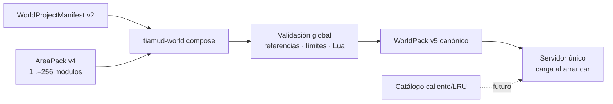
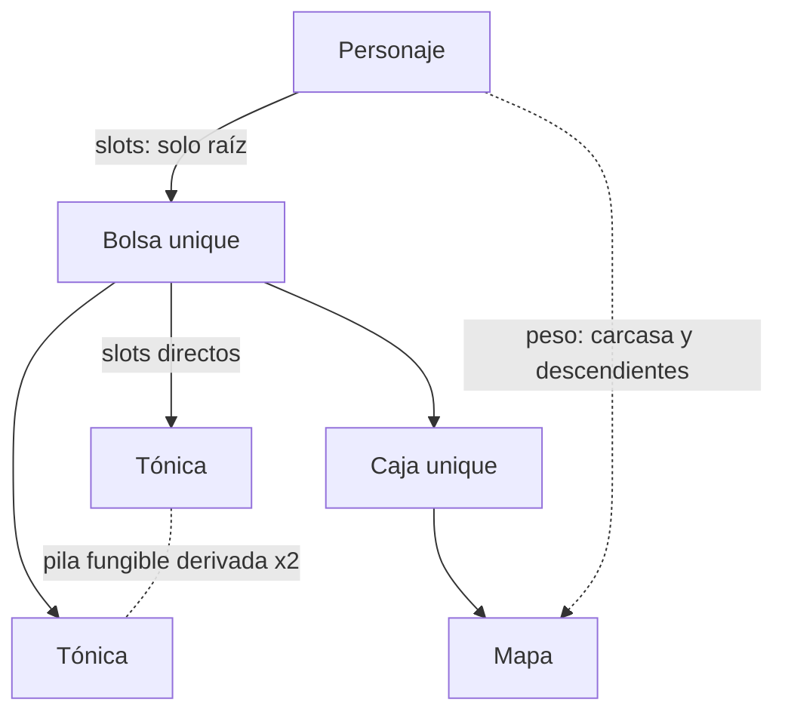

# Autoría, validación y publicación de mundos

Esta guía describe el contrato vigente de autoría de Tiamud: **WorldPack v5**
como artefacto canónico de ejecución, **AreaPack v4** como módulo de autoría y
`WorldProjectManifest` v2 como composición fuera de línea. La autoridad exacta
son los tipos y validadores de `crates/world-pack`; el ejemplo revisado es
[`worlds/lantern-square.world.json`](../worlds/lantern-square.world.json).

La [especificación v0.3](spec-v0.3.md) resume el producto y el
[centro de autoría](authoring/README.md) amplía personajes, medios, percepción,
variantes, scripts y pruebas de contenido.

## Frontera de ejecución

El servidor valida y carga un único `WorldPackDocument` v5 completo antes de
abrir sus listeners. `TIAMUD_WORLD_PACK` permite seleccionar un artefacto
externo revisado; si no se define, se usa Lantern Square embebido.

Un WorldPack compuesto no contiene áreas runtime. `AreaPack` es propiedad
editorial modular: `tiamud-world compose` resuelve sus dependencias y produce
un único artefacto plano. Por tanto:

- no hay composición, descarga ni resolución de dependencias durante el juego;
- no existen salidas “entre paquetes” runtime: todo destino debe existir en el
  WorldPack final;
- cambiar el mundo requiere seleccionar el artefacto y reiniciar;
- la carga/reemplazo caliente y la expulsión LRU del ADR 0005 siguen pendientes;
- los IDs publicados son identidad durable, no títulos; y
- perder imagen, audio o color nunca elimina prosa o acciones jugables.



## Versiones y compatibilidad

| Entrada | Tratamiento |
| --- | --- |
| WorldPack v5 | Formato canónico nativo. |
| WorldPack v4/v3/v2 | Se normaliza de forma determinista a v5 antes de validar. |
| AreaPack v4 | Formato modular nativo. |
| AreaPack v3/v2/v1 | Se normaliza a v4 antes de componer. |
| Envy/Merc | Solo pasa por `envy-import`; los programas históricos nunca se ejecutan. |

La compatibilidad antigua no permite escribir vocabulario legado en un
documento nativo. WorldPack v5 y AreaPack v4 rechazan `items`, `room.items`,
`itemRules` y `lootItemIds`: usan `itemPrototypes` e
`initialItemInstances`.

WorldPack v4 y AreaPack v3 reciben por normalización `maxStackUnits: 1` y sin
contenedor. Si una entrada antigua intenta declarar campos de 3B, se rechaza en
vez de ignorarlos: debe declarar la versión nueva.

Los objetos v3/v2 antiguos se convierten uno a uno, sin deduplicar por nombre o
contenido. El prototipo y la instancia pueden conservar la misma cadena
histórica porque pertenecen a espacios tipados diferentes. Un VNUM importado
produce un prototipo; cada reset inequívoco produce su propia instancia.

## Proyecto modular v2

El manifiesto contiene la identidad global, sala inicial, semilla y defaults de
personaje. Las rutas de área son relativas, no escapan del directorio del
proyecto y son únicas.

```text
WorldProjectManifest v2
├── schemaVersion! = 2
├── id!
├── name!
├── startRoomId!
├── rngSeed?
├── defaultLineageId?
├── defaultBackgroundId?
├── defaultBaseClassId?
└── areas[]!             1..=256
    ├── id!
    └── path!
```

Ejemplo:

```json
{
  "schemaVersion": 2,
  "id": "ejemplo-modular",
  "name": "Mundo modular de ejemplo",
  "startRoomId": "plaza:centro",
  "rngSeed": 42,
  "defaultLineageId": "ejemplo:mortal",
  "defaultBaseClassId": "ejemplo:viajero",
  "areas": [
    { "id": "plaza", "path": "areas/plaza.area.json" },
    { "id": "puerta", "path": "areas/puerta.area.json" }
  ]
}
```

## AreaPack v4

Cada área reutiliza los mismos registros del WorldPack; no crea una segunda
representación de salas, objetos o NPC. Solo añade `id` y `dependsOn` como
frontera de propiedad.

```text
AreaPack v4
├── schemaVersion! = 4
├── id!
├── dependsOn[]?
├── itemPrototypes[]?
├── initialItemInstances[]?
├── rooms[]?
├── npcPrototypes[]?
├── npcSpawns[]?
├── levelThresholds[]?
├── lineages[]?
├── backgrounds[]?
├── baseClasses[]?
├── advancedClasses[]?
├── talentGraphs[]?
├── abilities[]?
├── npcAbilitySets[]?
├── roomMedia[]?
├── entityMedia[]?
├── roomPerception[]?
├── sceneVariants[]?
├── scripts[]?
└── contentTests[]?
```

Una dependencia puede ser cíclica: dos áreas con salidas de ida y vuelta son un
caso normal. Toda referencia estructurada a una entidad de otra área debe
declarar su `id` en `dependsOn`. Esto incluye:

- salidas a salas ajenas;
- instancia→prototipo y ubicación de instancia en sala, spawn o contenedor ajenos;
- spawn→prototipo NPC y spawn→sala;
- concesiones/requisitos de progresión y habilidades;
- multimedia, percepción, variantes, scripts y pruebas.

El compositor no inspecciona texto Lua para inventar dependencias. Las
referencias opacas dentro de `source` son responsabilidad del autor.

### Ejemplo de dos áreas conectadas

`areas/plaza.area.json`:

```json
{
  "schemaVersion": 4,
  "id": "plaza",
  "dependsOn": ["puerta"],
  "itemPrototypes": [
    {
      "id": "plaza:farol",
      "name": "farol azul",
      "description": "Un farol de cristal azul.",
      "aliases": ["farol", "lámpara"],
      "equipmentSlot": "trinket",
      "weightGrams": 1200,
      "slotCost": 2,
      "rarity": "common",
      "itemLevel": 1,
      "stackPolicy": "unique",
      "maxStackUnits": 1,
      "transferPolicy": "transferable"
    }
  ],
  "initialItemInstances": [
    {
      "id": "plaza:farol-1",
      "prototypeId": "plaza:farol",
      "location": { "kind": "room", "roomId": "plaza:centro" }
    }
  ],
  "rooms": [
    {
      "id": "plaza:centro",
      "title": "La plaza",
      "description": "Un camino sale hacia el norte.",
      "exits": [
        {
          "direction": "north",
          "target": { "kind": "room", "room_id": "puerta:entrada" }
        }
      ]
    }
  ]
}
```

`areas/puerta.area.json`:

```json
{
  "schemaVersion": 4,
  "id": "puerta",
  "dependsOn": ["plaza"],
  "rooms": [
    {
      "id": "puerta:entrada",
      "title": "La puerta norte",
      "description": "La plaza queda al sur.",
      "exits": [
        {
          "direction": "south",
          "target": { "kind": "room", "room_id": "plaza:centro" }
        }
      ]
    }
  ],
  "npcPrototypes": [
    {
      "id": "puerta:lobo",
      "name": "lobo de lluvia",
      "description": "Vigila el camino bajo la lluvia.",
      "level": 1,
      "maxHealth": 18,
      "strength": 3,
      "defence": 1,
      "experienceReward": 60,
      "respawnTicks": 8
    }
  ],
  "npcSpawns": [
    {
      "id": "puerta:lobo-1",
      "prototypeId": "puerta:lobo",
      "roomId": "puerta:entrada"
    }
  ],
  "itemPrototypes": [
    {
      "id": "puerta:colmillo",
      "name": "colmillo plateado",
      "description": "Un pequeño colmillo engarzado en plata.",
      "aliases": ["colmillo"],
      "weightGrams": 100,
      "slotCost": 1,
      "rarity": "uncommon",
      "itemLevel": 1,
      "stackPolicy": "unique",
      "maxStackUnits": 1,
      "transferPolicy": "transferable"
    }
  ],
  "initialItemInstances": [
    {
      "id": "puerta:colmillo-1",
      "prototypeId": "puerta:colmillo",
      "location": {
        "kind": "npc_spawn",
        "npcSpawnId": "puerta:lobo-1"
      }
    }
  ]
}
```

El botín no vive en `npcPrototypes`. La ubicación `npc_spawn` de la instancia
es la asignación inicial, única y validada.

## WorldPack v5

El artefacto plano conserva identidad, catálogos de objeto, salas y gameplay.
Las extensiones de multimedia/percepción/scripts se aplanan en el documento
por `WorldPackDocument` aunque la estructura Rust separa el núcleo del mundo.

```text
WorldPack v5
├── schemaVersion! = 5
├── id!
├── name!
├── startRoomId!
├── source?
├── itemPrototypes[]?
├── initialItemInstances[]?
├── rooms[]!
├── gameplay?
│   ├── rngSeed?
│   ├── npcPrototypes[]?
│   ├── npcSpawns[]?
│   ├── characterProgression?
│   ├── abilities[]?
│   └── npcAbilitySets[]?
├── roomMedia[]?
├── entityMedia[]?
├── roomPerception[]?
├── sceneVariants[]?
├── scripts[]?
└── contentTests[]?
```

Un mundo mínimo sin objetos:

```json
{
  "schemaVersion": 5,
  "id": "ejemplo",
  "name": "Mundo de ejemplo",
  "startRoomId": "ejemplo:entrada",
  "rooms": [
    {
      "id": "ejemplo:entrada",
      "title": "La entrada",
      "description": "Un arco de piedra conduce al camino."
    }
  ]
}
```

## Prototipos e instancias de objeto

`itemPrototypes` define contenido reutilizable. `initialItemInstances` define
unidades iniciales y su única ubicación.

```text
ItemPrototype
├── id!
├── name!
├── description!
├── aliases[]?
├── equipmentSlot?       weapon | body | trinket
├── attackBonus?
├── healAmount?
├── consumable?
├── effect?
├── weightGrams!         0..=1_000_000
├── slotCost!            1..=100
├── rarity!              common | uncommon | rare | epic | legendary
├── itemLevel!           1..=1_000
├── stackPolicy!         unique | fungible
├── maxStackUnits!       unique = 1; fungible = 2..=1.000
├── container?
│   ├── maxSlots!        1..=1.000
│   └── maxWeightGrams!  0..=1.000.000
└── transferPolicy!      transferable en fase 3B

InitialItemInstance
├── id!                  ID durable interno
├── prototypeId!         prototipo existente
└── location!
    ├── { kind: room, roomId }
    ├── { kind: npc_spawn, npcSpawnId }
    ├── { kind: container, containerInstanceId }
    └── { kind: staged }
```

Invariantes:

- cada instancia referencia exactamente un prototipo;
- cada instancia tiene una sola ubicación;
- un prototipo no tiene ubicación;
- dos instancias pueden compartir prototipo, nunca identidad;
- una instancia `npc_spawn` referencia un spawn existente;
- una instancia `container` referencia otra instancia cuyo prototipo define
  contenedor;
- el grafo de contención no admite autorreferencia, ciclos ni más de cuatro
  aristas;
- las instancias nuevas de runtime usan una secuencia durable incluida en
  checkpoint y rollback;
- el servidor resuelve nombre, descripción, peso, rareza y reglas desde el
  prototipo;
- `entityMedia(kind=item)` referencia un prototipo y puede presentar cada una
  de sus instancias visibles;
- `roomPerception.hiddenItems` referencia una instancia concreta;
- Web, Telnet y GMCP reciben solo IDs opacos derivados de una sal
  criptográficamente aleatoria nueva por sesión;
- Telnet muestra esas referencias en escena, inventario y equipo y las acepta
  como selector exacto; y
- una referencia opaca selecciona la unidad o grupo exactos; una consulta
  textual ambigua falla en vez de escoger una unidad arbitraria.

La capacidad de personaje no se autoriza en el WorldPack ni se calcula en el
cliente. Los slots del personaje cuentan raíces portadas, agrupadas por
prototipo; el peso incluye raíces portadas/equipadas y todos sus descendientes.
Los slots de un contenedor cuentan hijos directos agrupados y su peso usado
cuenta todo el subárbol, sin incluir la carcasa del propio contenedor. Equipar,
desequipar, reemplazar, tomar, soltar, introducir y extraer prevalidan el
resultado completo.



Las pilas nunca son entidades durables. Se derivan por ubicación/prototipo,
ordenan sus instancias por ID y se dividen por `maxStackUnits`:

```text
stackSlots = ceil(quantity / maxStackUnits) * slotCost
totalWeightGrams = quantity * weightGrams
```

La cantidad predeterminada es uno y una mutación acepta como máximo 256
unidades. `put` opera sobre raíces portadas; `get` solo sobre hijos directos;
`contents` pagina veinte grupos. Mover una instancia contenedor conserva las
ubicaciones relativas de todo su subárbol.

Fase 3B acepta únicamente `transferPolicy: transferable`. Los valores
`character_bound` y `non_transferable` existen en el vocabulario cerrado pero
el validador los rechaza como reservados hasta que 3C ejecute su semántica. 3B
no implementa `give`, intercambio, afijos, elegibilidad/reparto, procedencia de
drops ni tablas aleatorias.

## Composición, validación y digest

```sh
mkdir -p build/worlds
cargo run --locked -p world-pack --bin tiamud-world -- compose \
  worlds/lantern-square.project.json \
  --output build/worlds/lantern-square.composed.world.json

cargo run --locked -p world-pack --bin tiamud-world -- validate \
  build/worlds/lantern-square.composed.world.json
```

La composición:

- rechaza propiedades desconocidas también en registros anidados;
- valida rutas relativas y evita escapes o duplicados;
- exige IDs globales únicos, salvo el par histórico tipado
  prototipo/instancia normalizado con la misma cadena;
- verifica `dependsOn` para referencias estructuradas cruzadas;
- fusiona y valida todas las referencias, límites, condiciones y scripts;
- ordena canónicamente listas no semánticas;
- produce bytes y reportes deterministas; y
- escribe el destino completo de forma atómica sin sobreescribirlo.

Lantern Square se compone desde tres áreas y produce siete prototipos y ocho
instancias iniciales. El artefacto es byte a byte idéntico al WorldPack
canónico y su SHA-256 es:

```text
080dbc59fccde2327754d9e2834b8b98040905c15753062731d7b968e8cc0855
```

Límites principales:

| Recurso | Límite |
| --- | ---: |
| Manifiesto de proyecto | 1 MiB |
| Número de áreas | 1..=256 |
| Cada fichero de área | 16 MiB |
| Total de fuentes de área | 16 MiB |
| WorldPack compuesto | 16 MiB |
| Ruta relativa | 4096 bytes |
| Prototipos de objeto por WorldPack | 1.024 |
| Instancias iniciales por WorldPack | 8.192 |
| Aliases por prototipo | 32 |
| Peso de un prototipo | 0..=1.000.000 g |
| Coste de slots de un prototipo | 1..=100 |
| `itemLevel` | 1..=1.000 |
| Unidades máximas por pila | 1.000 |
| Slots de un contenedor | 1..=1.000 |
| Peso de contenido por contenedor | 0..=1.000.000 g |
| Profundidad de contención | 4 aristas |
| Unidades movidas por acción | 256 |
| Grupos por página de `contents` | 20 |

## Flujo editorial

`tiamud-world` comparte el mismo normalizador y validador en todos sus comandos:

```sh
cargo run --locked -p world-pack --bin tiamud-world -- validate mundo.json
cargo run --locked -p world-pack --bin tiamud-world -- preview mundo.json --room <id>
cargo run --locked -p world-pack --bin tiamud-world -- test mundo.json
cargo run --locked -p world-pack --bin tiamud-world -- build mundo.json --output artefacto.json
cargo run --locked -p world-pack --bin tiamud-world -- diff anterior.json nuevo.json
```

Publicación y rollback usan artefactos inmutables por digest. No equivalen a
recarga en caliente: activar un digest prepara qué artefacto usará el proceso al
arrancar o reiniciar.

Antes de publicar:

1. compón las áreas y revisa el `CompositionReport`;
2. valida el artefacto y sus recursos;
3. ejecuta pruebas de contenido y previews textuales;
4. verifica licencia/procedencia de cada input y medio;
5. compara el diff canónico;
6. publica por digest sin sobrescribir; y
7. prueba arranque y rollback con una persistencia desechable.

Los recursos multimedia son presentación inmutable, mismo origen y
direccionada por contenido. Lua se compila y ejecuta con capacidades/cuotas; no
tiene sistema de archivos, red, procesos ni módulos nativos. La IA editorial es
opcional, fuera de ejecución y siempre produce un borrador que requiere
validación y revisión humana.

## Persistencia y evolución del formato

WorldPack define el mundo inicial; `WorldRuntimeSnapshot` v3 define dónde están
las instancias después de jugar y conserva el siguiente contador de identidad.
El decoder elige primero por `snapshotVersion`; las conversiones desde v1 y v2
usan DTO explícitos y fallan cerradas ante campos cruzados, referencias, ciclos,
profundidad, capacidad o contador inválidos. Al restaurar un
snapshot anterior, las instancias iniciales nuevas del WorldPack se conservan y
el estado durable se superpone; una instancia creada en runtime que no figure
en el snapshot no reaparece. Antes de abrir listeners se validan por lotes los
propietarios de objetos siguiendo padres `Contained` hasta la raíz, sus equipos,
el grafo y su capacidad, incluidos personajes
desconectados, y esos agregados temporales no quedan en el mundo activo.
El runtime admite hasta 65.536 instancias; tanto el snapshot como la suma de
fichas inspeccionadas en esa barrera están limitados a 1 MiB, y cada ficha a
64 KiB. SQLite y
PostgreSQL guardan ese snapshot acotado como `TEXT` opaco dentro de la
transacción existente de esquema v10. No hay tabla espejo, doble escritura ni
esquema v11.

Tras una futura release estable, renombrar un ID requerirá alias, tombstone o
migración explícita. Nunca recicles un ID publicado para otro significado.
