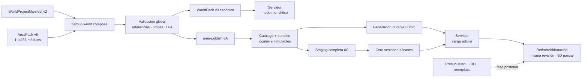
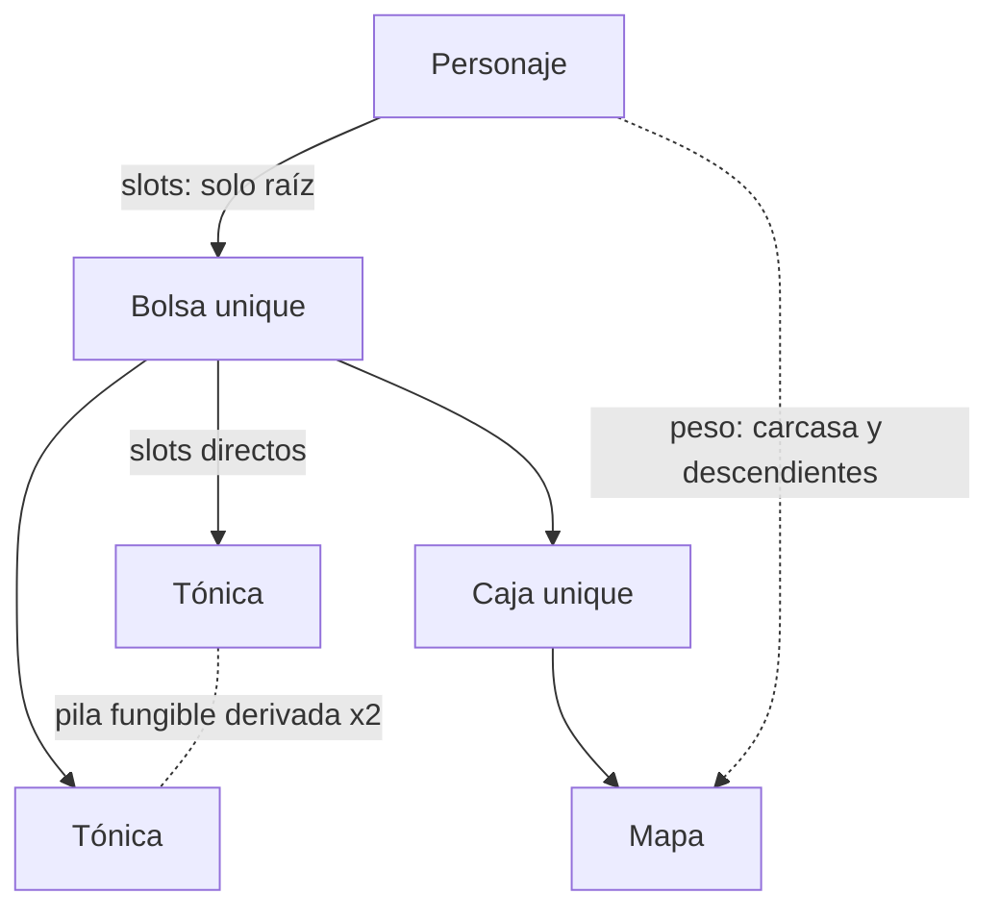

# Autoría, validación y publicación de mundos

Esta guía describe el contrato vigente de autoría de Tiamud: **WorldPack v9**
como artefacto canónico de ejecución, **AreaPack v8** como módulo de autoría y
`WorldProjectManifest` v2 como composición fuera de línea. La autoridad exacta
son los tipos y validadores de `crates/world-pack`; el ejemplo revisado es
[`worlds/lantern-square.world.json`](../worlds/lantern-square.world.json).

La [especificación v0.3](spec-v0.3.md) resume el producto y el
[centro de autoría](authoring/README.md) amplía personajes, medios, percepción,
variantes, scripts y pruebas de contenido.

## Frontera de ejecución

El servidor elige exactamente una fuente antes de abrir listeners:

- modo monolítico: `TIAMUD_WORLD_PACK` selecciona un
  `WorldPackDocument` v9 completo; sin variables de mundo se usa Lantern Square
  embebido; o
- modo catálogo 6B: `TIAMUD_AREA_REGISTRY` y `TIAMUD_AREA_CATALOG` deben
  definirse juntas y señalan un registro local más el path content-addressed
  exacto de su catálogo.

Los modos son excluyentes. Una pareja incompleta o mezclada con
`TIAMUD_WORLD_PACK` falla cerrada; no cae al mundo embebido. `AreaPack` sigue
siendo el módulo de autoría y 6B no compone fuentes durante el juego: consume
el `CompiledArea` ya publicado y contrastado con el WorldPack monolítico de
respaldo.

El modo catálogo fija el SHA-256 canónico como identidad de generación. Puede
añadir áreas verificadas bajo demanda, 6C puede sustituir la generación
completa mediante SIGHUP local y 6D puede retirar/rehidratar internamente la
misma revisión de una unidad vacía. Nunca parchea una revisión individual.
La base de datos conserva la generación autoritativa: cambiar `area-active` no
modifica por sí solo el runtime y un reinicio recupera por digest la autoridad
durable. Los IDs publicados continúan siendo identidad, no títulos, y perder
imagen, audio o color nunca elimina prosa o acciones jugables.



## Versiones y compatibilidad

| Entrada | Tratamiento |
| --- | --- |
| WorldPack v9 | Formato canónico nativo. |
| WorldPack v8/v7/v6/v5/v4/v3/v2 | Se normaliza de forma determinista a v9 antes de validar, sin inventar emotes; v2-v7 tampoco inventan comunicación, v2-v6 tampoco inventan sellos ni afijos y v2-v5 tampoco inventan tablas ni fuentes de botín. |
| AreaPack v8 | Formato modular nativo. |
| AreaPack v7/v6/v5/v4/v3/v2/v1 | Se normaliza a v8 antes de componer, sin inventar emotes; v1-v6 tampoco inventan comunicación, v1-v5 tampoco inventan sellos ni afijos y v1-v4 tampoco inventan tablas ni fuentes de botín. |
| Envy/Merc | Solo pasa por `envy-import`; los programas históricos nunca se ejecutan. |

La compatibilidad antigua no permite escribir vocabulario legado en un
documento nativo. WorldPack v9 y AreaPack v8 rechazan `items`, `room.items`,
`itemRules` y `lootItemIds`: usan `itemPrototypes` e
`initialItemInstances`.

`lootTables` y `lootSources` nacen en WorldPack v6 y AreaPack v5. Declararlos,
aunque estén vacíos, en WorldPack v2-v5 o AreaPack v1-v4 se rechaza como mezcla
de esquemas. La conversión de esos formatos crea colecciones vacías: ni el
normalizador ni `envy-import` deducen probabilidades a partir de resets o listas
históricas ambiguas.

Las recompensas selladas, `affixes`, `affixPools` y `affixPoolId` nacen en
WorldPack v7 y AreaPack v6. Declararlos, aunque estén vacíos, en formatos
anteriores se rechaza como mezcla de esquemas. La normalización conserva el
botín normal de v6/v5, pero no inventa sellos, probabilidades secundarias ni
afijos.

La comunicación authored nace en WorldPack v8 y AreaPack v7. Un campo
`ability.communication`, aunque sea una forma vacía o parcial, se rechaza en
WorldPack v2-v7 y AreaPack v1-v6 en vez de interpretarse como una habilidad
ordinaria. La normalización deja `communication` ausente y `envy-import` no lo
deduce de prosa, programas o flags históricos.

Los emotes authored nacen en WorldPack v9 y AreaPack v8. `socialEmotes`,
aunque sea un array vacío, se rechaza en WorldPack v2-v8 y AreaPack v1-v7.
La normalización produce una colección vacía y `envy-import` nunca convierte
sociales, programas o prosa histórica en plantillas ejecutables.

WorldPack v4 y AreaPack v3 reciben por normalización `maxStackUnits: 1`, sin
contenedor y con `transferPolicy: transferable`. En esas versiones la política
debe ser exactamente `transferable`; `character_bound` y `non_transferable`
no se reinterpretan como si el formato antiguo ya conociera la vinculación de
3C. Si una entrada antigua intenta declarar campos de 3B/3C, se rechaza en vez
de ignorarlos: debe declarar la versión nativa correspondiente. WorldPack
v3/v2, AreaPack v2/v1 y Envy/Merc también normalizan siempre a objetos
transferibles y nunca infieren un vínculo desde flags históricos.

Los objetos v3/v2 antiguos se convierten uno a uno, sin deduplicar por nombre o
contenido. El prototipo y la instancia pueden conservar la misma cadena
histórica porque pertenecen a espacios tipados diferentes. Un VNUM importado
produce un prototipo; cada reset inequívoco produce su propia instancia.

## Proyecto modular v2

El manifiesto contiene la identidad global, sala inicial, semilla y defaults de
personaje. Las rutas de área son relativas, no escapan del directorio del
proyecto y son únicas.

```text
WorldProjectManifest v2
├── schemaVersion! = 2
├── id!
├── name!
├── startRoomId!
├── rngSeed?
├── defaultLineageId?
├── defaultBackgroundId?
├── defaultBaseClassId?
└── areas[]!             1..=256
    ├── id!
    └── path!
```

Ejemplo:

```json
{
  "schemaVersion": 2,
  "id": "ejemplo-modular",
  "name": "Mundo modular de ejemplo",
  "startRoomId": "plaza:centro",
  "rngSeed": 42,
  "defaultLineageId": "ejemplo:mortal",
  "defaultBaseClassId": "ejemplo:viajero",
  "areas": [
    { "id": "plaza", "path": "areas/plaza.area.json" },
    { "id": "puerta", "path": "areas/puerta.area.json" }
  ]
}
```

## AreaPack v8

Cada área reutiliza los mismos registros del WorldPack; no crea una segunda
representación de salas, objetos o NPC. Solo añade `id` y `dependsOn` como
frontera de propiedad.

```text
AreaPack v8
├── schemaVersion! = 8
├── id!
├── dependsOn[]?
├── itemPrototypes[]?
├── initialItemInstances[]?
├── rooms[]?
├── npcPrototypes[]?
├── npcSpawns[]?
├── lootTables[]?
├── lootSources[]?
├── affixes[]?
├── affixPools[]?
├── levelThresholds[]?
├── lineages[]?
├── backgrounds[]?
├── baseClasses[]?
├── advancedClasses[]?
├── talentGraphs[]?
├── abilities[]?
├── socialEmotes[]?
├── npcAbilitySets[]?
├── roomMedia[]?
├── entityMedia[]?
├── roomPerception[]?
├── sceneVariants[]?
├── scripts[]?
└── contentTests[]?
```

Una dependencia puede ser cíclica: dos áreas con salidas de ida y vuelta son un
caso normal. Toda referencia estructurada a una entidad de otra área debe
declarar su `id` en `dependsOn`. Esto incluye:

- salidas a salas ajenas;
- instancia→prototipo y ubicación de instancia en sala, spawn o contenedor ajenos;
- spawn→prototipo NPC y spawn→sala;
- tabla de botín→prototipo y fuente de botín→spawn/tabla ajenos;
- concesiones/requisitos de progresión y habilidades;
- multimedia, percepción, variantes, scripts y pruebas.

El compositor no inspecciona texto Lua para inventar dependencias. Las
referencias opacas dentro de `source` son responsabilidad del autor.

### Ejemplo de dos áreas conectadas

`areas/plaza.area.json`:

```json
{
  "schemaVersion": 8,
  "id": "plaza",
  "dependsOn": ["puerta"],
  "itemPrototypes": [
    {
      "id": "plaza:farol",
      "name": "farol azul",
      "description": "Un farol de cristal azul.",
      "aliases": ["farol", "lámpara"],
      "equipmentSlot": "trinket",
      "weightGrams": 1200,
      "slotCost": 2,
      "rarity": "common",
      "itemLevel": 1,
      "stackPolicy": "unique",
      "maxStackUnits": 1,
      "transferPolicy": "transferable"
    }
  ],
  "initialItemInstances": [
    {
      "id": "plaza:farol-1",
      "prototypeId": "plaza:farol",
      "location": { "kind": "room", "roomId": "plaza:centro" }
    }
  ],
  "rooms": [
    {
      "id": "plaza:centro",
      "title": "La plaza",
      "description": "Un camino sale hacia el norte.",
      "exits": [
        {
          "direction": "north",
          "target": { "kind": "room", "room_id": "puerta:entrada" }
        }
      ]
    }
  ]
}
```

`areas/puerta.area.json`:

```json
{
  "schemaVersion": 5,
  "id": "puerta",
  "dependsOn": ["plaza"],
  "rooms": [
    {
      "id": "puerta:entrada",
      "title": "La puerta norte",
      "description": "La plaza queda al sur.",
      "exits": [
        {
          "direction": "south",
          "target": { "kind": "room", "room_id": "plaza:centro" }
        }
      ]
    }
  ],
  "npcPrototypes": [
    {
      "id": "puerta:lobo",
      "name": "lobo de lluvia",
      "description": "Vigila el camino bajo la lluvia.",
      "level": 1,
      "maxHealth": 18,
      "strength": 3,
      "defence": 1,
      "experienceReward": 60,
      "respawnTicks": 8
    }
  ],
  "npcSpawns": [
    {
      "id": "puerta:lobo-1",
      "prototypeId": "puerta:lobo",
      "roomId": "puerta:entrada"
    }
  ],
  "itemPrototypes": [
    {
      "id": "puerta:colmillo",
      "name": "colmillo plateado",
      "description": "Un pequeño colmillo engarzado en plata.",
      "aliases": ["colmillo"],
      "weightGrams": 100,
      "slotCost": 1,
      "rarity": "uncommon",
      "itemLevel": 1,
      "stackPolicy": "unique",
      "maxStackUnits": 1,
      "transferPolicy": "transferable"
    }
  ],
  "initialItemInstances": [
    {
      "id": "puerta:colmillo-1",
      "prototypeId": "puerta:colmillo",
      "location": {
        "kind": "npc_spawn",
        "npcSpawnId": "puerta:lobo-1"
      }
    }
  ]
}
```

El botín no vive en `npcPrototypes`. La ubicación `npc_spawn` de una instancia
es botín fijo authored, asignado una sola vez y validado. El botín repetible se
declara por separado mediante `lootTables` y `lootSources`, como se detalla más
abajo.

## WorldPack v9

El artefacto plano conserva identidad, catálogos de objeto, salas y gameplay.
Las extensiones de multimedia/percepción/scripts se aplanan en el documento
por `WorldPackDocument` aunque la estructura Rust separa el núcleo del mundo.

```text
WorldPack v9
├── schemaVersion! = 9
├── id!
├── name!
├── startRoomId!
├── source?
├── itemPrototypes[]?
├── initialItemInstances[]?
├── rooms[]!
├── gameplay?
│   ├── rngSeed?
│   ├── npcPrototypes[]?
│   ├── npcSpawns[]?
│   ├── characterProgression?
│   ├── abilities[]?
│   ├── socialEmotes[]?
│   ├── npcAbilitySets[]?
│   ├── lootTables[]?
│   ├── lootSources[]?
│   ├── affixes[]?
│   └── affixPools[]?
├── roomMedia[]?
├── entityMedia[]?
├── roomPerception[]?
├── sceneVariants[]?
├── scripts[]?
└── contentTests[]?
```

Un mundo mínimo sin objetos:

```json
{
  "schemaVersion": 9,
  "id": "ejemplo",
  "name": "Mundo de ejemplo",
  "startRoomId": "ejemplo:entrada",
  "rooms": [
    {
      "id": "ejemplo:entrada",
      "title": "La entrada",
      "description": "Un arco de piedra conduce al camino."
    }
  ]
}
```

Cada sala y variante exige un `title` de 1..=128 bytes UTF-8 seguros, sin
caracteres de control, y una `description` de 1..=8.192 bytes UTF-8 seguros. Los saltos de
línea y tabulaciones revisados son válidos en la descripción; una cadena vacía,
solo whitespace, una secuencia de control insegura o un exceso de bytes se
rechazan. Los límites cuentan bytes, no caracteres Unicode.

## Habilidades de comunicación y telepatía

WorldPack v9/AreaPack v8 conserva la comunicación introducida por WorldPack
v8/AreaPack v7 y reutiliza `AbilityDefinition`: la telepatía no es un
canal global ni un `tell` renombrado. El personaje debe conocer la habilidad,
tener su recurso disponible y pagar un coste positivo; la habilidad tiene un
cooldown authored positivo y conserva el cooldown global de habilidades.

```json
{
  "id": "tiamud:mind-whisper",
  "name": "Mind Whisper",
  "description": "Envía un pensamiento privado a un aliado conectado.",
  "category": "utility",
  "resourceCosts": { "stamina": 2 },
  "cooldownTicks": 2,
  "targeting": "single_ally",
  "communication": {
    "kind": "telepathy",
    "scope": "direct_online",
    "blockedRoomIds": ["demo:archive"]
  }
}
```

El vocabulario es cerrado: solo `kind: telepathy` y
`scope: direct_online`. La habilidad debe ser `spell` o `utility`, usar
`single_ally` y no puede combinar comunicación con daño, curación ni estados.
Un mundo admite como máximo 32 habilidades de comunicación; cada una enumera
hasta 64 salas bloqueadas, únicas y existentes. Una referencia a una sala de
otra AreaPack exige la correspondiente dependencia `dependsOn`. Ningún
`npcAbilitySet` puede incluirla.

Lantern Square concede `tiamud:mind-whisper` a `tiamud:wanderer`, la clase
predeterminada, cuyo pool de stamina permite pagarla desde nivel 1. El Archivo
demuestra un bloqueo authored. El mensaje y el destinatario son input runtime:
no se escriben en el WorldPack.

## Emotes sociales authored

WorldPack v9 declara `gameplay.socialEmotes`; AreaPack v8 usa `socialEmotes`
en su raíz. Hay como máximo 32 por mundo. Cada definición contiene un `id`
namespaced de hasta 64 bytes, un `command` ASCII único que cumple
`[a-z][a-z0-9-]*` (hasta 32 bytes), un nombre seguro de hasta 64 bytes,
`audience: room` y `targeting: none|optional_character|required_character`.

```json
{
  "id": "tiamud:smile",
  "command": "smile",
  "name": "Sonreír",
  "audience": "room",
  "targeting": "optional_character",
  "templates": {
    "untargeted": {
      "actor": "Sonríes.",
      "others": "{actor} sonríe."
    },
    "targeted": {
      "actor": "Sonríes a {target}.",
      "target": "{actor} te sonríe.",
      "others": "{actor} sonríe a {target}."
    }
  }
}
```

`none` exige solo `untargeted`, `required_character` solo `targeted` y
`optional_character` ambos. Sin objetivo, `actor` no admite placeholder y
`others` exige `{actor}` exactamente una vez. Con objetivo, `actor` exige solo
`{target}`, `target` solo `{actor}` y `others` uno de cada. Se rechazan llaves
o placeholders adicionales, controles, ESC, CR/LF, `<`, `>` y `&`; el
resultado de sustituir nombres de 64 bytes debe caber en 512 bytes. Las
plantillas no conceden autoridad ni visibilidad: el runtime calcula la
audiencia de la sala.

## Prototipos e instancias de objeto

`itemPrototypes` define contenido reutilizable. `initialItemInstances` define
unidades iniciales y su única ubicación.

```text
ItemPrototype
├── id!
├── name!
├── description!
├── aliases[]?
├── equipmentSlot?       weapon | body | trinket
├── attackBonus?
├── healAmount?
├── consumable?
├── effect?
├── weightGrams!         0..=1_000_000
├── slotCost!            1..=100
├── rarity!              common | uncommon | rare | epic | legendary
├── itemLevel!           1..=1_000
├── stackPolicy!         unique | fungible
├── maxStackUnits!       unique = 1; fungible = 2..=1.000
├── container?
│   ├── maxSlots!        1..=1.000
│   └── maxWeightGrams!  0..=1.000.000
└── transferPolicy!      transferable | character_bound | non_transferable

InitialItemInstance
├── id!                  ID durable interno
├── prototypeId!         prototipo existente
└── location!
    ├── { kind: room, roomId }
    ├── { kind: npc_spawn, npcSpawnId }
    ├── { kind: container, containerInstanceId }
    └── { kind: staged }
```

Invariantes:

- cada instancia referencia exactamente un prototipo;
- cada ID de instancia authored ocupa 1..=128 bytes y usa la gramática cerrada
  de identificadores gameplay; los IDs runtime son `runtime:<u64-canónico>`;
- cada instancia tiene una sola ubicación;
- un prototipo no tiene ubicación;
- dos instancias pueden compartir prototipo, nunca identidad;
- una instancia `npc_spawn` referencia un spawn existente;
- una instancia `container` referencia otra instancia cuyo prototipo define
  contenedor;
- el grafo de contención no admite autorreferencia, ciclos ni más de cuatro
  aristas;
- las instancias nuevas de runtime usan una secuencia durable incluida en
  checkpoint y rollback;
- el servidor resuelve nombre, descripción, peso, rareza y reglas desde el
  prototipo;
- `entityMedia(kind=item)` referencia un prototipo y puede presentar cada una
  de sus instancias visibles;
- `roomPerception.hiddenItems` referencia una instancia concreta;
- Web, Telnet y GMCP reciben solo IDs opacos derivados de una sal
  criptográficamente aleatoria nueva por sesión;
- Telnet muestra esas referencias en escena, inventario y equipo y las acepta
  como selector exacto; y
- una referencia opaca selecciona la unidad o grupo exactos; una consulta
  textual ambigua falla en vez de escoger una unidad arbitraria.

La capacidad de personaje no se autoriza en el WorldPack ni se calcula en el
cliente. Los slots del personaje cuentan raíces portadas, agrupadas por la
pila derivada de prototipo y vínculo; el peso incluye raíces portadas/equipadas
y todos sus descendientes. Los slots de un contenedor cuentan hijos directos
agrupados por esa misma clave y su peso usado
cuenta todo el subárbol, sin incluir la carcasa del propio contenedor. Equipar,
desequipar, reemplazar, tomar, soltar, introducir y extraer prevalidan el
resultado completo.



Las pilas nunca son entidades durables. Se derivan por
ubicación/prototipo/vínculo,
ordenan sus instancias por ID y se dividen por `maxStackUnits`:

```text
stackSlots = ceil(quantity / maxStackUnits) * slotCost
totalWeightGrams = quantity * weightGrams
```

La cantidad predeterminada es uno y una mutación acepta como máximo 256
unidades. `put` opera sobre raíces portadas; `get` solo sobre hijos directos;
`contents` pagina veinte grupos. Mover una instancia contenedor conserva las
ubicaciones relativas de todo su subárbol.

### Propiedad efectiva y transferencia

WorldPack v9 y AreaPack v8 aceptan las tres políticas. WorldPack v5 y AreaPack
v4 también las aceptaban en su frontera histórica. La vinculación no se escribe
en autoría: pertenece a cada instancia runtime y se crea, valida y persiste
cuando el personaje adquiere el objeto.

- `transferable` puede cambiar de propietario o volver al mundo si todas las
  instancias de su subárbol también son transferibles;
- `character_bound` se vincula al `CharacterId` de la primera adquisición, no
  se desliga ni se reasigna y conserva el vínculo al consumirse; y
- `non_transferable` no guarda vínculo, pero una vez dentro del grafo de un
  personaje no puede soltarse ni pasar a otro; su consumo autorizado sí puede
  llevarlo al estado terminal `Consumed`.

El propietario efectivo se obtiene siguiendo hasta cuatro padres `Contained`
hasta una raíz `Carried` o `Equipped`. Por eso una bolsa `transferable` que
contenga un objeto ligado o no transferible puede reorganizarse dentro del
inventario de su dueño, pero no soltarse ni entregarse. `take`, `drop`,
`put`, `get`, equipo, consumo y la concesión autorizada de Lua prevalidan
ubicación, vínculo, grafo y capacidad sobre una copia prospectiva completa.

La entrega directa usa la misma acción en Web y Telnet:

```text
give [cantidad] <objeto> to <personaje>
```

Solo mueve raíces `Carried` y conserva cada subárbol. El receptor debe ser
distinto, estar conectado y en la misma sala; se resuelve por selector opaco o
nombre exacto no ambiguo. La entrega exige un subárbol completamente
`transferable`, capacidad válida en ambos personajes y ausencia de ignore del
receptor o block bilateral. Todo el lote de 1..=256 raíces se confirma con una
sola mutación y commit; `canGive` y las acciones proyectadas solo ayudan a la
interfaz, nunca sustituyen esta autorización del servidor.

La fase 3D implementa intercambio confirmado como estado runtime, no como
autoría del WorldPack. Solo reserva raíces `Carried` cuyo subárbol completo es
`transferable`; no añade campos de trade, escrow ni propietario a
`ItemPrototype` o `InitialItemInstance`. Siguen ausentes entrega offline/remota
y los repartos need/greed, master-loot o por contribución.

## Botín fijo y repetible

Una aparición de NPC puede combinar dos fuentes que convergen en la misma
resolución autoritativa:

- cada raíz inicial con ubicación `npc_spawn` es botín fijo authored y solo se
  entrega una vez; y
- una `lootSource` enlaza esa aparición con una `lootTable`, que se resuelve de
  nuevo en cada derrota.

La tabla procesa primero `guaranteed` y después `pools`, ambos ordenados por ID
canónico. Cada pool realiza `rolls` selecciones con reemplazo. Una entrada
`item` usa un peso entero positivo y una cantidad uniforme inclusiva entre
`minQuantity` y `maxQuantity`; una entrada `nothing` consume la tirada sin crear
una instancia y no admite prototipo ni cantidades. El runtime usa rejection
sampling, no porcentajes flotantes ni módulo sesgado.

AreaPack v8 declara ambas colecciones en su nivel superior; WorldPack v9 las
sitúa dentro de `gameplay`. El botín normal se introdujo en AreaPack v5 y
WorldPack v6. El fragmento siguiente muestra su forma común actual:

```json
{
  "lootTables": [
    {
      "id": "tiamud:gate-stalker-drops",
      "guaranteed": [
        {
          "id": "tiamud:drop:road-token",
          "itemPrototypeId": "tiamud:road-token",
          "quantity": 1
        },
        {
          "id": "tiamud:drop:storm-seal",
          "itemPrototypeId": "tiamud:storm-seal",
          "quantity": 1
        }
      ],
      "pools": [
        {
          "id": "tiamud:drop:trophy",
          "rolls": 1,
          "entries": [
            {
              "kind": "item",
              "id": "tiamud:drop:wolf-clasp",
              "weight": 6000,
              "itemPrototypeId": "tiamud:wolf-clasp",
              "minQuantity": 1,
              "maxQuantity": 1,
              "affixPoolId": "tiamud:storm-talon-affixes"
            },
            {
              "kind": "nothing",
              "id": "tiamud:drop:nothing",
              "weight": 4000
            }
          ]
        }
      ]
    }
  ],
  "lootSources": [
    {
      "kind": "npc_spawn",
      "id": "tiamud:gate-stalker-loot",
      "npcSpawnId": "tiamud:gate-stalker-1",
      "lootTableId": "tiamud:gate-stalker-drops",
      "rights": "party_round_robin"
    }
  ]
}
```

En la demostración, cada derrota produce un `tiamud:road-token` y un
`tiamud:storm-seal` garantizados y realiza una tirada: `tiamud:wolf-clasp`
tiene peso 6000 y `nothing` 4000, es decir, 60 % frente a 40 %. Además, la instancia inicial
`tiamud:stormglass-talon` permanece como botín fijo de la primera derrota. La
política `party_round_robin` reparte cada raíz sucesiva por una cohorte de hasta
seis personajes; `credited_character` reservaría todas al iniciador. La
selección inicial no es discrecional del líder.

Reglas de referencias y capacidad:

- IDs de tabla, fuente, entrada garantizada, pool y entrada ponderada son
  canónicos, únicos en su ámbito y ocupan 1..=128 bytes;
- cada prototipo, aparición de NPC y tabla referenciados debe existir;
- una aparición admite como máximo una fuente y toda tabla debe estar usada;
- una tabla admite hasta 8 entradas garantizadas y 8 pools; cada pool, 1..=8
  tiradas y 1..=64 entradas;
- el WorldPack admite 256 tablas, 1.024 fuentes y 4.096 entradas ponderadas;
- cada peso está en `1..=1.000.000` y cada cantidad en `1..=32`; y
- el peor caso de raíces fijas más unidades repetibles para una aparición no
  puede superar 64 por derrota.

## Sellos ganados y afijos (fase 4B)

WorldPack v9 y AreaPack v8 conservan las recompensas selladas obtenidas jugando
y un único afijo opcional por unidad de botín `unique`, introducidos en v7/v6.
La decisión autoritativa es
el [ADR 0014](decisions/0014-earned-sealed-rewards-and-deterministic-affixes.md).
No son cajas pagadas: no existen compra de tiradas, llaves, pity ni una moneda
premium implícita.

Un prototipo sellado declara `sealedLootTableId` y debe ser `unique`,
`maxStackUnits: 1`, consumible, `character_bound`, sin contenedor, equipo,
ataque, curación ni efecto. No admite instancia inicial. Una tabla normal
asociada a un NPC debe generarlo como recompensa; su tabla de apertura no puede
ser una `lootSource` directa ni producir otro sello. La apertura siempre genera
entre 1 y 16 unidades y su expansión de resultados base más afijos
condicionales admite como máximo 1.024 filas visibles en `reward odds`.

```json
{
  "itemPrototypes": [
    {
      "id": "tiamud:storm-seal",
      "name": "juramento sellado del acechante",
      "description": "Un cordón ennegrecido por la lluvia rodea una esquirla marcada.",
      "consumable": true,
      "weightGrams": 40,
      "slotCost": 1,
      "rarity": "rare",
      "itemLevel": 1,
      "stackPolicy": "unique",
      "maxStackUnits": 1,
      "transferPolicy": "character_bound",
      "sealedLootTableId": "tiamud:storm-oath-rewards"
    }
  ],
  "lootTables": [
    {
      "id": "tiamud:storm-oath-rewards",
      "guaranteed": [
        {
          "id": "tiamud:reward:stormglass-talon",
          "itemPrototypeId": "tiamud:stormglass-talon",
          "quantity": 1,
          "affixPoolId": "tiamud:storm-talon-affixes"
        }
      ]
    }
  ],
  "affixes": [
    {
      "id": "tiamud:affix:storm-bitten",
      "label": "mordido por la tormenta",
      "position": "prefix",
      "attackBonusDelta": 1
    }
  ],
  "affixPools": [
    {
      "id": "tiamud:storm-talon-affixes",
      "entries": [
        {
          "kind": "affix",
          "id": "tiamud:affix-roll:storm-bitten",
          "weight": 6000,
          "affixId": "tiamud:affix:storm-bitten"
        },
        {
          "kind": "nothing",
          "id": "tiamud:affix-roll:plain",
          "weight": 4000
        }
      ]
    }
  ]
}
```

Hay como máximo 512 definiciones de afijo, 256 pools, 64 entradas por pool y
4.096 entradas ponderadas en total. La etiqueta ocupa hasta 64 bytes; cada
delta positivo de ataque o curación llega como máximo a 1.000. Un pool se
referencia solo con cantidad exactamente uno desde un prototipo no sellado,
`unique` y `maxStackUnits: 1`. Un delta de ataque requiere objeto equipable y
uno de curación, consumible; el valor efectivo no puede superar los límites
del runtime. Un objeto recibe como máximo un afijo.

Los pools normales y sellados usan selección ponderada entera, determinista y
sin sesgo. La tirada de afijo normal se consume aunque después no quepa o se
suprima el drop, para que el resultado no dependa de la capacidad observable.
`open <sello>` consume una unidad y `reward odds <sello>` muestra las
probabilidades exactas authored. Consumo, RNG, contador de apertura, creación,
vínculo, capacidad y grupos de resultado —hasta 16 y coherentes con las
instancias creadas— forman un solo commit; cualquier fallo restaura exactamente
el sello, los contadores y el RNG.

`WorldRuntimeSnapshot` v7 conserva por instancia el afijo aplicado y la
procedencia `SealedReward`. Las copias durables incluyen los digests canónicos
de definición, pool y registro, pero clientes Web, Telnet y GMCP solo reciben
la presentación y estadísticas autorizadas: IDs estables, estado RNG,
contadores internos y digests permanecen opacos. Los mismos afijos funcionan
en botín normal y sellado.

El SHA-256 de la forma canónica exacta de cada tabla viaja al dominio. Cada
instancia generada conserva procedencia durable con drop, aparición, tabla,
digest, entrada, pool opcional, índices y tick. Las instancias iniciales se
marcan como authored; las creadas por la API general conservan procedencia
runtime propia. Esta metadata vive en `WorldRuntimeSnapshot` v7 y nunca se
expone a clientes. Cambiar una tabla después no reescribe la procedencia de los
objetos ya generados.

## Composición, validación y digest

```sh
mkdir -p build/worlds
cargo run --locked -p world-pack --bin tiamud-world -- compose \
  worlds/lantern-square.project.json \
  --output build/worlds/lantern-square.composed.world.json

cargo run --locked -p world-pack --bin tiamud-world -- validate \
  build/worlds/lantern-square.composed.world.json
```

La composición:

- rechaza propiedades desconocidas también en registros anidados;
- valida rutas relativas y evita escapes o duplicados;
- exige IDs globales únicos, salvo el par histórico tipado
  prototipo/instancia normalizado con la misma cadena;
- verifica `dependsOn` para referencias estructuradas cruzadas;
- fusiona y valida todas las referencias, límites, condiciones y scripts;
- ordena canónicamente listas no semánticas;
- produce bytes y reportes deterministas; y
- escribe el destino completo de forma atómica sin sobreescribirlo.

Lantern Square se compone desde tres áreas y produce tres salas, diez
prototipos, nueve instancias iniciales, dos tablas de botín, una fuente, un
afijo, un pool, una habilidad de telepatía directa y un emote social authored.
El artefacto de 53.567 bytes es byte a byte idéntico al
WorldPack canónico y su
SHA-256 es:

```text
9a75894a9e2e0c48d20257633f323d52bbe78b9db106de8c497f4784392b5e75
```

La demostración conserva `tiamud:road-token` y `tiamud:wolf-clasp` como
`transferable`: sus IDs publicados no cambian de semántica sin migración. Los
casos 3C son nuevas identidades: `tiamud:rain-writ`, consumible con
`healAmount: 1` y `non_transferable`, comienza en `demo:north-gate`; y
`tiamud:stormglass-talon`, `character_bound`, es botín fijo de
`tiamud:gate-stalker-1`. Esa misma aparición usa reparto round-robin de party
para el `tiamud:road-token` y el `tiamud:storm-seal` garantizados, además de la
tirada 60 % `tiamud:wolf-clasp`/40 % `nothing` de su tabla repetible. El clasp
normal y el talón obtenido al abrir el sello comparten una tirada de afijo:
60 % `storm-bitten` y 40 % sin afijo.
La clase inicial predeterminada concede además `tiamud:mind-whisper`, con coste
de stamina y cooldown positivos; `demo:archive` demuestra su bloqueo authored.

Límites principales:

| Recurso | Límite |
| --- | ---: |
| Manifiesto de proyecto | 1 MiB |
| Número de áreas | 1..=256 |
| Cada fichero de área | 16 MiB |
| Total de fuentes de área | 16 MiB |
| WorldPack compuesto | 16 MiB |
| Ruta relativa | 4096 bytes |
| Título de sala | 1..=128 bytes seguros, sin controles |
| Descripción de sala | 1..=8.192 bytes seguros |
| Prototipos de objeto por WorldPack | 1.024 |
| Instancias iniciales por WorldPack | 8.192 |
| Bytes por ID de instancia | 1..=128 |
| Aliases por prototipo | 32 |
| Peso de un prototipo | 0..=1.000.000 g |
| Coste de slots de un prototipo | 1..=100 |
| `itemLevel` | 1..=1.000 |
| Unidades máximas por pila | 1.000 |
| Slots de un contenedor | 1..=1.000 |
| Peso de contenido por contenedor | 0..=1.000.000 g |
| Profundidad de contención | 4 aristas |
| Unidades movidas por acción | 256 |
| Grupos por página de `contents` | 20 |
| Tablas/fuentes de botín | 256 / 1.024 |
| Garantizados/pools por tabla | 8 / 8 |
| Tiradas/entradas por pool | 8 / 64 |
| Entradas ponderadas globales | 4.096 |
| Peso/cantidad de una entrada | 1..=1.000.000 / 1..=32 |
| Raíces fijas + repetibles por derrota | 64 |

## Publicación 6A, ejecución aditiva 6B, corte 6C y retirada 6D

El release revisado declara revisión, propiedad, dependencias, portales,
procedencia y licencias de cada área. Se publica en un registro local:

```sh
cargo run --locked -p world-pack --bin tiamud-world -- area-publish \
  worlds/lantern-square.project.json \
  --release worlds/lantern-square.area-release.json \
  --registry build/area-registry
```

Stdout devuelve la ruta content-addressed exacta del catálogo. Verifícala sin
mutar el registro:

```sh
cargo run --locked -p world-pack --bin tiamud-world -- area-verify \
  --catalog build/area-registry/area-catalogs/71b3f0f3493d91254d4ce1ed60c147e9f0f480ca204f62f05b3fd05d92e6e3f1/e954be5b7e1d6918a1b87d5405d651f0fc52ee81996ab0c100cfcb1909ed15a6.catalog.json \
  --registry build/area-registry
```

El catálogo v1 admite hasta 256 entradas y 1 MiB. El manifiesto de release se
acota a 256 KiB; cada bundle JSON canónico y la suma declarada se acotan a
16 MiB. Los tres sobres limitan profundidad JSON a 16 y rechazan claves
duplicadas recursivamente. `storedBytes == expandedBytes`: no existe compresión
v1. `trustMode=unsigned_local` supone un host confiable y publicadores
cooperantes; digest no demuestra autoría ni habilita redistribución.

`AreaPack.dependsOn` es la declaración editorial exhaustiva. El catálogo
deriva `hardDependencies` solo de referencias estructurales cruzadas que no son
`RoomExit`; cada salida entre áreas se publica como `portals` con
`sourceExit`, peer y revisión mínima. `softDependencies` queda vacío. El bundle
incluye el AreaPack revisable y un `CompiledArea` estricto ligado por
`compiledAreaSha256`. El WorldPack monolítico de respaldo demuestra que el
conjunto completo conserva la misma semántica.

`ItemInstanceContainer` es el caso estructural que exige materialización
simétrica: si hijo y contenedor pertenecen a áreas distintas, el publicador
añade dependencias duras en ambos sentidos. `open_exact` las reconstruye desde
el WorldPack de respaldo y rechaza un catálogo que no conserve el cierre
atómico. Así nadie puede mover, llenar o ligar el contenedor antes de que
aparezca su contenido authored.

Para ejecutar esa generación local, usa exactamente las dos variables
siguientes y no definas `TIAMUD_WORLD_PACK`:

```sh
TIAMUD_AREA_REGISTRY=build/area-registry \
TIAMUD_AREA_CATALOG=build/area-registry/area-catalogs/71b3f0f3493d91254d4ce1ed60c147e9f0f480ca204f62f05b3fd05d92e6e3f1/e954be5b7e1d6918a1b87d5405d651f0fc52ee81996ab0c100cfcb1909ed15a6.catalog.json \
TIAMUD_TELNET_MODE=plaintext \
cargo run --locked -p tiamud-server
```

El servidor fija el digest del catálogo antes de listeners y no vuelve a leer
`area-active`. En persistencia vacía instala el área de `startRoomId` y el
cierre de `hardDependencies`; con snapshot o ledger previo instala primero la
generación completa. Un portal hacia un área no residente permanece como
`DeferredExit`. La entrada real prepara el cierre fuera del actor, lo instala
atómicamente y reintenta una vez, con límites de dos trabajos activos, ocho
pendientes, cinco segundos y 32 áreas.

Si desaparece el último solicitante mientras espera uno de los dos permisos,
se notifica y cancela el trabajo en cola de inmediato. A los cinco segundos el
solicitante recibe timeout. Un `spawn_blocking` ya iniciado no se cancela de
forma insegura: conserva permiso y marca terminal hasta terminar y su resultado
tardío se descarta.

Una instalación estática no escribe snapshot. Instancias y NPC iniciales que
formen parte del estado dinámico se confirman con la transacción existente
antes de activar el lote. Fallos de bundle, dependencia, timeout, saturación o
commit restauran mundo, contenido runtime y residencia; los clientes solo ven
un destino no disponible genérico. Todas las áreas cargadas permanecen en
memoria hasta apagar.

Una instancia inicial `NpcSpawn` puede vivir en otra área que el NPC. La
instalación la incorpora al botín fijo tanto si ambos llegan juntos como si el
NPC ya residía, valida los límites y marca el lote como dinámico para confirmar
la relación antes de publicarla.

Ni 6A ni 6B permiten que un portal normal cargue transitivamente sus vecinos.
La fase 6C mínima sustituye una generación completa sin reiniciar. Después de
publicar una revisión creciente, SIGHUP solicita reconciliar el puntero local:

```sh
sudo systemctl kill --signal=HUP tiamud
```

Para rollback, conserva el catálogo inmutable anterior, selecciónalo de forma
explícita y envía el mismo SIGHUP:

```sh
cargo run --locked -p world-pack --bin tiamud-world -- area-select \
  --catalog <ruta-exacta-del-catalogo-retenido> \
  --registry build/area-registry
sudo systemctl kill --signal=HUP tiamud
```

El servidor abre y verifica el puntero dos veces, verifica catálogo, fallback
y bundles y construye un mundo/contenido/coordinador privados completos. La
compatibilidad exige `worldId`, nombre, `startRoomId`, RNG, gameplay, objetos e
instancias iniciales, NPC, botín, afijos, áreas, ownership, IDs de sala y VNUM
legacy idénticos, además de `persistentMigrationVersion == 0`. Una activación
normal exige revisiones crecientes; un rollback recorre la dirección inversa
solo por la selección explícita. Pueden cambiar títulos, prosa, salidas,
recursos, percepción, variantes, medios y scripts síncronos validados.

El corte cierra admisiones y requiere cero sesiones y cero leases. Si existe
actividad devuelve `busy`, no expulsa jugadores y conserva la generación
anterior. Con quiescencia exige residencia completa, restaura el snapshot v8
actual sobre la candidata, confirma por CAS snapshot + identidad SQL v15 y solo
entonces intercambia el
estado en memoria. La primera ejecución liga la generación; en restart la fila
durable prevalece sobre un `area-active` más reciente.

Un fallo definitivo antes del commit conserva la generación anterior. Si el
commit devuelve un resultado ambiguo, el servidor relee SQL: publica G1 si
quedó durable, reabre G0 si no y, ante otro valor o error, queda fail-stop en
`Committing` con el actor detenido y readiness 503 hasta recuperación.

Una instalación 6B/v13 con recovery compartido o personajes debe arrancar v14
con G0 exacto y `TIAMUD_ACK_LEGACY_AREA_GENERATION=<sha256-exacto-G0>`. Verifica la
liga, retira la variable y solo entonces introduce G1. La fila v14 nace vacía;
cambiar binario/esquema y catálogo a la vez aceptaría G1 como autoridad inicial
sin compatibilidad/CAS contra el G0 que v13 no retenía.

Recovery sin snapshot/ledger puede coexistir con personajes. Sin liga durable,
recovery compartido o cualquier personaje obliga al ACK exacto de G0; una base
vacía o con cuentas sin personajes/recovery de mundo puede ligar sin ACK.
Monolítico con autoridad→catálogo no pertenece a 6C. El ACK se rechaza en modo
monolítico, con liga, sin recovery/personaje o ante digest distinto.

6D implementa una ruta interna parcial de checkpoint, retirada y rehidratación
de la misma revisión de una unidad vacía. No implementa reemplazo de revisión,
jugadores durante retirada, migraciones, LRU, GC, red, compresión o firma. El
gate pasa 774 pruebas Rust —329 del servidor— y la reauditoría 0 P1/0 P2. El
humo SQLite está retenido. PostgreSQL 18 desechable pasa 20/20 pruebas del
adaptador y 7/7 enfocadas del servidor, incluida la CAS v14; su humo liga G0 y
valida `noop`, readiness, Web, Telnet, dos áreas residentes y cierre limpio.
Véanse el
[registro de aceptación PostgreSQL v14/PWA](project/log/2026-07-17-postgresql-v14-and-pwa-acceptance.md),
[ADR 0005](decisions/0005-hot-area-lifecycle.md) y
[ADR 0020](decisions/0020-additive-local-area-loading.md) y
[ADR 0021](decisions/0021-quiescent-area-generation-cutover.md), y el estado
parcial 6D está en [ADR 0022](decisions/0022-reversible-area-unit-retirement.md).

## Flujo editorial

`tiamud-world` comparte el mismo normalizador y validador en todos sus comandos:

```sh
cargo run --locked -p world-pack --bin tiamud-world -- validate mundo.json
cargo run --locked -p world-pack --bin tiamud-world -- preview mundo.json --room <id>
cargo run --locked -p world-pack --bin tiamud-world -- test mundo.json
cargo run --locked -p world-pack --bin tiamud-world -- build mundo.json --output artefacto.json
cargo run --locked -p world-pack --bin tiamud-world -- diff anterior.json nuevo.json
```

Publicación y rollback usan artefactos inmutables por digest. El puntero
`area-active` es selección editorial y SIGHUP es su única reconciliación local
en ejecución. La fila SQL v15, no ese fichero mutable, decide recovery. Una
selección anterior requiere `area-select`; no se interpreta una revisión menor
accidental como permiso de rollback. El corte retiene el mismo lock cooperativo
del registro que `area-publish` y `area-select` hasta resolver el CAS durable.

Antes de publicar:

1. compón las áreas y revisa el `CompositionReport`;
2. valida el artefacto y sus recursos;
3. ejecuta pruebas de contenido y previews textuales;
4. verifica licencia/procedencia de cada input y medio;
5. compara el diff canónico;
6. publica por digest sin sobrescribir; y
7. prueba arranque y rollback con una persistencia desechable.

Los recursos multimedia son presentación inmutable, mismo origen y
direccionada por contenido. Lua se compila y ejecuta con capacidades/cuotas; no
tiene sistema de archivos, red, procesos ni módulos nativos. La IA editorial es
opcional, fuera de ejecución y siempre produce un borrador que requiere
validación y revisión humana.

## Persistencia y evolución del formato

WorldPack define el mundo inicial; `WorldRuntimeSnapshot` v8 define dónde están
las instancias después de jugar, su `binding` obligatorio, los contadores de
identidad y apertura, los afijos aplicados, las reservas de trade, la
procedencia normal o sellada, los encuentros de botín, los derechos sobre suelo
y los cursores round-robin. El decoder elige primero por
`snapshotVersion` y compara esa versión original con la columna SQL. DTO
explícitos v1-v5 convierten de forma estricta: v1-v3 producen
`binding: { kind: "unbound" }` y v4 añade trade vacío. Al llegar a v6, cada
origen v1-v5 añade botín vacío y procedencia
`legacy_snapshot { sourceVersion }` para todas sus instancias. Un v6 exacto
convierte a v7 con `itemAffixes: []` en cada instancia y
`nextRewardOpenId: 1`.
Todas fallan cerradas ante campos cruzados. En particular, inyectar `binding`
en v3, trade en v4, procedencia/derechos v6 en v5 o afijos/contador de apertura
v7 en v6 no adelanta su versión.
También se rechazan referencias, ciclos, profundidad, capacidad, contador,
propietario, vínculo, participante, reserva, cohorte o procedencia inválidos.

SQLite y PostgreSQL usan esquema v15. `world_area_generation` guarda solo
`worldId`, digest activo, digest anterior, secuencia de activación y timestamp;
las rutas se derivan del registro configurado. Una transición 6C actualiza esa
fila y el snapshot v8 en la misma transacción mediante compare-and-swap. No es
otra autoridad del mundo y el traslado SQLite→PostgreSQL la conserva.
`world_area_checkpoints` conserva solo el estado dinámico de unidades 6D
retiradas y se confirma/consume atómicamente con el manifiesto v8; el mover
valida y copia sus filas.

Al restaurar un snapshot anterior, las instancias iniciales nuevas del
WorldPack se conservan y el estado durable se superpone; una instancia creada
en runtime que no figure en el snapshot no reaparece. Antes de abrir listeners
se validan por lotes los propietarios de objetos siguiendo padres `Contained`
hasta la raíz y todos los `CharacterId` ligados, incluidos los de objetos
consumidos. Se comprueban sus fichas, equipos, el grafo, los vínculos y la
capacidad, también para personajes desconectados. Los participantes de trade
que no sean ya propietarios se cargan con un presupuesto adicional cerrado;
las identidades que solo aparecen en cohortes o derechos de botín se comprueban
mediante consultas de existencia por lotes. Se cancelan trades y encuentros de
botín abiertos antes de readiness, pero los derechos ya generados sobreviven al
reinicio. Esos agregados temporales no quedan en el mundo activo.

El runtime admite hasta 65.536 instancias. Los snapshots raw heredados v1-v5
conservan el límite físico de 1 MiB; los snapshots v6–v8,
así como
cada nueva admisión/confirmación, admiten hasta 2 MiB. La suma de fichas de
propietarios
inspeccionadas sigue limitada a 1 MiB y cada ficha a 64 KiB. SQLite y
PostgreSQL esquema v15 guardan el snapshot como `TEXT` opaco dentro de la
transacción existente. La migración v10→v11 aumenta de forma transaccional la
restricción física del singleton runtime a 2 MiB y conserva versión, JSON,
secuencia cubierta y fecha; no convierte el JSON ni crea otra autoridad. No hay
tabla espejo/escrow/loot, doble escritura ni `jsonb`.

Tras una futura release estable, renombrar un ID requerirá alias, tombstone o
migración explícita. Nunca recicles un ID publicado para otro significado.
