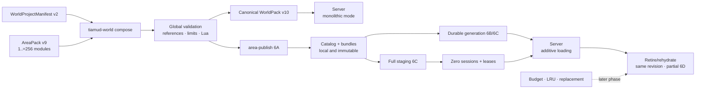
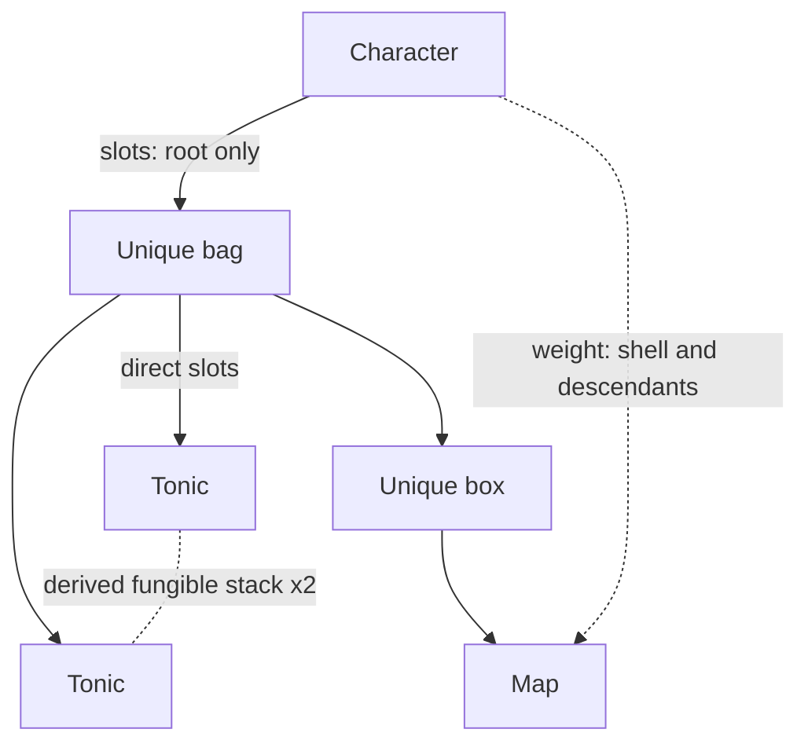

# World authoring, validation, and publishing

This guide describes Tiamud's current authoring contract: **WorldPack v10** as
the canonical runtime artifact, **AreaPack v9** as the authoring module, and
`WorldProjectManifest` v2 as offline composition. The exact authority is the
types and validators in `crates/world-pack`; the reviewed example is
[`worlds/lantern-square.world.json`](../worlds/lantern-square.world.json).

The [v0.3 specification](spec-v0.3.md) summarizes the product, and the
[authoring hub](authoring/README.md) expands on characters, media, perception,
variants, scripts, and content tests.

## Runtime boundary

The server picks exactly one source before opening listeners:

- monolithic mode: `TIAMUD_WORLD_PACK` selects a complete
  `WorldPackDocument` v10; without world variables the embedded Lantern Square is
  used; or
- catalog mode 6B: `TIAMUD_AREA_REGISTRY` and `TIAMUD_AREA_CATALOG` must be
  defined together and point to a local registry plus the exact
  content-addressed path of its catalog.

The modes are mutually exclusive. An incomplete pair, or one mixed with
`TIAMUD_WORLD_PACK`, fails closed; it does not fall back to the embedded world.
`AreaPack` remains the authoring module, and 6B does not compose sources during
play: it consumes the already-published `CompiledArea` checked against the
monolithic backup WorldPack.

Catalog mode fixes the canonical SHA-256 as generation identity. It can add
verified areas on demand, 6C can replace the whole generation via a local
SIGHUP, and 6D can internally retire/rehydrate the same revision of an empty
unit. It never patches an individual revision. The database holds the
authoritative generation: changing `area-active` does not by itself alter the
runtime, and a restart recovers the durable authority by digest. Published IDs
remain identity, not titles, and losing image, audio, or color never removes
prose or playable actions.



## Versions and compatibility

| Input | Handling |
| --- | --- |
| WorldPack v10 | Native canonical format. |
| WorldPack v9/v8/v7/v6/v5/v4/v3/v2 | Deterministically normalized to v10 before validation. They receive the implied legacy `first-hunt` quest, the `tonic`/`trail-ration` commodities and the `lantern-market` shop bound to `startRoomId` (the behaviour every pre-v10 runtime hardcoded); v2-v8 do not invent emotes, v2-v7 also do not invent communication, v2-v6 also do not invent seals or affixes, and v2-v5 also do not invent loot tables or sources. |
| AreaPack v9 | Native modular format. |
| AreaPack v8/v7/v6/v5/v4/v3/v2/v1 | Normalized to v9 before composition with empty `commodities`, `quests` and `shops`; v1-v7 do not invent emotes, v1-v6 also do not invent communication, v1-v5 also do not invent seals or affixes, and v1-v4 also do not invent loot tables or sources. |
| Envy/Merc | Only passes through `envy-import`; the historical programs are never executed. |

Legacy compatibility does not allow writing legacy vocabulary into a native
document. WorldPack v10 and AreaPack v9 reject `items`, `room.items`,
`itemRules`, and `lootItemIds`: use `itemPrototypes` and
`initialItemInstances`.

`lootTables` and `lootSources` originate in WorldPack v6 and AreaPack v5.
Declaring them, even empty, in WorldPack v2-v5 or AreaPack v1-v4 is rejected as
schema mixing. Converting those formats creates empty collections: neither the
normalizer nor `envy-import` infers probabilities from resets or ambiguous
historical lists.

Sealed rewards, `affixes`, `affixPools`, and `affixPoolId` originate in
WorldPack v7 and AreaPack v6. Declaring them, even empty, in earlier formats is
rejected as schema mixing. Normalization preserves the normal v6/v5 loot but
does not invent seals, secondary probabilities, or affixes.

Authored communication originates in WorldPack v8 and AreaPack v7. An
`ability.communication` field, even an empty or partial form, is rejected in
WorldPack v2-v7 and AreaPack v1-v6 instead of being interpreted as an ordinary
ability. Normalization leaves `communication` absent, and `envy-import` does not
infer it from prose, programs, or historical flags.

Authored emotes originate in WorldPack v9 and AreaPack v8. `socialEmotes`, even
an empty array, is rejected in WorldPack v2-v8 and AreaPack v1-v7. Normalization
produces an empty collection, and `envy-import` never converts socials,
programs, or historical prose into executable templates.

Quests, commodities and shops originate in WorldPack v10 and AreaPack v9.
`commodities`, `quests` or `shops`, even empty, are rejected in WorldPack v2-v9
and AreaPack v1-v8. Unlike other additions, normalizing a WorldPack v2-v9 makes
the formerly hardcoded starter quest and market explicit (see
[Quests, commodities and shops](#quests-commodities-and-shops)); an AreaPack
v1-v8 normalizes to empty collections because no single legacy area owned them.

WorldPack v4 and AreaPack v3 receive `maxStackUnits: 1` through normalization,
with no container and `transferPolicy: transferable`. In those versions the
policy must be exactly `transferable`; `character_bound` and `non_transferable`
are not reinterpreted as if the old format already knew 3C binding. If an old
entry tries to declare 3B/3C fields, it is rejected rather than ignoring them:
it must declare the corresponding native version. WorldPack v3/v2, AreaPack
v2/v1, and Envy/Merc also always normalize to transferable items and never infer
binding from historical flags.

Old v3/v2 items are converted one-to-one, without deduplicating by name or
content. The prototype and the instance may keep the same historical string
because they belong to different typed spaces. An imported VNUM produces a
prototype; each unambiguous reset produces its own instance.

## Modular project v2

The manifest holds the global identity, start room, seed, and character
defaults. Area paths are relative, do not escape the project directory, and are
unique.

```text
WorldProjectManifest v2
├── schemaVersion! = 2
├── id!
├── name!
├── startRoomId!
├── rngSeed?
├── defaultLineageId?
├── defaultBackgroundId?
├── defaultBaseClassId?
└── areas[]!             1..=256
    ├── id!
    └── path!
```

Example:

```json
{
  "schemaVersion": 2,
  "id": "ejemplo-modular",
  "name": "Mundo modular de ejemplo",
  "startRoomId": "plaza:centro",
  "rngSeed": 42,
  "defaultLineageId": "ejemplo:mortal",
  "defaultBaseClassId": "ejemplo:viajero",
  "areas": [
    { "id": "plaza", "path": "areas/plaza.area.json" },
    { "id": "puerta", "path": "areas/puerta.area.json" }
  ]
}
```

## AreaPack v9

Each area reuses the same WorldPack registries; it does not create a second
representation of rooms, items, or NPCs. It only adds `id` and `dependsOn` as an
ownership boundary.

```text
AreaPack v9
├── schemaVersion! = 9
├── id!
├── dependsOn[]?
├── itemPrototypes[]?
├── initialItemInstances[]?
├── rooms[]?
├── npcPrototypes[]?
├── npcSpawns[]?
├── lootTables[]?
├── lootSources[]?
├── affixes[]?
├── affixPools[]?
├── levelThresholds[]?
├── lineages[]?
├── backgrounds[]?
├── baseClasses[]?
├── advancedClasses[]?
├── talentGraphs[]?
├── abilities[]?
├── socialEmotes[]?
├── commodities[]?
├── quests[]?
├── shops[]?
├── npcAbilitySets[]?
├── roomMedia[]?
├── entityMedia[]?
├── roomPerception[]?
├── sceneVariants[]?
├── scripts[]?
└── contentTests[]?
```

A dependency can be cyclic: two areas with round-trip exits are a normal case.
Every structured reference to an entity in another area must declare its `id` in
`dependsOn`. This includes:

- exits into rooms of another area;
- instance→prototype and instance location in a room, spawn, or container of
  another area;
- spawn→NPC prototype and spawn→room;
- loot table→prototype and loot source→spawn/table of another area;
- progression and ability grants/requirements;
- media, perception, variants, scripts, and tests.

The compositor does not inspect Lua text to invent dependencies. Opaque
references inside `source` are the author's responsibility.

### Example of two connected areas

`areas/plaza.area.json`:

```json
{
  "schemaVersion": 8,
  "id": "plaza",
  "dependsOn": ["puerta"],
  "itemPrototypes": [
    {
      "id": "plaza:farol",
      "name": "farol azul",
      "description": "Un farol de cristal azul.",
      "aliases": ["farol", "lámpara"],
      "equipmentSlot": "trinket",
      "weightGrams": 1200,
      "slotCost": 2,
      "rarity": "common",
      "itemLevel": 1,
      "stackPolicy": "unique",
      "maxStackUnits": 1,
      "transferPolicy": "transferable"
    }
  ],
  "initialItemInstances": [
    {
      "id": "plaza:farol-1",
      "prototypeId": "plaza:farol",
      "location": { "kind": "room", "roomId": "plaza:centro" }
    }
  ],
  "rooms": [
    {
      "id": "plaza:centro",
      "title": "La plaza",
      "description": "Un camino sale hacia el norte.",
      "exits": [
        {
          "direction": "north",
          "target": { "kind": "room", "room_id": "puerta:entrada" }
        }
      ]
    }
  ]
}
```

`areas/puerta.area.json`:

```json
{
  "schemaVersion": 5,
  "id": "puerta",
  "dependsOn": ["plaza"],
  "rooms": [
    {
      "id": "puerta:entrada",
      "title": "La puerta norte",
      "description": "La plaza queda al sur.",
      "exits": [
        {
          "direction": "south",
          "target": { "kind": "room", "room_id": "plaza:centro" }
        }
      ]
    }
  ],
  "npcPrototypes": [
    {
      "id": "puerta:lobo",
      "name": "lobo de lluvia",
      "description": "Vigila el camino bajo la lluvia.",
      "level": 1,
      "maxHealth": 18,
      "strength": 3,
      "defence": 1,
      "experienceReward": 60,
      "respawnTicks": 8
    }
  ],
  "npcSpawns": [
    {
      "id": "puerta:lobo-1",
      "prototypeId": "puerta:lobo",
      "roomId": "puerta:entrada"
    }
  ],
  "itemPrototypes": [
    {
      "id": "puerta:colmillo",
      "name": "colmillo plateado",
      "description": "Un pequeño colmillo engarzado en plata.",
      "aliases": ["colmillo"],
      "weightGrams": 100,
      "slotCost": 1,
      "rarity": "uncommon",
      "itemLevel": 1,
      "stackPolicy": "unique",
      "maxStackUnits": 1,
      "transferPolicy": "transferable"
    }
  ],
  "initialItemInstances": [
    {
      "id": "puerta:colmillo-1",
      "prototypeId": "puerta:colmillo",
      "location": {
        "kind": "npc_spawn",
        "npcSpawnId": "puerta:lobo-1"
      }
    }
  ]
}
```

Loot does not live in `npcPrototypes`. The `npc_spawn` location of an instance
is authored fixed loot, assigned exactly once and validated. Repeatable loot is
declared separately through `lootTables` and `lootSources`, as detailed below.

## WorldPack v10

The flat artifact holds identity, item catalogs, rooms, and gameplay. The
media/perception/scripts extensions are flattened into the document by
`WorldPackDocument`, even though the Rust structure separates the world core.

```text
WorldPack v10
├── schemaVersion! = 10
├── id!
├── name!
├── startRoomId!
├── source?
├── itemPrototypes[]?
├── initialItemInstances[]?
├── rooms[]!
├── gameplay?
│   ├── rngSeed?
│   ├── npcPrototypes[]?
│   ├── npcSpawns[]?
│   ├── characterProgression?
│   ├── abilities[]?
│   ├── socialEmotes[]?
│   ├── npcAbilitySets[]?
│   ├── lootTables[]?
│   ├── lootSources[]?
│   ├── affixes[]?
│   ├── affixPools[]?
│   ├── commodities[]?
│   ├── quests[]?
│   └── shops[]?
├── roomMedia[]?
├── entityMedia[]?
├── roomPerception[]?
├── sceneVariants[]?
├── scripts[]?
└── contentTests[]?
```

A minimal world with no items:

```json
{
  "schemaVersion": 10,
  "id": "ejemplo",
  "name": "Mundo de ejemplo",
  "startRoomId": "ejemplo:entrada",
  "rooms": [
    {
      "id": "ejemplo:entrada",
      "title": "La entrada",
      "description": "Un arco de piedra conduce al camino."
    }
  ]
}
```

Each room and variant requires a `title` of 1..=128 safe UTF-8 bytes, with no
control characters, and a `description` of 1..=8,192 safe UTF-8 bytes. Reviewed
line breaks and tabs are valid in the description; an empty string,
whitespace-only, an unsafe control sequence, or a byte overflow are rejected.
The limits count bytes, not Unicode characters.

## Communication and telepathy abilities

WorldPack v9/AreaPack v8 preserves the communication introduced by WorldPack
v8/AreaPack v7 and reuses `AbilityDefinition`: telepathy is not a global channel
or a renamed `tell`. The character must know the ability, have its resource
available, and pay a positive cost; the ability has a positive authored cooldown
and keeps the global ability cooldown.

```json
{
  "id": "tiamud:mind-whisper",
  "name": "Mind Whisper",
  "description": "Envía un pensamiento privado a un aliado conectado.",
  "category": "utility",
  "resourceCosts": { "stamina": 2 },
  "cooldownTicks": 2,
  "targeting": "single_ally",
  "communication": {
    "kind": "telepathy",
    "scope": "direct_online",
    "blockedRoomIds": ["demo:archive"]
  }
}
```

The vocabulary is closed: only `kind: telepathy` and `scope: direct_online`. The
ability must be `spell` or `utility`, use `single_ally`, and cannot combine
communication with damage, healing, or conditions. A world allows at most 32
communication abilities; each lists up to 64 blocked rooms that are unique and
existing. A reference to a room in another AreaPack requires the corresponding
`dependsOn` dependency. No `npcAbilitySet` may include it.

Lantern Square grants `tiamud:mind-whisper` to `tiamud:wanderer`, the default
class, whose stamina pool allows paying for it from level 1. The Archive
demonstrates an authored block. The message and the recipient are runtime input:
they are not written into the WorldPack.

## Authored social emotes

WorldPack v10 declares `gameplay.socialEmotes`; AreaPack v9 uses `socialEmotes`
at its root. There are at most 32 per world. Each definition contains a
namespaced `id` of up to 64 bytes, a unique ASCII `command` matching
`[a-z][a-z0-9-]*` (up to 32 bytes), a safe name of up to 64 bytes,
`audience: room`, and `targeting: none|optional_character|required_character`.

```json
{
  "id": "tiamud:smile",
  "command": "smile",
  "name": "Sonreír",
  "audience": "room",
  "targeting": "optional_character",
  "templates": {
    "untargeted": {
      "actor": "Sonríes.",
      "others": "{actor} sonríe."
    },
    "targeted": {
      "actor": "Sonríes a {target}.",
      "target": "{actor} te sonríe.",
      "others": "{actor} sonríe a {target}."
    }
  }
}
```

`none` requires only `untargeted`, `required_character` only `targeted`, and
`optional_character` both. Without a target, `actor` allows no placeholder and
`others` requires `{actor}` exactly once. With a target, `actor` requires only
`{target}`, `target` only `{actor}`, and `others` one of each. Additional braces
or placeholders, controls, ESC, CR/LF, `<`, `>`, and `&` are rejected; the
result of substituting 64-byte names must fit in 512 bytes. The templates grant
no authority or visibility: the runtime computes the room audience.

## Quests, commodities and shops

[ADR 0032](decisions/0032-worldpack-v10-quests-and-shops.md) (accepted) moves
the formerly hardcoded starter quest and market into data. WorldPack v10 places
`commodities`, `quests` and `shops` under `gameplay`; AreaPack v9 declares them
at its root and composition registers their IDs in the same global namespace as
every other entity. The IDs, stage order, objective order and `stockId` values
are durable once published: character progress, commodity balances and runtime
stock are keyed by them. Display text is `LocalizedText`; because there is no
per-player locale yet, the runtime shows `en` or, without it, the first locale
in lexicographic order.

Commodities are abstract counted goods held per character, not item instances:

```json
{ "id": "tonic", "name": { "en": "healing tonic" }, "maxOwned": 99 }
```

A quest has a closed repeatability policy, 1..=16 stages of 1..=8 objectives,
optional coin/experience rewards and an optional prerequisite:

```json
{
  "id": "first-hunt",
  "name": { "en": "First Hunt" },
  "summary": { "en": "Defeat one hostile creature; reward 25 coin and 50 experience." },
  "aliases": ["first hunt", "hunt"],
  "repeatability": "once",
  "stages": [
    { "id": "hunt", "objectives": [{ "kind": "defeat_npc", "count": 1 }] }
  ],
  "rewards": { "coins": 25, "experience": 50 }
}
```

| Objective | Fields | Progress |
| --- | --- | --- |
| `defeat_npc` | `npcPrototypeId?`, `count` 1..=1000 | Each NPC defeat resolved by the logical tick; without a prototype any NPC counts. |
| `collect_item` | `itemPrototypeId`, `count` 1..=1000 | Units of that prototype carried or equipped at once, including nested containers. Items are not consumed. |
| `visit_room` | `roomId` | Standing in the room after any successful action. |
| `talk_to_npc` | `npcPrototypeId` | `talk <npc>` / `talk to <npc>` on a visible living NPC of that prototype. |

A stage completes when every objective reaches its count; the next stage starts
from zero and only re-checks `collect_item`/`visit_room` immediately, so one
defeat or conversation never advances two stages. Completing the last stage
makes the quest `ready_to_claim`. `quest complete` grants the rewards and marks
it `completed` in one atomic action; a second claim fails. `repeatable` quests
may be accepted again after a claim and count completions; `once` quests may
not. A character holds at most 32 quests.

`prerequisite` is a closed subset of the scene `Condition` language: `all`,
`any`, `not`, integer comparisons on `actor.level`, and `contains` on
`actor.flags` or `actor.quest_states`, with at most 32 nodes and depth 4. Any
other field (time, weather, world instance, preferences, senses) is rejected
because the runtime evaluates prerequisites only from the actor's own durable
state. `actor.quest_states` contains `<quest>:active|ready_to_claim|completed`
and, while a quest is not completed, `<quest>:stage:<stageId>`, so scene
variants and scripts can react to a stage.

A shop binds to one room (at most one shop per room) and, optionally, to a
`keeperNpcSpawnId` that must spawn in that room and be alive for the shop to
trade. Each of its 1..=32 stock entries references one commodity once:

```json
{
  "id": "lantern-market",
  "name": { "en": "Lantern Market" },
  "roomId": "demo:lantern-square",
  "stock": [
    {
      "stockId": "tonic",
      "commodityId": "tonic",
      "buyPrice": 12,
      "sellPrice": 6,
      "initialStock": 20,
      "maxStock": 100,
      "restock": { "kind": "none" }
    }
  ]
}
```

`buyPrice` is 1..=1,000,000 and `sellPrice` may not exceed it, so a buy/sell
loop never creates coin. `maxStock` is 1..=10,000 and bounds both
`initialStock` and stock returned by sales. `restock` is `none` or
`{"kind":"interval","everyTicks":1..=100000,"amount":1..=maxStock,"ceiling":1..=maxStock}`,
applied deterministically on logical ticks that are multiples of `everyTicks`.
A world declares at most 64 commodities, 256 quests and 64 shops; `stockId` is
unique across all shops.

Quest and shop references to rooms, NPC prototypes or items are validated on the
composed world and do not create hard area dependencies: in catalog mode the
whole adventure catalog is pinned from the verified monolithic fallback, like
progression and emotes. Changing it changes gameplay, so a 6C cutover rejects
it. A catalog published before AreaPack v9 owns none of it; its WorldPack v9
fallback normalizes with the implied legacy content, which verification accepts
only when it is exactly that content and no area owns any adventure ID.

Not yet implemented: item-prototype stock (shops sell only commodities), sealed
rewards or progression grants as quest rewards, item consumption on claim,
per-player locales and defeat credit outside the logical tick (an NPC defeated
directly by an ability action does not count, as before).

## Item prototypes and instances

`itemPrototypes` defines reusable content. `initialItemInstances` defines
initial units and their single location.

```text
ItemPrototype
├── id!
├── name!
├── description!
├── aliases[]?
├── equipmentSlot?       weapon | body | trinket
├── attackBonus?
├── healAmount?
├── consumable?
├── effect?
├── weightGrams!         0..=1_000_000
├── slotCost!            1..=100
├── rarity!              common | uncommon | rare | epic | legendary
├── itemLevel!           1..=1_000
├── stackPolicy!         unique | fungible
├── maxStackUnits!       unique = 1; fungible = 2..=1.000
├── container?
│   ├── maxSlots!        1..=1.000
│   └── maxWeightGrams!  0..=1.000.000
└── transferPolicy!      transferable | character_bound | non_transferable

InitialItemInstance
├── id!                  internal durable ID
├── prototypeId!         existing prototype
└── location!
    ├── { kind: room, roomId }
    ├── { kind: npc_spawn, npcSpawnId }
    ├── { kind: container, containerInstanceId }
    └── { kind: staged }
```

Invariants:

- each instance references exactly one prototype;
- each authored instance ID occupies 1..=128 bytes and uses the closed grammar
  of gameplay identifiers; runtime IDs are `runtime:<canonical-u64>`;
- each instance has a single location;
- a prototype has no location;
- two instances may share a prototype, never identity;
- an `npc_spawn` instance references an existing spawn;
- a `container` instance references another instance whose prototype defines a
  container;
- the containment graph allows no self-reference, cycles, or more than four
  edges;
- new runtime instances use a durable sequence included in checkpoint and
  rollback;
- the server resolves name, description, weight, rarity, and rules from the
  prototype;
- `entityMedia(kind=item)` references a prototype and can present each of its
  visible instances;
- `roomPerception.hiddenItems` references a specific instance;
- Web, Telnet, and GMCP receive only opaque IDs derived from a fresh
  cryptographically random salt per session;
- Telnet shows those references in the scene, inventory, and equipment and
  accepts them as an exact selector; and
- an opaque reference selects the exact unit or group; an ambiguous textual
  query fails rather than picking an arbitrary unit.

Character capacity is not authorized in the WorldPack and is not computed on the
client. The character's slots count carried roots, grouped by the stack derived
from prototype and binding; weight includes carried/equipped roots and all their
descendants. A container's slots count direct children grouped by that same key,
and its used weight counts the whole subtree, excluding the container's own
shell. Equip, unequip, replace, take, drop, put, and get prevalidate the
complete result.



Stacks are never durable entities. They are derived by
location/prototype/binding, order their instances by ID, and split by
`maxStackUnits`:

```text
stackSlots = ceil(quantity / maxStackUnits) * slotCost
totalWeightGrams = quantity * weightGrams
```

The default quantity is one, and a mutation accepts at most 256 units. `put`
operates on carried roots; `get` only on direct children; `contents` paginates
twenty groups. Moving a container instance preserves the relative locations of
its entire subtree.

### Effective ownership and transfer

WorldPack v9 and AreaPack v8 accept the three policies. WorldPack v5 and AreaPack
v4 also accepted them at their historical boundary. Binding is not written in
authoring: it belongs to each runtime instance and is created, validated, and
persisted when the character acquires the item.

- `transferable` can change owner or return to the world if every instance in
  its subtree is also transferable;
- `character_bound` binds to the `CharacterId` of the first acquisition, is
  never unbound or reassigned, and keeps the binding when consumed; and
- `non_transferable` keeps no binding, but once inside a character's graph it
  cannot be dropped or handed to another; its authorized consumption can move it
  to the terminal `Consumed` state.

The effective owner is obtained by following up to four `Contained` parents to a
`Carried` or `Equipped` root. That is why a `transferable` bag containing a bound
or non-transferable item can be reorganized within its owner's inventory but not
dropped or handed over. `take`, `drop`, `put`, `get`, equipment, consumption,
and authorized Lua granting prevalidate location, binding, graph, and capacity
against a complete prospective copy.

Direct handoff uses the same action on Web and Telnet:

```text
give [quantity] <item> to <character>
```

It only moves `Carried` roots and preserves each subtree. The recipient must be
different, connected, and in the same room; they are resolved by opaque selector
or unambiguous exact name. Handoff requires a fully `transferable` subtree, valid
capacity in both characters, and no ignore by the recipient or bilateral block.
The whole batch of 1..=256 roots is confirmed with a single mutation and commit;
`canGive` and the projected actions only aid the interface, they never replace
this server authorization.

Phase 3D implements confirmed trade as runtime state, not as WorldPack authoring.
It only reserves `Carried` roots whose entire subtree is `transferable`; it adds
no trade, escrow, or owner fields to `ItemPrototype` or `InitialItemInstance`.
Offline/remote handoff and need/greed, master-loot, or contribution splits
remain absent.

## Fixed and repeatable loot

An NPC spawn can combine two sources that converge on the same authoritative
resolution:

- each initial root with an `npc_spawn` location is authored fixed loot and is
  delivered only once; and
- a `lootSource` links that spawn to a `lootTable`, which is resolved anew on
  each defeat.

The table processes `guaranteed` first and then `pools`, both ordered by
canonical ID. Each pool performs `rolls` selections with replacement. An `item`
entry uses a positive integer weight and an inclusive uniform quantity between
`minQuantity` and `maxQuantity`; a `nothing` entry consumes the roll without
creating an instance and allows no prototype or quantities. The runtime uses
rejection sampling, not floating-point percentages or biased modulo.

AreaPack v8 declares both collections at its top level; WorldPack v9 places them
inside `gameplay`. Normal loot was introduced in AreaPack v5 and WorldPack v6.
The following fragment shows its current common form:

```json
{
  "lootTables": [
    {
      "id": "tiamud:gate-stalker-drops",
      "guaranteed": [
        {
          "id": "tiamud:drop:road-token",
          "itemPrototypeId": "tiamud:road-token",
          "quantity": 1
        },
        {
          "id": "tiamud:drop:storm-seal",
          "itemPrototypeId": "tiamud:storm-seal",
          "quantity": 1
        }
      ],
      "pools": [
        {
          "id": "tiamud:drop:trophy",
          "rolls": 1,
          "entries": [
            {
              "kind": "item",
              "id": "tiamud:drop:wolf-clasp",
              "weight": 6000,
              "itemPrototypeId": "tiamud:wolf-clasp",
              "minQuantity": 1,
              "maxQuantity": 1,
              "affixPoolId": "tiamud:storm-talon-affixes"
            },
            {
              "kind": "nothing",
              "id": "tiamud:drop:nothing",
              "weight": 4000
            }
          ]
        }
      ]
    }
  ],
  "lootSources": [
    {
      "kind": "npc_spawn",
      "id": "tiamud:gate-stalker-loot",
      "npcSpawnId": "tiamud:gate-stalker-1",
      "lootTableId": "tiamud:gate-stalker-drops",
      "rights": "party_round_robin"
    }
  ]
}
```

In the demo, each defeat produces one guaranteed `tiamud:road-token` and one
`tiamud:storm-seal` and performs one roll: `tiamud:wolf-clasp` has weight 6000
and `nothing` 4000, that is, 60% versus 40%. In addition, the initial instance
`tiamud:stormglass-talon` remains as fixed loot from the first defeat. The
`party_round_robin` policy distributes each successive root across a cohort of up
to six characters; `credited_character` would reserve them all for the initiator.
The initial selection is not at the leader's discretion.

Reference and capacity rules:

- table, source, guaranteed entry, pool, and weighted entry IDs are canonical,
  unique in their scope, and occupy 1..=128 bytes;
- each referenced prototype, NPC spawn, and table must exist;
- a spawn allows at most one source, and every table must be used;
- a table allows up to 8 guaranteed entries and 8 pools; each pool, 1..=8 rolls
  and 1..=64 entries;
- the WorldPack allows 256 tables, 1,024 sources, and 4,096 weighted entries;
- each weight is in `1..=1.000.000` and each quantity in `1..=32`; and
- the worst case of fixed roots plus repeatable units for one spawn cannot exceed
  64 per defeat.

## Earned seals and affixes (phase 4B)

WorldPack v9 and AreaPack v8 preserve the sealed rewards earned through play and
a single optional affix per `unique` loot unit, introduced in v7/v6. The
authoritative decision is
[ADR 0014](decisions/0014-earned-sealed-rewards-and-deterministic-affixes.md).
These are not paid boxes: there is no roll purchase, keys, pity, or an implicit
premium currency.

A sealed prototype declares `sealedLootTableId` and must be `unique`,
`maxStackUnits: 1`, consumable, `character_bound`, with no container, equipment,
attack, healing, or effect. It allows no initial instance. A normal table
associated with an NPC must generate it as a reward; its opening table cannot be
a direct `lootSource` or produce another seal. Opening always generates between
1 and 16 units, and its expansion of base results plus conditional affixes allows
at most 1,024 rows visible in `reward odds`.

```json
{
  "itemPrototypes": [
    {
      "id": "tiamud:storm-seal",
      "name": "juramento sellado del acechante",
      "description": "Un cordón ennegrecido por la lluvia rodea una esquirla marcada.",
      "consumable": true,
      "weightGrams": 40,
      "slotCost": 1,
      "rarity": "rare",
      "itemLevel": 1,
      "stackPolicy": "unique",
      "maxStackUnits": 1,
      "transferPolicy": "character_bound",
      "sealedLootTableId": "tiamud:storm-oath-rewards"
    }
  ],
  "lootTables": [
    {
      "id": "tiamud:storm-oath-rewards",
      "guaranteed": [
        {
          "id": "tiamud:reward:stormglass-talon",
          "itemPrototypeId": "tiamud:stormglass-talon",
          "quantity": 1,
          "affixPoolId": "tiamud:storm-talon-affixes"
        }
      ]
    }
  ],
  "affixes": [
    {
      "id": "tiamud:affix:storm-bitten",
      "label": "mordido por la tormenta",
      "position": "prefix",
      "attackBonusDelta": 1
    }
  ],
  "affixPools": [
    {
      "id": "tiamud:storm-talon-affixes",
      "entries": [
        {
          "kind": "affix",
          "id": "tiamud:affix-roll:storm-bitten",
          "weight": 6000,
          "affixId": "tiamud:affix:storm-bitten"
        },
        {
          "kind": "nothing",
          "id": "tiamud:affix-roll:plain",
          "weight": 4000
        }
      ]
    }
  ]
}
```

There are at most 512 affix definitions, 256 pools, 64 entries per pool, and
4,096 weighted entries in total. The label occupies up to 64 bytes; each positive
attack or healing delta reaches at most 1,000. A pool is referenced with a
quantity of exactly one from an unsealed, `unique`, `maxStackUnits: 1` prototype.
An attack delta requires an equippable item and a healing one a consumable; the
effective value cannot exceed the runtime limits. An item receives at most one
affix.

Normal and sealed pools use integer, deterministic, unbiased weighted selection.
The normal affix roll is consumed even if the drop later does not fit or is
suppressed, so the result does not depend on observable capacity.
`open <sello>` consumes one unit and `reward odds <sello>` shows the exact
authored probabilities. Consumption, RNG, opening counter, creation, binding,
capacity, and result groups —up to 16 and consistent with the created
instances— form a single commit; any failure restores exactly the seal, the
counters, and the RNG.

`WorldRuntimeSnapshot` v7 preserves the applied affix and the `SealedReward`
provenance per instance. The durable copies include the canonical digests of the
definition, pool, and registry, but Web, Telnet, and GMCP clients receive only
the authorized presentation and stats: stable IDs, RNG state, internal counters,
and digests stay opaque. The same affixes work on normal and sealed loot.

The SHA-256 of each table's exact canonical form travels to the domain. Each
generated instance keeps durable provenance with drop, spawn, table, digest,
entry, optional pool, indices, and tick. Initial instances are marked as
authored; those created by the general API keep their own runtime provenance.
This metadata lives in `WorldRuntimeSnapshot` v7 and is never exposed to clients.
Changing a table afterward does not rewrite the provenance of items already
generated.

## Composition, validation, and digest

```sh
mkdir -p build/worlds
cargo run --locked -p world-pack --bin tiamud-world -- compose \
  worlds/lantern-square.project.json \
  --output build/worlds/lantern-square.composed.world.json

cargo run --locked -p world-pack --bin tiamud-world -- validate \
  build/worlds/lantern-square.composed.world.json
```

Composition:

- rejects unknown properties, including in nested registries;
- validates relative paths and prevents escapes or duplicates;
- requires globally unique IDs, except the historical typed
  prototype/instance pair normalized with the same string;
- verifies `dependsOn` for cross-area structured references;
- merges and validates all references, limits, conditions, and scripts;
- canonically orders non-semantic lists;
- produces deterministic bytes and reports; and
- writes the complete destination atomically without overwriting it.

Lantern Square is composed from three areas and produces three rooms, ten
prototypes, nine initial instances, two loot tables, one source, one affix, one
pool, one direct telepathy ability, one authored social emote, two
commodities, one quest and one shop. The 55,264-byte artifact is byte-for-byte
identical to the canonical WorldPack, and its SHA-256 is:

```text
666dda61438a6a1e2b17d6ef0ba825b4d72c7e1b9d122e93284d71dab8ab4092
```

The demo keeps `tiamud:road-token` and `tiamud:wolf-clasp` as `transferable`:
their published IDs do not change semantics without migration. The 3C cases are
new identities: `tiamud:rain-writ`, consumable with `healAmount: 1` and
`non_transferable`, starts in `demo:north-gate`; and `tiamud:stormglass-talon`,
`character_bound`, is fixed loot from `tiamud:gate-stalker-1`. That same spawn
uses party round-robin distribution for the guaranteed `tiamud:road-token` and
`tiamud:storm-seal`, plus the 60% `tiamud:wolf-clasp`/40% `nothing` roll from its
repeatable table. The normal clasp and the talon obtained by opening the seal
share one affix roll: 60% `storm-bitten` and 40% no affix. The default starting
class also grants `tiamud:mind-whisper`, with a positive stamina cost and
cooldown; `demo:archive` demonstrates its authored block.

Main limits:

| Resource | Limit |
| --- | ---: |
| Project manifest | 1 MiB |
| Number of areas | 1..=256 |
| Each area file | 16 MiB |
| Total area sources | 16 MiB |
| Composed WorldPack | 16 MiB |
| Relative path | 4096 bytes |
| Room title | 1..=128 safe bytes, no controls |
| Room description | 1..=8.192 safe bytes |
| Item prototypes per WorldPack | 1.024 |
| Initial instances per WorldPack | 8.192 |
| Bytes per instance ID | 1..=128 |
| Aliases per prototype | 32 |
| Weight of a prototype | 0..=1.000.000 g |
| Slot cost of a prototype | 1..=100 |
| `itemLevel` | 1..=1.000 |
| Max units per stack | 1.000 |
| Slots of a container | 1..=1.000 |
| Content weight per container | 0..=1.000.000 g |
| Containment depth | 4 edges |
| Units moved per action | 256 |
| Groups per `contents` page | 20 |
| Loot tables/sources | 256 / 1.024 |
| Guaranteed/pools per table | 8 / 8 |
| Rolls/entries per pool | 8 / 64 |
| Global weighted entries | 4.096 |
| Weight/quantity of an entry | 1..=1.000.000 / 1..=32 |
| Fixed + repeatable roots per defeat | 64 |

## 6A publishing, 6B additive execution, 6C cutover, and 6D retirement

The reviewed release declares each area's revision, ownership, dependencies,
portals, provenance, and licenses. It is published to a local registry:

```sh
cargo run --locked -p world-pack --bin tiamud-world -- area-publish \
  worlds/lantern-square.project.json \
  --release worlds/lantern-square.area-release.json \
  --registry build/area-registry
```

Stdout returns the exact content-addressed path of the catalog. Verify it
without mutating the registry:

```sh
cargo run --locked -p world-pack --bin tiamud-world -- area-verify \
  --catalog build/area-registry/area-catalogs/71b3f0f3493d91254d4ce1ed60c147e9f0f480ca204f62f05b3fd05d92e6e3f1/e954be5b7e1d6918a1b87d5405d651f0fc52ee81996ab0c100cfcb1909ed15a6.catalog.json \
  --registry build/area-registry
```

The v1 catalog allows up to 256 entries and 1 MiB. The release manifest is
bounded to 256 KiB; each canonical JSON bundle and the declared sum are bounded
to 16 MiB. All three envelopes limit JSON depth to 16 and reject recursively
duplicated keys. `storedBytes == expandedBytes`: there is no v1 compression.
`trustMode=unsigned_local` assumes a trusted host and cooperating publishers;
a digest proves neither authorship nor redistribution rights.

`AreaPack.dependsOn` is the exhaustive editorial declaration. The catalog derives
`hardDependencies` only from cross-area structural references that are not
`RoomExit`; each cross-area exit is published as `portals` with `sourceExit`,
peer, and minimum revision. `softDependencies` stays empty. The bundle includes
the reviewable AreaPack and a strict `CompiledArea` bound by `compiledAreaSha256`.
The monolithic backup WorldPack demonstrates that the full set preserves the same
semantics.

`ItemInstanceContainer` is the structural case that requires symmetric
materialization: if the child and container belong to different areas, the
publisher adds hard dependencies in both directions. `open_exact` reconstructs
them from the backup WorldPack and rejects a catalog that does not preserve the
atomic closure. That way no one can move, fill, or bind the container before its
authored content appears.

To run that local generation, use exactly the following two variables and do not
define `TIAMUD_WORLD_PACK`:

```sh
TIAMUD_AREA_REGISTRY=build/area-registry \
TIAMUD_AREA_CATALOG=build/area-registry/area-catalogs/71b3f0f3493d91254d4ce1ed60c147e9f0f480ca204f62f05b3fd05d92e6e3f1/e954be5b7e1d6918a1b87d5405d651f0fc52ee81996ab0c100cfcb1909ed15a6.catalog.json \
TIAMUD_TELNET_MODE=plaintext \
cargo run --locked -p tiamud-server
```

The server fixes the catalog digest before listeners and does not re-read
`area-active`. On empty persistence it installs the `startRoomId` area and the
`hardDependencies` closure; with a prior snapshot or ledger it installs the whole
generation first. A portal to a non-resident area remains a `DeferredExit`. The
actual entry prepares the closure outside the actor, installs it atomically, and
retries once, with limits of two active jobs, eight pending, five seconds, and 32
areas.

If the last requester disappears while waiting for one of the two permits, the
queued job is notified and canceled immediately. After five seconds the requester
receives a timeout. An already-started `spawn_blocking` is not canceled unsafely:
it keeps its permit and marks terminal until it finishes, and its late result is
discarded.

A static installation does not write a snapshot. Initial instances and NPCs that
form part of the dynamic state are committed with the existing transaction before
activating the batch. Bundle, dependency, timeout, saturation, or commit failures
restore the world, runtime content, and residency; clients only see a generic
unavailable destination. All loaded areas remain in memory until shutdown.

An initial `NpcSpawn` instance can live in an area other than the NPC. The
installation incorporates it into the fixed loot whether both arrive together or
the NPC already resided, validates the limits, and marks the batch as dynamic to
commit the relationship before publishing it.

Neither 6A nor 6B lets a normal portal transitively load its neighbors. Minimal
phase 6C replaces a whole generation without restarting. After publishing an
increasing revision, SIGHUP requests reconciling the local pointer:

```sh
sudo systemctl kill --signal=HUP tiamud
```

For rollback, keep the previous immutable catalog, select it explicitly, and send
the same SIGHUP:

```sh
cargo run --locked -p world-pack --bin tiamud-world -- area-select \
  --catalog <ruta-exacta-del-catalogo-retenido> \
  --registry build/area-registry
sudo systemctl kill --signal=HUP tiamud
```

The server opens and verifies the pointer twice, verifies the catalog, fallback,
and bundles, and builds a complete private world/content/coordinator.
Compatibility requires identical `worldId`, name, `startRoomId`, RNG, gameplay,
initial items and instances, NPCs, loot, affixes, areas, ownership, room IDs, and
legacy VNUMs, plus `persistentMigrationVersion == 0`. A normal activation requires
increasing revisions; a rollback traverses the reverse direction only by explicit
selection. Titles, prose, exits, resources, perception, variants, media, and
validated synchronous scripts may change.

The cutover closes admissions and requires zero sessions and zero leases. If
activity exists it returns `busy`, does not evict players, and keeps the previous
generation. With quiescence it requires full residency, restores the current v8
snapshot over the candidate, commits by CAS the snapshot + SQL v15 identity, and
only then swaps the in-memory state. The first run binds the generation; on
restart the durable row prevails over a more recent `area-active`.

A definitive failure before the commit keeps the previous generation. If the
commit returns an ambiguous result, the server re-reads SQL: it publishes G1 if
it became durable, reopens G0 if not, and, on any other value or error, remains
fail-stop in `Committing` with the actor stopped and readiness 503 until recovery.

A 6B/v13 installation with shared recovery or characters must boot v14 with the
exact G0 and `TIAMUD_ACK_LEGACY_AREA_GENERATION=<sha256-exacto-G0>`. Verify the
binding, remove the variable, and only then introduce G1. The v14 row is born
empty; changing binary/schema and catalog at the same time would accept G1 as the
initial authority without compatibility/CAS against the G0 that v13 did not
retain.

Recovery without snapshot/ledger can coexist with characters. Without a durable
binding, shared recovery, or any character forces the exact G0 ACK; an empty
database or one with accounts but no characters/world recovery can bind without
an ACK. Monolithic with authority→catalog does not belong to 6C. The ACK is
rejected in monolithic mode, with a binding, without recovery/character, or on a
different digest.

6D implements a partial internal path of checkpoint, retirement, and rehydration
of the same revision of an empty unit. It does not implement revision replacement,
players during retirement, migrations, LRU, GC, network, compression, or signing.
The gate passes 774 Rust tests —329 from the server— and the re-audit 0 P1/0 P2.
The SQLite smoke is retained. Disposable PostgreSQL 18 passes 20/20 adapter tests
and 7/7 focused server tests, including the v14 CAS; its smoke binds G0 and
validates `noop`, readiness, Web, Telnet, two resident areas, and a clean
shutdown. See the
[PostgreSQL v14/PWA acceptance log](project/log/2026-07-17-postgresql-v14-and-pwa-acceptance.md),
[ADR 0005](decisions/0005-hot-area-lifecycle.md), and
[ADR 0020](decisions/0020-additive-local-area-loading.md) and
[ADR 0021](decisions/0021-quiescent-area-generation-cutover.md), and the partial
6D state is in [ADR 0022](decisions/0022-reversible-area-unit-retirement.md).

## Editorial workflow

`tiamud-world` shares the same normalizer and validator across all its commands:

```sh
cargo run --locked -p world-pack --bin tiamud-world -- validate mundo.json
cargo run --locked -p world-pack --bin tiamud-world -- preview mundo.json --room <id>
cargo run --locked -p world-pack --bin tiamud-world -- test mundo.json
cargo run --locked -p world-pack --bin tiamud-world -- build mundo.json --output artefacto.json
cargo run --locked -p world-pack --bin tiamud-world -- diff anterior.json nuevo.json
```

Publishing and rollback use immutable artifacts by digest. The `area-active`
pointer is an editorial selection, and SIGHUP is its only local reconciliation
while running. The SQL v15 row, not that mutable file, decides recovery. A prior
selection requires `area-select`; an accidental lower revision is not interpreted
as permission to roll back. The cutover holds the same cooperative registry lock
as `area-publish` and `area-select` until the durable CAS is resolved.

Before publishing:

1. compose the areas and review the `CompositionReport`;
2. validate the artifact and its resources;
3. run content tests and textual previews;
4. verify the license/provenance of each input and medium;
5. compare the canonical diff;
6. publish by digest without overwriting; and
7. test startup and rollback with a disposable persistence.

Media resources are immutable presentation, same-origin, and content-addressed.
Lua is compiled and executed with capabilities/quotas; it has no filesystem,
network, processes, or native modules. Editorial AI is optional, out of the
runtime, and always produces a draft that requires validation and human review.

## Persistence and format evolution

WorldPack defines the initial world; `WorldRuntimeSnapshot` v8 defines where the
instances are after play, their mandatory `binding`, the identity and opening
counters, the applied affixes, the trade reservations, the normal or sealed
provenance, the loot encounters, the ground rights, and the round-robin cursors.
The decoder first picks by `snapshotVersion` and compares that original version
with the SQL column. Explicit v1-v5 DTOs convert strictly: v1-v3 produce
`binding: { kind: "unbound" }` and v4 adds an empty trade. On reaching v6, each
v1-v5 origin adds empty loot and provenance
`legacy_snapshot { sourceVersion }` for all its instances. An exact v6 converts
to v7 with `itemAffixes: []` on each instance and `nextRewardOpenId: 1`.
All fail closed on cross fields. In particular, injecting `binding` in v3, trade
in v4, v6 provenance/rights in v5, or v7 affixes/opening counter in v6 does not
advance its version.
Invalid references, cycles, depth, capacity, counter, owner, binding,
participant, reservation, cohort, or provenance are also rejected.

SQLite and PostgreSQL use schema v17. `world_area_generation` stores only
`worldId`, active digest, previous digest, activation sequence, and timestamp;
paths are derived from the configured registry. A 6C transition updates that row
and the v8 snapshot in the same transaction via compare-and-swap. It is not
another world authority, and the SQLite→PostgreSQL migration preserves it.
`world_area_checkpoints` keeps only the dynamic state of retired 6D units and is
committed/consumed atomically with the v8 manifest; the mover validates and
copies its rows.

When restoring a previous snapshot, the WorldPack's new initial instances are
preserved and the durable state is overlaid; a runtime-created instance not
present in the snapshot does not reappear. Before opening listeners, item owners
are validated in batches by following `Contained` parents to the root, together
with all bound `CharacterId`s, including those of consumed items. Their sheets,
equipment, the graph, the bindings, and capacity are checked, also for
disconnected characters. Trade participants that are not already owners are
loaded with an additional closed budget; identities that appear only in cohorts
or loot rights are checked with batched existence queries. Open trades and loot
encounters are canceled before readiness, but already-generated rights survive a
restart. Those temporary aggregates do not remain in the active world.

The runtime allows up to 65,536 instances. Inherited raw v1-v5 snapshots keep the
physical limit of 1 MiB; v6–v8 snapshots, as well as each new
admission/commit, allow up to 2 MiB. The sum of inspected owner sheets remains
limited to 1 MiB and each sheet to 64 KiB. SQLite and PostgreSQL schema v17 store
the snapshot as opaque `TEXT` within the existing transaction, split into a
scalar head, a manifest and ten digested sections that are rewritten only when
they change ([ADR 0035](decisions/0035-sectioned-runtime-snapshot-storage-schema-v17.md),
accepted); the 1/2 MiB limits apply to the reassembled document, which is the
same snapshot DTO. The v10→v11 migration transactionally raised the runtime
singleton's physical constraint to 2 MiB, and v16→v17 splits that document into
sections without converting its content; neither creates another authority.
There is no mirror/escrow/loot table, double write, or `jsonb`.

After a future stable release, renaming an ID will require an alias, tombstone,
or explicit migration. Never recycle a published ID for another meaning.
