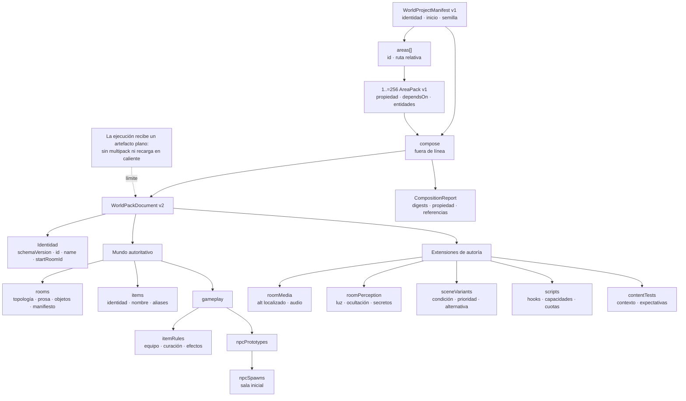
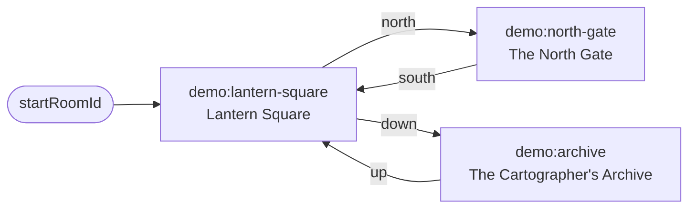

# Autoría, validación y publicación de mundos

Esta guía describe el contrato que consume el servidor de Tiamud y el flujo
editorial que lo produce. La autoridad actual son los tipos y validadores de
`world-pack`; el ejemplo revisado es
[`worlds/lantern-square.world.json`](../worlds/lantern-square.world.json).
La [especificación v0.2](spec-v0.2.md) conserva además decisiones y propuestas
históricas, algunas anteriores al formato que terminó implementándose.

## Qué representa un mundo en ejecución

El artefacto que recibe el entorno de ejecución es un único
`WorldPackDocument` v2 en JSON.
Dentro de ese artefacto no existe una entidad `area`: contiene directamente
las salas, objetos, reglas de juego y extensiones de autoría ya compuestas. El
servidor carga exactamente un documento antes de abrir sus puertos, desde la
ruta indicada por `TIAMUD_WORLD_PACK` o, si la variable no existe, desde el
paquete revisado incrustado en el ejecutable.

La autoría sí dispone de una frontera modular sin conexión: un manifiesto de
proyecto v1 enumera módulos `AreaPack` v1 y `tiamud-world compose` los fusiona
en el único WorldPack v2 que entiende el runtime. El módulo conserva una unidad
de propiedad editorial y dependencias comprobables; no se convierte en una
unidad cargable o activable durante el juego.

Esto tiene consecuencias deliberadas:

- el entorno de ejecución no compone documentos, resuelve dependencias entre
  paquetes ni carga varios mundos a la vez;
- no existen salidas entre paquetes en ejecución: todo destino debe poder
  resolverse dentro del artefacto final;
- no hay recarga en caliente; cambiar el mundo requiere seleccionar el nuevo
  artefacto y reiniciar el proceso;
- los IDs estables son identidad persistente, no títulos de presentación;
- una imagen o audio ausente degrada solo la presentación, nunca las reglas ni
  la prosa jugable.

Los prefijos de IDs como `demo:`, `tiamud:` o `midgaard:` son una convención de
autoría útil para evitar colisiones. El validador actual solo exige que los IDs
que declara como obligatorios no estén vacíos; no impone una gramática general
de espacios de nombres.



## Autoría modular con `AreaPack` v1

La composición modular separa la propiedad editorial sin debilitar las
garantías globales del mundo. El manifiesto y todo el formato estructurado de
`AreaPack` v1 son estrictos: rechazan propiedades desconocidas —también en las
entidades anidadas— e indican la ruta JSON de la errata.

```text
WorldProjectManifest v1
├── schemaVersion! = 1
├── id!                  ID del WorldPack resultante
├── name!                nombre del mundo resultante
├── startRoomId!         sala inicial global
├── rngSeed?
└── areas[]!             entre 1 y 256
    ├── id!              1..=256 bytes seguros y único
    └── path!            ruta relativa y única

AreaPack v1
├── schemaVersion! = 1
├── id!                  debe coincidir con el manifiesto
├── dependsOn[]?         IDs de otras áreas
├── items[]?
├── rooms[]?
├── itemRules[]?
├── npcPrototypes[]?
├── npcSpawns[]?
├── roomMedia[]?
├── roomPerception[]?
├── sceneVariants[]?
├── scripts[]?
└── contentTests[]?
```

Cada `AreaPack` reutiliza exactamente los tipos de entidad explicados en el
resto de esta guía; no introduce una segunda representación de sala, objeto o
NPC. El manifiesto mantiene la identidad, el nombre, la sala inicial y la
semilla globales porque deben existir una sola vez en el resultado.

Ejemplo de proyecto con dos áreas conectadas:

```json
{
  "schemaVersion": 1,
  "id": "ejemplo-modular",
  "name": "Mundo modular de ejemplo",
  "startRoomId": "plaza:centro",
  "areas": [
    {"id": "plaza", "path": "areas/plaza.area.json"},
    {"id": "puerta-norte", "path": "areas/puerta-norte.area.json"}
  ]
}
```

`areas/plaza.area.json`:

```json
{
  "schemaVersion": 1,
  "id": "plaza",
  "dependsOn": ["puerta-norte"],
  "rooms": [
    {
      "id": "plaza:centro",
      "title": "La plaza",
      "description": "Un camino sale hacia el norte.",
      "exits": [
        {
          "direction": "north",
          "target": {"kind": "room", "room_id": "puerta-norte:entrada"}
        }
      ]
    }
  ]
}
```

`areas/puerta-norte.area.json`:

```json
{
  "schemaVersion": 1,
  "id": "puerta-norte",
  "dependsOn": ["plaza"],
  "rooms": [
    {
      "id": "puerta-norte:entrada",
      "title": "La puerta norte",
      "description": "La plaza queda al sur.",
      "exits": [
        {
          "direction": "south",
          "target": {"kind": "room", "room_id": "plaza:centro"}
        }
      ]
    }
  ]
}
```

Las dependencias pueden ser cíclicas: dos áreas con salidas de ida y vuelta son
un caso normal. No se permite una dependencia propia, repetida o inexistente.
Toda referencia estructurada que cruza de un área a otra debe declarar el área
destino en `dependsOn`. Esto cubre:

- salidas y objetos colocados en salas;
- reglas y botín de objetos;
- prototipos y salas de apariciones NPC;
- multimedia y percepción de sala, objetos o NPC ocultos;
- variantes de escena;
- sala de scripts y pruebas de contenido.

El compositor no interpreta el texto Lua para inventar dependencias. Una
referencia escrita dentro de `source`, o un ID de misión opaco, sigue siendo
responsabilidad explícita del autor.

Invariantes de composición:

- la ruta de cada área es relativa, no contiene `..`, barras inversas ni
  prefijo de unidad, y su destino canónico permanece dentro del directorio del
  manifiesto;
- dos entradas no pueden apuntar al mismo fichero, ni léxica ni canónicamente;
- el `id` interno del área coincide exactamente con el declarado por el
  proyecto;
- ninguna estructura del `AreaPack` contiene campos desconocidos; una errata
  anidada falla antes de fusionar el mundo;
- los IDs de sala, objeto, prototipo NPC, aparición NPC, variante de escena y
  script son únicos en todo el proyecto, incluso entre clases distintas;
- el WorldPack fusionado pasa después todas las validaciones globales:
  referencias, ubicación única de objetos, apariciones, variante por defecto y
  alcanzabilidad desde `startRoomId`;
- los recursos se buscan siempre desde el directorio canónico del manifiesto;
  cuando existe una raíz antecesora de Git o de workspace reconocible por
  `Cargo.toml` y `apps/web/public`, se añaden también esa raíz y su directorio
  público. Cada candidato se canonicaliza y ningún enlace o ruta puede escapar
  de esas raíces;
- la composición es determinista y el fichero de salida se publica completo de
  forma atómica; nunca reemplaza un destino existente.

Límites de composición:

| Recurso | Límite |
| --- | ---: |
| Manifiesto del proyecto | 1 MiB |
| Número de áreas | 1..=256 |
| Cada fichero de área | 16 MiB |
| Total de fuentes de área | 16 MiB |
| WorldPack compuesto | 16 MiB |
| Ruta relativa | 4096 bytes |

La librería produce además un `CompositionReport` determinista: incluye un
digest canónico del manifiesto independiente del orden de `areas`, digest y
tamaño del artefacto, SHA-256 de los bytes exactos de cada fuente, propiedad de
todos los tipos de registro, dependencias y referencias cruzadas. El comando
muestra un resumen de esos datos; no incrusta la identidad de las áreas dentro
del WorldPack runtime.

```sh
mkdir -p build/worlds
cargo run --locked -p world-pack --bin tiamud-world -- compose \
  worlds/lantern-square.project.json \
  --output build/worlds/lantern-square.composed.world.json
```

Este proyecto real divide el mundo revisado entre `square`, `archive` y
`north-gate`. Su artefacto canónico es idéntico al producido al canonicalizar
`worlds/lantern-square.world.json`; el fichero fuente versionado no está él
mismo serializado en orden canónico. La prueba de integración protege esa
equivalencia semántica para que modularizar la autoría no cambie el mundo.

El resultado entra en el mismo flujo `test`, `preview`, `diff` y `publish` que
un WorldPack escrito directamente. `compose` valida el documento, sus assets y
compila Lua con el mismo sandbox que el runtime, pero no ejecuta las pruebas de
contenido: `test` sigue siendo un paso explícito posterior.

> **Frontera actual.** La composición modular sin conexión descrita arriba sí
> está implementada. El catálogo residente, los bundles de área inmutables y
> su ciclo de carga o activación segura pertenecen a la
> [arquitectura objetivo del ADR 0005](decisions/0005-hot-area-lifecycle.md),
> cuya implementación está pendiente. Ese diseño futuro no cambia el contrato
> de hoy: el servidor sigue recibiendo un solo WorldPack v2 al arrancar y no
> recarga áreas en caliente.

## Anatomía de `WorldPackDocument` v2

En los árboles siguientes, `!` significa obligatorio en la práctica y `?`,
opcional. Algunos campos tienen un valor por defecto al deserializar, pero la
validación posterior puede convertirlos en obligatorios efectivos.

```text
WorldPackDocument
├── schemaVersion! = 2
├── id!                  cadena no vacía
├── name!                cadena no vacía
├── startRoomId!         ID de una sala existente
├── source?
│   ├── format!
│   ├── dialect?
│   └── file?
├── items[]?
├── rooms[]!             al menos una por la referencia startRoomId
├── gameplay?
│   ├── rngSeed?
│   ├── itemRules[]?
│   ├── npcPrototypes[]?
│   └── npcSpawns[]?
├── roomMedia[]?
├── roomPerception[]?
├── sceneVariants[]?
├── scripts[]?
└── contentTests[]?
```

Este es un documento mínimo completo y válido:

```json
{
  "schemaVersion": 2,
  "id": "ejemplo",
  "name": "Mundo de ejemplo",
  "startRoomId": "ejemplo:entrada",
  "rooms": [
    {
      "id": "ejemplo:entrada",
      "title": "La entrada",
      "description": "Un arco de piedra conduce al camino."
    }
  ]
}
```

`source` registra procedencia del formato —por ejemplo, `world-pack` o una
importación histórica—, pero no cambia la identidad ni habilita semántica
adicional durante la ejecución.

### Salas, identidad y topología

```text
rooms[]
├── id!                  único y estable
├── title!               no vacío
├── description!         exigido por JSON
├── legacyVnum?          único dentro del documento
├── assetManifest?       ruta relativa segura
├── items[]?             IDs de instancias iniciales
├── exits[]?
│   ├── direction!       north|east|south|west|up|down
│   ├── target!
│   │   ├── {"kind":"room","room_id":"..."}
│   │   └── {"kind":"legacy_vnum","vnum":123}
│   ├── description?
│   ├── keywords?
│   └── legacyValues[]?
└── legacy?
    ├── flags!
    ├── sector!
    └── prefixValues[]?
```

La descripción es obligatoria para deserializar, aunque la validación v2 no
rechaza todavía una cadena vacía. Los autores deben tratar la prosa completa y
no vacía como parte del contrato de accesibilidad: ninguna ilustración puede
contener información jugable exclusiva.

Invariantes topológicos:

- cada ID de sala es único;
- cada sala declara como máximo una salida por dirección;
- las salidas son dirigidas: una salida inversa solo existe si el autor la
  declara expresamente;
- un destino de tipo `room` debe existir en el documento;
- todas las salas deben ser alcanzables desde `startRoomId` siguiendo las
  salidas dirigidas;
- `legacyVnum` es compatibilidad de importación, no identidad canónica;
- la validación base puede conservar como diagnóstico un VNUM externo, pero el
  cargador del servidor falla si no puede resolverlo dentro del WorldPack.

No deben renombrarse IDs de salas publicadas sin una migración deliberada. Las
ubicaciones persistidas usan esos IDs; si una ubicación antigua deja de
existir, el servidor reubica y repara duraderamente al personaje en
`startRoomId`.

La topología exacta del mundo de muestra es pequeña a propósito:



El formato no almacena coordenadas, zonas anidadas ni un plano gráfico. Un
cliente puede derivar un mapa básico de las salidas autorizadas, pero esas
coordenadas no forman parte de WorldPack v2.

### Objetos y reglas de juego

```text
items[]
├── id!
├── name!
├── description!
└── aliases[]?

gameplay.itemRules[]
├── itemId!
├── equipmentSlot?       weapon|body|trinket
├── attackBonus?         0 por defecto; nunca negativo
├── healAmount?          0 por defecto; nunca negativo
├── consumable?          false por defecto
└── effect?
    ├── kind!            regeneration|strength
    ├── magnitude!       > 0
    └── remainingTicks!  > 0
```

Cada objeto declarado es una instancia estable y debe comenzar exactamente en
una sala. No puede aparecer dos veces ni quedar sin ubicación inicial. Una
regla de juego debe referenciar un objeto declarado y solo puede existir una
regla por objeto.

`aliases` alimenta la resolución textual del objeto, pero el validador no
impone hoy unicidad ni formato a cada alias. Conviene usar formas breves,
inequívocas y revisadas en el mismo idioma que el nombre jugable.

### NPC y apariciones

```text
gameplay.npcPrototypes[]
├── id!, name!, description!
├── level!               > 0
├── maxHealth!           > 0
├── strength!            > 0
├── defence!             >= 0
├── experienceReward!
├── respawnTicks!        > 0
└── lootItemIds[]?

gameplay.npcSpawns[]
├── id!                  único
├── prototypeId!         prototipo existente
└── roomId!              sala existente
```

Todo prototipo debe ser utilizado por al menos una aparición. Los IDs de botín
deben declarar objetos existentes, no pueden repetirse dentro del prototipo y
una misma instancia de botín no puede asignarse a más de una aparición.

WorldPack v2 no contiene definiciones completas de tiendas, economía, grupos,
ayudas ni misiones. El núcleo jugable sí mantiene esos estados y un script
puede iniciar una misión por ID, pero el documento no modela su título, pasos,
recompensas o localización editorial.

<a id="multimedia-percepcion-y-localizacion"></a>

## Multimedia, percepción y localización

### Política de percepción

```text
roomPerception[]
├── roomId!
├── light?               bright|dim|dark; bright por defecto
├── hiddenItems?         {itemId: dificultad}
├── hiddenNpcs?          {spawnId: dificultad}
└── secretExits?         {direction: dificultad}
```

Solo puede existir una política por sala. Cada dificultad está entre 1 y 100.
Un objeto oculto debe existir, una aparición NPC oculta debe pertenecer a esa
misma sala y una salida secreta debe estar declarada en ella. La percepción se
aplica antes de serializar la vista; el cliente no recibe IDs o condiciones
secretas para filtrarlos por su cuenta.

### Imagen y audio de sala

```text
roomMedia[]
├── roomId!
├── imageAlt?            {"en":"...", "es":"..."}
└── audio?
    ├── channel!         ambience|effects|music
    ├── path!
    └── loop?            false por defecto
```

WorldPack v2 solo localiza `imageAlt`; los títulos, descripciones, nombres de
objetos y NPC siguen siendo cadenas únicas. La resolución del texto alternativo
es determinista: locale exacto, idioma base, `en` y finalmente la primera clave
en orden lexicográfico.

Un mapa de texto alternativo admite como máximo 16 locales. Cada clave mide de
2 a 35 caracteres alfanuméricos o guiones, sin guiones dobles ni en los
extremos. Cada valor contiene entre 1 y 512 bytes útiles y no incluye
caracteres de control.

Una sala con `assetManifest` necesita `imageAlt`. Para el entorno de ejecución,
la ruta del manifiesto tiene exactamente esta forma:

```text
assets/<64 caracteres sha256 minúsculos>/manifest.json
```

Solo puede existir una entrada `roomMedia` por sala. El audio es opcional y
puede existir sin imagen. Sus rutas válidas son:

```text
assets/<sha256>/audio-<nombre>.opus
assets/<sha256>/audio-<nombre>.ogg
assets/<sha256>/audio-<nombre>.mp3
```

El nombre y la ruta completos usan minúsculas, dígitos, guion y punto, no
superan 160 bytes y no contienen consulta, fragmento ni barras adicionales.

### Compilación de imágenes

[`tiamud-assets`](../crates/asset-pipeline/README.md) es una herramienta sin
conexión; el servidor nunca la invoca. Acepta fuentes PNG, JPEG o WebP
revisadas, de al menos 1280 píxeles de ancho, y nunca amplía la imagen.

- Una fuente opaca produce 640 y 1280 píxeles en AVIF, WebP cuando está
  disponible la característica predeterminada, y JPEG.
- Una fuente transparente o compilada con `--lossless` produce PNG en ambas
  anchuras.
- Los límites predeterminados son 64 MiB de fuente codificada, 8192 píxeles por
  eje, 40 millones de píxeles, 256 MiB decodificados y 2 MiB por variante.
- La cuarentena decodifica y recodifica a PNG sin metadatos. La publicación
  posterior exige revisión humana, digest, dimensiones, transparencia y marca
  temporal coincidentes.
- Autor, licencia, procedencia, revisión, generador opcional, clasificación,
  punto focal, color dominante y digests participan en el manifiesto
  direccionado por contenido.

Para una fuente no confiable, el límite de revisión se expresa mediante tres
comandos separados. `FECHA_RFC3339` debe ser idéntica en revisión y
publicación:

```sh
cargo run --locked -p tiamud-asset-pipeline --bin tiamud-assets -- \
  quarantine \
  --source incoming/escena.png \
  --output private/quarantine

cargo run --locked -p tiamud-asset-pipeline --bin tiamud-assets -- \
  review \
  --record private/quarantine/DIGEST/quarantine.json \
  --reviewer "Equipo editorial de Tiamud" \
  --reviewed-at FECHA_RFC3339

cargo run --locked -p tiamud-asset-pipeline --bin tiamud-assets -- \
  publish \
  --record private/quarantine/DIGEST/quarantine.json \
  --alt "Descripción completa y contextual de la escena." \
  --output apps/web/public/assets \
  --author "Contribuidores de Tiamud" \
  --license CC-BY-4.0 \
  --provenance "Fuente original revisada para esta escena." \
  --reviewed-at FECHA_RFC3339
```

`tiamud-world validate` comprueba que el manifiesto referenciado exista, no
supere 256 KiB y contenga un `alt` idéntico al texto localizado que se resuelve
como inglés. No vuelve a verificar todos los archivos y hashes internos del
manifiesto: ese contrato pertenece al compilador de assets.

El registro de WorldPacks no copia multimedia. Además, el servidor de
referencia sirve los archivos de `apps/web/dist` incrustados en el binario, no
una carpeta vecina al JSON. Un paquete externo solo mostrará sus recursos si
estaban incorporados en la distribución web usada para compilar el servidor o
si el despliegue añade conscientemente una capa que los sirva. Si faltan, la
prosa y las acciones continúan funcionando.

## Variantes de escena y condiciones

```text
sceneVariants[]
├── roomId!
└── variants[]
    ├── id!
    ├── priority?        0 por defecto; única dentro de la sala
    ├── when?
    ├── title?
    ├── description?
    ├── assetManifest?
    ├── imageAlt?
    └── audio?
```

Solo puede existir un conjunto `sceneVariants` por sala. Si una sala declara
variantes, necesita exactamente una variante sin `when`. Es la alternativa
incondicional, no una condición que compita por prioridad. Cada variante debe
sobrescribir al menos título, descripción, manifiesto, texto alternativo o
audio; una condición sola no constituye contenido.

La selección:

1. evalúa las variantes condicionadas;
2. elige la coincidencia de mayor prioridad;
3. usa la alternativa incondicional si ninguna coincide;
4. hereda de la sala los campos no sobrescritos;
5. devuelve una escena autorizada que no contiene el ID de variante ni la
   condición que la seleccionó.

Una variante que cambia de manifiesto debe aportar su propio `imageAlt`. Si
solo cambia el texto alternativo puede heredar la imagen base; audio, título y
descripción también se heredan cuando no se sobrescriben.

Ejemplo reducido:

```json
{
  "roomId": "ejemplo:entrada",
  "variants": [
    {
      "id": "noche-lluviosa",
      "priority": 20,
      "when": {
        "all": [
          {"eq": ["world.time.period", "night"]},
          {"eq": ["world.weather", "rain"]}
        ]
      },
      "title": "La entrada bajo la lluvia"
    },
    {
      "id": "estado-normal",
      "priority": 0,
      "title": "La entrada"
    }
  ]
}
```

Operadores admitidos:

```text
all, any, not, eq, ne, in, gt, gte, lt, lte, contains
```

Campos escalares:

| Campo | Tipo o dominio |
| --- | --- |
| `world.instance` | cadena |
| `world.time.period` | `dawn`, `day`, `dusk`, `night` |
| `world.weather` | `clear`, `cloudy`, `rain`, `storm`, `snow`, `fog` |
| `world.time.hour` | entero `0..=23` |
| `actor.level` | entero `0..=u32::MAX` |
| `actor.is_admin` | booleano |

Los conjuntos `actor.flags`, `actor.quest_states`,
`actor.content_preferences` y `actor.senses` solo aceptan `contains`. `eq`,
`ne` e `in` operan sobre campos escalares; las comparaciones de orden solo
aceptan la hora y el nivel.

El AST admite como máximo 1024 nodos y 32 niveles. `all`, `any` e `in` no pueden
estar vacíos. La validación detecta además tipos incompatibles, valores
enumerados inválidos, prioridades repetidas y contradicciones directas de
igualdad dentro de un mismo `all`.

Límites del contexto actual de ejecución que conviene conocer:

- `world.instance` siempre vale `primary`;
- la hora es el tick lógico módulo 24;
- el simulador produce `clear`, `rain`, `cloudy` —a partir de viento— y `fog`;
  `storm` y `snow` pertenecen al dominio del formato, pero hoy no surgen del
  simulador;
- las pruebas embebidas sí pueden construir explícitamente otros contextos.

## Scripts Lua acotados

```text
scripts[]
├── id!
├── roomId!
├── hooks[]!             al menos uno
├── capabilities[]?
├── limits?
└── source!              Lua inline, no ruta externa
```

Hooks disponibles:

```text
on_enter, on_leave, on_look, on_use, on_talk,
on_combat_start, on_defeat, on_timer, on_quest_event
```

Capacidades disponibles:

```text
narrate, set_flag, damage, heal, give_item, start_quest, schedule
```

Cada script se liga a una sala existente; los IDs, hooks y capacidades no se
pueden repetir. Hay un máximo de 256 scripts por documento. Las cuotas por
defecto y sus máximos aceptados son:

| Recurso | Predeterminado | Máximo |
| --- | ---: | ---: |
| Fuente | 64 KiB | 64 KiB |
| Memoria | 2 MiB | 8 MiB; mínimo 64 KiB |
| Instrucciones | 100 000 | 1 000 000 |
| Tiempo de pared | 25 ms | 100 ms |
| Eventos | 32 | 64 |
| Campo de evento | 1024 bytes | 2048 bytes |

El entorno de ejecución usa una VM Lua 5.4 nueva por ejecución, sin archivos,
procesos, carga de paquetes o bibliotecas nativas, bytecode ni `load`. Solo
expone `tiamud.emit` y `tiamud.random`; la semilla se deriva de datos duraderos.
El contexto visible contiene `actor_name`, `actor_level`, `actor_is_admin`,
`world_hour` y `world_weather`.

`math.random` y `math.randomseed` están desactivados para impedir resultados no
reproducibles. También se retiran `string.find`, `string.match`, `string.gmatch`
y `string.gsub`: las implementaciones C de patrones no se pueden interrumpir
con el hook de instrucciones y, por tanto, no respetarían de forma fiable la
cuota de tiempo. Las operaciones sencillas de cadena, como `upper`, siguen
disponibles dentro del límite de memoria. `print`, `warn` y `collectgarbage`
también están desactivados para impedir inyección de salida del host y otra
operación C no interrumpible.

Además de las cuotas por módulo, la validación de autoría rechaza más de ocho
módulos para la misma pareja sala/hook y el runtime vuelve a imponer ese límite.
El lote completo dispone de 50 ms y todo el scripting de un tick persistido de
100 ms. El tiempo restante del lote reduce la
cuota efectiva del siguiente módulo; cuando se agota no se inicia otro módulo.
Un agotamiento del presupuesto global descarta todos los efectos y narraciones
de scripts de ese tick, restaura el estado anterior y persiste de nuevo el tick
base sin ejecutar hooks. El reloj y el juego siguen avanzando sin aceptar un
lote parcial.

Todos los scripts aplicables se ordenan por ID y primero producen eventos
inertes. Solo después se valida y aplica el lote. Un error de script, una
capacidad no concedida o un efecto inválido deja todo el lote inerte o restaura
el estado guardado previo.

Los límites de dominio son más estrechos que la cuota genérica del campo:

- `narrate`: texto no vacío de hasta 1024 bytes;
- `set_flag`: hasta 64 bytes alfanuméricos, `-`, `_` o `.`;
- `damage` y `heal`: cantidad `1..=10_000`;
- `give_item`: ID de hasta 128 bytes seguros;
- `start_quest`: ID de hasta 64 bytes seguros;
- `schedule`: retraso `1..=86_400` ticks y una bandera válida;
- el destino solo puede ser `self` o estar ausente.

La guía específica del sandbox está en
[`crates/scripting/README.md`](../crates/scripting/README.md).

## Pruebas de contenido

```text
contentTests[]
├── name!                 único
├── roomId!
├── context?
└── expect!               al menos una expectativa
    ├── title?
    ├── descriptionContains[]?
    ├── outputExcludes[]?
    ├── assetManifest?
    ├── exits[]?
    └── items[]?          nombres resueltos, no IDs
```

El contexto puede fijar instancia, periodo, clima, hora, nivel, rol
administrativo, banderas, estados de misión, preferencias y sentidos.
`outputExcludes` busca cada cadena prohibida en el JSON completo de la escena
resuelta, por lo que sirve para impedir fugas de IDs de variantes, condiciones
o banderas internas.

Ejemplo:

```json
{
  "name": "la noche no filtra estado de autor",
  "roomId": "ejemplo:entrada",
  "context": {
    "worldTimePeriod": "night",
    "worldWeather": "rain",
    "worldTimeHour": 23,
    "actorLevel": 1
  },
  "expect": {
    "title": "La entrada bajo la lluvia",
    "outputExcludes": ["noche-lluviosa", "world.time.period"]
  }
}
```

Estas pruebas comprueban selección y proyección de escenas. No ejecutan hooks
Lua ni vuelven a comprobar los archivos internos de un manifiesto multimedia.

## Flujo editorial reproducible

Ejecute los comandos desde la raíz del repositorio. `build/` está ignorado y
es adecuado para artefactos locales:

```sh
mkdir -p build/worlds

cargo run --locked -p world-pack --bin tiamud-world -- compose \
  worlds/lantern-square.project.json \
  --output build/worlds/lantern-square.composed.world.json

cargo run --locked -p world-pack --bin tiamud-world -- validate \
  build/worlds/lantern-square.composed.world.json

cargo run --locked -p world-pack --bin tiamud-world -- test \
  build/worlds/lantern-square.composed.world.json

cargo run --locked -p world-pack --bin tiamud-world -- build \
  build/worlds/lantern-square.composed.world.json \
  --output build/worlds/lantern-square.world.json

cargo run --locked -p world-pack --bin tiamud-world -- preview \
  build/worlds/lantern-square.world.json \
  --room demo:lantern-square \
  --format ansi \
  --time-period night \
  --weather rain

cargo run --locked -p world-pack --bin tiamud-world -- diff \
  build/worlds/lantern-square.composed.world.json \
  build/worlds/lantern-square.world.json

cargo run --locked -p world-pack --bin tiamud-world -- publish \
  build/worlds/lantern-square.world.json \
  --registry data/world-registry

cargo run --locked -p world-pack --bin tiamud-world -- rollback \
  --registry data/world-registry \
  --world lantern-square \
  --sha256 <digest-del-artefacto>
```

`build` valida y produce JSON canónico con salto de línea final. Ordena por
identidad los objetos, salas, reglas, NPC, multimedia, percepción, variantes,
scripts y pruebas; normaliza también aliases, botín, salidas, condiciones y
expectativas. Dos documentos semánticamente iguales producen los mismos bytes.
Sin `--force`, nunca reemplaza un destino existente.

`diff` resume altas, bajas y cambios por ID de entidad; una diferencia de orden
dentro de una entidad aún puede aparecer como cambio, por lo que conviene
comparar artefactos ya canonicalizados. `preview` emite texto o ANSI saneado y
no incluye ID de sala, ID de variante ni condición de autor.

```mermaid
flowchart LR
    accTitle: Validación, publicación y selección del WorldPack
    accDescr: El JSON se valida, prueba, canonicaliza y revisa antes de publicar un artefacto inmutable; el operador selecciona su ruta explícita para el siguiente arranque del servidor.

    PROJECT["WorldProjectManifest v1"]
    AREAS["AreaPack v1"]
    COMPOSE["compose fuera de línea<br/>valida grafo · assets · límites"]
    DIRECT["WorldPack v2 directo<br/>alternativa monolítica"]
    SRC["WorldPack v2 plano<br/>frontera del runtime"]
    VAL["validate<br/>esquema · referencias · assets"]
    TEST["test explícito<br/>expectativas embebidas"]
    BUILD["build<br/>JSON canónico determinista"]
    REVIEW["preview + diff<br/>revisión humana"]
    PUB["publish<br/>artefacto inmutable SHA-256"]
    PACK["packs/&lt;world-hash&gt;/&lt;digest&gt;.world.json"]
    ACTIVE["active/&lt;world-hash&gt;.json"]
    ROLLBACK["rollback<br/>verifica mundo + digest"]
    ENV["TIAMUD_WORLD_PACK<br/>ruta exacta"]
    LOAD["arranque<br/>≤ 16 MiB · valida · compila Lua"]
    LIVE["puertos HTTP/WSS/Telnet"]

    PROJECT --> COMPOSE
    AREAS --> COMPOSE
    COMPOSE --> SRC
    DIRECT --> SRC
    SRC --> VAL --> TEST --> BUILD --> REVIEW --> PUB
    PUB --> PACK
    PUB --> ACTIVE
    ROLLBACK --> ACTIVE
    PACK -. "selección explícita del operador" .-> ENV
    ACTIVE -. "no se consume automáticamente" .-> ENV
    ENV --> LOAD --> LIVE
```



### Registro inmutable y rollback

`publish` calcula el SHA-256 de los bytes canónicos y guarda:

```text
<registry>/packs/<sha256-del-world-id>/<digest>.world.json
<registry>/active/<sha256-del-world-id>.json
```

El primer fichero es inmutable. Si ya existe, la operación solo es idempotente
cuando sus bytes coinciden. El segundo es un puntero JSON que se reemplaza por
`rename` atómico. Hashear el ID de mundo evita convertir un ID editorial en una
ruta controlada por el autor.

`rollback` exige un digest hexadecimal minúsculo de 64 caracteres, vuelve a
cargar el artefacto, comprueba que pertenece al mundo indicado y recalcula su
hash antes de cambiar el puntero. No borra ni modifica publicaciones previas.

El servidor no consulta por sí mismo el puntero `active`. El procedimiento de
operación debe resolver el artefacto, asignar su ruta exacta a
`TIAMUD_WORLD_PACK` y reiniciar Tiamud. Esta separación evita que un cambio del
registro altere silenciosamente un proceso ya activo.

## Límites y fronteras que no deben omitirse

- `tiamud-world` admite como máximo 32 MiB, pero `tiamud-server` y
  `tiamud-admin check` solo admiten 16 MiB. El límite publicable práctico es
  **16 MiB**.
- `publish` valida y canonicaliza, pero **no ejecuta `contentTests`**. El paso
  `test` del flujo anterior es explícito y obligatorio para el equipo
  editorial.
- La herramienta de línea de comandos compila Lua y exige cada hook declarado
  durante `compose`, `validate`, `build` y `publish`. No ejecuta los hooks como
  prueba funcional; ese comportamiento debe cubrirse con `contentTests` y
  pruebas del área.
- `publish` no copia imágenes o audio, y `rollback` no vuelve a comprobar que
  sigan presentes.
- El cargador del entorno de ejecución exige rutas de manifiesto direccionadas
  por contenido y resuelve todos los VNUM históricos; es deliberadamente más
  estricto que el modelo de intercambio.
- Al leer directamente un WorldPack, Serde ignora campos JSON desconocidos
  para mantener compatibilidad futura. Por ello, que `validate` no rechace una
  propiedad desconocida no demuestra que una errata tenga efecto. La entrada
  modular es deliberadamente más estricta: `compose` audita el manifiesto y
  todos los campos estructurados de cada `AreaPack` y rechaza los desconocidos
  con su ruta JSON. En ambos flujos conviene comparar el artefacto canónico y
  cubrir el comportamiento con `contentTests`.
- No existe todavía un JSON Schema normativo versionado. Los tipos Rust, sus
  validadores y sus pruebas son la fuente de verdad.
- No hay límites independientes de cantidad para salas, objetos o variantes;
  quedan acotados por el tamaño total, memoria y las validaciones de referencias.

## Importación histórica

[`envy-import`](../tools/envy-import/README.md) es un puente conservador y sin
conexión. Audita archivos EnvyMUD/Merc, conserva VNUM y descriptores como datos
históricos y convierte únicamente aquello cuya semántica es inequívoca. Un
destino externo, reset condicional, tienda, programa o referencia dudosa queda
inerte con un diagnóstico; nunca se ejecuta ni se completa por conjetura.

El modelo WorldPack actual puede representar NPC, apariciones y equipo. El
importador histórico todavía no traduce automáticamente los móviles, equipo,
tiendas, resets condicionales, contenedores, puertas con estado o programas de
los formatos antiguos. Esos registros permanecen en `LegacyContent` y exigen
modelado manual, revisión de procedencia y una decisión de licencia antes de
publicarlos.

La importación de una fuente histórica no concede derechos sobre ella. El
informe conserva digest, formato, codificación y estado
`undetermined_review_required`; el autor debe documentar una fuente y licencia
autorizadas antes de incorporar texto o multimedia al proyecto.
